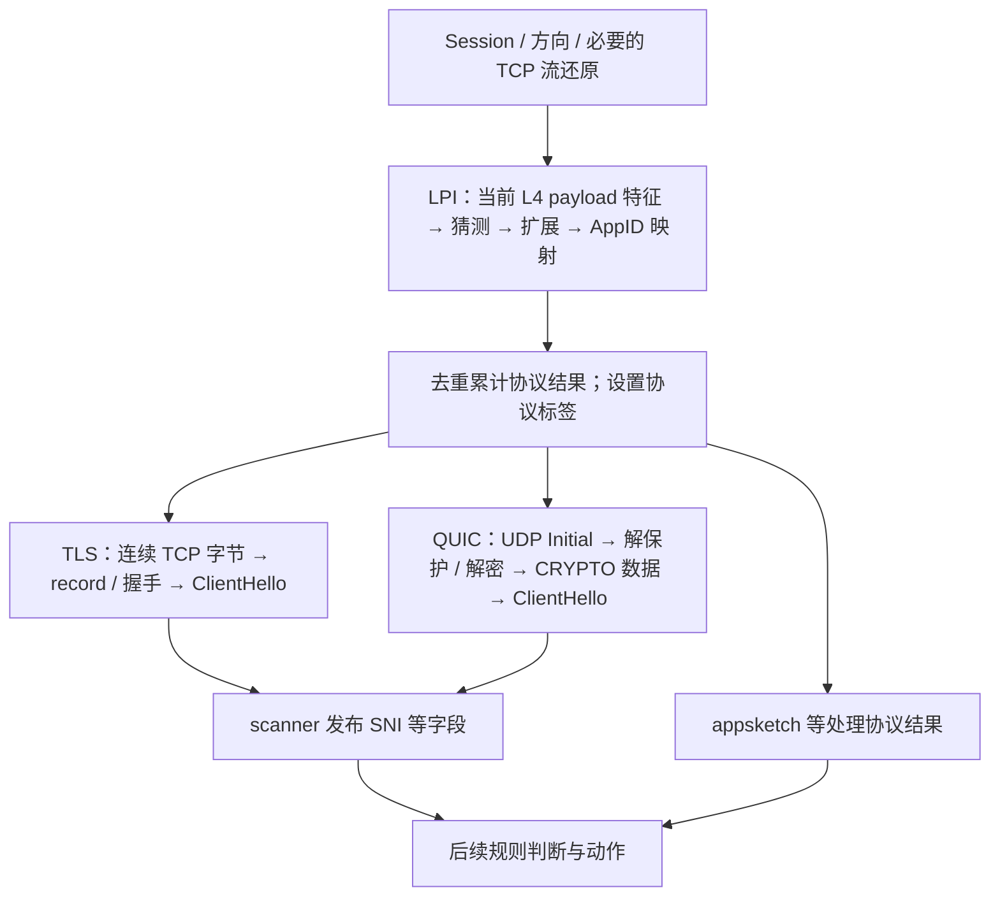

# LPI / TLS / QUIC SNI：参考 fork 的明确处理过程

日期：2026-09-23。用户要求先说明参考 fork 已有的具体过程，避免把已有答案重新列成抽象待决问题。本报告只读检查外部 C/VPP fork，不导入源码、不使用已移除的非 VPP Snort C++ 实现，不构建或运行设备。

后续确认：用户接受按本报告的正常流程及已定产品差异作为初版起点，遇到具体问题再调整；参数仍留实验，源码核对不等于当前产品已经实现。[讨论确认](2026-09-14_RULE_ENGINE_DISCUSSION_TMP.md#22-依据参考-fork-明确-lpi--sni-正常处理过程用户接受为初版起点)

参考仓库：`/home/js/backup/backup/Git/vpp`，HEAD `837432be3b6cf496755cfa27b7cca439734eb726`。整仓有无关工作区改动；本轮核对的 LPI、TLS、QUIC、scanner 及指定 Session Manager 文件未见 scoped git 改动。记录的是该工作树的静态行为，不是当前产品实现或验收结论。

## 1. 正常路径已有明确实现

Session Manager 先建立 / 更新 session、方向及 TCP 状态，并将可取得的连续 TCP segments 挂到包上；进入 session feature arc 后，LPI 位于各 decoder 前面，scanner / appsketch 等结果处理位于 security enforcer 前面。[session 与 segment](</home/js/backup/backup/Git/vpp/src/plugins/stellar_session_manager/session_manager_node.c:435>)、[feature 顺序](</home/js/backup/backup/Git/vpp/src/plugins/stellar_session_manager/session_manager_feature_order.c:5>)

简化流程如下。它只展示职责顺序，不是当前产品必须复建的固定节点表：

图中两类 decoder 按实际协议标签进入。**LPI 与 TLS 的输入不同**：LPI 直接读取当前包的 L4 payload 特征，并不先把整条 TCP 字节流交给 LPI；TLS 才消费 Session Manager 给出的连续 segments。[LPI 输入](</home/js/backup/backup/Git/vpp/src/plugins/stellar_lpi/stellar_lpi_plugin.c:574>)、[TLS 输入](</home/js/backup/backup/Git/vpp/src/plugins/stellar_tls_decoder/stellar_tls_decoder.c:771>)

## 2. LPI 的逐包过程、结果与停止条件

1. feature 启用后，TCP / UDP session 包进入 LPI。没有 L4 payload 或属于 pseudo packet 时直接返回；首次需要时创建 session 上的识别上下文。
2. 更新当前方向的特征：payload 前部字节、当前 payload 长度、累计观察量和检测次数；随后调用 `lpi_guess_protocol`，再调用扩展识别，最后将名称映射为支持的 AppID。
3. 新的有效 AppID 按首次出现顺序去重追加，记录首次检测序号；无新结果不清空旧结果。fork 还把可用 AppID 映射成 TLS / QUIC 等协议标签，让后续 decoder 进入。
4. 一般有效协议结果使 `stop_detect=1`；隧道 / NAT、RDP / RTP / RTCP、SMTP / IMAP / POP3 / FTP / XMPP 等明确例外允许继续猜测。
5. 没有有效映射结果时，可在后续有 payload 的包上继续尝试；检测次数达到配置上限后不再调用 detector。fork 默认上限 20 个检测包，结果数组最多 8 项；数组满只拒绝追加，不能与 `stop_detect` 混为同一个条件。

依据：[特征更新与猜测 / 停止条件](</home/js/backup/backup/Git/vpp/src/plugins/stellar_lpi/stellar_lpi_core.c:268>)、[20 / 8 常量](</home/js/backup/backup/Git/vpp/src/plugins/stellar_lpi/stellar_lpi_plugin.c:144>)、[去重追加与逐包处理](</home/js/backup/backup/Git/vpp/src/plugins/stellar_lpi/stellar_lpi_plugin.c:550>)、[AppID → 标签](</home/js/backup/backup/Git/vpp/src/plugins/stellar_lpi/stellar_lpi_plugin.c:81>)。

这些常量只说明 fork 已有有界尝试方法，不成为手机产品默认。例外继续识别也不等于能解封装任意隧道；本产品首版隧道内解析范围不变。

**停止检测与状态释放分开。** 所检查包装层在 stop / 检测预算耗尽后保留上下文和已发布结果，session exdata 清理时才释放 detector context；没有看到在检测预算耗尽处发布一个结构化的“最终 Unknown”结果。无 AppID 时出现的 `UNKNOWN` 是结束时 debug JSON 的显示值，不能当作已发布给规则的可比较终态。[清理与 JSON](</home/js/backup/backup/Git/vpp/src/plugins/stellar_lpi/stellar_lpi_plugin.c:365>)

fork 的协议结果还经 appsketch 消费：新 AppID 的 tag 触发读取累计数组。不能笼统称作所有 LPI 结果均由 SNI scanner 发布。[appsketch 接入](</home/js/backup/backup/Git/vpp/src/plugins/stellar_appsketch/stellar_appsketch_node.c:178>)

## 3. TLS SNI 的具体过程

TLS node 需要 `TCP_SEGMENT` 与 `L7PROTO_TLS` 标签。TLS decoder 在 session 上保存解析状态，读取 segments，组装 TLS record 和 handshake；完整 ClientHello 才交给公共解析器。成功产生 ClientHello 消息，失败产生 malformed ClientHello 消息。scanner 对合法 ClientHello 发布 SNI，并能区分“此完整 hello 没有 SNI”与 malformed；数据尚未收齐时没有完整 ClientHello 消息，不能提前判断无 SNI。[TLS node](</home/js/backup/backup/Git/vpp/src/plugins/stellar_tls_decoder/stellar_tls_decoder_node.c:558>)、[ClientHello 完成](</home/js/backup/backup/Git/vpp/src/plugins/stellar_tls_decoder/stellar_tls_decoder.c:460>)、[scanner](</home/js/backup/backup/Git/vpp/src/plugins/stellar_scanner/stellar_scanner_plugin.c:1005>)

**LPI 已经识别出 TLS 并停止猜协议，不会因此停止 TLS/SNI 解析。** session 上的累计协议标签仍可在后续有 payload 的包上提供给 decoder。另一方面，fork 的 TLS decoder 还解析 ServerHello、证书等内容，取得 SNI 不代表整个 TLS decoder 立即退出；本产品只做已定消费者所需的解析，不能直接继承其完整工作范围。

## 4. QUIC SNI 的具体过程

QUIC 标签触发 UDP decoder；探测支持的版本后，受保护 Initial 路径执行头部保护移除 / 解密，并收集 CRYPTO 数据，再使用公共 TLS ClientHello 解析器。数据不完整时可返回 `CHLO_NOT_COMPLETED`；取得 SNI 后把 session-owned 的 QUIC 信息挂到当前包，scanner 发布 `QUIC_SNI`。一旦信息已发布或 session 被标为忽略，后续路径跳过重复解析；packet / payload 预算超限会设置忽略状态。

依据：[QUIC node 入口](</home/js/backup/backup/Git/vpp/src/plugins/stellar_quic_decoder/stellar_quic_decoder_node.c:209>)、[Initial 处理](</home/js/backup/backup/Git/vpp/src/plugins/stellar_quic_decoder/stellar_quic_decoder.c:911>)、[ClientHello 解析](</home/js/backup/backup/Git/vpp/src/plugins/stellar_quic_decoder/stellar_quic_decoder.c:377>)、[预算及发布](</home/js/backup/backup/Git/vpp/src/plugins/stellar_quic_decoder/stellar_quic_decoder.c:1049>)、[scanner](</home/js/backup/backup/Git/vpp/src/plugins/stellar_scanner/stellar_scanner_plugin.c:3338>)。

QUIC 的正常路径清楚，但异常结果合同不如 TLS 的 valid-no-SNI / malformed 区分完整。例如此版本错误停止判断将 `PARSE_RESULT_ERROR` 与 `version` 而非 `ret` 比较，不能据此承诺每个解析错误立即形成终态；预算耗尽和 session 清理也不是合法 hello 无 SNI 的证据。CRYPTO 拼接代码本身不构成完整的缺口 / 重叠处理正确性证明。详细源码限定见 [TLS / QUIC 专项核对](2026-09-23_FORK_TLS_QUIC_PROCESS.md)。这些是静态观察，未复现故障。

## 5. 已有答案与当前产品适配边界

| 项目 | 可以依据 fork 明确的过程 | 当前产品已定的差异 / 仍需落实的部分 |
| --- | --- | --- |
| LPI | 随 payload 更新特征、猜测 / 扩展 / 映射、去重追加、按协议或预算停止 | 使用项目协议目录与结果合同；20 包 / 8 项不是已定产品常量 |
| TLS SNI | 有 TLS 标签与连续字节后组装 ClientHello，完整后发布 SNI / 本次 hello 无 SNI / malformed 证据 | 一份 TCP 字节缓存由流还原拥有，TLS 引用；只做首版需要的解析 |
| QUIC SNI | Initial → 解保护 / 解密 → CRYPTO 数据 → ClientHello → SNI | 独立有界组装；补齐异常归一化和并发 / 容量验收，不能照抄可疑错误路径 |
| 原包处理 | fork 的 TLS 与 QUIC 都存在保留原包的分支 | 产品已明确不扣原包等待 SNI，只保留后续解析所需字节 |
| 结果生效 | decoder / 结果消费者在 enforcer 前，可使当前包带上新事实 | 产品按当前已发布事实和统一 Rank 判定；不能照搬 fork 的独立 enforcer 动作体系 |
| 结束与资源 | 各识别器有独立上下文、跳过条件与 session 清理 | 产品在已定消费者都不再需要数据时释放解析缓存，保留 Flow / CT 及已发布结果；具体限制通过实验落实 |

因此，正常处理流程已有足够清楚的参考，不需要重新让用户选择一套抽象生命周期。后续工程工作应集中在对齐已定 owner-local / 不扣包 / 单缓存原则、项目协议映射，以及缺失 / 无结果 / 错误 / 预算停止的最小一致表达；不能将 fork 没有明确发布的终态虚构成现成能力。
