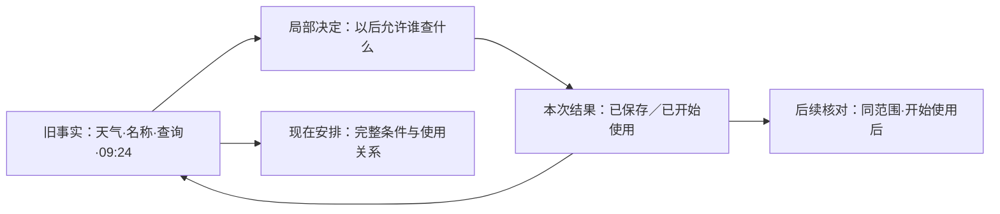

# Sakamoto 功能组织与首屏设计参考 V2

2026-09-30。用户把首页最终取舍交给本设计席；以下是研究者负责的优先设计，不是 Jobs 本人裁定，也不是产品实现或验收。旧[122行参考](2026-09-30_JOBS_INDEPENDENT_DESIGN_REFERENCE.md)保留历史。
依据仍是[产品愿景](../product/NETWORK_CONTROL_PRODUCT_VISION.md)、[统一规则语义](../product/UNIFIED_RULE_ENGINE_SPEC.md)与本轮一手研究；DNS/IP 按目标能力正常设计，不受当前缺实现限制。
[手机参考画板](assets/2026-09-30-jobs-second-debate/design-reference-v2.html)：四幅393×852画布组成设备、应用、名单三组，含设备四种状态及应用三种来意切换。[平板与 Linux 参考画板](assets/2026-09-30-jobs-second-debate/design-reference-v2-large.html)补充 Android 竖/横平板、Linux 桌面、触控竖屏与小窗口的四种视图。均表达构图、语言和有限内存交互，示意数据不证明现实效果。

## 我选的产品形态

**主导航：概览｜活动｜联网安排。** 概览固定回设备总体；活动保持完整查询；联网安排管理以后怎样处理。应用目录/搜索固定在概览，规则/组/名单目录固定在安排的次层。
设备、应用控制身份、一次事实、规则与其使用关系、名单，是稳定对象。“联网安排”是已有规则/组/分配的用户视图，不新增持久实体、第二套规则模型或隐含 checkpoint。
每个画布只有一个主意图：概览认出这段设备变化；应用看这个对象的明确事实；安排管理现在的使用关系；名单认清正在使用的匹配内容；审阅决定是否使用一份新资料。
我舍弃独立应用主导航、三块摘要组成的应用 dashboard、永久“探索工具”目录、名单日常页的大来源维护卡、首屏完整条件树。能力搬到有名字的任务面，不靠全部折叠收口。
品味在关系里：对象可认、动作预期清楚、空间顺序能解释下一步；图和应用互相指向，名单和消费者关系可见，完成任务后有自然归宿。留白、少卡片与字体服务这些关系，不能单独证明质量。

一手依据的范围：[1984 Macintosh](https://book.stevejobsarchive.com/#sid-144)强调熟悉操作与丰富表达；[1984 Moritz](https://book.stevejobsarchive.com/#sid-185)讨论尺度、精度与保留功能；[1997 员工](https://book.stevejobsarchive.com/#sid-678)要求组合可理解；[2007 员工](https://book.stevejobsarchive.com/#sid-1186)强调发现与使用。它们支撑检查方法，不规定今日导航。Objects 的 Jobs 逐字稿、Ive 回顾、编者叙述已在旧稿分开。

## 首页最终裁决：时间变化先于同段贡献应用

**主对象是设备的一段连续活动，主意图是“这一段发生了什么，由谁贡献”。** 默认最近30分钟，不称“现在谁正在联网”。当前 home 已有这个时间意图，V2 是精确收敛它，不抹去已有探索价值。

| 393的固定空间顺序 | 看见的具体内容与动作 |
| --- | --- |
| 身份与可信范围 | 我的网络；最近30分钟；记录覆盖/最新至09:41。运行状态可点，不用总量或非空列表代替保护状态。 |
| 同范围的收发与小图 | 本段收到9.4 MB/发出1.9 MB；紧凑区域包含总量、同刻度柱和时段。点时段→该段贡献；图不要求先读懂才点应用。 |
| 观察轻入口与独立查询事实 | 当前连接、统计、地图固定可见；本段20次查询被阻止单独计量并可进入，不把它加进连接或字节总数。 |
| 同段贡献应用 | 音乐8.8 MB本段收发；天气本段查询与收发；未知归属保留事实。标题“这段时间的应用”，不用正在/持续接收冒充历史贡献。全部应用/搜索始终可见。 |

三个主触点：选时段、点应用、找全部应用；统计/地图/当前连接是轻入口，完整能力可持续探索，规则编辑不在此争主位。
我拒绝把历史图全退到第二层：短暂DNS、未知归属和发送峰常在用户打开时已经结束，连续变化应直接暴露，流量理解不只做控制的背景。图只是选择器，应用仍承担认识与行动。
我承担的代价：只想看当前音乐的人先越过总量/图区域，当前连接需明确进入；这比让连续变化必须主动寻找更值得。A/B观察席及root仍偏当前应用主位＋固定历史线索，这是实际分歧，不写成一致。

| 同一秩序的状态 | 真实表达，不自动换首页 |
| --- | --- |
| 安静 | 覆盖完整；本段0B，图显示没有传输；应用区说这30分钟没有查询/连接记录，仍可选时段或看当前连接，不宣称设备安全。 |
| DNS-only，当前无连接 | 图0B；本段20次查询被阻止、最近一次09:26；天气与未知归属的查询仍在所选时段列表。当前快照未见连接另有明确时刻，不把旧查询说成现在联网。 |
| 记录缺口 | 覆盖行明确09:21–09:26缺口，图用斜纹空段，不填0；总量标“已记录”，应用只呈可用事实。未知位置、归属及缺口不是空白美化。 |

画板图刻度4MB/5分钟，六段收到[3.6,.4,.8,1.6,1.2,1.8]MB合9.4；发出[.12,.02,1.30,.16,.12,.18]MB合1.9。缺失第三段后只合计已记录8.6/0.6，刻度与可见承诺自洽。

## 应用画布：固定壳，显式问题决定主事实

身份（图标/天气）、范围位置、一行现在安排、事实区、类型与时间记录的空间顺序固定。不以入口来意动态搬动整页，也不先做活动/安排两张tab。
壳内短句可写“现在：跟踪名单中的名称查询受限　管理→”；复杂混合安排只写“按不同条件处理·查看安排”，不把组合条件压成全允许/全阻止。完整管理多一次转场，是我承担的成本。

| 明确来意/所选类型 | 主事实与公开记录 | 不让它争此屏 |
| --- | --- | --- |
| 已知天气，默认最近30分钟全部 | 紧凑双口径：2条连接、21次查询；按时间排列真实记录，可明确改筛选。 | 大发送数字、大曲线、完整规则卡。 |
| 来自发送变化，明确连接/传输 | “这5分钟发出1.3 MB”，对应本段实际传输记录；无归属/关联则说未定位，查询是独立入口。 | 不精选两条阻止查询当成发送原因。 |
| 来自查询阻止，明确查询 | “这5分钟21次名称查询；20次被阻止，1次返回地址”，名称/时间/真实结果继续深入。 | 无关发送量不做最大主角，不把所有查询都写成被阻止。 |

普通字重承担时段/量词，不放9px灰脚注；蓝色给可操作关系，红色只标具体阻止事实，不给应用安全评级。主动作是类型、事实、管理；地图/统计从完整观察入口进入，更多检查不伪装成一般设置。
“当前连接”另进同一天气壳，范围位置明确“最新连接快照09:41”，主位才给仍保持/近10秒速率；可见返回“回09:21–09:26查询”，恢复原范围/选择。万能时间按钮不同时控制历史/当前/未来。

## 时间由任务形态区分

旧事实只给当时结果与依据；当前安排是一项明确转场，不把最新允许卡粘回原记录。1440也不自动把两种时代并列，因为宽度不改变事实语义。
结果面保留天气/名称/活动类型，主动作“核对这个名称的后续查询”，次动作“完成”回旧事实。后续核对显示精确名称/子域范围、通道及开始使用时点，真实0记录就是尚无执行证据，仍可进当前安排检查剩余条件。
保存失败保留本次输入；保存但未生效呈新保存与旧正在使用版本，并给修正动作；不确定先查再重试。持续未生效状态归当前安排/全局状态，原记录不改名、不改结果。取消输入不是 checkpoint。

## 名单：日常内容与采用新资料是真正两件工作

日常393固定：跟踪域名身份→正在使用版本/出处短签→两行真实用途→当前匹配内容。名单本身不是阻止开关，用途短签先说明连接规则供Firefox/Signal使用、查询规则供天气使用。
内容是扁平名称行；metrics名称及子域下缩进api.metrics本名单精确排除；events精确来源、local精确本地补充。名称/范围比卡片更重要，不为每一事实做白卡。
日常主要触点：“修改名单内容”“使用此名单”“审阅变化”；来源仅短签入口。检查频率/采用偏好/暂停检查/停止订阅搬来源管理；完整消费者/执行观察/分配/顺序/创建规则搬使用此名单，不在日常页末尾折叠塞回。
**独立审阅是优先选择。** 固定顺序：正在使用/候选尚未采用→新增cdn精确、移出events精确→local补充/api排除保持原样→两类消费者的真实规则用途→“使用这份新资料”/“暂不采用”。
差异先说明匹配集合，再接到谁按哪些规则判断；“执行阻止规则”不保证新记录全被阻止。核对来源/使用规则是低权重深入动作，不复制完整消费者表抢采用主意图。
来源/消费者往返恢复同候选、位置与展开项；版本变化使审阅过期，改来源不能沿用旧候选。采用启动保存/生效过程，完成回当前名单；暂缓回原位置且候选保留。额外转场及候选状态维护是我明确承担的代价。

## 一套动作语法：动词＋对象＋范围

| 人想改变什么 | 用户动作句与边界 |
| --- | --- |
| 天气局部查询 | “允许天气以后查询metrics.example.net，仅此名称”；写现有规则，明确顺序/通道，不能说保证一切联网。 |
| Firefox与共享组 | “从日常联网移出Firefox；Signal继续使用”；改变使用关系，不删组、不保证放行；其他来源仍引入同规则时不说已关闭规则。 |
| 名单自动检查 | “暂停检查新资料”；当前内容与使用继续。停止订阅明确保留内容；解除应用使用与删除名单是不同对象。 |
| 采用候选 | “使用这份新资料”；结果分保存/开始使用，完整配置导入另叫“替换这套配置”，不冒充追加名单。 |

393共享转场首屏换成“日常联网·共同用于Firefox、Signal”，回天气只是返回来源；1440左选择与右共享范围对齐，不沿用天气标题骗局部。泛“关闭”“保存”“解除”不承担所有动作。

## 两条完整任务

**任务一：从设备变化到局部决定、共享使用，再回旧事实。**

1. 概览选09:21–09:26→贡献天气→明确查询类型→metrics 09:24事实：看当时DNS阻止/规则/资料；关联IP/连接仅有证据才展示。
2. 从事实允许天气以后查询该精确名称→本次保存/使用结果→同目标/查询/生效后核对；无新事实不称验证完成，结束回原事实。
3. 查看现在安排→Firefox现有使用→日常联网共享范围→仅移除Firefox保留Signal→对象结果；回旧查询仍解释当时依据，默认不并列最新允许卡。

**任务二：维护名单、采用更新，区分局部例外与共享排除。**

1. 联网安排→名单目录→跟踪域名日常内容→来源检查安排；暂停检查时当前资料和消费者保留，重新检查可恢复维护。
2. 有候选→独立审阅名称/范围差异、本地保留与两类用途→可去来源/消费者核对再回同候选→采用结果分保存/使用→回当前名单。
3. 只给天气例外从天气事实建局部规则；希望全部消费者不匹配才修改本名单排除。解除使用在使用关系，删除资料先处理引用；都不是“停止订阅”。

## 完整能力的归宿与现实妥协

联网安排首屏按身份一行“按不同条件处理·来自2项安排”；进入列真实使用关系，执行/观察及范围各自明白。有效顺序按真实展开去重，来源可多条；解除放使用关系行，不放去重后的规则行。
规则/组/名单稳定专业目录，编辑保留AND/OR/NOT、IP/端口、网络/方向/协议/SNI、优先级/顺序及全部范围；组只组织复用。预演固定可见，先选DNS/连接与正在使用/已保存未生效/本次待提交快照，缺失事实不能判成否定。
活动固定“观察一段”，可锁未来一分钟并筛对象/目标，使用daemon持续普通记录；结束只是收口浏览窗口，**撤回旧稿把普通一分钟观察另造采集/报告的方案**。诊断仅为额外判断/阶段证据，固定次层及应用更多检查入口；具体深度仍未知，不伪造证据或删此能力。
完整活动、统计/协议/规则效果、地图/地区/未知位置均可直接探索，保持查询与选择。运行状态处理权限/恢复及影响；设置管理后台、外观、数据、配置导入导出，不收纳观察工具。关闭界面与停止运行分别说明。
平板/1440可将列表与所选事实、资料差异与用途、条件与预演并排，必须标当前选择；393/Linux窄窗逐级。Android profile/共享UID、Linux真实控制身份各自保留，不因窗口变宽虚构独立程序控制能力。

平板与 Linux 的可见补充现在位于同一参考入口：五种窗口各有概览、应用活动、名单内容、更新审阅。原框尺寸、平台选择与显示缩放在产品画面外；Android保持个人/工作资料，Linux竖屏保持本机用户控制范围。构图、核验路径与未实现的深入入口见[跨平台补充说明](2026-09-30_V2_TABLET_LINUX_REFERENCE.md)。

## 实际辩论与收束验证

A观察席推动日常内容为主及独立采用屏，并明确用途先于日常内容、用途晚于审阅差异；本席采纳。B两席推动按对象安排、类型对应主事实、独立时间范围，均真实答复并收到收口。C推动动作对象句与旧事实/本次结果分层，本席采纳。
最后A研究/B观察实际目视四幅并各提两问；本席拒绝其首页当前应用主位偏好，接受应用大传输数配查询故事的反证。修整已落画板，不以口头答复代替产出；各组未同意所有取舍。
浏览器核对四幅、三种应用来意/类型与四设备状态无脚本错误；本席目视整体与查询/DNS-only截图，核对图量纲/总量及首屏关系。只新增V2及参考画板，未改app-first、愿景、后端、tracker、设备或提交git。
未证：真实用户发现率、表达准确率、长名单与复杂条件密度、诊断额外证据及Linux身份/承载接入。它们是交付要验证的现实约束；本轮已选定优先形态，不把所有设计责任推成平票或功能完整声明。
