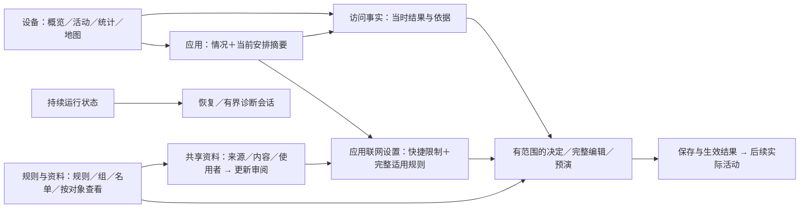

# Sakamoto：借鉴 Jobs 思路的独立功能组织参考

日期：2026-09-30。设计研究席；不是 Jobs 本人的意见，也不是已确认规格。
方法：先读产品任务与一手材料、向主评审发独立骨架，再打开当前原型比较；未用旧评审结论。
标记：**证据**＝文档/实屏可核对；**推演**＝本席设计选择；**未知**＝须用用户任务检验。
输入：[愿景](../product/NETWORK_CONTROL_PRODUCT_VISION.md)、[规则语义](../product/UNIFIED_RULE_ENGINE_SPEC.md)、[功能盘点](2026-09-29_UI_FUNCTIONAL_INVENTORY.md)、[ADR-0009](../adr/0009-unified-rules-and-vpp-owned-configuration.md)。DNS/IP 按目标能力设计；盘点的实现缺失不限制此方案。

## 一手依据与边界

实际在线读了 Archive 以下六节的编辑节选，另读 Objects 两条 Jobs 短片逐字稿；未观看完整视频。每条只取一个依据，不把历史产品结论机械移植。

| 一手材料 | 证据摘要 |
| --- | --- |
| [1984 Macintosh](https://book.stevejobsarchive.com/#sid-144) | 熟悉的操作降低学习负担，同时保留更丰富的表达。 |
| [1984 Moritz](https://book.stevejobsarchive.com/#sid-185) | 精度随物件尺度变化；缩小仍要容纳同样功能。 |
| [1997 员工](https://book.stevejobsarchive.com/#sid-678) | 组合必须让团队与客户理解；删减同时改善、补入产品。 |
| [2001 Store](https://book.stevejobsarchive.com/#sid-875) | 产品、试用、求助和专业软件各有用途与空间。 |
| [2007 Macworld](https://book.stevejobsarchive.com/#sid-1196) | 控制应随当前用途变化，而非所有用途共用固定按钮。 |
| [2007 员工](https://book.stevejobsarchive.com/#sid-1186) | 功能存在不足够，用户还须发现并完成它。 |
| [Objects of Our Life](https://stevejobsarchive.com/stories/objects-of-our-life) | Jobs 的直觉性短片强调已有经验和一致机制；简洁短片谈当时形态与技术。Ive 导言是回忆，The Story 是编者解释，不能当 Jobs 原话。 |

**推演：**先判断每项能力是否构成清楚任务，再决定同页或分离。资料没有规定 Sakamoto 的页数、导航或功能名单；“全折叠”“删高级能力”“只看应用/只看图”均不是自动答案。

## 承诺、主体与功能归宿

**推演承诺：**我能看清这台设备的变化，认出是谁，决定怎样联网，并核对实际发生了什么。
稳定主体是设备、应用控制身份、一次访问、规则及其使用关系、共享资料；“当前安排”仅是现有有效规则/组/分配的用户视图，**不新增持久实体或第二套规则模型**。
主导航优先比较「设备｜活动｜规则与资料」，设备中固定应用目录与搜索；「设备｜应用｜规则与资料」保留为挑战者。运行状态持续可点，设置另有固定入口。页数不是目标，独立应用主入口的收益仍待测试。

| 用户任务 → 归宿 | 同页/分离理由与首屏主次 | 收益 / 代价 / 验证 |
| --- | --- | --- |
| 不知谁在联网 → 设备概览 | 可信状态与时间→收发趋势及分口径事实→变化与贡献应用；活动/统计/地图可直接切换，保留查询，不必先选应用。 | 从变化找对象；多一种导航层次；看用户能否找到全设备地图/完整活动并返回同一时段。 |
| 已知要看谁 → 应用目录与详情 | 目录搜索、最近活动、已有安排；详情同页放情况、两三项代表事实、当前安排摘要与调整入口。完整历史与所有条件分别深入。 | 理解与决定接在同一对象；摘要要持续维护且不能假装涵盖所有条件；让用户复述当前做了什么，再找到具体事实。 |
| 看清一次访问 → 事实详情 | 应用、时间、DNS/连接类型、目标、真实结果、当时规则/资料版本同页；改变以后行为另开有范围的操作。 | 不把过去改写成未来；需清楚提示时态；保存后询问旧记录为何仍被阻止。 |
| 精细控制 → 应用设置/完整规则编辑 | 应用设置承接快捷限制与完整有效规则；编辑首屏给谁、活动类型、动作、范围，条件树有专门编辑空间，顺序/模式始终可查。 | 保留 AND/OR/NOT、协议、SNI、IP/端口、方向、网络等全部表达；比快捷控制更长；测试组合条件、observe 冲突与返回取消。 |
| 复用和全设备维护 → 规则与资料 | 规则、组、名单是同一工作区的不同目录，不是同一混合列表；“按对象查看”给每个控制身份的完整有效顺序、来源和模式，集中分配入口可选多个对象。 | 能从共享内容或使用者两端维护；会增加维护学习；测试查出两个应用为何结果不同。 |
| 维护订阅/例外 → 资料详情 | 来源、当前内容、使用者属于同一资产，可同页；新建来源、改本地内容、审阅待更新版本是独立提交任务。DNS 与连接消费者均显示。 | 不混淆资料和执行动作；更新比较多一步；测试用户能否分清全列表排除与仅一个应用允许。 |
| 询问“如果” → 编辑/规则/事实旁的预演 | 选已保存/正在使用/本次待提交输入及事实来源；展示规则顺序、预计结果、不足事实。另有规则工作区独立入口。 | 与决定相连且可反复探索；需维护输入快照；让用户区分合成、可支持的历史输入和真实 observe。 |
| 持续探索 → 设备观察各视图 | 完整活动可按对象/目标/结果过滤；统计可转协议/规则效果；地图与地区/目标列表联动，同一范围也可回到应用。 | 设备级探索不寄居应用；多维筛选有复杂度；测试从未知归属追 IP、再回到原地图选择。 |
| 排查或管理环境 → 状态/设置 | 状态先给影响与下一步，再到恢复和诊断；设置管理权限、后台、外观、数据、配置导入导出，规则工作区也直达配置状态。 | 工具按任务找到；暂保留预演与诊断的固定索引兜底候选；测试用户在正常/失败时都能找到完整能力。 |

组只组织复用，不决定胜出；分配显示执行/观察及全部使用者，展开后的有效顺序才说明实际判断。名单是匹配资料，来源不决定动作。以上遵循规则规格，界面组织属于推演。
应用局部允许写成该控制身份下明确范围与顺序的现有规则；共享规则修改须先显示其他使用者，不悄悄改为局部。复制再改与只移除本处分配均可达。

## 两条逐屏情境

**情境一：发现变化→找到应用→事实→决定→验证（推演）。**
1. 设备概览看到 09:21–09:26 发送量增大，选此段；贡献列表显示天气的发送量和被阻止查询分别计量，未知归属也保留。
2. 点天气直接进应用情况，保留时段；首屏表达“本段发送多少、查询发生什么、当前使用什么安排”，点相应事实，不先学习域名才能做基本控制。
3. 事实页说明 metrics.example.net 的一次 DNS 查询被哪条规则/哪版名单阻止；相关 IP 信息或连接只有证据支持才关联，缺失不填假故事。
4. 点“调整以后的查询”：保持天气身份，选只允许此精确名称或名称及子域；解释是 DNS 查询，若要限制连接则明确另选。进完整编辑可加入网络条件或改模式，取消保留旧安排。
5. 提交反馈分别说保存、生效、影响谁；成功留在天气上下文并提供“看后续活动”。旧事实不变；有新实际查询才验证结果，没有新记录则仍待验证。
6. 若仍被阻止，点新事实检查赢家及完整顺序；若运行或记录有缺口，去状态/诊断。预演解释预计结果，不能替代真实执行证明。

**情境二：共享名单订阅→维护→局部例外→更新（推演）。**
1. 规则与资料→名单→添加来源；填地址/格式后预览规范化条目与错误，确认名称/子域范围，保存资料。创建不自动启用阻止。
2. 资料详情的“用于规则”分别选择 DNS 查询、连接或二者的目标规则语义，再分配应用；显示规则动作/模式与涉及对象，可去应用查看实际有效顺序。
3. 天气有一项不应受影响：从天气事实创建局部允许；若希望所有消费者都排除此名称，才到资料的本地排除。两种影响范围不共用含糊“例外”按钮。
4. 有新版本时，进入更新审阅：旧/新版本、增删条目、覆盖范围变化、本地补充/排除、受影响规则及对象；采用前可预演具体事实，未知影响标未知。
5. 采用后列资料保存版本与规则生效结果；编译失败说明旧生效版本仍用，回到此更新修正/重试。自动采用策略在来源管理设置，更新事件仍可追溯。
6. 暂停检查仅停检查；停止订阅明确是否保留当前资料；解除某应用使用移除对应分配；删除资料先列引用并处理依赖。不得把四者写成同一个“关闭”。

## 手机、平板与 Linux

| 场景 | 布局推演与语义 | 收益 / 代价 / 验证 |
| --- | --- | --- |
| 手机 | 单栏；设备观察有可见视图切换，详情逐级，短局部决定可用底部面板；长条件有独立编辑空间，更新比较采用明确审阅模式或独立屏；首屏不堆地图、条件树、来源表单。 | 触控目标清楚；模式或导航增加状态维护；测中断返回能否找到对象、时段、未提交输入。 |
| Android 平板 | 应用列表＋所选应用详情；观察图/列表联动；编辑与作用范围、更新变化与使用者可并排，保留 Android profile/共享 UID 与权限。 | 并排服务关联任务；空间不足仍须转单栏；测试并排选择同步，不能因平板宣称 Linux 程序身份。 |
| Linux 宽/窄窗口 | 宽窗列表—详情及条件—预演并排，键盘焦点/搜索可用；窄窗逐级但保留相同对象/查询。UID 控制边界清楚，同 UID 程序不伪装成可独立控制；后台承载单独解释。 | 熟悉程序名可辅助识别；身份方案仍未知；测共享控制成员和退出窗口后规则状态，不能把宽度当平台。 |

## 反馈、失败与退出

操作对象承担反馈：保存失败留输入；保存但未生效同时显示新保存/旧运行版本；回复不确定先查询再重试；失败项直达修正。全局只汇总影响和入口，不能用一次成功 toast 掩盖两种版本。
记录延迟/缺口在相应事实与统计显示覆盖，健康入口解释原因；零记录、未知与真实零值区分。暂停停止判断/记录，不写成继续观察；诊断采集另有单会话、时限、停止与报告。
输入取消不改变现行规则；解除一项安排说明其他规则继续判断。退出编辑提示保存/放弃；关闭界面与停止运行分开，Android 后台与 Linux 承载分别说明。无有效配置时先修复，再明确启动；首版不新增 checkpoint。
**未知：**订阅格式覆盖、局部例外与共享规则顺序的可理解程度、预演可支持的事实、Linux 程序身份和监督入口、视图导航发现率。不可把设计范围写成已实现或功能完整。

## 独立方案与当前实屏的比较

证据范围：本席 Playwright 实走手机 390×844、Android 820×1180、Linux 1440×900/640×760；独立 `scope=jobsdesign61-0930-*`。参照主评审 `/tmp/jobs-debate-baseline-0930/manifest.json`；截图与走查文字暂存 `/tmp/jobsdesign61-0930/`，不是用户验收。
实走 home→天气→域名活动/一次查询→调整局部允许→保存生效；名单→资料详情→本地补充/排除，以及有待更新版本的审阅；宽屏资料/平板应用/窄窗探索工具。未声称覆盖所有页面或实际后端。

| 当前可核对位置 | 对独立推演的修正或分歧 | 收益 / 代价 / 怎么验证 |
| --- | --- | --- |
| `connection.html?id=s4-blocked-0` 局部调整 | 现有面板已直接说明只为天气允许此名称查询；生效后旧记录保留并给后续活动入口。保留此机制，不为统一布局强迫完整编辑。 | 情境连续；共享范围仍需深入明确；分别走局部允许/改共享规则并复述影响。 |
| 手机 `app-detail.html?id=s4` | 实屏先是连接去向，安排只显示“1 项设置”；平板才显趋势与查询总数。建议手机也给简短情况与具体安排含义，再给代表事实。 | 增加判断能力；挤占事实首屏；比较两版完成“天气被怎样管、是否仍联网”的准确率。 |
| `domain-detail.html?id=d1` | 来源、内容、使用者同属一个资产，可以保留；手机更新审阅需成为明确任务，同页模式与独立提交屏竞争，桌面可并排。 | 更新有清楚开始/退出；模式维护或导航各有成本；测来源维护与采用新版本是否误操作及取消返回。 |
| `extensions.html` | 地图、规则预演、诊断仅因“深入”归一页，不能证明任务组合合适。分别接回观察、决定、检查，仍保留各自完整入口与预演/诊断固定索引候选。 | 用途可发现；需维护情境入口与索引的一致任务表达；测三项能力在正常/失败场景的找到率。 |
| 主导航与设备全局入口 | 当前活动独立主入口、应用目录从设备进入；三入口方案只是竞争候选。设备子视图须直接可达并记住选择，若活动频繁往返受损，应重选导航。 | 知道应用时更直接；设备活动可能多一步；对比已知应用、未知变化、持续活动三类任务，不能按页数裁胜负。 |

## 提交跨组辩论的三个命题

1. 应用首屏应共同表达情况与当前安排含义，完整条件分离；反证：简短安排使用户误以为看到了全部生效条件，或明显妨碍找事实。
2. 地图/预演/诊断不该仅以“探索工具”同级组合；反证：按任务归宿后正常用户反而更难找到其完整能力，且固定工具入口明显改善。
3. 三主入口＋设备持久观察视图值得与现行导航竞争，不能先认定更好；反证：持续设备活动/跨目标探索出现稳定绕路，而独立活动入口可显著减少中断。

## 阶段 C：真实跨组质询后的取舍

- 已读三组本轮独立观察稿，实际回应 A/B/C；分别反问 A/C 并收到回答。以下修正前述候选，未做用户对比测试。
- **A 组质询改变判断：**当前位置弱只能证明需改善审阅，不能证明独立屏必要。保留独立提交屏与同页审阅模式竞争；A 先试固定模式，本席不裁胜负。两者均给当前/候选尚未采用、条目精确范围、本地修改和两类消费者实际模式/对象，不能只剩版本/数量。
- A 答复接受固定正文秩序与明确进入/退出，来源核对可就地展开，去天气消费者返回恢复同一候选/位置；候选或使用版本变化须重核对。若并列版本摘要已解决误读、同页往返更好，本席撤回独立屏偏好；反之才比较独立边界。
- **C 组质询改变判断：**收回“先删完整工具索引”的必然性。地图归设备观察；暂保留“预演与诊断”兜底，按“合成事实检查预计决定 / 有时限观察真实判断”表达，规则工作区固定可达，天气固定“更多检查”直接到达，不强制先过索引。
- 主动预演必须先选天气与 DNS 查询/连接，使用不同事实集合；分别标正在使用、已保存未生效、本次待提交输入及资料版本。无候选先创建暂时输入；DNS 不能拿端口443/TLS假充查询。C 接受此表达；这些仍是推演，不写成当前原型具备。
- C 答复接受正常天气→更多检查→未来60秒会话→停止/报告→原天气时段与选择；采集范围不覆盖原30分钟浏览范围，离开若采集继续则有持续状态/停止入口。只在无故障/无规则及全设备主动任务都稳定可发现、索引反而添误解时再考虑去索引。
- **B 组质询改变优先比较：**独立应用主入口收益未证。先保留“设备/活动/规则与资料＋设备固定应用目录/搜索”为优先比较基线，应用主入口作挑战者；活跃应用原本一次可到，不能虚报缩短路径。B 收口接受此竞争范围，仍要求实测发现与定位成本。
- 挑战者的设备页必须常驻概览/活动/统计/地图：点设备恢复原子视图，点概览明确回总体。子返回恢复全设备类型/结果/时段/排序/记录选择/滚动；局部后续核对另存对象＋目标范围＋通道＋生效后时间，不能覆盖来源查询。代价是常驻一行与额外导航语义。
- **未决：**同页/独立审阅、应用/活动主入口、是否最终保留检验索引。分别比较版本/消费者判断与往返，已知应用/未知变化/持续全设备探索，无失败的主动预演/真实采集；准确率、完成和恢复成本裁决，页面数与 Jobs 权威不裁决。
