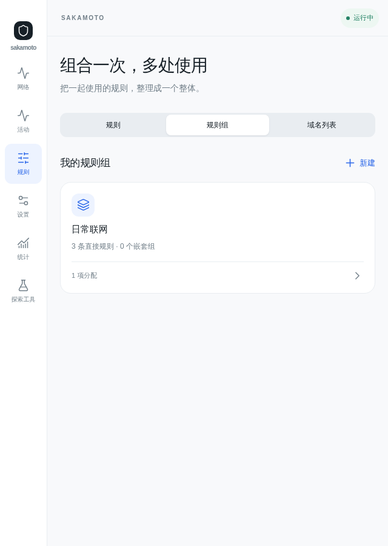
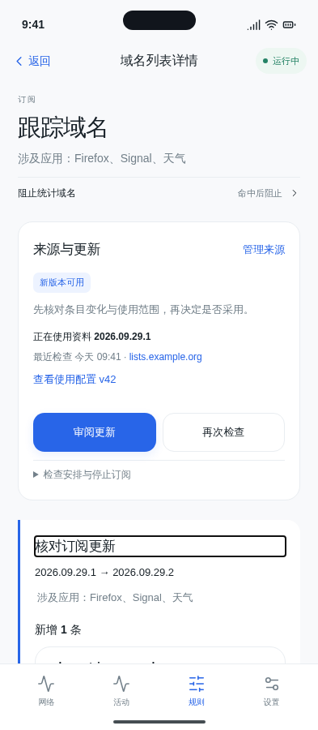
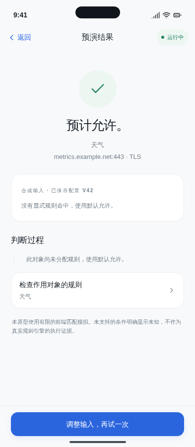
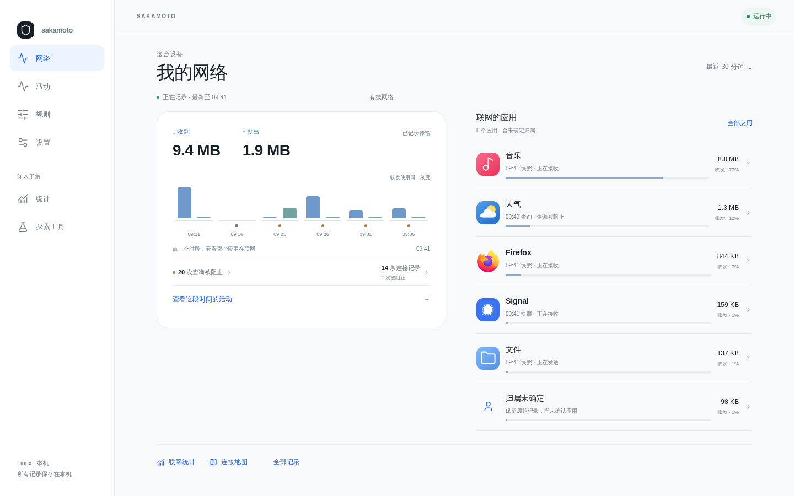

# 当前原型的产品组合与整体体验审查

日期：2026-09-30。C 组产品观察席：gpt-6.1-sol / high。先独立观察，再接受反方案质询；末节记录真实交流与收窄。

结论：在本轮已走任务中，应用作为理解与决定的中心显示了可识别的价值；这不证明整体可用性或产品组合完整。当前更大的结构缺口是：全设备安排缺少总览归宿；精确决定的解除重新要求理解分配；DNS 任务未进入预演。名单与运行页面还有主次、重叠问题，宜有限重排，不能只修间距，也不能机械删能力。

## 依据与边界

- 实际读了 [1997 员工讲话](https://book.stevejobsarchive.com/#speech-apple-1997)：产品线要让客户理解各项为何存在，聚焦同时包含改善留下的产品与必要新增。
- 实际读了 [2007 员工讲话](https://book.stevejobsarchive.com/#speech-apple-2007)：已有功能若无法发现与使用，就不足以证明产品有用。
- 实际读了 [2007 iPhone 发布讲话](https://book.stevejobsarchive.com/#speech-macworld-2007)：多种能力可以形成一个产品，控制应随当前任务出现。这是我的审查推论，不是 Jobs 对本原型的评价。
- 产品基准为 `NETWORK_CONTROL_PRODUCT_VISION.md`；看得见、能决定、可验证同等重要；DNS/IP 按目标能力正常设计。
- 先目视页面、实际点击和输入，再读相关实现佐证；未读旧评审或其他组结论。不会用 47 页、链接覆盖或几条成功流程证明完整。
- 地址根为 `http://127.0.0.1:4173/app-first/`。全部操作是本地原型；没有访问订阅服务器、改变设备或修改产品代码。

## 已走的完整任务

| 人的任务 | 实际路径、失败与结束 | 判断 |
| --- | --- | --- |
| 只让天气查询这个名称，随后撤回安排 | 首页天气 → 被阻止 DNS `s4-blocked-0` → 允许天气查询 `metrics.example.net` → 保存失败，范围保留 → 重试成功 → 查看后续活动，明确 0 条新记录 → 应用设置的新允许项 → 规则详情 → 分配 → 解除 → 已保存且已生效 | 决定与失败恢复连贯；撤回掉入高级模型；旧阻止记录保留正确 |
| 停止不可靠的订阅更新，保留自己的资料，再恢复维护 | `d1&subscription=failed&localcase=modified` → 检查重试后没有新版本 → 暂停自动检查 → 停止订阅确认 → 现有资料和本地补充/排除仍保留，规则仍使用 → 重新启用 | 维护任务可完成；停止订阅与停止使用资料分开，边界表达清楚 |
| 临时让音乐不联网，再解除 | 音乐详情 → 我的联网设置 → 限制所有联网 → 等保存完成 → 返回详情显示所有联网已限制 → 返回开关解除，单独快捷规则消失 | 快捷限制能直接撤回，不能泛化为所有控制都缺解除 |

前两条使用 `scope=whole61-0930-t1/t2`；第一条初始 `scenario=save-error`。脚本 `/tmp/whole61-tasks.js` 重现两条；`/tmp/whole61-proof.js` 重现快捷、预演和分配路由。每次脚本使用新浏览器会话，scope 只隔离当前 session。

## 1. “当前安排”没有与规则、组、资料同等清楚的归宿

事实与路径：配置管理列“分配 3”，点击实际进入规则组，只看见“日常联网 / 1 项分配”；另外的 DNS 直接分配和仅观察分配要分别进入规则详情才能找到。规则、规则组、域名列表三栏组织的是资产类型，未提供全设备安排的总览。
复现：`config.html?platform=linux&scope=whole61-0930-config-check` → 分配 3 → `groups.html`。源码 `js/manage.js` 的分配计数目标确为 `groups.html`；`js/rules.js` 的分配编辑与解除能力存在。
理解代价：想回答“哪些应用按哪些安排联网、哪些只是观察”时，人要遍历资产并拼回适用关系；计数入口没有兑现所承诺的范围。这是维护任务缺归宿，不是缺分配能力。
方案 A：规则主入口先给“当前安排”，按应用/使用范围呈现实际动作、观察与来源；规则、组、名单保留为共享资产入口。更贴近掌控任务，但需处理重复与继承的表达。
方案 B：保留现有三栏，增加直接可达的安排视图，把分配计数准确路由过去。改动更小，但资产仍是主导航逻辑。
倾向 B 先补缺口，再用真实任务验证 A；无需先增第四个底部导航项。

## 2. 精确决定容易建立，解除却要求重新学习“分配”

事实与路径：天气的精确允许由记录内 sheet 完成，失败可以就地重试，成功可以核对同对象后续活动。撤回这一项却要应用设置 → 允许规则详情 → 天气分配 → 全部应用、内容类型及执行方式表单 → 解除 → 通用配置版本结果。
理解代价：原任务是“撤回我给天气的这个例外”，页面却要求辨认规则资产与适用关系；结果页主要告诉 v43/v44，没有回顾已解除的对象、目标与其他规则如何继续判断。
方案 A：应用设置的精确决定项提供“解除对天气的这项安排”，确认准确范围，结果留在原项附近；共享或继承安排注明来源并引导修改相应安排。保留高级分配页。
方案 B：继续统一走分配编辑，但提供只显示当前安排的解除入口与对象结果回顾。实现较收敛，仍保留一次高级概念跳转。
倾向 A；不能把解除组分配伪装成移除单个应用例外。快捷全联网开关已能直接解除，不属于本项问题。

## 3. 名单详情的能力组合有共同对象，但两种来意使用同一种首屏

事实与路径：天气被阻止记录 → 查看使用的名单 → `d1`，首先看到订阅来源与更新、大号“立即检查更新”，顶部快捷规则却是用于 Firefox/Signal 的“阻止统计域名”；天气实际使用的 DNS 规则在后面的完整使用列表。主动维护订阅时同样首屏有用。
理解代价：从一次处理结果来核对名称的人，先遇到资料维护任务，要继续找命中条目与自己的使用关系。手机 393 更明显；已有“涉及应用”及完整规则关联，所以不能判名单和使用关系完全割裂。
方案 A：名单保持同一详情，按来源来意前置所选名称、匹配范围、本地例外和当前应用的使用规则；订阅维护摘要与完整来源仍可达。保留共享对象，有上下文组织成本。
方案 B：详情分成“条目与使用 / 来源维护”两层；不同入口直接落到相应层。任务更清楚，但要防止两层各自藏掉采用版本和实际使用版本。
倾向 A。不能把“暂停检查/停止订阅”改成停止规则使用；资料版本与配置版本也不能合并成一个数字。

## 4. 运行与恢复对普通状态重复承担同一个任务

事实与路径：`runtime.html` 和 `recovery.html` 分别使用新 scope、`scenario=permission`，都说明未控制也未记录，并提供继续授权。恢复页再重复当前、配置与下一步。正常运行时，恢复页也保留独立入口，但主要让人再回运行状态。恢复中/需处理场景另有停止恢复的能力，应保留。
理解代价：需要恢复的人不知道两页各自负责什么；同一判断在多个页面表达，不等于增加了完成能力。设置中的运行与授权入口合理，问题在深层职责重叠。
方案 A：单一运行状态页按状态展开恢复步骤、进度与停止恢复；故障深链接仍可直接定位这些内容。入口清楚，但要避免把长期运行环境设置塞进恢复流程。
方案 B：保留专用恢复页，只在恢复任务确实进行或需处理时进入；正常/待授权状态直接留运行页。职责较小，但仍需解释跨页关系。
倾向 A 或严格的 B；不建议把配置导入、权限表单、资料更新都合并进运行页。

## 5. “探索工具”未把被邀请的 DNS 验证任务容纳进去

事实与路径：`rule-detail.html?platform=android&scope=whole61-0930-preview&id=r5&app=s4` → 预演一次访问 → 天气、`metrics.example.net:443/TCP/TLS/Wi-Fi` → “预计允许 / 此对象尚未分配规则”。表单没有查询/连接类型；`js/explore.js` 的 `evaluate()` 只筛连接规则。天气已有 DNS 规则与分配，画面却不能说明被跳过的活动范围。
理解代价：用户从 DNS 规则来核验，却只能表达连接任务，并可能把“没有连接规则”读成没有自己的安排。页脚的有限模拟说明不能补上任务类型缺席。这是产品范围遗漏，非模拟后端或未实际发请求的问题。
方案 A：预演显式支持查询/连接，入口带入当前规则、对象、活动类型与已知目标；查询只询问相关事实，结果说明未评估的范围，并返回原任务。适合已确认的 DNS 产品前提，但需设计两种事实集合。
方案 B：暂时明确限定“连接预演”，DNS 规则入口改为解释其可核验路径，仍能查看后续 DNS 活动。诚实但验证能力较窄，不能当作目标体验已完整。
倾向 A。地图已有首页/应用入口，预演已有规则入口，不是所有工具只能从设置找；诊断会话目前仍主要由工具容器发起，需要在连接/应用问题中给有范围入口。工具目录可保留为专家索引，不能代替任务入口。

## 保留点、覆盖与未验证

首页的时段、收发、应用贡献可以共同回答“设备这段时间谁在联网”，不是天然拼盘；应用详情中的观测与控制也有共同对象。Linux 1440 并排和 Android 820 的应用详情组合成立。393 应用详情把连接、设置、DNS 前置，流量总量后置，是另一种任务排序；若从首页贡献进入，宜保留一条所选时段总量摘要，暂不据此主张拆页。

| 范围 | 本轮实看/实走 | 覆盖限度 |
| --- | --- | --- |
| 首页、应用、活动、记录、设置 | Android 393；应用 Android 820；首页 Linux 1440；精确与快捷任务 | 不宣告所有时间范围、身份及无活动状态均完整 |
| 名单、订阅、条目、使用规则 | Android 393；失败、重试、暂停、停止、恢复；更新候选首屏 | 未再次完成全部采用方式/本地编辑冲突组合 |
| 规则、组、分配、配置 | Android 393；规则/分配计数路由 Linux 640；导入范围扩大、待生效页 | 未走所有嵌套组与继承冲突；未宣告安全可批量迁移 |
| 运行、恢复、权限、网络、存储、通知 | Android 393；正常与待授权，其他职责页面实看 | 未操作设备授权、实际断网或真实恢复 |
| 地图、预演、诊断及工具入口 | DNS 规则预演实走；其他表单/入口与代码引用核验 | 未完整走诊断采集；Linux 640 不替代 Linux 1440 的全部任务验证 |

必要能力清单按理解、决定、核验、维护/解除检查；本轮找到的归宿缺口与范围缺口已列出，不能反推未列出的能力全部齐备。建议优先修 DNS 预演任务范围、安排归宿和精确解除，再讨论来源主次与运行页合并。

## 阶段 C 辩论后收敛

- B 组研究席质询后，第 1 项方案 B 收窄为准确列齐既有 3 项适用关系，复用现有对象筛选；不要求新增有效策略总表或第 4 类资产。共享组分配一行，解除整项明确影响全部对象；只移除 Firefox 是调整对象并保留 Signal，默认允许不是可解除资产。
- 第 3 项不再主张动态更换空间秩序：A 为固定结构、来意摘要与定位，全部共享使用关系保留；B 为固定的条目/使用与来源两层。当前证据不能裁决孰优，长名单、跨区往返及版本/完整作用范围判断失败是改用 B 的条件。
- 来意摘要必须分清那次记录与当前名单：仅回顾记录保留的事实，当前条目只解释现在的匹配/用途，并可回原记录依据。没有历史匹配证据时不能以现态证明旧结果，不要求本轮新增历史名单归档。
- 只有可核对的记录时配置、不可变资料版本及该次匹配事实都与当前一致，才可说明两者使用同一资料；即使合并展示也保留“当时结果 / 当前安排”的时间标签。同名、同配置数字不足。
- 保留分歧：运行与恢复能否合页尚无完整恢复任务证据；DNS 预演范围和分配计数失配由 root、同组研究席另行实走复现，优先级保持。快捷摘要同步及历史快照不造新活动均已反证，不列为执行失败。

## 与独立设计席的有界交锋

- 以正常、无既有规则/无故障的主动 DNS/连接预演与未来一分钟真实判断采集质询“工具目录应消失”；设计席撤回删除索引的必然性，接受“预演与诊断”专家索引作为竞争兜底，地图仍归设备观察。
- 同意索引按“合成事实检查预计决定 / 观察未来真实判断”表达，并允许应用详情直接进入；索引不是必经步骤。采集结束落本次报告，返回应用恢复原来时段；采集范围与原观察范围分开，离开界面不冒充停止。
- 净收益必须来自上下文、完整事实集合与返回连续。只有正常主动任务在无索引版本中同样可发现、完成且少歧义，才有证据撤回索引偏好；现有材料没有证明该条件。补入 DNS 预演与比较快照仍是设计推演，不宣称现原型已有。
