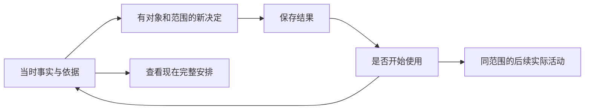

# 交互决策逻辑与取舍临时汇总

日期：2026-09-30。状态：临时设计工作稿。本文把当前选择、选择理由、承担的代价和保留异议集中在一起，供继续讨论、修改原型和后续细化使用。它不是正式 PRD、实现清单或发布验收；实施与验收状态仍由既有规格、源码、证据和 Plane 管理。

**2026-10-03 VPN DNS方向进一步明确：** 用户纠正系统hook是libnetd；VPN DNS进入TUN记录过滤，放行查询由应用送往加密远程上游，配合阻止常见外部加密DNS服务。需要小范围请求／缓存能力；用户澄清“doc”为DoQ后，明确自身对外请求可以不支持DoQ，当前上游收窄为DoT／DoH。具体库、缓存与例外、上游失败及识别边界继续讨论。**Android资源开关已由用户撤下，当前不继续预先优化。** 见[本轮查询流程](2026-10-03_VPN_DNS_RELAY_DISCUSSION.md)，不将新产品方向冒写成已有数据面能力。

**2026-10-03用户确认大致方向并转入Android DNS：** 标准／增强／自定义的维护分工、授权后后台守护及误伤时引导恢复已获大致认可；用户明确标准是大多数人的常用模式，要求写入Markdown后先讨论Android。系统hook、仅Root解析事件、VPN的SNI／DNS、自行解析、53／5353和资源开关进入[本轮核查与讨论](2026-10-03_ANDROID_STANDARD_DNS_DISCUSSION.md)，不将其中推测或资源排序冒写成执行合同；具体名称、名单、切换及排查操作仍开放。

**2026-10-03用户否定V4并提出普通用户场景：** 两版均未通过，不继续作为待选主方案。新方向是首次授权后按系统权限适配，提供标准／增强／自定义或高级三种使用方式；普通用户选择标准就交给后台静默守护，遇到误伤才几步排查并加例外。不同模式不能强迫用户使用同一套默认界面，原来不区分全局简单／高级的限制被取代。见[本次期望与未决部分](../product/NETWORK_CONTROL_PRODUCT_VISION.md#2026-10-03-从标准防护与后台守护重新描述普通用户路径)；这是用户初步场景，不是已定稿界面或完整例外合同，未自动改原型。

**2026-10-03 V4可操作比较：** 用户要求将已有研究思路落成设计与交互原型后，提供[改变结果／共用与差异](2026-10-03_UI_PROTOTYPE_V4.md)两种规则Tab操作起点，共有的情况核对只作较轻工具。两版共用内存状态，包含误伤、优先级、反向动作、共享变化、恢复当前来源及应用往返的实际路径。制作原型不等于确认新的key、主方案或局部语义；下方被否定的两个候选不恢复。

**2026-10-03研究汇总仍未到点：** 用户对已有论文／产品思路汇总仍不满意。原证据保留，但不能把几条可深追的机制当成用户层核心已经找到。两席短查可操作作品、共用来源与局部差异的成熟产品关系，结论与限制见[研究单位反查](2026-10-03_CONTROL_RESEARCH_SYNTHESIS.md#后续补查研究单位反查)；没有确认新的概念或原型方向。

**2026-10-03转向已有思路研究：** 用户指出key仍未找到，要求GPT-6.1-sol子代理搜索相近论文和应用。四席研究及主代理核查已汇总为[已有思路、工作逻辑与证据](2026-10-03_CONTROL_RESEARCH_SYNTHESIS.md)，重点区分目标结果输入、有效政策、行为差异、例子用途及共同默认／局部差异，包含负面结果和未核验线索。材料用于继续思考，没有拼接新方案或确认新语义，前述两案仍被否定。

**2026-10-03两个核心候选均未通过：** 用户明确对范围表达和判断路线都完全不满意，认为仍是拼凑功能，没有体现其要求的乔布斯式品味。下方两案收敛记录转为被否定的探索过程，不再作为当前推荐或实施依据；未确认替代方案，用户层核心仍未找到。见[反馈记录](../product/NETWORK_CONTROL_PRODUCT_VISION.md#2026-10-03-用户否定两个核心交互候选)。

**2026-10-02核心交互收敛为两个候选：** 四个全新设计席先独立提案，再完成八项实际主问与两项追问；四份“选区／范围块”合并为一个家族，撤回将未来访问比作现存照片的依据，也撤回图必然沦为接线作业的判断。主代理保留[范围表达与判断路线](2026-10-02_INTERACTION_CORE_DIRECTIONS.md)两种真正不同的操作语言，给出具体操作面与同题比较；应用×网络格最多作有条件的半种快捷入口。遵守用户最后的一两种主方案、必要时半种补充的呈现要求，不强判唯一冠军。所有新交互与持续范围、局部顺序、复用语义仍为建议，未改原型或正式执行合同。

**2026-10-02从用户层表达方式重新开题：** 用户再次澄清，当前核心难题是用户眼前的概念与自然操作方式，后端最终落成带优先级的规则并不要求界面继续采用规则思维。可以完全跳出当前形式，图形只是探索可能；按用户要求安排四个不同偏向的独立设计席，从Jobs公开设计实践出发提出可操作候选并实际互辩。之前三席的父内／整组局部改写只作为保守对照，不是本轮既定骨架，也未获用户确认。见[本轮明确的题目](../product/NETWORK_CONTROL_PRODUCT_VISION.md#用户进一步明确从用户层的表达方式重新开题)。

**2026-10-02转向联网决定的根本交互概念：** 用户指出规则、组、名单、嵌套和局部调整仍未形成自然的完整工作，要求按Jobs哲学重新找交互主心骨。允许与禁止对等，应用本身也是条件，后端可支持所需组合；重点是用户怎样统一表达、理解、复用和调整决定。共同内容下的个别调整要保留其关联，不能仅改称呼或再分几个资产入口。用户随后纠正规则具有优先级：匹配条件与最终胜出不同，不能把每项禁止当成否决权，也不能默认局部或整组调整自动高于其他规则。三席候选据此重审，优先级不得从主概念中消失。见[本轮讨论方向](../product/NETWORK_CONTROL_PRODUCT_VISION.md#2026-10-02-从联网决定重思交互概念)。下方公共条件比较为此前阶段建议，新的主模型尚未确认。

**2026-10-02公共条件与编辑捷径实际互辩：** 两席先独立构造持续约束与当前成员编辑，再完成四项真实质询。主代理建议以持续组使用条件作为主要能力，理由是改变G这处使用而保留组外共享内容；明确批量替换或追加仍是另一项成立的编辑工作。未来成员自动受限不是已知需求，不适用警告也不等于用户控制意图已经完成；整体收尾不能由当前后端强加为两次保存。详见[本轮取舍](2026-10-02_GROUP_CONDITION_JOBS_DEBATE.md)。这些语义仍为建议，下面用户提出的快捷想法未被冒写成已确认或已否决。

**2026-10-02公共条件作为编辑捷径的候选：** 用户提出公共条件也可能是编辑规则组时的一种快捷方式，明确只是想法。当前区分“持续约束整组及后来加入的成员”与“一次编辑当前成员条件”两种候选；尚未选定，不能把公共条件的存在直接写成已批准的持续组约束。见[当前讨论边界](../product/NETWORK_CONTROL_PRODUCT_VISION.md#2026-10-02-规则组公共条件与设计依据)。

**2026-10-02用户确认规则组公共条件与持续品味审视：** 规则组可以有公共条件；当前后端实现不是设计上限，符合产品体验需要时可以修改后端。乔布斯式品味须始终反问包括已接受决定在内的设计，检验是否直觉、精确、克制并能完整工作。已记入[产品基线](../product/NETWORK_CONTROL_PRODUCT_VISION.md#2026-10-02-规则组公共条件与设计依据)；条件怎样组合、嵌套与不相容时如何操作仍待本轮推演。

**2026-10-02执行效果真实互辩：** 两席gpt-6-astra／low／priority（fast）先独立，再完成四项实际质询；删掉“按成员看效果”“查看整套效果”及重复扁平成员榜，建议效果接回原成员内容、计数直达实际记录。组内历史、规则全部效果与当前共同修改影响分别明确，返回保留范围和时段；三层结构不要求逐层经过才能看证据。具体案例、真实改变与代价见[本轮取舍](2026-10-02_RULE_EFFECTS_JOBS_DEBATE.md)。以下已确认边界保持，本轮新增呈现与返回方案仍为建议。

**2026-10-02用户确认执行效果与三层组约束：** 单条规则和规则组均需能查看真实执行效果，应用与规则视角连接相同活动；区分正在使用、所选时段实际处理与具体结果，计数单位清楚，域名查询和连接分别表达。规则组整体效果与其中单条规则效果分开，不混入成员在其他范围的全部结果，也不因重复引用简单累加。用户明确最外层组算第1层，最多三层规则组，单条规则不占组层级；摘要与深入返回继续收准，见[确认基线](../product/NETWORK_CONTROL_PRODUCT_VISION.md#2026-10-02-规则执行效果与规则组嵌套)。

**2026-10-02用户接受新建规则主流程并要求文字稿：** 用户接受动作起步、直接选择具体内容、可见网络范围、明确应用后保存使用，以及同一内容的“另一种情况”和保存待用。已整理[规则创建交互文字稿](../product/RULE_CREATION_INTERACTION_DRAFT.md)，覆盖名单与UDP两案、当下读法、操作、完成、待用与改错；[确认范围](../product/NETWORK_CONTROL_PRODUCT_VISION.md#2026-10-02-接受新建规则主流程)已记入基线。具体文案、控件和其他未决语义继续细化，以下保留辩论当时的状态。

**2026-10-02新建规则的Jobs品味推演：** 用户授权两个案例，由两个gpt-6-astra／low／priority（fast）席先独立、再实际互问；无法定夺才启第三席的条件本轮未触发。主代理建议动作起步、同一内容逐渐完整：直接选实际名单或连接内容，网络范围可见可改，明确应用后保存使用，也可保存待用；OR增加时原网络与目标保持同一支。实际改变、完成读法及舍弃未提交使用候选的代价见[完整推演](2026-10-02_RULE_CREATION_JOBS_WALKTHROUGH.md)。这是新建议，未扩大下文用户已接受方向或冻结创作步骤。

**2026-10-02用户接受规则Tab品味方向：** 用户接受主代理总结：实际规则内容占主位，名称／状态辅助、管理信息按需深入；围绕同一内容理解和修改，完整条件、例外及共同影响清楚；单次修改呈现完成结果，整套工作继续当前整套；连续编写不因每次保存强制退出编辑。接受首层不全面清点管理关系的取舍。确认范围已记入[产品基线](../product/NETWORK_CONTROL_PRODUCT_VISION.md#2026-10-02-接受规则tab的品味方向)，具体布局与其他案例细节继续细化。以下保留辩论当时的状态。

**2026-10-02 A/B重开及品味裁决：** 用户指定两个全新gpt-6.1-sol／high／priority（fast）席，主对话保持当前模型，并明确乔布斯式品味是最终裁决尺度。双方先完成四项实际互问，再完成两项品味挑战；主代理撤回缺少真实差异的A/B二选一，明确选规则实际内容主位、管理事实按需深入、同一对象直接操作和自然收尾。单独修改完成后看清结果，持续作者或整套任务不因每次保存强制重启；详见[本轮裁决](2026-10-02_RULES_AB_REOPEN.md)。用户确认的是裁决尺度，具体方案仍为建议；以下旧默认组织比较保留为过程记录。

**2026-10-02默认组织重新竞争：** 用户要求重新辩论后，同三席分别构造内容库A、完整工作台B、用途规则组C的强版本，用首次控制、复杂共同修改、半年再找与零起点整套同样工作实际互问。B从作者优先改选A默认，A/C也撤回对强版本的不公平成本判断；主代理明确建议默认先认规则／规则组内容及使用状态，保留已知规则直达完整编辑和整套任务连续。真实改变、代价及可改选B/C的条件见[本轮取舍](2026-10-02_RULES_MAIN_REDEBATE.md)。这是组织建议，不是实测优越或正式新决定；应用第二视角和旧局部复制细节未重开。

**2026-10-02规则主线真实互辩：** 同三席gpt-6.1-sol／xhigh独立读iTunes官方材料、提案并实际互问；主代理支持规则主线，保留对作者门槛的强批评，收准库灵感只作组织参考。候选让单条及整套从零直接成立，按即时控制、准备待用、继续整套收尾；名单材料接回当前内容，复杂规则仍须完整理解。真实改判及完整条件工作台／用途组优先的强反案见[本轮判断](2026-10-02_RULES_MAIN_DEBATE.md)和三席报告；具体组织与收尾合同仍为建议，第二应用浏览视角不在本轮决定。

**2026-10-02规则Tab当前主线及讨论范围：** 用户明确自己的决定也需要辩论；当前先以规则内容为主推进这个Tab。应用视角可以作为同Tab后续选项，但现在无需决定，也不作为主线。已收准[产品记录](../product/NETWORK_CONTROL_PRODUCT_VISION.md#2026-10-02-规则tab主视角与应用视角)，本轮集中推演规则／规则组的完整工作及代价，具体组织和创作路径继续决定。

**2026-10-02转向规则Tab整体思路：** 用户明确，单App调整的内容修改／复制等处理须结合其他交互决定，不作绝对约束，不在此细节继续停留。本轮主代理借Jobs时代早期iTunes的库与组合关系，探索可读控制内容、按使用对象浏览、直接可发现的创作及同一内容深入与核对；见[灵感稿](2026-10-02_RULES_TAB_JOBS_IDEAS.md)。尚未确认具体规则Tab结构或创作顺序，既定四项边界保留。

**2026-10-02共同修改继续互辩：** 同三席gpt-6.1-sol／xhigh先独立提出反例，再真实互问和收准。候选按本次工作直接进入单条或整组，核对后能继续未结束的共同任务；明示转换未完成工作时不虚构个人保存。主代理支持已确认的共同修改边界，反对普通局部调整默认复制整套内容；整套组成与单条内容各按当前对象呈现作用应用组和应用，不要求预读全部复用目录。理由、真实改判及仍未决定的局部使用／个人内容区别见[本轮取舍](2026-10-02_SHARED_EDIT_BOUNDARY_DEBATE.md)与三席报告，具体候选尚未正式确认。

**2026-10-02用户确认跳转后的作用对象呈现：** 共同修改跳转至规则Tab后，明确显示当前规则所作用的应用组和应用；从组中进入单条内容时围绕当前编辑对象说明其作用范围。已补入[确认基线](../product/NETWORK_CONTROL_PRODUCT_VISION.md#2026-10-02-应用内修改与专属共用规则)；具体呈现方式、持续共用与成员变化等未一起决定。本轮三席互辩已吸收这项新增确认。

**2026-10-02用户确认共同修改的入口边界：** 跨越多个应用的规则或规则组，其共同内容不能在单个应用界面内修改，需要多走一步进入规则Tab中的对应规则或规则组。应用内修改继续只作用当前应用，共同维护是另一项明确工作。已补入[确认基线](../product/NETWORK_CONTROL_PRODUCT_VISION.md#2026-10-02-应用内修改与专属共用规则)；持续共用合同、个人内容变化及任务返回细节仍逐项决定。

**2026-10-02对用户反馈的再辩：** 同三席gpt-6.1-sol／xhigh先独立评价用户两点反馈，再实际互问、作答和修订。主代理支持默认单应用修改及两种起点并存，首选持续共用同一内容、个人内容明确独立、共同维护直接进入规则Tab中准确的对象并回本次任务；保留个人差异积累后的查找与维护成本。真实改判及独立取舍见[本轮意见](2026-10-02_JOBS_FEEDBACK_DEBATE.md)和三席报告；用户随后确认的入口边界见上文，其余新增含义仍是建议，正式确认以产品基线为准。

**2026-10-02用户确认单应用范围与规则并存：** 单个应用内修改只应用于这个应用，之后才明确选择共用；应用专属规则、多个应用共用以及应用组共用的规则同时存在。应用内创作／修改与规则入口主动创作／管理可并存，前轮比较的工作起点不作为二选一。已记录[确认基线](../product/NETWORK_CONTROL_PRODUCT_VISION.md#2026-10-02-应用内修改与专属共用规则)；其他成员、关联、局部与重叠处理仍逐项讨论。

**2026-10-02三席整体操作互辩：** 三个全新gpt-6.1-sol／xhigh席按品味、交互和整体组合的不同尺度，先读Jobs一手材料再独立提案、实际互问，并按用户要求回到同一人的完整路线。候选贯通首页识别变化、全部应用快速联网、应用已有流、精确控制、单规则双向使用、共同维护及核对返回；保留集中规则Tab的强反案与使用成本。局部问答仅检验边界，不能代替整体流畅直觉。见[综合](2026-10-02_JOBS_OPERATION_LOGIC_DEBATE.md)及其中三份报告；互辩当时均为建议，后续正式确认仅为上文单应用范围及专属／共用并存，其余继续讨论，未改原型，也未宣称整套逻辑完成。

**2026-10-01从用户期望逐项决定：** 用户明确要求记录共同决定，主代理和子代理自行提出的方案先不作为正式决定，不一次性宣称逻辑已经定稿。本轮期望是应用列表中的按网络条件快速联网设置，以及单条规则与应用／应用组的双向快速关联。不同Wi-Fi名称对应不同信任程度的情景模式作为探索项继续讨论。应用组持续成员关系、加入自动接受／移出仅解除一处等主代理建议尚未确认。当前期望与决定权限见[产品记录](../product/NETWORK_CONTROL_PRODUCT_VISION.md#2026-10-01-从用户期望继续决定逻辑)，下文“首选”“裁决”“收口”保留为建议与过程，只有用户明确确认的部分进入基线。

**2026-10-01用户补充应用组：** 应用组作为共同作用对象，一条规则或一个规则组可以用于单个应用或应用组，涵盖域名和非域名规则。规则组组织规则，应用组组织接受规则的应用；两者与域名列表分别表达内容、作用对象及目标名称。成员变化、重叠来源、成员单独调整和解除结果仍需决定。当前关系见[产品基线](../product/NETWORK_CONTROL_PRODUCT_VISION.md#2026-10-01-用户确认的交互基线)，此前只画规则到单个应用的关系不再作为完整模型。

**2026-10-01用户确认主导航及讨论阶段：** 当前确定**首页、规则、设置**三个Tab，其他Tab是否添加后续讨论。用户随后明确，当前困难是逻辑未决定完整：入口职责、应用与各类规则/规则组/域名列表的关联、局部和共享修改、解除使用后的结果需要继续决定；非域名规则路径也须成立。剩余工作不能被归为界面细节或以构图代替。下文两入口、三目的分箱等保留为阶段推导，当前导航与讨论阶段以[产品愿景](../product/NETWORK_CONTROL_PRODUCT_VISION.md#2026-10-01-用户确认的交互基线)中的本次确认为准。

**2026-10-01用户确认的四项基线：** 首页保留已确定的时间变化、活动、流量与同段应用贡献；UI及交互由用户对象和任务组织；应用页直接说明拦截什么，正文以已有流、流量及协议为重点，通过SNI、DNS解析结果、IP—域名关联等信息取得域名，默认显示域名本身，没有可用域名时才显示IP，来源及拦截次数与情况按需点开；规则默认直接表达“这个应用拦截这份域名列表”，执行方式可深入查看。后端等价功能是本轮既定设计前提，二次开发后续讨论。已确认基线记录在[产品愿景](../product/NETWORK_CONTROL_PRODUCT_VISION.md#2026-10-01-用户确认的交互基线)；以下保存各轮推导，其应用页默认目标索引、默认拦截记录行等建议以本次确认的已有流主位为准，其他建议继续细化。

**2026-10-01访问意图辩论收口：** 五席真实交叉问答后的暂时首选是应用→目标→有范围的决定，由产品规划完整含义内的执行。首次提供可用推荐并开始持续观察，广告/跟踪名单一次可选且不预勾，LAN不默认启用；日常以目标实际记录为主，确知能力变化影响某项时就地显示后果。完整条件与规则顺序约束全部方式，新增关联地址等扩大范围另作选择。预设收窄为名单目标及确切设备发现；高级、共享维护与健康Debug沿同一内容深入。理由、改判、承担代价及主代理对高层语义模型的保留意见见[本轮综合](2026-10-01_ACCESS_INTENT_DEBATE.md)，具体故事与原词见[设计裁决](2026-10-01_ACCESS_DESIGN_VERDICT.md)，平台事实见[研究](2026-10-01_ACCESS_PLATFORM_RESEARCH.md)。这是设计首选，尚非用户确认规格；以下保留各轮推导，V3未落实本轮变化。

**2026-10-01新工作方向：用户要求从访问意图重新推导交互。** 首页的时间曲线、活动、流量与同段应用贡献继续保留。应用与默认决定先表达“这个应用能否访问这个域名”，DNS查询处理、TLS/QUIC SNI识别、域名到IP关联属于产品可能采用的执行方式；具体方式可在解释与高级设置中查看、调整。V3中默认“调整以后的查询”已经限定了用户目标，这项生成逻辑接受重审，旧裁决和V3继续作为阶段记录。

用户默认表达控制对象、访问目标、允许或限制、精确名称或包含子域等真实范围。产品根据可用能力与证据形成执行方案，必要时多个方式协作；不要求用户先选DNS/连接类别或执行阶段。执行方案仍要能解释、核对，实际查询、连接、字节和历史结果不能因此伪合成一次已证明的访问。高级选择若改变覆盖或范围，普通摘要也必须准确反映这个改变。

自动选择需要保持行为含义。限制某名称与限制其解析地址的范围可能不同；同一IP可承载多个名称，地址限制可能影响这个应用访问其他名称。因此自动方案的精确范围、覆盖不足和可能扩大影响须成为可理解的产品结果，不能只藏在技术详情。[RFC 6066第3节](https://www.rfc-editor.org/rfc/rfc6066.html#section-3)支持共享地址的事实；[RFC 9849](https://www.rfc-editor.org/rfc/rfc9849.html)说明真实SNI可能被加密，支持名称可用性不能被保证的事实。自动方式的具体选择、降级和高级覆盖偏好仍待推演，不据这次讨论冻结。

现有[统一规则规格第4节](../product/UNIFIED_RULE_ENGINE_SPEC.md#4-execution-planning-and-bounded-compilation)已经把识别前后的位置交给编译器；它还没有定义跨DNS、SNI与地址关联的统一访问意图，DNS请求过滤与关联执行仍在该版Out of Scope。新方向需要继续审查用户意图、执行方案、归因与能力结果怎样进入单一权威源和现有合同；不预先决定新增持久实体，不让UI保管第二套可编辑规则模型。本次只记录工作方向，未修改已接受规格、接口或原型。

上轮2026-10-01体验重思收口：保留首页时间变化→同段贡献与应用连续画布。整体改以“我的网络”“联网规则”两个稳定可读物件展开；编辑才形成“本次修改”，健康额外证据由“从现在记录实际判断”动作开启。旧三目的分箱不继续作为生成结构的前提。具体首屏、完整故事、真实改判与精度条件见[体验裁决](2026-10-01_EXPERIENCE_DESIGN_VERDICT.md)、[品味答辩](2026-10-01_EXPERIENCE_TASTE_RETHINK.md)、[整体提案](2026-10-01_WHOLE_EXPERIENCE_RETHINK.md)和[语义核对](2026-10-01_EXPERIENCE_SEMANTICS_CHECK.md)。一手方法见[方法复查](2026-10-01_JOBS_EXPERIENCE_METHOD_RETHINK.md)。这些是阶段选择，不是用户已确认规格或实现证明。

对应[V3交互原型](../../app/design/prototypes/2026-09-29-interaction-directions/v3/README.md)已新增。V3继承V2首页、应用与名单的内部逻辑，落实整体物件及行动关系；V2和旧三目的参考板继续作为历史材料。原型全部为内存样例，三个全新品味、交互、整体评审席已实际操作、向设计席对质并复核整改；[V3收口](2026-10-01_UI_PROTOTYPE_V3.md)与原型QA区分可操作样例和未验证范围。

**当前主线是设备变化 → 同段贡献应用 → 具体事实 → 有范围的决定 → 实际后续核对。** 品味首先体现在对象、事实与动作的关系：每个页面有清楚主意图，深入和返回保持同一个问题，精确由形态、名称和时态承担。信息全在、按钮可点、页面数量多，都不能证明功能组合或完整性成立。

## 当前依据与决策权限

| 性质 | 已明确的内容 |
| --- | --- |
| 用户确认的产品方向 | 我的设备由我决定如何联网；看得见、能决定、可验证。流量理解和规则控制同等重要，应用作为熟悉的认知与操作对象贯穿路径。 |
| 本轮设计前提 | DNS 拦截与接入、IP 和相关事实按目标能力融入设计；当前后端未接通不能成为删掉这些体验的理由。事实关联仍须有证据。 |
| 用户授权的首页裁决 | 用户将图与应用谁先的取舍交给虚拟乔布斯设计席；最终采用时间变化在前、同段贡献应用紧接其后。保留反方意见，不写成全体一致。 |
| 本轮裁决尺度 | 独立控制线、入口及规则页的存在都可以重审；UI不按后端模块划分。设计席可以推演并接受挑战，最后按乔布斯设计哲学与品味的具体理由取舍，不凭席位身份获胜。 |
| 当前保留及重审范围 | 首页时间变化与同段贡献、实际活动与流量；应用按用户的访问对象和意图组织。旧查询/连接类型主位、默认通道限定动作和整体功能组合接受新方向重审；真实身份、范围、来源与时间关系继续准确表达。 |
| 尚未冻结或证明 | 全部功能组合、复杂条件摘要、诊断新增证据、Linux 程序归属、完整历史资料、后台订阅合同、全状态和真实用户完成率。 |

依据见[产品愿景](../product/NETWORK_CONTROL_PRODUCT_VISION.md)与[统一规则规格](../product/UNIFIED_RULE_ENGINE_SPEC.md)。乔布斯材料提供质疑方法；本文的页面和取舍是我们的设计推演，不代称本人意见。一手阅读边界见[品味](2026-09-30_JOBS_TASTE_PRIMARY_RESEARCH.md)、[逻辑](2026-09-30_JOBS_LOGIC_PRIMARY_RESEARCH.md)、[整体](2026-09-30_JOBS_WHOLE_PRIMARY_RESEARCH.md)研究。

## 品味怎样约束功能组合

同页内容应互相解释，不能仅因为同属一个后台模块或资产就并陈。一个应用的情况、真实活动和简短当前约束可以构成完整对象；来源参数、完整条件树与提交新版本则各有不同的开始和结束。需要搬出的功能真正进入有名字的任务，不把所有复杂性折叠在长页末端。

位置和动作应可学习。身份、范围和主要事实的位置稳定；用户明确选择类型或任务时改变内容。蓝色承担可操作关系，阻止色局限于具体结果，未知与缺口清楚但不制造风险故事。字号和量词须能读懂，不能让大数靠极小脚注才成立。

当前明确放弃：应用的情况、事实、安排三张等权卡；活动与安排两个等权常驻标签；名单日常的大来源维护卡；只靠链接介绍能力的永久工具目录；首屏完整规则条件树；无依据精选几条好看事实。保留能力的可达路径，承担必要的深入成本。

## 导航与功能归宿

本轮[联网决定续辩](2026-09-30_NETWORK_DECISION_INTERACTION_DEBATE.md)重新审查了“控制/规则”是否应独立存在，阶段选择见[设计裁决](2026-09-30_CONTROL_DESIGN_VERDICT.md)。此前三入口作为当时工作基准保留在[V2原记录](2026-09-30_JOBS_DESIGN_REFERENCE_V2.md)，不继续约束新结构。

下述导航表格记录无第三入口阶段，当前以2026-10-01新体验裁决为准；其后[深度裁决](2026-09-30_DEPTH_DESIGN_VERDICT.md)采用三个稳定目的位置，现也接受体验方法续审。两者都不能仅凭功能覆盖或版本正确宣布整体品味已成立。

| 入口 | 主要工作 | 内容与取舍 |
| --- | --- | --- |
| 概览 | 看设备一段时间的变化，并认出是谁贡献 | 时间图与贡献应用相连；应用目录和搜索固定可达。统计、地图、当前连接有直接入口，规则编辑不争这里的主位。点概览固定回总体。 |
| 活动 | 持续筛选、追查完整实际事实 | 保留对象、目标、类型、结果、时段、所选记录和位置。宽屏列表与事实并排，窄屏逐级进入，返回恢复调查。接受它占一个主入口。 |
| 对象上的改变任务 | 决定设备、应用或目标以后怎样处理 | 明确动作进入意图与精确表达，完整条件、使用关系及预演围绕同一输入；完成回来源对象。它不预设为独立主导航。 |
| 专业连续任务空间 | 长期维护命名内容、共同使用与尚未使用资料 | 设备固定创建、我保存的内容、全部应用/多选及设备任务可达；切换对象保持草稿和基线。接受专业首访多一步，不把规则/组/名单三目录换名充当普通首屏。 |

运行信任以持续可点状态承接，设置固定可达。权限、后台、外观、数据、配置管理有自己的归宿，不把观察工具都收进设置。应用目录不新增独立主导航；应用仍可一次点击进入自己的活动与控制。

用户动作最终调用现有规则、组、分配与配置API，不新增持久“安排”实体或第二套规则模型。无活动应用、从零创建、批量、完整配置导入导出、保存/使用差异与修复都有固定触点；搜索加速已知对象，不能独自证明可发现。

最强反方是常驻“以后管理”工作台，长期跨对象编写与比较的会话更直接。当前保留连续专业工作收益，承担首次进入与集中扫描多一步；若落实时变成菜单迷宫、重复搜索或丢草稿，就是没有兑现本选择。地图、统计、预演和诊断各有可见任务入口。

## 首页裁决与保留异议

默认观察最近30分钟，依次呈现身份与可信范围、同刻度收发和时间图、独立查询线索、同段贡献应用。手机按这个关系纵向展开，大屏将图与贡献相邻并排。图上选择时段直接更新贡献；点应用直接深入，不要求先选中再猜第二次点击。

**理由：**短暂查询、发送峰和归属未定活动可能在打开界面时已经结束。连续设备事实应自然暴露，应用帮助认出是谁。图是范围选择器，不能独自代表网络掌控；DNS 次数、连接事实、字节与记录覆盖各自表达。

**最强备选：**当前应用主位，设备变化作背景，历史明确进入。反方认为它更快认出熟悉对象，愿付历史多一步的成本。设计席最终不采用该默认，愿让只想看当前音乐的人越过总量与图区域，再进入当前连接。这个异议保留，裁决不等于发现率已被验证。

当前旧首页已有最近30分钟及图到贡献的路径。本轮收敛时间与注意力关系，不把已有意图说成不存在，也不把它称为首次发明。

| 状态 | 同一空间秩序中的表达 |
| --- | --- |
| 安静且记录完整 | 明确所选时段没有相应活动记录，保留时间探索和当前连接；不把无记录或0 B写成安全。 |
| 只有 DNS 活动 | 字节可以为0，查询结果与发生时间仍可见；旧查询不冒充此刻正在传输，未知归属不消失。 |
| 记录缺口 | 时间图显示缺段，量标已记录；不填0、不推算缺失量，不用漂亮平线掩盖覆盖不足。 |

图、贡献与进入应用的范围必须一致，收发使用同刻度，量与时间单位紧贴。默认贡献按同段事实呈现；用户明确追发送或接收指标时应使用对应贡献口径，不能拿收发总量冒充发送贡献。完整指标选择仍需细化，参考板不证明所有统计组合已具备。

## 应用与连接事实的组织

采用一个连续应用画面：固定身份、范围、简短当前安排及管理入口、主要事实、类型与实际记录。明确选择全部、查询或连接后改变事实主位，页面整体顺序保持稳定。

| 来意与类型 | 主要事实 | 舍弃的组合与成本 |
| --- | --- | --- |
| 已知应用而未限定问题 | 紧凑查询/连接索引及按明确时间次序排列的记录 | 不默认用一个大发送量代表所有来意，也不随意精选两三条故事。 |
| 追查询结果 | 查询数、返回地址或被阻止等实际结果、名称与时间 | 无关发送量退出主位；不把所有查询都说成被阻止。 |
| 追连接或发送变化 | 本范围传输、方向、对应连接事实 | 查询另有入口，不用邻接的阻止查询暗示发送原因。 |
| 看现在连接 | 明确最新快照及其时刻、传输/空闲/结束等状态 | 从历史任务进入当前多一步，换取时间含义清楚；返回恢复原历史范围。 |

当前安排只给可确定的条件含义及管理入口。比如“跟踪名单中的名称查询受限”；复杂混合情况用诚实的安排索引，不缩成全允许、全阻止或查询全拦。摘要不能替代完整条件，当前设置也不能解释旧结果。

已有连接仍需透视：最近收发、方向、存续经过、累计及处理依据可深入核对。历史时段的字节、最新近段速率和整条累计分别标记；长连接与所选时段相交时仍可见，即使本段传输为0。已建立、首次观察、最后数据与结束依据按实际证据表达，不补造开始时间。

DNS 查询与连接只在证据支持时关联；同一时间、名称或地址不自动证明因果。域名/IP/协议等深入可达，正常基本控制不要求用户先学习它们。应用身份未知时保留原始事实，不猜一个熟悉应用补位。

## 旧事实与新决定的回路

旧事实正文保持当时结果与可用依据。新决定的保存/生效反馈属于本次完成层；后续核对另有对象、名称范围、通道和开始使用时点。完成回旧事实时，不把新的绿色允许卡长期粘在旧阻止记录上；大屏宽度不改变这个时态关系。

| 情况 | 必须保持的结果与动作 |
| --- | --- |
| 保存失败 | 保留输入与范围，允许重试；不改变旧使用状态。 |
| 已保存但未生效 | 同时说明新保存与旧正在使用内容，给处理入口；不能笼统成功。 |
| 回复不确定或版本冲突 | 先核对最新状态及范围，再决定重试；不盲目重复创建。 |
| 已开始使用 | 表达设置已使用，随后核对真实活动；不宣称访问或应用功能已恢复。 |
| 尚无新记录或记录不足 | 保留等待/缺证状态，不由查看、刷新动作制造成功活动。 |

核对视图围绕原决定范围，同时能查看其他适用限制与范围外的必要旁证。只检查一个名称的允许结果，不等于证明天气功能恢复；有关联证据才把查询和连接接起来。

时间范围、应用/身份、筛选、所选记录、来源与滚动位置沿返回恢复。设备观察、应用观察、生效后核对各自保存范围，后续调查不覆盖原五分钟选段；新事实到来有可见提示，阅读时不自动插入造成跳动，跟随新记录是明确选择。

## 控制范围与共享关系

| 动作 | 改变什么 | 必须讲清的取舍 |
| --- | --- | --- |
| 应用快捷限制 | 该控制身份下的查询与连接，按明确网络范围处理 | 解除快捷限制后，其他规则仍判断；解除不等于一律允许。 |
| 某名称的局部允许/阻止 | 当前控制身份、名称及子域范围、查询/连接通道下的现有规则 | 不改其他应用或共享名单，不保证战胜所有规则；规则顺序仍需核对。 |
| 再次调整 | 重现已选动作、通道、名称范围及作用对象 | 修改动作不能静默把子域范围缩回精确名称。 |
| 解除一处使用 | 移除或调整规则/组的这项使用关系 | 共享整项解除会影响全部列出对象；只移除Firefox须保留Signal，不删除共享资产。 |
| 完全退出共享组的一条规则 | 分离必要引用链、重绑并明确解除残留来源 | 与一个名称的局部允许、停止一条具名组关系不同；核对完整序列，说明哪些分支不再跟随原组更新，不画继承叶子的停用开关。 |
| 修改共享规则或名单 | 明确列出的全部消费者可能受到影响 | 进入时标范围扩大并保留回应用；不能沿用局部标题假装只改天气。 |

解除与再次调整应围绕同一安排可达，不迫使普通用户重新穿过完整技术表单。专业分配、完整条件和共享编辑仍保留。默认允许不是可删除资产，删除规则也不等于解除一个应用的使用。

按对象查看真实有效顺序；同规则可能有多个来源，展示去重后的实际规则与全部使用关系。解除发生在使用关系行，不在去重规则行冒称规则已关闭。组组织复用，不自行决定胜出。

仅观察的首层表达是命中后实际允许；声明的阻止定义放第二层。不同对象方式不同则分项表达，未分配规则不冒充正在执行。更完整的匹配、动作和顺序仍服从统一规则规格。

模式属于真实使用关系，组绑定修改会涉及其成员；隐式直接使用固定执行，不能假装有独立观察开关。只改共享名称或条件保留各关系方式。复制为新身份的观察规则可能成为更早允许赢家，不能称同时保留原阻止的影子采集。

最高快捷限制仍在时，局部允许先显露真实赢家，明确解除影响并回同一输入；高级保存不自动抬高优先级。全选当前控制身份只兑现本批，不包含未来或不可控未知身份；程序名不自动成为独立控制身份。

## 名单内容与来源维护

名单是匹配资料，来源是维护方式，执行动作来自使用它的规则。同一名单可被DNS和连接规则消费，也可以尚未使用；创建资料不自动启用阻止。

日常主位固定为身份、当前资料/出处短签、真实用途短关系、精确匹配内容。名称与是否包含子域贴在条目旁；本地排除缩进表达集合关系，不让来源维护卡占据正文。

| 能力 | 归宿 | 承担的代价 |
| --- | --- | --- |
| 匹配名称、本地补充与排除 | 名单日常及明确内容编辑 | 不用数量替代内容；本地修改须显露自己的范围。 |
| 地址、格式、频率、检查、暂停/停止、采用偏好 | 来源管理 | 来源维护常客多一次深入，换取日常内容清楚。 |
| 完整消费者、执行/观察、分配、有效顺序、创建规则 | 使用此名单 | 完整使用关系多一次深入；日常和审阅仍保留决定必要的真实用途。 |
| 删除名单 | 对象操作，先处理引用 | 不与日常查内容、立即检查和创建规则并列为大动作。 |

来源条目、本地补充、本地排除分别保留；排除优先于本名单正向条目，只影响本名单。另一份名单或规则仍可命中，局部排除不是全设备放行。只给天气例外从天气事实建局部规则，希望全部消费者不匹配才改本名单内容。

上述本地排除、来源调度与候选资料是目标交互。当前T18/T19只承接正向名称条目及限定导入，本轮不把排除伪装成删除一条正向名称或暗改所有消费者；仍需同一权威模型下的相应契约。IP/CIDR可复用通过现有普通规则条件表达，不新增独立CIDR名单后台。

暂停检查保留现有资料与使用，停止订阅也不等于停止规则匹配；明确保留内容及本地修改。编辑已停止订阅不偷偷重新启用。换来源保留旧资料直到新来源检查并采用，来源格式和真实后台调度合同尚未冻结。

## 更新审阅与配置导入

**当前首选是手机独立更新审阅。** 同对象互相可达，不代表日常、来源维护和采用候选应接成一条长台账。独立审阅让一份尚未采用的资料成为一个有开始和结束的决定。

固定顺序是当前/候选版本、精确增删或范围差异、本地补充/排除的保留或冲突、消费者通道/实际方式/对象、采用或暂缓。大屏可把差异与用途并排；不会因屏幕变宽把历史结果与当前设置混起来。

采用承担一次进退和候选快照、展开项、来源/消费者往返位置的维护成本。核对回来须继续同一候选；途中资料或用途变化使原核对过期，不能拿旧摘要提交。采用结果分别表达资料保存与规则实际使用，失败保留旧使用资料。

默认先审阅更新，也允许明确自动采用。眼前已有候选时改变自动采用偏好，必须明确是否一并采用；现有交互样例选“保存并采用待更新版本”，不能同时要求手动审阅又暗示已自动处理。资料版本与配置版本分别说明。

整套配置导入是完整替换，不是追加名单。确认前核对条件、动作、顺序、组成员、分配及资料的实质差异，并展开受影响应用；同名、同数量也可能改变范围。可确定的地址差异翻译成可理解的含义，复杂否定/复合条件不猜整体效果。

不把计数、原JSON或第二次确认当作理解的替代。固定确认按钮本身没有被判错；简单样例首屏已有完整替换说明，不能据此要求强制滚到底。复杂差异需要诚实索引与逐项核对，错误指出项、引用与位置，并保留输入。提交方式与具体摘要仍需按真实配置密度细化。

## 观察工具与运行信任

地图归观察，与同范围连接、地区和精确目标清单相连。地域选择只筛选，按控制身份→IP配对勾选后进入有证据的精确条件，不把两个集合交叉扩大、不生成国家条件。DNS无地址事实仍在未入图清单；未知位置、特殊地址和IPv6保留。地图不按国家给安全评级，统计仍可按对象、协议和规则效果深入。

预演归决定：明确查询/连接、事实来源及正在使用/已保存未使用/待提交输入快照。不同通道使用相应事实，不拿443端口或TLS输入假充DNS查询；缺事实标不足。合成预计不能替代实际执行证据，无既有规则时也有主动入口。

完整预演的输入与快照选择是目标服务契约，已有匹配器测试边界和开发工具不自动证明生产预演API已完整。组友好名称、DNS接入、地理资料及新增聚合同样区分目标体验与当前接口事实。

普通未来一分钟是持续记录中的观察窗口，不另造采集启动页和报告。结束不停止记录，未来窗口与原调查范围分别明确；当前补充示意选择结束后回原范围。独立诊断只有在提供日常记录以外、能事先说明的判断/阶段证据时成立，具体证据深度仍未知。

运行状态先说明是否控制、是否记录、覆盖、保存/使用差异与下一步。正常和待授权不再由两个重复首页承担同一任务，故障可深链接到恢复步骤；停止恢复、暂停与环境管理仍可达。授权恢复后待启动仍需明确启动，不能写成已恢复判断。

诊断停止、关闭界面、暂停防火墙、停止订阅检查各改变不同对象；动作名称不统称关闭。Android后台/权限与Linux承载分别设计，不由非空活动列表推断保护正在工作。

## 手机平板和 Linux 的适配

| 窗口 | 已选布局方向 | 不能随布局改变的含义 |
| --- | --- | --- |
| Android手机393×852 | 单栏、局部决定面板、独立更新审阅；深入后明确返回 | 个人/工作资料、共享UID、查询与连接、历史与现在。 |
| Android平板820×1180和1180×820 | 图/贡献、列表/事实、差异/用途并排；选择可见，触控入口自然 | 仍是Android身份与授权语义；空间不足按任务逐级。 |
| Linux桌面1440×900 | 侧栏与并排关联空间，鼠标/键盘选择与搜索 | 程序识别线索不自动获得独立控制能力。 |
| Linux触控竖屏820×1180 | 窄导航栏和触控密度 | 保持Linux用户/控制身份，不能变成Android个人资料模型。 |
| Linux小窗口640×760 | 顶部工作导航、列表到独立事实逐级 | 返回恢复范围/选择；完整能力仍有归宿。 |

Android作用身份包括资料与完整UID；共享UID成员共同受影响。Linux参考以js用户身份示意，程序名帮助识别，改变安排仍可能影响同身份程序。用户看到的观测归属与规则的执行范围必须分别说清；PID/可执行程序的独立控制方案尚未选定。

这些尺寸是当前参考窗口，不是已冻结的产品断点。并排必须能核对同一对象，不能只因为屏宽就塞入多种任务；记录、来源和用途可以同屏比较，但不等权争主位。缩放属于参考板外层，不改变平台身份。

## 已有材料与未证边界

本轮手机参考支持四种设备场景、三种应用来意/类型的有限示意；大屏参考有五窗口乘四视图，并核对了选段贡献、记录选择、窄窗返回、来源候选返回及示意采用。完整规则深入等部分入口仍只表达意图，不能把提示当完整交互验收。

原产品原型尚未按V2整体改版。前轮发现的DNS预演通道缺口、应用切换共享资产失去范围、分配计数归宿不全、重开子域决定缩小范围仍属于已记录观察；本文不是修复记录，也不以旧检查通过反推其他能力完整。

需要继续细化或验证的边界包括：复杂条件短语的准确投影、多来源/嵌套组及冲突的表达、长名单/多消费者密度、候选变化的审阅连续性、完整历史规则/资料依据、真实订阅格式与调度、诊断额外证据、Linux归属与承载、全键盘/读屏、真实用户发现和完成率。它们不抹去当前已经作出的首选，也不能被写成已实现保证。

首版暂缓checkpoint；不因此取消未提交输入的取消或解除当前使用。不加入计费、限速、定时等未经选择的能力，也不把本轮UI组织变成第二套规则配置模型。

## 参考与讨论记录

- [联网决定的交互结构与品味取舍](2026-09-30_NETWORK_DECISION_INTERACTION_DEBATE.md)与[设计裁决](2026-09-30_CONTROL_DESIGN_VERDICT.md)：重开独立控制入口、覆盖第一版全部相关能力、实际反驳和API边界；[配套参考板](assets/2026-09-30-control-debate/control-reference.html)演示关键任务。
- [当前设计参考V2](2026-09-30_JOBS_DESIGN_REFERENCE_V2.md)：优先结构、两条完整情境与首页裁决。
- [第二轮品味取舍](2026-09-30_JOBS_TASTE_DECISIONS_V2.md)：实际反驳、改判、明确偏好及保留异议。
- [平板与Linux补充](2026-09-30_V2_TABLET_LINUX_REFERENCE.md)：五窗口、实际核验范围与深入入口的限度。
- [手机参考构图](assets/2026-09-30-jobs-second-debate/design-reference-v2.html)与[平板及Linux参考构图](assets/2026-09-30-jobs-second-debate/design-reference-v2-large.html)：可查看的示意材料。
- [阶段四原型说明](../../app/design/prototypes/2026-09-29-interaction-directions/app-first/README.md)：已有交互及模拟边界，不等于V2已落实。

后续改变首选时，在对应段落同时更新理由、代价和验证边界，并保留原讨论记录。本文保持临时工作稿性质；转正式规格前仍需逐项确认范围和状态。
