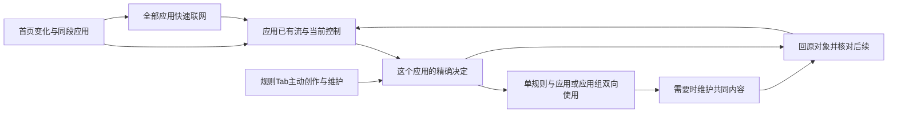

# 乔布斯品味与整体用户操作逻辑：三席互辩候选

2026-10-02。三个全新席位均为 `gpt-6.1-sol / xhigh`，分别侧重品味、交互与整体组合。先独立读一手材料并提出完整故事，再向另外两席真实发问、回答和有限跟进；最后按用户要求回到整条使用路线。此前low初稿未进入互辩，不作为本轮结果。

**本文保留互辩候选及后续用户确认。** 首页／规则／设置、应用已有流主位、域名本身的显示、应用组及用户当前期望以[产品记录](../product/NETWORK_CONTROL_PRODUCT_VISION.md)为准。未获用户确认的三席及主代理选择仍是建议；没有改原型、后端、规格、设备或tracker，也没有宣称整体逻辑已经定稿。

**后续用户确认（2026-10-02）：** 单个应用内修改只作用于这个应用，随后才明确选择共用；应用专属规则、多个应用共用及应用组共用的规则同时存在。应用内操作与规则入口主动创作管理可并存，不能将本轮比较的两种工作起点当成互斥方案。确认内容已进入[正式产品基线](../product/NETWORK_CONTROL_PRODUCT_VISION.md#2026-10-02-应用内修改与专属共用规则)，其余仍为候选。

## 整体首选：同一个人的工作自然深入

三席经整体回看共同倾向：**首页认出发生什么，应用完成当下决定，规则延续复用和长期维护，设置处理设备及产品行为。** 从应用开始的工作应能沿所面对的内容继续深入；作用范围从单应用扩大到共同使用者时，明确改变工作对象，原问题仍有返回路径。

这是候选工作路线，各步可以从自己的意图直接开始；它不要求每次操作经过全部节点，也不规定页面布局。

### 一次完整使用应该怎样发生

1. 用户在首页看曲线与同段贡献，认出视频应用正在消耗移动流量；稳定可达全部应用，没有活动的应用也能找到并安排。
2. 从应用列表直接选择网络条件及联网安排，完成后仍面对这个应用。普通暂停联网不先要求命名规则、创建组或学习资料结构。
3. 点击应用，正文重点仍是已有流、取得的域名、协议和流量；当前拦截直接可读，次数、来源和记录按需要深入。快设与精确控制围绕同一个应用共存。
4. 用户需要更精确控制：已有内容适用就“使用现有规则”；需要新条件就从应用或连接“设置规则”。域名列表直接表达为该应用的拦截，UDP、端口、地址等非域名条件同样能操作。没有流也能主动创建。
5. 从应用创作／修改先只作用于该应用，之后才明确选择共用，已获用户确认。三席建议以一次“保存并用于这个应用”表达完成；具体动作形态继续细化。用户后来想共用，再选择其他应用或应用组；单条规则无需先装进规则组是本轮建议。
6. 从规则开始，先读内容，再“用于应用／应用组”；从应用或组开始，先有作用对象，再“使用规则”。两种起点办理同一件使用工作，完成回各自发起对象。
7. 想让共同使用者一起改变，才进入共同规则、规则组或名单的维护；此刻明确哪些应用会改变。应用组组织使用者，规则组组织共同内容，名单组织名称，这些结构在确实需要时帮助理解工作。
8. 完成回原应用、所选时段和原流，或者原规则及筛选；决定后的活动另作核对。需要权限或运行处理时可从原问题进入设置具体项，处理后接回原工作。设置承担设备运行、权限及产品偏好，控制内容在自己的工作中维护。

这条路线需要同时承接快速操作与完整能力：批量、非域名条件、规则组、应用组、名单及订阅维护、未使用内容和健康深入都保可发现路径。同一个人逐渐深入，入口与术语不应先把他分成两种用户。

## 三个侧重怎样检验整个产品

| 席位 | 从一手材料推导的尺度 | 对整体路线最强的批评 |
| --- | --- | --- |
| [品味席](2026-10-02_JOBS_OPERATION_TASTE_DEBATE.md) | 熟悉对象、直接决定、可自行发现；产品承担必要结构工作 | 停一个应用或修一条连接仍要先学规则／规则组／应用组／名单，说明普通主线未成立。 |
| [交互席](2026-10-02_JOBS_OPERATION_INTERACTION_DEBATE.md) | 动作随当前问题适配、后果可预测，深入与返回连贯 | 已在应用里找到规则，却被送到全局规则目录重新寻找；保存与取消正确也补不了这次工作中断。 |
| [整体席](2026-10-02_JOBS_OPERATION_WHOLE_DEBATE.md) | 丰富能力由同一个人自然发现并组合，日常与长期维护互相解释 | 快设、完整规则及共享维护各自正确却互不相通，会形成三个仓库；仅设“高级区”没有兑现深度。 |

三席实际读取Jobs Archive相关讲话节选；员工讲话的会议通话案例讨论复杂技术怎样易用且可自行发现，Macworld讨论操作随应用需求适配，iPad谈话借家庭观影讨论同一作品的多层价值。[员工讲话](https://book.stevejobsarchive.com/#speech-to-apple-employees-2007)、[Macworld](https://book.stevejobsarchive.com/#speech-macworld-2007)、[iPad谈话](https://book.stevejobsarchive.com/#on-the-ipad)。上述尺度是本轮推导，具体关联、继承或Tab方案不是Jobs的处方。档案编辑背景、Ive声音和Jobs发言分别辨认，各席报告注明实际读取范围。

## 真正的整体反案与承担的代价

最强反案：应用主要观察与快捷联网，精确创作、复用和共同维护集中到规则Tab的一套完整安排表，携带原应用及原流，并在结束后返回。这种方案便于学一套编辑方式、查齐内容与关系，不能仅以“多一次切换”否定它。

这是互辩中用来比较成本的工作重心反案。用户随后明确应用内操作与规则入口管理并存，应用专属与共用规则均存在；本段不再作为要求用户二选一的待决题。

三席暂首选对象连续深入，因为“修这个应用”应能沿眼前内容完成，不强迫转换成整理全局规则的工作。它承担的真实成本是两端入口必须表达同一内容和影响，共享编辑前多认一次使用者；集中方案承担的是任务切换及寻找关联内容的成本。

若对象内操作只有简化按钮、解释和跳转，完整能力最终仍需重搜目录，首选失败；若集中规则区能自然携带对象、完成并返回，反案仍值得考虑。需要演完整使用及后续原型验证，互辩本身不证明实际发现率或整体流畅性。

## 局部互辩只作为整体路线的边界证据

| 实际反例 | 真正改判 | 对整条路线的意义 |
| --- | --- | --- |
| 同一规则通过两组与直接使用作用于一个应用；逐处解除不能兑现“只改我” | 交互、整体放弃逐来源作为唯一主路径，接受应用级的同规则使用调整；来源级解除保留给对应维护任务 | 普通人的意图可一次完成，深入来源不成为必修步骤。 |
| 只收窄使用条件也自动转个人副本，后来共享更新丢失 | 品味放弃“所有单应用修改均独立维护”；收窄使用继续共享，真正改内容才明确个人维护 | 快速修正能延续长期维护价值，不为表面少一步隐藏维护责任。 |
| 未提交成员修改中，深入保存名单；再取消成员修改 | 取消只放弃对应未提交工作，已独立保存的名单及未完成使用反馈保留 | 同一个人的中断、深入及返回不丢已完成工作，也不复活取消输入。 |
| 原规则已限定Wi-Fi，局部另限移动网络得到空适用范围 | 明确使用范围只能收窄；真正把Wi-Fi匹配改为移动，需要明确改个人内容或共同内容 | 表达与实际后果一致，不能用一个漂亮动作掩盖意图未实现。 |

每席报告保留实际问答、有限跟进、初判与修订；这里不以案例通过数宣布整体完成。快设恢复与精确控制的关系、多来源的后续变化、个人维护和重新共用等仍只是候选。

## 接下来优先逐项决定的整体问题

**第一项已确认：应用内修改只作用于当前应用，随后才选择共用。** 用户同时明确规则入口主动创作管理、多个应用及应用组共用规则也存在；它们与单应用专属规则共存。后续继续决定各操作怎样完成及关联，而不是要求在两种起点之间选掉一个。

**第二项：规则Tab先帮助人审阅什么。** 整体席偏好“已有安排及其使用者”，保留主动创作和未使用内容；另一个起点是按应用／应用组审阅联网安排。二者必须接回应用实际活动，当前没有替用户选定内部组织。

共享修改怎样扩大任务范围、恢复联网是否继续已有精细规则，需要沿上述路线逐项确定。不同Wi-Fi名称与信任程度的情景模式继续保留探索，不由本轮冻结自动切换、信任或覆盖逻辑。

本轮交付的是三种侧重的整体候选、真实改判与后续确认。正式记录仅包含用户明确确认的单应用修改范围及专属／共用并存，其余选择继续讨论。
