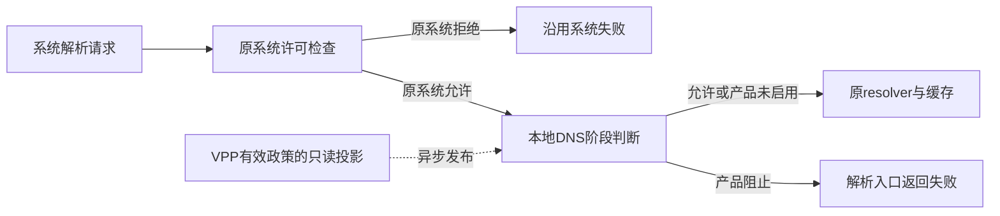

# libnetd hook：入口、晚挂与后台防护生命周期

2026-10-03。用户确认HEV＋同Mbed TLS＋c-ares窄改的DNS实现路线，要求接下来讨论libnetd hook。本文是当前建议；没有部署、操作设备、修改生产代码或冻结正式接口。

## 2026-10-04：系统组件替换继续研究，转查iodé上游

用户明确：按修改resolver源码并通过KSU／Magisk挂载替换库的路线，即使不写入原系统分区，也是在替换系统实际加载的组件；少量适配代码并不会取消整库替换、APEX挂载及启动加载问题。这条部署路线先记录并继续研究，尚未批准实施或选择最终安装方式。

用户补充系统DNS思路参考iodéOS的开源组件，要求子代理调查iodéSnort及相关系统／App组件。追加[上游研究与本项目取舍](2026-10-04_IODE_DNS_REFERENCE_ASSESSMENT.md)将区分其ROM源码集成、组件间决策通路与本项目普通Root设备的模块部署条件。此前晚挂和Xposed是阶段候选；已确认的VPN HEV／Mbed TLS／c-ares路线继续保留。

两席已完成固定源码核查：iodé在getaddrinfo handler经Unix socket同步取得verdict／getips，允许时保留原callback和resolver；其daemon地址映射不是完整DNS回答cache。该ROM机制与下文的小hook／本地投影建议属于不同接入合同，研究尚未把其中一种冻结为本项目部署方案。

## 确认范围与两条DNS路径

用户接受系统正常启动、App后台防护Runtime就绪后才开启拦截，不要求此前所有解析都受控。关闭界面不停止后台守护；实际停止／失联的回退继续决定。

已确认的VPN DNS路径继续由HEV原owner模块接管查询、过滤、缓存并转DoT／DoH。Root系统hook使用Android原resolver，不把HEV客户端、完整TLS或另一DNS缓存搬进netd。这是两种执行入口，产品政策与例外的语义保持统一。

## 新候选：Xposed／LSPosed的App解析入口

用户希望通过Xposed减少不同Android系统／ROM的反编译与系统库改造。追加[Xposed研究](2026-10-03_XPOSED_DNS_HOOK_OPTIONS.md)确认可以研究此路：框架在scope内App／system_server注入模块，在目标进程内挂Java方法或native函数，通常不要求反编译、重签APK或替换系统resolver。

这会把拦截点移到被覆盖App的解析调用。LSPosed Native Hook并不是独立netd的远程注入器；App libc可直接通过dnsproxyd通路请求netd，仅挂system_server的Java方法不能覆盖这些调用。[官方Native Hook](https://github.com/LSPosed/LSPosed/wiki/Native-Hook)、[App直达通路](https://android.googlesource.com/platform/bionic/+/refs/tags/android-16.0.0_r1/libc/dns/net/getaddrinfo.c#425)

| App侧入口 | 当前可考虑的作用 |
| --- | --- |
| Java InetAddress及Network专属解析入口 | 在该调用的地址cache前判断，允许后继续原缓存／resolver；不能只挂默认两个方法就宣称覆盖所有Java网络路径 |
| Java DnsResolver各query／rawQuery入口 | 按真实名字／问题和显式Network处理；异步结果、取消与错误需保留原接口合同 |
| 已验证的公共libc／NDK native解析入口 | 补JNI／native绕过Java的部分；按实际调用、进程ABI和框架能力适配，不能用一个getaddrinfo涵盖全部raw与network-specific请求 |

App进程UID比前台App猜测可靠，但共享UID、isolated进程和代发调用仍要保持正确归属。显式Network可保留已知上下文，未知实际选网不补造。自带DoH／DoT、独立UDP解析、直接IP和App自行持有的地址不因此全部受控。

候选使用同一权威DNS阶段投影，后台防护Runtime就绪后才启用；每个App不维护另一套可编辑规则，也不内建新的HEV／TLS／DNS客户端。Java与native多入口需避免重复判断与重复统计，拦截记录表述实际调用机会，不冒称已发生上游wire query。

作用域决定哪些App／进程真正有hook。推荐包名列表不等于自动覆盖全部设备、新App、多用户和辅助进程；已经运行的进程也不能仅凭后来勾scope承诺热插。[作用域合同](https://github.com/LSPosed/LSPosed/wiki/Module-Scope)

本轮判断是**优先比较App侧Xposed作为减少二进制改造的候选**，同时保留netd集中hook研究；用户尚未选择替代方案。Xposed框架自身还有Android／ART、Zygote注入和启动兼容要求，不能承诺免所有平台适配或启动失败。官方稳定资料目前标示Android8.1–14，不能由此推定Android16可用；KSU通常还要另配兼容的Zygisk实现，实际组合尚未验证。[官方支持范围](https://github.com/LSPosed/LSPosed#supported-versions)、[KSU关系](https://kernelsu.org/guide/difference-with-magisk.html)

下文的集中式netd设计仍是另一候选，不能把它的全局接点与App侧作用域混为同一种覆盖。

## hook本身建议只做一个本地判断

`evaluate_domain_name`已有请求UID、网络上下文和可能未完全限定的hostname；它在resolver lookup前执行。保留原callback和OEM检查，原系统deny不能被产品例外或失联回退改成allow。回调可并发调用，官方禁止sleep／RPC，因而不向App逐条询问决定。[callback合同](https://android.googlesource.com/platform/packages/modules/DnsResolver/+/refs/tags/android-16.0.0_r1/include/netd_resolv/resolv.h#96)、[原系统检查](https://android.googlesource.com/platform/system/netd/+/refs/tags/android-16.0.0_r1/server/main.cpp#98)

允许时继续系统原解析、缓存、Private DNS和上游；阻止时沿解析入口的失败返回。当前getaddrinfo分支是`EAI_SYSTEM`，不能冒称已生成DNS wire NXDOMAIN／REFUSED。[实际路径](https://android.googlesource.com/platform/packages/modules/DnsResolver/+/refs/tags/android-16.0.0_r1/DnsProxyListener.cpp#915)

覆盖范围是实际调用系统resolver的请求。App内部缓存、直接IP和自带DoH不因此变成可见；未完全限定／空hostname也不能猜成最终FQDN。包层SNI与其他已能执行的政策仍是另一个事实取得机会。

## 政策与观察保持小且独立

[ADR-0009](../adr/0009-unified-rules-and-vpp-owned-configuration.md)仍由VPP管理、保存和编译有效配置。hook读取其只读DNS阶段投影，不由App复制另一份可编辑规则，不增加另一套优先顺序。

投影必须保持完整规则与例外意义；不能从包含连接条件的规则中摘出域名，变成更宽的独立拦截。尚未知的事实保持未知；导出格式与跨进程发布属于后续正式接口设计，本轮不冻结。

开启需要完整有效的投影和后台防护generation就绪。配置传送、验证、记录消费异步进行，callback只做有界读取与判断。保存版本、VPP有效版本和hook实际应用版本须能够区分，不把尚未下发成功显示成已完全生效；更新失败的具体保留／退出策略继续讨论。

观察同样不能阻塞解析。系统事件能补查询结果与地址，但不含产品命中原因；getaddrinfo拒绝后仍可上报失败，raw非A／AAAA存在上报缺口。因此建议hook自产有界非阻塞决策记录，标明产品是否拒绝及有效政策来源，系统失败码不自动算产品block。[事件证据](2026-10-03_LIBNETD_LATE_HOOK_OPTIONS.md#阻断记录不能只靠系统结果事件)

## 跨版本稳定性：检查点与安装方式分开判断

追加[跨版本源码核查](2026-10-03_LIBNETD_CROSS_VERSION_STABILITY.md)抽查Android10／12／14／16固定发布标签。Android12、14、16的`evaluate_domain_name`签名、允许／拒绝语义及callback成员顺序一致；Android10的callback结构尚无该字段。它是一个集中、已有多年延续的源码检查点，有利于维护同一份小补丁，不能据此宣布覆盖全部Android版本和OEM实现。[12头文件](https://android.googlesource.com/platform/packages/modules/DnsResolver/+/refs/tags/android-12.0.0_r1/include/netd_resolv/resolv.h)、[16头文件](https://android.googlesource.com/platform/packages/modules/DnsResolver/+/refs/tags/android-16.0.0_r1/include/netd_resolv/resolv.h)

resolver与netd之间的导出边界也有真实兼容性设计：Android16构建声明stubs版本和header ABI checker；12／16的初始化仅在系统API≥30时读取新增的尾部两项callback，保留对旧平台的处理。因此不能笼统说其C导出ABI没有稳定性保障。但这个边界没有提供运行时注册／热更新域名callback的setter；隐藏的callback存储地址、函数体及定位方法也不是导出合同。[构建边界](https://android.googlesource.com/platform/packages/modules/DnsResolver/+/refs/tags/android-16.0.0_r1/Android.bp#250)、[初始化兼容逻辑](https://android.googlesource.com/platform/packages/modules/DnsResolver/+/refs/tags/android-16.0.0_r1/DnsResolver.cpp#39)、[晚安装接点](2026-10-03_LIBNETD_LATE_HOOK_OPTIONS.md#固定源码允许定位到哪里)

建议保持一份独立判断逻辑，将源码移植、匹配原库的产物或私有hook定位集中在适配层。一个修改好的整库能否跨build使用，仍需核对实际依赖、初始化合同、OEM行为和安全更新；不能从回调签名相同推导成立。DNS Resolver是可更新APEX，适配身份也不能只用Android大版本。[官方模块边界](https://source.android.com/docs/core/ota/modular-system/dns-resolver)

集中在这个接点可缩小适配面；它是否比选定的Framework／Xposed入口更兼容，取决于双方实际使用的是公开接口还是内部实现，本轮没有同条件实机对照。源码抽查不等于已可部署的跨版本保证。

## 安装方式是当前最重要的选择

| 方式 | 实际变化 | 当前判断 |
| --- | --- | --- |
| 开机加载匹配替换库，默认直通，App后打开过滤 | 早期已改变resolver加载，只延后政策启用 | 容易理解，但早期加载风险仍在；不是当前默认建议 |
| App防护就绪后给原netd安装小hook | 系统先使用原库；后对当次PID定位并挂钩 | 优先验证；没有公开setter，不能保证注入或修改一定安全可行 |
| ROM／OEM源码集成原callback | 由平台维护注册、同步和生命周期 | 有源码／发布条件时可选；不是普通KSU模块通用入口 |

追加[晚安装研究](2026-10-03_LIBNETD_LATE_HOOK_OPTIONS.md)已核查普通全局callback字段、隐藏包装函数和导出表。它们是可调查接点，不是稳定App API；`resolv_init`会启动服务，不能重复调用来热更新callback。

晚bind不会替换原进程已映射的库；强制重启netd会连带zygote重启。目标是在App就绪后适配原进程，按实际Build ID、映射、签名、CFI和权限确定办法，而不是拿一个Android版本号就覆盖APEX。[初始化](https://android.googlesource.com/platform/packages/modules/DnsResolver/+/refs/tags/android-16.0.0_r1/DnsResolver.cpp#31)、[netd重启行为](https://android.googlesource.com/platform/system/netd/+/refs/tags/android-16.0.0_r1/server/netd.rc#11)

当前优先核查一个已知原始build中的callback字段或原函数接点；不从源码名称猜发行ELF地址，也不以Root权限替代注入／同步可行性验证。方案若不能可靠成立，保留系统原行为并明确前置DNS控制未启用，不自动换成开机整库覆盖。

## 建议的启停顺序

1. 正常开机，原netd／resolver工作；KSU载体不默认覆盖resolver或自动早期注入。
2. App启动后台防护；权威有效政策就绪，Root helper核对当次PID和实际库身份。
3. 成功晚挂后先保持产品直通，完整投影发布成功才开启判断；关闭界面继续守护。
4. Runtime停用／失联或投影不可用时，建议退出产品判断，沿用原系统判断。不能解除系统原deny。
5. 已驻留shim先变成直通；实际卸载需处理正在执行的调用，不能直接卸库使指针悬空。netd自然重启后旧地址全部失效，重新核验前保持系统原行为。

这些是建议的生命周期和安装目标，不是现有实现。回退能处理政策未就绪，不能修复已发生的注入／内存错误；晚挂仍可能造成当次netd退出。当前有源码接点证据，没有目标设备晚安装成功证据，不能把它当作已可部署方案。
