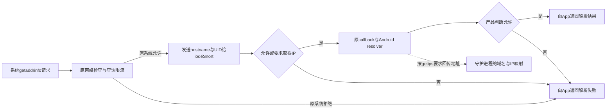

# iodé DNS参考：系统组件替换与组件职责

2026-10-04。承接[libnetd讨论](2026-10-03_LIBNETD_HOOK_DESIGN_DISCUSSION.md)和[跨版本源码核查](2026-10-03_LIBNETD_CROSS_VERSION_STABILITY.md)。这是研究与产品方向记录，不是实施、模块安装或设备验收。

## 用户明确的范围

修改resolver源码，再由KSU／Magisk将编译后的库挂到系统加载位置，仍属于系统组件替换；systemless只说明不直接改原分区。适配层可以让源码维护集中，但不能把整库加载变成一个受支持的动态callback注册操作。

部署方案先记录、继续研究，没有选定最终安装方式。此前晚挂小hook和App侧Xposed是阶段候选。用户允许App后台防护正常就绪后才启用政策；这不代表已解决替换库在系统启动阶段的加载问题。

用户补充系统DNS方向参考iodéOS开源的iodéSnort与相关组件，要求子代理调查实际实现。本项目已确认的VPN DNS路线仍是HEV原owner＋小型DNS模块＋同Mbed TLS完整能力＋c-ares有限报文／缓存改造，不引入新Rust运行时，不加入自身上游DoQ。

## 上游身份与研究证据

官方[About页](https://iode.tech/about/)把Source Code指向自有GitLab；[2024年机制说明](https://blog.iode.tech/how-does-the-iode-blocker-work/)描述在系统发送DNS前获取请求，并明确App自带DoH不在这种系统解析拦截范围。宣传中的MITM字样不作为TLS解密、完整覆盖或实际IPC行为的证据。

两席已经完成固定源码核查，主代理阅读全文并复核核心入口、消费者、缓存分工与启动配置：

- [系统DNS集成研究](2026-10-04_IODE_DNS_SYSTEM_INTEGRATION_RESEARCH.md)。
- [相关组件与DNS职责研究](2026-10-04_IODE_COMPONENTS_DNS_RESEARCH.md)。

研究只读取官方上游源码与文档，不安装模块、编译系统或操作设备。外部组件机制用于调查；产品包域仍遵守[ADR-0008](../adr/0008-remove-snort-cpp-mainline.md)，不恢复被删除的Snort C++主线或直接导入上游实现。

## 已核实的核心组件

| 官方组件／本轮固定源码 | DNS相关职责 |
| --- | --- |
| `packages/modules/DnsResolver`，`v7-staging`，`8cc3ff9369c49107a030ea9ed17cedf7816db342` | 在`GetAddrInfoHandler`加入与守护进程的同步通信；允许继续解析时仍调用原callback与resolver。[解析入口][R1] |
| `blocker/iode-snort`，`staging`，`5fc8fabc9f49587bf59a4a687f76ee4f6d15a1b9` | 根据hostname与UID判断，接收解析所得IP、维护地址映射与统计；系统守护进程通过init启动。[consumer][R2]、[启动配置][R3] |
| `blocker/iode`，`main`，`86a593ae35fd46a8ef0482b64a435dc9da2f8992` | 展示统计与设置防护；README明确依赖iodéOS，不是可单装到其他ROM的通用DNS应用。[App说明][R4] |

这些是调查时固定的分支快照，不是本轮重建或验证的正式发布组合。官方说明将iodéOS7映射到Android16／LineageOS23，完整manifest、系统集成和其他相关组件见两份专项报告。[版本说明][R5]

### 其他关联组件的职责

固定`v7-staging` manifest为`48e5b5689047e9077523f98b23efa5d838a13d2a`，使用Android16r4／Lineage23.2，重定向iodé的DnsResolver fork；`system/netd`本身仍从Lineage取得。其他系统依赖包括vendor打包、init和SELinux的domain／socket权限，详见[系统集成报告](2026-10-04_IODE_DNS_SYSTEM_INTEGRATION_RESEARCH.md)。

Framework的相关补丁是TOPACTIVITY控制通知，并非本次DNS请求的UID来源；DNS源码直接从请求socket取UID。App相关的`iode_utils`是设备／应用辅助插件，不是DNS客户端；control和DNSSTREAM分别承担配置与事件读取，详见[组件报告](2026-10-04_IODE_COMPONENTS_DNS_RESEARCH.md)。因此这些仓库应按实际职责参考，不把全部配套补丁归作DNS hook。

## 实际DNS通路

以下描述完成判定交互的正常分支；故障与未就绪行为见后文。

固定入口通过`/dev/socket/iode-snort-netd`发送名字长度、hostname及请求socket的UID，同步读取`verdict`与`getips`。DNS协议没有逐请求netId、query type、RR TTL或DNS wire响应字段。[R1][R1]、[R2][R2]

`getips`为允许或启用取得被拒域名IP的设置；它要求Android原resolver取得地址后回传family和IPv4／IPv6。它不是守护进程返回已缓存DNS答案，也不绕过Android缓存。启用取得被拒域名IP时，某些请求会先完成原解析、回传地址，再丢弃给App的结果并返回`EAI_NODATA`；因此不能概括为所有被拒请求都不会发往上游。[R1][R1]、[R2][R2]

此处RPC加入的是解析handler，不是前轮`evaluate_domain_name` callback内部；允许解析时保留原callback链。前轮回调不sleep／RPC的合同不能直接当作对iodé另一接点的判定，也不能据此允许把同步RPC搬进本项目的callback。

同一固定文件的raw请求、gethostbyname和反向解析没有这段iodéSnort事务；已确认的是getaddrinfo接点。它们是否最终由另一条包层政策阻断要另取证，不能由NFQUEUE存在补成同样的DNS前置覆盖。[入口覆盖证据](2026-10-04_IODE_DNS_SYSTEM_INTEGRATION_RESEARCH.md#真实入口覆盖边界)

## 原resolver缓存、地址映射与上游不是同一职责

Android原resolver仍负责实际lookup、自己的缓存和系统支持的上游传输。iodéSnort接收的是解析所得地址；`Domain::validIP`依据保存时间与`settings.maxAgeIP`，不是RR TTL、负缓存SOA或DoH HTTP Age。因此其域名／IP映射不能当作本项目VPN完整DNS响应缓存的实现。[地址有效期][R6]

守护进程构建依赖为NFQUEUE／netlink及Android基础库；调查所得DNS职责是判定、地址关联与记录，不是在daemon里建立一个完整DoT／DoH客户端。App具有HTTP依赖也不能作为其实现DNS加密上游的证据。[daemon构建][R7]、[App依赖][R8]

## ROM集成与模块替换的差距

上游README把iodéSnort定义为iodéOS系统部分，构建放在`system_ext`并带init配置；启动定义提供control stream和netd seqpacket socket，在early-boot启用daemon。App同样声明依赖该系统。这是相互配合的ROM集成证据，不是已验证的跨ROM KSU／Magisk单库替换发行。[系统定位][R9]、[R3][R3]、[R4][R4]

连接无法建立、且判断仍为默认允许时，会保留原解析路径；不能把这一点扩展成peer已连接但不响应也会自动超时。固定解析入口没有显式socket读写deadline；daemon初始化持独占锁、DNSconsumer需取得共享锁，监听socket存在不能单独证明政策判定已经就绪。[R1][R1]、[初始化][R10]、[R2][R2]

部分协议结果收到后再失败的最终结果也须按实际状态判断，不能统称所有IPC故障最终放行。本轮保留这些源码边界，没有观察到或宣称实际设备bootloop。

## 对本项目的取舍

可以借鉴系统名字／UID取得、原resolver与政策判定分工、解析地址补充包层观察、后台daemon与UI分离，以及源码中保留原系统检查的接法。系统补丁及相关权限／初始化仍须作为完整集成调查，不能只依据一个callback签名或一份公开源码宣布模块可通用。

不能直接复用的是上游整份C++daemon、其IP年龄策略作为DNS回答TTL缓存，以及按名字／UID协议推定已有完整逐请求网络事实。包含其他连接／网络条件的产品规则仍须按实际取得事实判断；现有VPP权威配置与只读DNS阶段投影建议没有被另一套上游规则引擎替代。

系统Root入口继续利用原Android resolver，VPN入口继续已确认的HEV／Mbed TLS／c-ares路线。源码参考已经具体到接点与组件，安装方式、同步判定或本地投影的最终取舍、版本支持范围仍继续研究；本轮没有实施、设备操作或模块部署。

[R1]: https://gitlab.iode.tech/os/public/lineage/packages_modules_DnsResolver/-/blob/8cc3ff9369c49107a030ea9ed17cedf7816db342/DnsProxyListener.cpp#L937
[R2]: https://gitlab.iode.tech/os/public/blocker/iode-snort/-/blob/5fc8fabc9f49587bf59a4a687f76ee4f6d15a1b9/src/DnsListener.cpp#L46
[R3]: https://gitlab.iode.tech/os/public/blocker/iode-snort/-/blob/5fc8fabc9f49587bf59a4a687f76ee4f6d15a1b9/iode-snort.rc
[R4]: https://gitlab.iode.tech/os/public/blocker/iode/-/blob/86a593ae35fd46a8ef0482b64a435dc9da2f8992/README.md
[R5]: https://blog.iode.tech/fr/iodeos-7-est-officiellement-disponible/
[R6]: https://gitlab.iode.tech/os/public/blocker/iode-snort/-/blob/5fc8fabc9f49587bf59a4a687f76ee4f6d15a1b9/src/Domain.cpp#L18
[R7]: https://gitlab.iode.tech/os/public/blocker/iode-snort/-/blob/5fc8fabc9f49587bf59a4a687f76ee4f6d15a1b9/Android.bp
[R8]: https://gitlab.iode.tech/os/public/blocker/iode/-/blob/86a593ae35fd46a8ef0482b64a435dc9da2f8992/pubspec.yaml
[R9]: https://gitlab.iode.tech/os/public/blocker/iode-snort/-/blob/5fc8fabc9f49587bf59a4a687f76ee4f6d15a1b9/README.md
[R10]: https://gitlab.iode.tech/os/public/blocker/iode-snort/-/blob/5fc8fabc9f49587bf59a4a687f76ee4f6d15a1b9/src/iode-snort.cpp#L49
