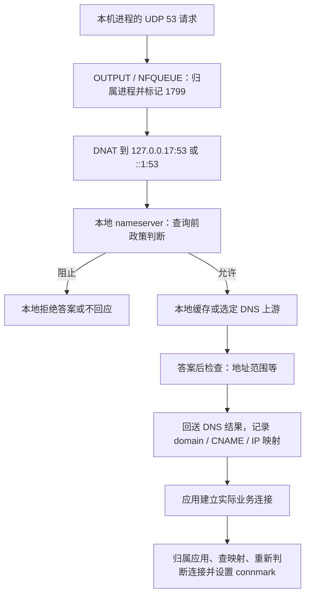

# Linux Portmaster：DNS 过滤原理与限制

研究日期：2026-10-05。用户已确认参考项目为 Safing **Portmaster**；本文只研究它在 Linux 本机的工作原理与限制。
这是外部参考证据，不是 Sakamoto 已接受设计，不改变产品、ADR 或执行合同，也不导入参考代码。

## 证据范围

- 官方源码快照：[`13a86a43cc6cee592395fcddc8387178f290f144`](https://github.com/safing/portmaster/commit/13a86a43cc6cee592395fcddc8387178f290f144)，提交时间 2026-10-02。
- GitHub 当前 latest release 为 [v2.2.3](https://github.com/safing/portmaster/releases/tag/v2.2.3)，2026-08-14 发布，tag 解引用为 [`beafc821f6040c9ad502a6fdd8ed575b16f44070`](https://github.com/safing/portmaster/tree/beafc821f6040c9ad502a6fdd8ed575b16f44070)。
- 静态交叉核对该 release tag：UDP DNS DNAT、本地 UDP listener、eBPF connection listener、resolved Varlink 结果订阅、853／DNS resolver 列表防绕过均已存在。[release DNAT][R1]、[release listener][R2]、[release eBPF][R3]、[release monitor][R4]、[release bypass][R5]
- 以下细节以固定主干源码为准；没有安装 Portmaster、抓包、性能测试或发行版实机验收。
- 官方旧 docs 正在迁移；涉及链名、监听 IP、mDNS 优先级、归属实现时，以源码修正旧文字，而不把旧文档中的“未来计划”当现状。[OS integration][D1]、[Secure DNS][D2]

## 核心机制：本机 DNS 接管，加上连接防火墙

Portmaster 默认不是让其他设备配置 DNS 的网络服务。它在 Linux 主机安装 Netfilter 规则，把本机发出的普通 DNS 请求改送自己的本地 nameserver；默认 listener 只在 loopback，外部查询默认拒绝。源码挂的是 `INPUT`／`OUTPUT`，并非路由器的 `FORWARD` 链。官方另有实验性的 network service 设置，但它不是这里研究的默认路径。[规则][S1]、[listener][S2]、[外部查询检查][S3]、[settings][D3]

图是源码调用顺序的归纳，不表示所有解析入口都会经过查询前判断。[接管][S4]、[nameserver][S3]、[连接归属与映射][S5]

### 1. 透明接管为什么无需改应用 DNS 设置

1. IPv4／IPv6 的 `mangle OUTPUT`／`INPUT` 链恢复 `CONNMARK`；尚无决定的包进入 NFQUEUE。用户态取得进程信息、执行政策，再通过 NFQUEUE 返回带 mark 的 `NF_ACCEPT`，后续 `filter`／`nat` 规则真正完成放行、拒绝、丢弃或重定向。[Netfilter 规则][S1]、[NFQUEUE verdict][S6]
2. `filterHandler` 看到发往端口 53、目的不是自己的 nameserver、resolver 已启用的外发连接，给出 `RerouteToNameserver`，保存请求连接的进程信息；自身预授权上游先获得放行，避免回送环。[接管条件][S4]
3. mark `1799` 的 **UDP** 流在 `nat OUTPUT` 被 DNAT 到 `127.0.0.17:53`／`[::1]:53`；本地 nameserver 的 Linux 默认 `localhost:53` 实际解释为这两个地址，不是旧 settings 文档写的 `127.0.0.1`。[DNAT][S1]、[地址解析][S2]
4. 已决定的连接靠 connmark 在内核复用决定，正常后续包不必逐包跑完整用户态政策。DNS 请求和原进程的联系则通过先保存的请求连接与源地址／端口重新取回。[verdict marks][S6]、[DNSRequest 创建][S7]

nameserver 通过普通 UDP socket 写回答案；按上述 stateful DNAT 机制，内核 conntrack／NAT 负责回复方向的反向地址转换，让客户端仍看到原来请求的 DNS 端点。这是根据已确认规则与 Netfilter NAT 语义作出的链路解释，本轮未抓包验证。[写回答案][S13]、[Netfilter stateful NAT][D5]

这里的“透明”指接入方式：应用原本发往外部 DNS 的 UDP 包可以被本机接走。它并不表示完全保留原 DNS 服务器选择、报文、TTL 或所有 DNS 传输协议。[接管][S4]、[缓存清理][S8]

### 2. 查询过滤、缓存、加密上游各做什么

nameserver 将查询归属进程并取得 profile，然后先调用防火墙判断；被明确阻止的查询可以不发上游。允许时进入 resolver，先查缓存，再选择上游，得到答案后又调用 `FilterResolvedDNS`。缓存命中也发生在本轮查询前政策判断之后。[nameserver 顺序][S3]、[resolver cache][S9]

普通 DNS `Block` 默认返回 A=`0.0.0.17`／AAAA=`::17`，TTL 为 1 秒；非 A／AAAA 默认 NXDOMAIN。`Drop` 不回包；自定义 responder 可返回不同结果，例如 Firefox canary 特例 NXDOMAIN。因此“过滤”既可能是本地答案，也可能是超时，不应统一描述为 NXDOMAIN。[DNS verdict responder][S10]、[BlockIP][S11]、[canary][S12]

resolver 是本地转发解析器，向递归 DNS 上游请求答案，自身不是从 root／权威服务器递归解析。它有 UDP DNS、TCP DNS、DoT、DoH 后端；默认配置为 Cloudflare 的 DoT 端点。**自身支持上游 TCP／DoT／DoH，不等于能够透明接管应用发出的 TCP53／DoH。**[response 合同][S13]、[后端选择][S14]、[默认配置][S15]

DoT 使用 Go TLS 与 DNS TCP framing；DoH 将重新生成的 DNS wire query 放入 HTTPS GET 的 `dns=` 参数，以 TLS 验证上游。加密发生在 Portmaster 到上游这一段，不是对其他应用 TLS 连接解密。[DoT][S16]、[DoH][S17]

缓存保存域名＋QType 的答案／authority／additional 与 resolver 来源，复用前检查来源仍有效、当前 resolver 设置是否允许。近到期条目可异步刷新；失败时可能回退旧成功答案；另有显式 stale-cache 选项。源码将输出 RR TTL 统一改成 17 秒，而内部缓存通常以最低原 TTL、最小 60 秒与最大 24 小时计算，错误、空答案和连通性域名有特殊期限。它不是原答案 TTL 原样递减的纯转发缓存。[缓存键与内容][S8]、[cache 检查及回退][S9]、[cache 参数][S18]

答案过滤主要处理 A／AAAA：移除不合适的 local／LAN／Internet 地址，某些情况下所有有效地址被移除便阻止整个查询；直接对答案 IP 应用完整 endpoint 规则仍有 TODO。SVCB／HTTPS 中的地址 hints 已被采集用于映射，但答案地址范围过滤仍有明确 TODO，二者不能混为完整支持。[答案过滤][S19]、[映射采集][S20]

### 3. 真正连接还会再判断

解析成功不意味着业务连接自动放行。Portmaster 记录 `domain → A/AAAA IP`、CNAME 链等证据；应用向某个 IP 建立连接时，先确定进程，再找该 profile 的 IP 映射，找不到则尝试 global scope，选最近记录的域名，交给连接防火墙再次判断。[保存映射][S20]、[使用映射][S5]、[最近域名][S21]

因此它有两个独立控制机会：**查询时阻止解析**与**真实连接时阻止联网**。第二种能阻断由缓存、系统 resolver 或直接 IP 发起的连接，但只有存在可用域名证据时才能正确执行域名政策；进程／IP／端口规则的可用性不等于域名识别完整。[master 决策][S22]、[映射查询][S5]

## 限制：哪些前提不成立时，效果会下降

### 普通 UDP53 最清楚；TCP53 不是同样的透明路径

固定源码和 v2.2.3 都只提供 UDP nameserver listener 与 UDP mark-1799 DNAT。请求 handler 还只接受 `*net.UDPAddr`。接管条件却仅检查目的端口 53，没有 UDP 条件，所以 TCP53 可能同样被打 1799，而找不到对应的 TCP DNAT／本地 TCP 服务。**可以确认没有完整本地 TCP53 接管通路；具体失败、绕行或与其他规则交互的行为尚未抓包验证。**[接管条件][S4]、[UDP DNAT][S1]、[listener][S2]、[handler transport][S3]

大答案、截断后的 TCP 重试、明确使用 TCP 的客户端不能据此认定已覆盖。上游 `TCPResolver` 的存在只证明 Portmaster 自己能发 TCP 查询。[本地 listener][S2]、[上游 TCP][S16]

查询入口要求单个 IN question；重新生成上游查询时只持有 FQDN／QType，不是原始 query flags／EDNS 的完整透明转发。这里不据静态阅读宣称所有 DNSSEC 都不可用，但不能把它当作完整保真 DNS 代理。[nameserver 输入][S3]、[Query 结构][S18]、[DoH 构造][S17]

### 加密 DNS 防绕过依赖已知端点，无法普遍解密

默认防绕过功能的具体手段是：Firefox `use-application-dns.net` canary 返回 NXDOMAIN，封禁 853 端口，并按 `17-DNS` 列表识别公共 resolver；还限制未接管的 53 请求。它不是通用 HTTPS 内部 DNS 检测器。[防绕过代码][S12]、[默认设置][S23]

**推论**：应用若把 DoH 发到未在列表中的自建／新端点、非标准端口，或者经允许的代理／隧道发送 DNS，端口和端点列表不足以取得里面的查询域名。业务连接仍经过可见网络层的防火墙，但“防火墙存在”不能推成“所有域名过滤无法绕过”。[防绕过判断范围][S12]、[连接域名来源][S5]

### systemd-resolved／nscd／dnsmasq 会丢失原查询应用身份

如果应用自己发 UDP53，内核 socket 可以给出查询进程。应用若通过 D-Bus／本地 IPC 调用系统 resolver，外发 DNS socket 属于 resolver，不能仅凭此 socket 还原原调用 App。Portmaster 将若干路径的 `systemd-resolved`、`nscd`、`dnsmasq` 特别归为 System Resolver。[识别名单][S24]、[官方解释][D1]

系统 resolver 查询不会机械套用原 App 的政策。当前源码让它走特殊 endpoint 检查；专门 profile 的 filter list 为空，答案过滤也跳过部分应用级限制和 CNAME 检查。主要用 global 域名映射，让后续真实业务连接按应用再判断。不能概括成“所有 DNS 请求都在查询前按原 App 阻止”，也不能绝对说“系统 resolver 查询一概不过滤”。[特殊 endpoint][S25]、[System Resolver profile][S26]、[答案特例][S19]、[global 映射][S20]

当前已加入两种补充，旧文档没有完整反映：

- eBPF connection listener 从 connect 事件带 PID，辅助网络连接归属；NFQUEUE 仍承担包控制，`/proc` socket／PID 查找仍作后备。它辨认的是连接发起进程，不自动恢复跨 IPC 的 DNS 原调用者。[Linux interception][S27]、[eBPF worker][S28]、[PID 获取][S29]
- 有 `/run/systemd/resolve/io.systemd.Resolve.Monitor` 时，订阅 `SubscribeQueryResults`，读取 DNS 结果并保存 global scope 的 domain／IP／CNAME 记录。当前数据结构／处理路径没有原 App PID，也没有查询前 veto；socket 不存在或订阅失败时只有告警，不能把这个功能当所有 Linux 都有的保证。[monitor 实现][S30]、[启动处理][S31]

**推论**：其他本地 DNS forwarder／HTTP proxy／隧道进程同样会让外发 socket 归属中间进程；只有另有可验证调用者证据才可能还原原 App。不同进程名被识别成 System Resolver 的覆盖还是固定路径名单，不是任意代理自动识别。[进程名单][S24]、[DNSRequest 归属][S7]

### DNS 缓存和共享 IP，使域名归属成为推断

多个域名可共用 CDN／云主机 IP；相同 App 也可能先后查多个指向同一 IP 的域名。当前连接 lookup 选 `MostRecentDomain`，并不是连接本身证明的唯一域名。global scope 时不同应用的查询更可能相互影响。[IPInfo][S21]、[connection lookup][S5]

IP 归属证据的保留也与 DNS 答案有效期不同：IPInfo 数据库条目至少保留一天再加一小时，`MostRecentDomain` 不逐条校验 DNS TTL。应用 cache 命中／长连接复用时可能没有新查询；重新启动后缺少可见历史、连接使用固定 IP 时也可能没有映射。上述具体场景的错误率没有测试，但“DNS 看到 IP 就精确知道每条连接域名”不成立。[保留期][S21]、[lookup][S5]、[官方歧义说明][D1]

### 局域网、mDNS 与 split DNS 不是自动等同系统行为

Portmaster 自己选择解析范围：获取 NetworkManager D-Bus／`resolv.conf` 的 DNS 与 search scope；匹配 scope 的服务器优先，私有域名走局域网服务器，普通公网域名走配置服务器与符合设置的后备。这意味着它接管了服务器选择，不只是对原查询加一项否决。[Linux 环境发现][S32]、[NetworkManager][S33]、[scope 选择][S34]

当前 `.local` 等 multicast 域名先尝试 local／system 单播 DNS，再 mDNS；旧架构文字写“先 multicast”，顺序已不同。它有自己的 mDNS UDP5353 解析器；应用直接发出的 UDP5353 不属于 53 端口 DNAT 规则。[scope 顺序][S34]、[mDNS 后端][S35]、[53 接管][S4]

关闭系统／网络 DNS、关闭 mDNS或仅允许安全协议，都会减少本地域名／设备发现的解析机会。企业 split DNS、特定 VPN 的每接口 DNS／路由域／私有 search scope 是否完全等价，要看信息是否被发现及连接能否到达；本轮只证明它有范围选择机制，不证明任意 Linux resolver 配置都能无损重现。[compliance][S34]、[环境发现][S32]、[官方设置限制][D2]

当前源码的安全协议／系统服务器 compliance 检查没有统一豁免连通性域名；旧官方说明中的连通性“总能忽略这些设置”不能直接照搬。实际 captive portal 行为需要按具体配置验证。[scope／compliance][S34]

### Linux 防火墙、VPN、端口占用与生命周期

这条接入路线需要系统级网络权限。项目附带的 systemd 服务授予 `CAP_NET_ADMIN`、`CAP_NET_BIND_SERVICE` 等能力，并明确声明 `Conflicts=firewalld.service`；因此默认打包服务不能被当成与 firewalld 并行运行的兼容承诺。[Linux service][S37]

官方说明 DNS 双方重定向是 Linux VPN 共存冲突来源；源码还依赖自己的 iptables 链顺序、packet／connmark 和 conntrack。当前版本已增加保存其他工具 packet mark 的特定规则，普通允许多数使用 `RETURN` 让后续防火墙继续判断，但仍不能承诺与任意 firewall／VPN 规则共存。[VPN docs][D4]、[当前规则][S1]

默认 listener 占用 `127.0.0.17:53`／`::1:53`；别的 DNS 软件绑定同地址或 wildcard 53 时可能失败，源码有冲突进程识别与通知。规则只在所在网络栈的 INPUT／OUTPUT 挂接，因此**推论**是它不自动覆盖其他 network namespace、转发的容器流量或整个 LAN。[listener 与冲突][S2]、[挂接链][S1]

conntrack 决定需要与生命周期一起看：启用时源码删除 Portmaster 标记连接，也删除非 loopback 的 mark=0 旧连接，注释明确这会使已有连接断开／重连；停止时删除规则与已标记 conntrack 状态。规则中虽然有 `--queue-bypass`，filter 链又对 mark=0 DROP，不能仅凭前者宣称守护进程异常退出总会 fail-open。[启停行为][S1]、[conntrack 清理][S36]

## 可用于后续 Linux 讨论的结论

Portmaster 证明了一条已实现的本机路线：**在本机 Netfilter 接走普通 UDP DNS，由本地 resolver 判断与解析，再把域名证据送给连接防火墙**。它不需要先把其他设备 DNS 改指向本机。[接管][S4]、[默认规则][S1]、[nameserver][S3]

讨论这种路线时要保留三个边界：UDP53 接管覆盖范围；查询时的原应用身份是否已知；DNS→IP 证据是否足以判断真实连接。加密 DNS 防绕过、系统 resolver、共享 IP 和其他网络软件会分别削弱这些前提。本文不将 Portmaster 的后端、缓存语义或 split DNS 细节直接变成我们的实现要求。

附注：CNAME 查询后过滤存在待验证的静态时序疑点。新 DNSRequest 以 `CNAME=nil` 创建，`FilterResolvedDNS` 先调用 CNAME 检查，而给当前 entity 填入本次 CNAME 的 `UpdateIPsAndCNAMEs` 在 deferred 保存路径才执行。后续业务连接仍可读取已保存的 CNAME；本轮不把前者宣称为已复现缺陷或“所有 CNAME 过滤失效”。[创建][S7]、[过滤／defer 顺序][S3]、[CNAME 检查及赋值][S19]、[后续连接][S5]

[D1]: https://docs.safing.io/portmaster/architecture/os-integration
[D2]: https://docs.safing.io/portmaster/architecture/core-service/secure-dns/
[D3]: https://docs.safing.io/portmaster/settings#corenetworkservice
[D4]: https://docs.safing.io/portmaster/install/status/vpn-compatibility
[D5]: https://wiki.nftables.org/wiki-nftables/index.php/Performing_Network_Address_Translation_(NAT)
[R1]: https://github.com/safing/portmaster/blob/beafc821f6040c9ad502a6fdd8ed575b16f44070/service/firewall/interception/nfqueue_linux.go#L91
[R2]: https://github.com/safing/portmaster/blob/beafc821f6040c9ad502a6fdd8ed575b16f44070/service/nameserver/module.go#L120
[R3]: https://github.com/safing/portmaster/blob/beafc821f6040c9ad502a6fdd8ed575b16f44070/service/firewall/interception/interception_linux.go#L24
[R4]: https://github.com/safing/portmaster/blob/beafc821f6040c9ad502a6fdd8ed575b16f44070/service/firewall/interception/dnsmonitor/eventlistener_linux.go#L61
[R5]: https://github.com/safing/portmaster/blob/beafc821f6040c9ad502a6fdd8ed575b16f44070/service/firewall/bypassing.go#L68
[S1]: https://github.com/safing/portmaster/blob/13a86a43cc6cee592395fcddc8387178f290f144/service/firewall/interception/nfqueue_linux.go#L51
[S2]: https://github.com/safing/portmaster/blob/13a86a43cc6cee592395fcddc8387178f290f144/service/nameserver/module.go#L118
[S3]: https://github.com/safing/portmaster/blob/13a86a43cc6cee592395fcddc8387178f290f144/service/nameserver/nameserver.go#L36
[S4]: https://github.com/safing/portmaster/blob/13a86a43cc6cee592395fcddc8387178f290f144/service/firewall/packet_handler.go#L478
[S5]: https://github.com/safing/portmaster/blob/13a86a43cc6cee592395fcddc8387178f290f144/service/network/connection.go#L561
[S6]: https://github.com/safing/portmaster/blob/13a86a43cc6cee592395fcddc8387178f290f144/service/firewall/interception/nfq/packet.go#L20
[S7]: https://github.com/safing/portmaster/blob/13a86a43cc6cee592395fcddc8387178f290f144/service/network/connection.go#L295
[S8]: https://github.com/safing/portmaster/blob/13a86a43cc6cee592395fcddc8387178f290f144/service/resolver/rrcache.go#L16
[S9]: https://github.com/safing/portmaster/blob/13a86a43cc6cee592395fcddc8387178f290f144/service/resolver/resolve.go#L166
[S10]: https://github.com/safing/portmaster/blob/13a86a43cc6cee592395fcddc8387178f290f144/service/network/dns.go#L210
[S11]: https://github.com/safing/portmaster/blob/13a86a43cc6cee592395fcddc8387178f290f144/service/nameserver/nsutil/nsutil.go#L53
[S12]: https://github.com/safing/portmaster/blob/13a86a43cc6cee592395fcddc8387178f290f144/service/firewall/bypassing.go#L14
[S13]: https://github.com/safing/portmaster/blob/13a86a43cc6cee592395fcddc8387178f290f144/service/nameserver/response.go#L30
[S14]: https://github.com/safing/portmaster/blob/13a86a43cc6cee592395fcddc8387178f290f144/service/resolver/resolvers.go#L84
[S15]: https://github.com/safing/portmaster/blob/13a86a43cc6cee592395fcddc8387178f290f144/service/resolver/config.go#L32
[S16]: https://github.com/safing/portmaster/blob/13a86a43cc6cee592395fcddc8387178f290f144/service/resolver/resolver-tcp.go#L87
[S17]: https://github.com/safing/portmaster/blob/13a86a43cc6cee592395fcddc8387178f290f144/service/resolver/resolver-https.go#L59
[S18]: https://github.com/safing/portmaster/blob/13a86a43cc6cee592395fcddc8387178f290f144/service/resolver/resolve.go#L66
[S19]: https://github.com/safing/portmaster/blob/13a86a43cc6cee592395fcddc8387178f290f144/service/firewall/dns.go#L19
[S20]: https://github.com/safing/portmaster/blob/13a86a43cc6cee592395fcddc8387178f290f144/service/firewall/dns.go#L230
[S21]: https://github.com/safing/portmaster/blob/13a86a43cc6cee592395fcddc8387178f290f144/service/resolver/ipinfo.go#L138
[S22]: https://github.com/safing/portmaster/blob/13a86a43cc6cee592395fcddc8387178f290f144/service/firewall/master.go#L31
[S23]: https://github.com/safing/portmaster/blob/13a86a43cc6cee592395fcddc8387178f290f144/service/profile/config.go#L661
[S24]: https://github.com/safing/portmaster/blob/13a86a43cc6cee592395fcddc8387178f290f144/service/process/profile.go#L91
[S25]: https://github.com/safing/portmaster/blob/13a86a43cc6cee592395fcddc8387178f290f144/service/firewall/master.go#L203
[S26]: https://github.com/safing/portmaster/blob/13a86a43cc6cee592395fcddc8387178f290f144/service/profile/special.go#L200
[S27]: https://github.com/safing/portmaster/blob/13a86a43cc6cee592395fcddc8387178f290f144/service/firewall/interception/interception_linux.go#L15
[S28]: https://github.com/safing/portmaster/blob/13a86a43cc6cee592395fcddc8387178f290f144/service/firewall/interception/ebpf/connection_listener/worker.go#L28
[S29]: https://github.com/safing/portmaster/blob/13a86a43cc6cee592395fcddc8387178f290f144/service/process/find.go#L66
[S30]: https://github.com/safing/portmaster/blob/13a86a43cc6cee592395fcddc8387178f290f144/service/firewall/interception/dnsmonitor/eventlistener_linux.go#L26
[S31]: https://github.com/safing/portmaster/blob/13a86a43cc6cee592395fcddc8387178f290f144/service/firewall/interception/dnsmonitor/module.go#L37
[S32]: https://github.com/safing/portmaster/blob/13a86a43cc6cee592395fcddc8387178f290f144/service/netenv/environment_linux.go#L155
[S33]: https://github.com/safing/portmaster/blob/13a86a43cc6cee592395fcddc8387178f290f144/service/netenv/dbus_linux.go#L81
[S34]: https://github.com/safing/portmaster/blob/13a86a43cc6cee592395fcddc8387178f290f144/service/resolver/scopes.go#L163
[S35]: https://github.com/safing/portmaster/blob/13a86a43cc6cee592395fcddc8387178f290f144/service/resolver/resolver-mdns.go#L290
[S36]: https://github.com/safing/portmaster/blob/13a86a43cc6cee592395fcddc8387178f290f144/service/firewall/interception/nfq/conntrack.go#L36
[S37]: https://github.com/safing/portmaster/blob/13a86a43cc6cee592395fcddc8387178f290f144/packaging/linux/portmaster.service#L1
