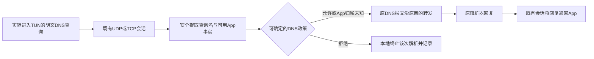

# VPN DNS一期：域名请求过滤

2026-10-05。本轮用户指出此前讨论扩成了全功能DNS代理，明确一期主要过滤相关域名请求，**自建DNS响应缓存与DoT／DoH可以延后二期或增强**。本文按最新范围收窄；先前缓存／加密转发方案保留为[后续研究](2026-10-03_HEV_DNS_REUSE_AND_CARES_FORK_RESEARCH.md)，不再作为一期前提。
本轮只改讨论文档，没有修改产品、正式ADR/API、模块或设备。

## 当前确认与保留范围

| 内容 | 一期范围 |
| --- | --- |
| 目的 | 对实际可见的DNS域名请求做政策判断与记录 |
| 允许 | 沿现有VPN转发通路发往原解析器，保留DNS报文与正常回复 |
| 拒绝 | 在请求转发前终止该次解析；本地拒绝结果的具体形式继续定义 |
| 自建响应cache／加密上游 | 用户明确允许延后二期／增强；一期不要求它们 |
| HEV与调度 | 复用原owner与已有UDP／TCP传输，不为过滤另建运行时或完整resolver |
| App归属未知 | 已确认先允许解析，不等待识别；后续业务连接按实际事实控制 |
| 固定DNS服务地址 | 用户曾认可这种入口；具体一期使用方式未定，不能让入口地址自动引入cache／加密客户端或换公网解析器 |

本稿没有Fake-IP业务地址方案。推迟新增TLS客户端不影响既有TLS／QUIC SNI解析所需的加密原语，也不要求关闭Android原本已有的Private DNS；加密连接中看不到的QNAME按实际能力记录。

## 过滤放在已有转发路径中

一期新增的是有限的名字读取、政策调用、记录和拒绝接点。允许查询不经getaddrinfo重造A／AAAA，也不缓存或重新序列化整份上游回答；已有传输继续处理收发与生命周期。

参考思路见[纯过滤源码核查](2026-10-05_VPN_DNS_FILTER_ONLY_REFERENCES.md)：DNS66提供查询侧检查后转发的例子；NetGuard提供回复侧过滤的例子。二者过滤位置不同，不能把“改变回复”当成“查询没有发往上游”。这里只借鉴接点与职责，不导入它们的实现或承诺其全部覆盖。

## 最少仍需处理的接点

1. **读名字和调用政策。** 保留完整规则与例外含义；仅在当前事实足以确定时作DNS拒绝。QNAME是新的DNS事实，不伪装成TLS／QUIC SNI；DNS服务器IP／53端口不是后续业务连接的目标IP／端口。
2. **放行保持原路径。** 保留原报文、原选定解析器与正常响应，不因广告过滤把内网查询统一送到公共服务。
3. **拒绝能闭合当前查询。** 明确拒绝与仅丢包是不同体验；拒绝码继续比较，不在本轮直接复制参考项目的结果。原包层DROP也不自动等于已经生成DNS应答。
4. **UDP与TCP分别核查。** UDP按datagram，TCP按已有流中的完整DNS帧处理；复用现有TCP传输，不能用只支持UDP的参考宣布TCP过滤已完成。

报文解析与在途状态仍要有界。这些是已有转发上接过滤的正确性责任，不要求增加上游递归解析、响应cache、HTTP/TLS客户端或完整mDNS服务。

当前[正式规则规格](../product/UNIFIED_RULE_ENGINE_SPEC.md#3-conditions-and-availability)的Domain字段仍是SNI，且[独立DNS过滤此前不在该版本范围](../product/UNIFIED_RULE_ENGINE_SPEC.md#out-of-scope)。用户新方向进入后续扩展，具体DNS事实／动作与统一规则接入在讨论明确后更新正式合同，不新增第二份可编辑的规则引擎。

## DNS地址是入口配置，不是新的解析系统

若配置原网络DNS服务器地址，实际进入TUN的DNS可沿原目的转发；VPN的DNS地址／路由仍需明确配置并验证，不能仅清空addDnsServer就保证系统查询进入TUN。[Android Builder](https://developer.android.com/reference/android/net/VpnService.Builder#addDnsServer(java.net.InetAddress))

此前认可的固定地址也可以只作为入口别名，转到原网络解析器，不必改变回答地址或使用新的公网解析器。地址到原解析器的选择／映射仍需定义；它是可保留的入口方案，不是必须先建完整DNS代理的理由。[固定入口与原目的的参考](2026-10-05_VPN_DNS_FILTER_ONLY_REFERENCES.md)

一期建议优先最少改变现有解析行为的接法。原解析器选择和网络切换仍沿已有平台／underlay合同，不在DNS过滤模块另做复杂的发现、主备排名或split DNS系统。

## mDNS与内网：先保持原行为

内网单播DNS首先保留原网络解析器和请求／回复，过滤只在实际可见、可确定的域名请求上介入。名字是否以.local结尾、DNS服务器是否私有IP，都不能单独当作完整分流政策。

mDNS／5353先按既有局域网发现路径处理，不送公共DNS，也不因一期域名过滤要求实现完整mDNS代理。其VPN兼容问题按现有本地网络转发与接口范围核查；“保持原行为”是设计目标，不等于已证明所有多播查询／答复兼容。[mDNS作用域](https://www.rfc-editor.org/rfc/rfc6762)

这两类确实还要讨论，但问题现在收窄为如何避免过滤接点破坏原行为。此前为了公共加密上游而推演的内网分流和本地DNS服务扩展，不再都是一期必须承担的功能。

## 归属与观察

原请求App可靠时采用它的有效政策；未知时按用户确认先允许，不等待UID结果，不用前台App或系统解析UID冒充业务App。[平台限制](2026-10-03_VPN_DNS_RELAY_DISCUSSION.md#应用归属与后续需要决定的事)

记录区分查询已看见、政策拒绝、查询已转发与上游实际回复；允许解析不是业务连接的永久许可。原系统／App已有DNScache、原策略匹配cache与Flow状态继续存在，延期的仅是产品自己新增的DNS回答cache。

## 二期／增强的边界

需要时再把过滤后的查询接入产品自己的TTL回答cache和DoT／DoH传输。届时才增加完整响应缓存键、负cache、HTTP Age、证书／bootstrap、加密主备等相应责任；沿已研究的HEV／同Mbed TLS／c-ares方向继续验证，不提前算成一期工作。

一期现在应先把“读名字→判定→允许原转发／拒绝→准确记录”闭合。拒绝应答、TCP接点、DNS入口配置与实际覆盖继续细化；本轮没有完成实施或设备验收，也没有扩大现有VPN转发兼容声明。
