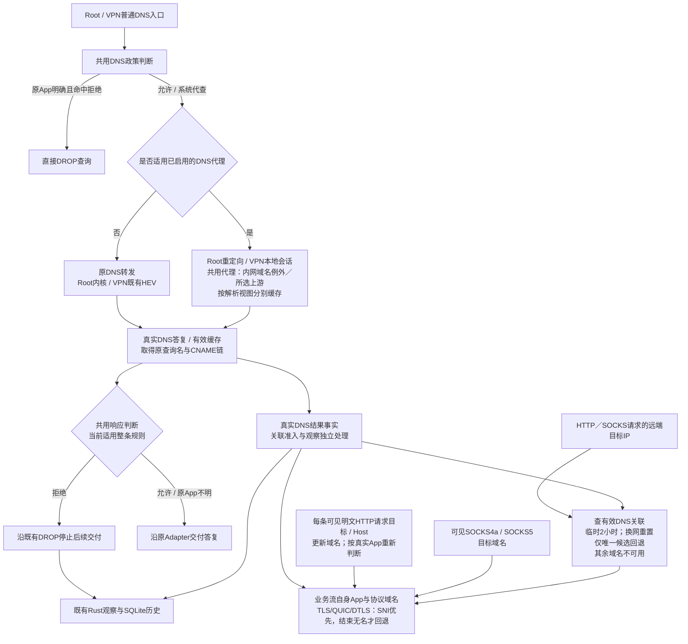

# VPP 参考 fork 的 DNS 能力核对

2026-10-05。有限静态源码核对；未构建、运行或抓包，也未导入参考代码。
用户目标是各平台 DNS 过滤开箱即用，不要求用户手动修改 DNS／浏览器／其他设备网络配置；过滤须在实际业务 IP 连接前产生实质效果。本轮继续 Linux 讨论。
源码核对部分是外部参考证据，不是产品已经具备该功能的声明；末尾另记录DNS处理位置的架构讨论，用户认可范围按章节标明，不将参考实现直接变成产品代码或验收事实。

**2026-10-07正式设计更新：** [ADR-0011](../adr/0011-application-dns-filtering-root-and-vpn.md)已确认Root/NFQ与VPN采用统一按应用DNS过滤，结合可归属查询的前置判断与后续业务连接判断。本稿10-05对“规格仍排除独立DNS过滤／关联”的描述保留为当时状态，当前设计范围以该ADR为准；源码集成与验收状态未因此改变。

**同日首版范围更新：** Root/NFQ与VPN共用DNS核心是首版实现范围；KSU/libnetd作为未来扩展，当前不实现。下文三入口复用描述保留为长期职责设计，具体首版模块方案见[首版范围与模块草图](#2026-10-07首版范围与模块草图)。

## 结论先行

**参考 fork 不只有 DNS 解析。** 它有 `stellar-dns-decoder → stellar-scanner → stellar-security-enforcer`：提取 QNAME，用域名对象匹配安全规则，执行 DNS 包丢弃或生成／替换 DNS 答复。
这些动作直接作用于 DNS 查询或 DNS 响应，并不必须等后续业务 IP 连接出现。准确区别是：`build` 模式可在查询包阶段答复；默认 `modify` 模式等 DNS 响应再改写。另有直接 drop 子动作。[feature 顺序][F1]、[QNAME 扫描][F2]、[DNS 执行][F3]、[默认模式][F4]

**标准 VPP 的 `src/plugins/dns` 是另一套 caching resolver，不能与上述过滤链混称。当前 Sakamoto Product 也没有接入这些 fork DNS 组件或标准 DNS plugin。**[标准功能说明][U1]、[当前 plugin 配置][P1]

## 源码身份与范围

| 项目 | 核对对象 |
| --- | --- |
| 外部参考 fork | `/home/js/backup/backup/Git/vpp` |
| fork HEAD | `837432be3b6cf496755cfa27b7cca439734eb726`，2026-04-07 |
| dirty 状态 | 77 路径：65 删除、1 修改、11 未跟踪；本报告所读 DNS decoder／scanner／enforcer／dns／proxy 目录没有 dirty 路径 |
| 适用 AGENTS | 外部路径祖先及相关源码子目录未发现 `AGENTS.md`；遵守当前项目研究边界 |
| 当前产品 VPP pin | `9258530f3804a152578ce11cc7c8a1e9eab88ed0`，与外部 fork 不同。[pin][P2] |
| 标准 VPP 静态对照 | 当前 pin 的干净 checkout `build-output/pinned-vpp-clean/src/plugins/dns` |

本次只读外部 VPP C 主线和当前产品合同／构建信息；未读取本仓已删除／归档 Snort C++ 来源。

## 1. decoder：提供 DNS 事实，本身不作域名允许／拒绝

`stellar_dns_decoder` 挂在 TCP／UDP session feature arc。默认关注 53 与 5353 源／目的端口；UDP 使用 L4 payload，TCP使用 session 提供的 segment 与 DNS长度字段处理。解析结果作为 packet exdata 写入 buffer，并设置 DNS 协议 tag。[decoder 输入与结果][F5]、[默认端口][F6]

解析器解压 question QNAME，保存 QType／QClass、transaction ID、query／response flag 与 RR 信息。这一层的成功解析、计数和日志不是过滤结果；真正控制在后续 scanner／enforcer。[QNAME 解码][F7]、[decoder 节点][F5]

## 2. scanner：QNAME 进入真实规则匹配，不只是日志字段

`FIELD_SCHEMA_DNS_QNAME` 的 schema 明确是 `scan_name="DNS_QNAME"`、`object_table_name="FQDN_OBJECT"`。`scanner_scan_dns_fields` 对解析到的 QNAME 创建 string field，交给 `scanner_scan_fields`，再调用 `maat_scan_string` 更新规则状态。[schema][F8]、[字段提交][F2]、[maat 调用][F9]

这个扫描发生在处理当前 DNS message 时，查询与响应均有路径，不是先收集 DNS→IP 再等业务连接匹配。执行器从当前 session 的 scan state 编译最高优先级 `SECURITY_RULE`，分支支持 Allow／Deny。[DNS 扫描时机][F2]、[执行规则选择][F10]

仓库内 `diagnose_rule.json` 有可审查的示例：`DNS_QNAME` 对象条件，加 `action="deny"`，子动作 `respond` 配 `dns_record_set`，或 `drop` 配 `after_n_packets=0`。这是配置样例，不是本次运行成功证据。[QNAME→respond 示例][F11]、[QNAME→drop 示例][F12]

因此可以确认“QNAME 规则＋DNS 处理动作”的源码闭包；本轮没有把外部 `maat` 的所有匹配语义、订阅黑名单更新或通配规则当作已验证。

## 3. enforcer：查询丢弃、即时答复、响应改写分开看

### 直接 drop

命中 Deny 后，`RULE_SUB_ACTION_DROP` 调用 `security_enforcer_enforce_drop`。满足延迟包数条件即给当前 buffer 打 DROP tag，并设 session drop；`after_n_packets=0` 不要求先等业务 IP 连接。[动作分派][F13]、[drop 执行][F14]

在普通 UDP DNS 查询已完整解码、QNAME规则命中的前提下，这是查询本身被阻止。TCP可能先经过握手和早期片段，本报告不宣称任何 TCP 字节都不会先转发；该控制机会仍早于借助此解析结果建立后续业务连接。[decoder 输入][F5]、[drop][F14]

### respond／DNS redirect

`security_enforcer_enforce_respond` 检测当前 buffer 有 DNS message 后进入 `security_enforcer_enforce_dns_redirect`。它有明确 query／response gating：[执行入口][F3]

| generate 模式 | 条件 | 动作时点 |
| --- | --- | --- |
| `build` | DNS `QR=0` | 当前查询包阶段，丢弃原包并生成 S2C DNS 答复 |
| `modify` | DNS `QR=1` | 等原 DNS 响应进入链，再丢弃／替换响应 |

模式可由启动配置 `generate-packet-mode` 选择；`security_enforcer_new` 默认 `modify`，不能把“有 build 分支”写成默认总在发上游前拒绝。[mode 解析][F15]、[条件与生成][F3]、[默认值][F4]

答复复用 transaction ID与 question，根据 `DNS_RECORD_SET` profile 生成 A／AAAA／CNAME／TXT与TTL；无适用答案时使用配置的 fallback RCODE。配置解析接受 `fallback`，诊断样例为 REFUSED。之后构造 S2C UDP／TCP包并安排发送，原包标为DROP。[答复内容][F3]、[record-set 解析][F16]、[配置样例][F17]

所以它不是只有IP封锁，也不是仅静默drop；确有DNS协议答复处理。生成器、注入路径与TCP答复正确性没有实测，不能据此承诺完整RFC行为或直接复用源码。

## 4. 缓存、上游加密与应用身份：已确认和未确认

`stellar_dns_decoder` 的 `cache_ptr/cache_sz` 是TCP长度前缀的暂存，scanner的transaction状态是观察／规则状态；本轮没有找到这条QNAME过滤链提供普通resolver答案cache＋递归／转发上游的闭包。`DNS_RECORD_SET` 是配置答复模板，不是从上游保存答案的cache。[TCP暂存][F5]、[模板解析][F16]

fork还有独立 `stellar_proxy/manipulation/http_proxy_doh.c`：对进入HTTP proxy的DoH DNS wire数据提取 `DOH_QNAME`，匹配 `FQDN_OBJECT`并可生成替换答复；解码失败、非A／AAAA、没有适用答案等有PASSTHROUGH分支。入口有GET `dns=`与POST数据处理分支，不能只把它归为识别／日志功能。[DoH匹配][F18]、[答复与范围][F19]、[HTTP入口][E1]

追加TLS路径核对（2026-10-05）：**源码有TLS中间人终止→HTTP／DoH解析→规则与答复操纵的实现，但需要客户端接受代理签发的证书，且不能从存在实现推为默认启用。**

| 环节 | 静态证据与限制 |
| --- | --- |
| 两段TLS | proxy向真实服务端发起TLS连接，随后在客户端一侧作为TLS服务端接受握手；它是两段TLS终止，不是被动解密任意密文。[TLS两端][E2] |
| CA与叶证书 | key keeper以原服务器证书为基础，从本地CA或keyring profile取CA／私钥生成替代叶证书；`ssl_x509_forge`复制subject、设置CA issuer与`CA:FALSE`并用CA私钥签名。[key keeper][E3]、[签发][E4] |
| 明文处理链 | 成功握手后的TLS bufferevent进入连接读回调与HTTP decoder，HTTP session事件调用注册的DoH插件，才能读取内部DNS QNAME。[握手后连接][E5]、[HTTP事件][E6]、[DoH注册][E7] |
| 信任／pinning | **推论**：正常验证的客户端必须已信任此CA／证书，或有其他可验证的接受条件；代码确有Certificate Not Installed、Certificate Pinning、Mutual Authentication、Protocol Errors等可配置透传分支。关闭透传也不能令一个拒绝代理证书的客户端自动信任它。[旁路条件][E8] |
| 默认配置状态 | VPP plugin的cfg由`calloc`／`memset`置零，默认函数没有给`doh_proxy_enable`赋true，当前自有源码也未找到它的配置赋值入口；生产初始化读取该bool，DoH callback在false时直接返回。测试main则显式传true。故这里只确认存在代码路径，不声明默认已启用。[cfg初始化][E9]、[生产入口][E10]、[enable检查][E1]、[测试入口][E11] |
| HTTP版本 | 有`h2` ALPN与独立HTTP2 decoder，不能说仅HTTP1；本轮没有确认HTTP3／QUIC DoH处理链或完整HTTP2 DoH验收。[ALPN][E12]、[HTTP2初始化][E10] |

全fork自有源码有限检索没有确认专门DoT／DoQ的查询域名过滤／DNS上游客户端闭包；vendor协议识别或通用TLS能力不能代替它。普通DNS decoder也没有因此获得解密任意DoH／DoT的能力。

**处理别的应用加密DNS，与我们的resolver自己用DoT／DoH请求上游，是两件事。** 上述实现是HTTPS代理中的DoH操纵，未证明已经有可直接给本机过滤器使用的加密DNS上游client＋cache，也没有证明无需部署证书信任即可对所有应用开箱即用。

fork的规则示例含source IP、协议和QNAME；执行器的 `APP_ID` 来自协议／应用识别字段，不能直接解释为Linux socket PID或原DNS调用进程身份。本文也没有验证本机开箱即用接管／系统resolver IPC归属机制。[示例条件][F11]、[APP_ID获取][F13]

## 5. 标准 VPP DNS plugin 与当前 Product 的区别

当前pin的标准 `dns` 功能说明是缓存A／AAAA、CNAME、静态cache条目和上游解析；API包含enable、上游服务器、name／IP解析。静态条目可以改答案，但这里没有同等的QNAME域名对象规则→Allow／Deny执行链，也未确认DoT／DoH后端。[标准功能][U1]、[API][U2]

它启用时注册本地UDP DNS请求／回复节点，请求路径将名字送进cache／upstream resolver，再生成reply；不是透明劫持全部本机外发DNS的证明。源码IPv6 peer request分支明确以UNIMPLEMENTED丢弃，不能按FEATURE中的概述宣称该pin已完整支持IPv6客户端。[UDP注册][U3]、[请求路径][U4]

当前Product artifact只允许 `product_core_plugin.so`；主机runner将plugins默认disable并只enable这个plugin。标准 `dns` plugin即使在上游源码存在，也没有因此接入Product运行。[artifact][P1]、[runner][P3]

当前规则规格还把独立DNS request filtering／DNS-to-IP列为该版本排除项。用户新目标是接下来讨论的产品方向，不能用“识别DNS协议”或外部fork具备执行器来声明当前Product已有查询过滤。[当前规格][P4]

## 对本轮问题的回答

参考价值应分三层看：decoder提供DNS事实；scanner＋enforcer提供DNS阶段控制；标准dns plugin提供有限缓存／转发解析。外部fork已有实质DNS控制机会，而本机透明接入、原调用应用身份、加密上游及完整覆盖不是靠这些模块名字自动得到的。
本轮已足以回答“是不是只有解析”：**不是，确有QNAME规则驱动的DNS丢弃与答复改写／生成；但与我们当前Product已集成什么、以及Linux开箱即用如何成立，是不同的问题。**

## 2026-10-07首版范围与模块草图

**2026-10-11普通DNS记录类型与事实提取确认：** 用户接受首版普通DNS不只处理A／AAAA；TXT、MX、SRV、HTTPS等查询也按适用域名政策及选定解析路径处理，保留查询／答复的内容与语义。尚无专用提取器的记录保留其数据转发，代理缓存继续遵循TTL及解析视图合同，不将答复简化为地址列表。IP—域名关联只从实际、可靠提取的地址记录更新；CNAME仍按已确认范围及统一Rank过滤，不把其他记录中的名字／文本自动当作地址、SNI或新的域名政策事实。原App可靠性要求、系统代查放行及暂缓的关联应用范围保留。两入口共用此设计，具体解析／运输仍需实现验证。[正式范围](../adr/0011-application-dns-filtering-root-and-vpn.md#ordinary-dns-query-type-compatibility-choice-2026-10-11)、[未知记录透明处理](https://www.rfc-editor.org/rfc/rfc3597.html#section-3)

用户明确首版只推进Root/NFQ和VPN，要求尽量复用相同代码；KSU作为未来扩展，不进入本轮实现。用户随后澄清当前先收敛方案。本节是对照现有源码的模块草图，首版范围已确认，具体Interface、状态布局和文件拆分仍待后续设计，未修改产品代码。

**同日KISS核查后的确认：** 用户在三席[候选调查](2026-10-07_DNS_KISS_DESIGN_CANDIDATES.md)后明确继续维持完整代理的模块方案：Root内核socket入口与VPN既有HEV／lwIP内侧会话向同一DNS消息核心交付请求，共用过滤、缓存、DoT／DoH及结果处理；上游使用普通系统socket并沿VPP既有fd／timer事件推进。代理路径的VPN固定DNS入口与上游socket的protect／选网由产品自动配置。下文两路径行为区分启用条件：未启用替换时普通允许查询不必经过本地代理；已启用加密DNS的公网普通查询统一进代理，以10-08的替换范围确认为准。IP loopback桥接、内核直接listener等替代路线保留为研究，不进入当前主线；直接消息与私有socketpair的内部运输取舍仍是后续工程细节，未因此冻结。

**同日逐项讨论确认的入口范围：** 应用自行向公共DNS服务器发起的普通UDP／TCP53查询也接管，例如直接查询`8.8.8.8:53`；用户随后明确局域网DNS也可过滤但不能擅自修改目的地。Root/NFQ与VPN将这些普通单播查询交给共用DNS核心判断和记录，不仅处理产品配置的DNS服务地址。mDNS／5353及应用自带DoH／DoT以10-08各自的范围和阻断推荐前提确认为准。

**同日已有DNS设置保护约束：** 用户明确不能干扰局域网自建DNS的设置与解析用途。查询进入共用核心不代表允许替换其上游；例如用户用自己的DNS为`git.example.com`提供内部答案，不能因为名字像公网域名就转到公共DoT／DoH。DNS服务器的私网地址也不代表它只解析内网名字，搜索域资料不是完整的内网区域清单，因此不承诺自动判定所有内网／公网查询。现有网络明确声明的DNS路由须保留，只有用户明确配置作用于该路径的替换才改变其选择。Linux的[systemd域名路由说明](https://systemd.io/RESOLVED-VPNS/)提供按已有网络配置分流的参考，不是Android也拥有同等完整路由资料的证明。

**同日用户确认的上游行为：** 未明确配置替换时，允许的查询保持原DNS目的地与网络解析上下文，由原转发路径处理；VPN固定代理地址不再是这条路径的必经入口。仅用户配置并启用加密DNS后，产品才向所选DoT／DoH上游请求；同一代理模块的上游配置必须支持常规UDP／TCP DNS，用户主动选择常规服务器同样成立。过滤不依赖加密DNS开关，常规DNS不是仅供失败回退的备用路线。这修正此前“允许查询全部转远程加密DNS”的假设，保留共用判断／报文／关联与可选代理的缓存和客户端能力；启用替换时的内网域名例外分流见下文确认，其他局域网兼容与详细失败行为后续定义，公网普通查询的替换范围以10-08确认为准，加密上游故障的默认行为以10-08确认为准。缓存答复不能跨解析器／网络视图混用，具体key与布局仍待定义。

**2026-10-11上游地址及启动解析确认：** 用户接受DoT／DoH上游配置支持域名与IP；IP形式直接使用，域名形式优先使用所配置的连接IP，没有配置IP时由系统／原网络DNS取得服务地址。连接地址与TLS服务身份分别保留，使用IP不关闭证书／身份校验。启动解析只用于产品自己连接已选上游，经原系统／网络通路取得地址，不再次进入产品DNS代理，不给其他App同名查询额外权限，也不擅自选公共bootstrap解析器。业务查询继续按已选加密上游及内网例外分流；服务地址不可得时沿已确认主备／最终失败处理，不把业务查询切到常规DNS。地址更新、取消、平台接入与具体配置表示后续定义，复用已有owner／事件推进和有界资源约束，未据此实现新运行时。[启动问题与可选地址来源](https://www.rfc-editor.org/rfc/rfc8484.html#section-10)

**2026-10-08加密DNS替换范围确认：** 用户明确启用选定的加密DNS上游后，接管范围内发往公网解析器的普通UDP／TCP53查询统一交给本产品DNS服务，包含App原本自行发往其他公网DNS服务器的查询。过滤允许后使用所选解析视图的缓存或配置的DoT／DoH上游，不因原目的地是App自行指定的公网DNS就沿原服务器转发；例如`8.8.8.8:53`与产品DNS入口都进入同一代理逻辑。未启用上游替换时才沿原DNS路径。局域网自建DNS及已有域路由保护约束继续保留，内网域名例外分流见下文确认，其他兼容细节仍需定义；不把公网外观名字、服务器地址或搜索域当作完整内外网分类器。App自有加密DNS与mDNS另有范围。本次参考[Portmaster本地resolver与scope选择](2026-10-05_LINUX_PORTMASTER_DNS_REFERENCE_RESEARCH.md#局域网mdns-与-split-dns-不是自动等同系统行为)，不将其全部行为作为本项目合同。

**同日内网域名例外分流确认：** 用户接受为明确的内网主机名或域名及其子域设置解析例外，使用当前网络原DNS或指定的局域网DNS；代理路径中的其余查询走用户选定的DoT／DoH。已有明确解析范围在可取得时保留，用户可以补充例外，例如将`git.example.com`交给其原本提供内部答案的DNS。两条路径都先按当前适用政策检查，再查各自解析视图的缓存或请求上游，并继续记录；例外选择解析路径，不自动授予解析／连接权限。这里不承诺从名字外观、服务器地址或搜索域自动列出全部内网域名；具体配置表示、重叠范围处理和平台范围发现后续定义，mDNS按下文兼容范围处理。

**2026-10-08 mDNS兼容范围确认：** 用户确认首版mDNS／UDP5353继续原网络／系统处理流程，能观察到时保留既有协议识别和Flow记录，不接入加密DNS代理或DNS域名查询过滤，也不新增产品自己的mDNS解析器。通用应用／IP等独立适用规则仍正常执行，保留原解析路径不等于一律放行。用户以[Portmaster局域网兼容](2026-10-05_LINUX_PORTMASTER_DNS_REFERENCE_RESEARCH.md#局域网mdns-与-split-dns-不是自动等同系统行为)为参考方向，不引入其全部resolver行为；该范围针对mDNS流量，不将所有以`.local`结尾的普通单播查询一并豁免。平台多播可达性与观察覆盖仍需后续实现／设备验证，当前协议标签不是现有VPN已完成兼容的证据。

**2026-10-08应用自带加密DNS的阻断推荐前提确认：** 用户澄清产品不替换或解密其他App的DoH／DoT查询，可选控制是以适用规则阻断其连接。必须先完成产品自己的DoH／DoT功能并具备可用解析通路，才可推荐用户启用外部加密DNS阻断规则；此前保留原连接，不自动增设／开启此类阻断。具备条件后也由用户自行选择开启，不因产品解析能力完成就自动激活。显式配置的其他通用规则继续沿既有整条规则语义执行。连接阻断不冒充已检查QNAME的DNS查询过滤，也不保证App自动改走产品DNS；具体阻断对象和识别覆盖后续定义，不承诺完整识别全部DoH／DoT。当前同Mbed TLS仅有识别用密码原语，产品加密客户端仍未接入，这里记录设计顺序。

**2026-10-08多加密上游主备确认：** 用户接受配置多个DoT／DoH时按配置顺序使用主备：允许且需要请求上游的查询优先选择排在前面、当前可用的一个上游；连接失败、超时等上游故障后，才依序尝试后面的已配置加密上游，不默认同时向全部服务广播／竞速。NXDOMAIN等正常DNS结果不作为运输故障去另找正答案。全部失败且无有效缓存仍按下文处理；内网解析例外保持原先路由及视图。具体故障分类、超时／重试预算、可用状态与恢复机制留到实现定义。参考[Portmaster的外层逐个尝试循环](https://github.com/safing/portmaster/blob/882d900dadb6df91150cf87f0a12706d29172586/service/resolver/resolve.go#L419)，不引入其其他路由或旧缓存回退设置；Root／VPN共用此行为，尚未实现客户端。

**2026-10-08加密上游故障确认：** 用户确认配置的DoT／DoH上游全部失败且没有有效答案缓存时，报告解析失败，保持用户选定的上游配置，不自动切回原网络DNS或其他常规DNS。常规DNS仍由用户主动选择。对政策已允许的查询，这属于解析结果失败，与命中规则后直接DROP的DNS拒绝分别记录，不生成新的成功关联；所选上下文仍有效的缓存答复继续先经过当前政策判断。具体失败答复／状态格式、期限及所配置上游内的有界重试继续定义，本轮未因此选定拒绝码或把故障当作政策DROP。

**同日两路径与系统代查整理（当前）：** 未启用上游替换时，Root保留内核原DNS转发，VPN保留既有HEV普通DNS转发；VPP共用实现检查查询并读取真实答复，不要求修改正常允许的回包。启用产品代理时，Root重定向到内核socket入口，VPN向本地DNS会话交付，再使用共用缓存／所选上游。原请求App可靠且适用规则明确命中拒绝时，在查询阶段直接DROP，不等待上游回包再改写。只看到系统解析器UID、原调用App不明的查询在DNS按应用政策阶段放行；两条路径都从实际答复持续更新关联资料，后续业务连接按自身App匹配规则。

**同日用户确认的拒绝交付：** 首版选择直接DROP命中的DNS查询，两条路径一致；在原路径转发或代理缓存／上游处理之前停止该请求。代理不发起被拒绝的上游查询、不主动返回DNS拒绝或替代地址，原路径也不以改写正常答复来实现拒绝。客户端可能重试或等待超时，产品如实记录查询阶段的政策拒绝，不能记为上游失败或已经发出的拒绝答复。被丢弃的查询不产生新的成功解析关系，已有真实关联仍遵循其独立存续合同。

**2026-10-08 CNAME功能方向确认：** 用户在核对[Portmaster别名过滤](2026-10-08_PORTMASTER_CNAME_FILTERING_REFERENCE.md)后，接受首版让原查询名及实际返回、与该查询相连的CNAME链共同参与DNS域名判断，仍按当前适用的整条规则与统一Rank决定允许／拒绝，别名命中不增加独立拒绝优先级。查询名先检查；取得真实答复或有效缓存中的别名后再检查，产品代理在完整答案交付前准备事实并判断，缓存命中也不复用过去的权限。拒绝交付沿既有DROP，不改写答案或生成拒绝／替代回复。原转发路径按控制点实际可得的响应事实处理后续交付，保留No Recognition Hold，不为等别名扣留／重放原包，也不承诺透明TCP全部字节交付前都已完成检查。系统代查原App不明的DNS按应用政策放行规则不变；真实解析结果与响应政策结果分别记录，拒绝交付不冒充上游失败或App已成功收到。CNAME不替换QName或SNI，不新增对已有直接业务域名的冲突阻断。此前“DROP查询不生成新结果”针对解析前拒绝；解析后已取得的结果采集与关联准入仍各自处理。具体framing／交付接点待实现验证，本次未选择Portmaster的设置默认值或其代码调用顺序。

**SNI与关联的关系：** 用户要求可用直接SNI优于DNS关联资料。这表达域名证据的先后，不自行增加一套整条规则优先级，DNS资料也不能填入原SNI条件。一个IP可能对应多个名字，系统代查不产生虚构的原App归属；关联保留网络／解析来源等可得上下文，不采用最近名字覆盖为唯一域名。

**同日用户确认的SNI完整顺序：** 对识别为TLS／QUIC的业务连接，随后扩展到用户新增的DTLS，SNI识别过程中不采取连接域名措施，允许其他规则已放行的相关包先通过；其他独立适用的应用／IP等规则正常执行。识别到可用SNI后，以该名字为域名输入，DNS关联不再替代它或提供额外的冲突域名阻断。识别结束却没有可用名字时，包括缺失、解析失败／耗尽等，才尝试从有效DNS关联取域名；保留真实停止原因和DNS来源，关联不填入SNI事实，失败／耗尽也不等于确认无SNI。没有有效关联则域名仍不可用。包不扣留等待、不事后重放，已完成的裁决／记录不回改；有效关联条件、详细存续及具体识别预算继续定义，多候选与临时2小时过期窗口以10-08的确认为准。

**同日HTTP范围纠正：** 用户随后补充HTTP也涉及目标域名，前述TLS／QUIC限制只约束原SNI处理过程，不是连接域名能力的全部范围。可见HTTP请求目标／Host作为独立来源纳入设计；具体版本／framing、详细请求事实存续与缺失后的回退仍需定义；请求级判断及拒绝交付见下文确认。HTTP直接目标名、SNI及DNS关联分别保留来源，不能统一伪装为SNI。

**2026-10-08 HTTP请求级判断确认：** 用户接受可见明文HTTP按每条请求取得的有效目标名更新域名输入，并按真实App的当前适用统一规则重新判断，明确覆盖同一HTTP代理连接／会话内不同请求访问不同域名的场景。这里的复用对象是连接／会话，每条请求仍按HTTP语义确定自己的有效目标；先前请求的放行不自动授权后续请求，已完成的裁决／观察不回改。加密HTTP沿已选SNI／DNS关联路径处理。请求级判断粒度已确认；版本／framing、详细事实生命周期与缺名回退继续定义，拒绝交付见后续确认。[HTTP请求目标语义](https://www.rfc-editor.org/rfc/rfc9112.html#section-3.2)、[连接复用](https://www.rfc-editor.org/rfc/rfc9112.html#section-9.3)

**同日HTTP拒绝交付确认：** 用户接受命中HTTP目标域名拒绝后，首版沿既有DROP通路阻断该TCP连接的后续流量；同一代理连接／会话里的其他请求也会受影响。按请求取得目标名并判断，拒绝执行作用于连接，不选择精确移除单条请求、生成HTTP错误答复或主动TCP reset；既有政策修订后的重新判断合同继续适用。

**同日HTTP IP目标回退确认：** 用户接受HTTP请求的有效目标直接使用IP地址时，按请求中的远端目标IP查有效DNS关联；复用已确认的临时2小时窗口、换网重置与唯一候选才回退的规则。没有候选或多个候选时域名保持不可用，其他适用规则照常执行。保留DNS来源，不把它伪装成HTTP直接携带的域名或SNI；代理服务器自身地址不替代请求的远端目标，实际包端点语义不变。

**同日协议范围进一步确认：** 用户明确另加SOCKS5、SOCKS4与DTLS。为它们补各自的目标名字／握手解析，复用统一域名匹配与规则执行。SOCKS4的直接域名来源是4a请求，SOCKS5来自域名型目标地址；用户随后确认普通SOCKS4／SOCKS5 IP型请求也使用请求中的远端目标IP查有效DNS关联，取得域名后按实际App执行规则。取不到有效关联则域名不可用，其他适用规则继续正常判断；DNS取得的名字保留关联来源，不伪装成协议直接携带的目标名，不用代理服务器自身IP／域名替代远端目标。有效关联条件与详细存续继续定义，多候选与临时2小时过期窗口以10-08确认为准。DTLS新增真实SNI生产与握手／分片处理，沿用上面的SNI完整顺序。SIP域名处理暂缓，已有SIP协议识别保留；其个人设备场景包括[Linphone类SIP软电话](https://www.linphone.org/en/linphone-softphone/)，本轮没有据此声称个人使用率或将SIP全协议识别移除。下表其他来源继续核查，未自动扩大实现范围。

**2026-10-08关联歧义的KISS确认：** 用户接受只有一个有效候选时才取得DNS回退域名；没有候选或存在多个候选时，域名保持不可用。多个名字只记录为候选资料，不依据它们作域名政策处置，其他独立规则照常执行。此约束同时适用于SNI结束无名后的回退与HTTP／SOCKS请求IP目标回退；已有直接SNI／HTTP／SOCKS目标名仍按其来源判断，单个DNS候选也不冒充已证实的实际域名。有效关联范围与网络／解析上下文仍需定义；临时过期窗口见下文确认，歧义取舍本身不增加复杂候选裁决或新的数值预算。

**同日关联应用范围暂缓：** 用户在核对[原方案与Portmaster的profile／global查找](2026-10-08_DNS_ASSOCIATION_SCOPE_COMPARISON.md)后，明确不继续纠结按应用分组及跨应用使用的IP—域名关联范围，待实际数据后再定。未选择“已知App记录仅供本App使用”，也未因此选择把全部已知App记录全局共享。查询过滤、直接协议域名、唯一候选回退、临时期限及换网重置等已确认行为保留，不把IP关系当作实际连接域名的证明。

**2026-10-08关联过期窗口确认：** 用户在核对[iodé的独立关联年龄](2026-10-08_IODE_IP_LEAK_ASSOCIATION_LIFETIME_RESEARCH.md)后，选择暂用2小时（7200秒）作为IP—域名关联的过期窗口，后续可优化或重新设计。这个窗口独立于DNS答案缓存TTL，短TTL到期不会直接使关联过期；关联自身窗口到期后退出后续回退查找，没有其他有效候选时域名保持不可用，其他规则照常执行。历史资料的保留不延长当前关联资格。详细更新／刷新条件、其他网络／解析视图适用性及已有Flow的事实存续仍待定义；2小时是临时设计值。

**同日换网关联重置确认：** 用户明确切换网络后重置受影响路径当前用于执行的IP—域名关联缓存，即使旧关联仍在临时2小时窗口内，也不再供新网络的回退使用；新关联从实际结果重新采集。历史观察可以保留。这里重置的是关联执行状态，DNS答案缓存继续按自身TTL与解析视图管理；不因本产品重置就假定Android或App一定会产生新的可见DNS查询。[Android系统缓存换网核查](2026-10-08_ANDROID_DNS_CACHE_NETWORK_SWITCH_RESEARCH.md)另记源码事实，同网络解析器变化、详细刷新和已有Flow事实存续继续定义。



| DNS职责 | 共用实现与现有基础 | Adapter保留的差异／新增接点 |
| --- | --- | --- |
| 共用判断 | 复用[域名匹配](../../src/product/vpp/product_domains.c)、[配置编译](../../src/product/vpp/product_rule_config.c)和既有规则执行；补充查询名／实际CNAME事实与当前适用政策判断 | 输入取得的App／网络上下文各自适配；响应事实可得后检查，查询名／别名不替代现有SNI事实 |
| 共用报文与结果 | 查询／答复解析、实际CNAME链、关联所需的事务对应和结果处理供两条路径复用；透明路径读取原请求／回包，政策允许答复原样通过 | Root包入口与VPN既有传输分别提供取得的报文／上下文；具体TCP消息拼接与有界状态后续定义，保留No Recognition Hold |
| 可选DNS代理 | 仅所选代理路径拥有主动查询事务、答案缓存、常规UDP／TCP DNS及DoT／DoH客户端；沿既有owner／事件推进、同Mbed TLS补全／c-ares有限复用方向 | 上游平台socket操作通过Adapter接入；常规／加密运输差异封装在模块内部，核心不依赖HEV内侧会话 |
| 模式入口／答复 | 复用现有[NFQ入口](../../src/product/vpp/product_root_nfqueue_adapter.c)、[VPN传输](../../src/product/vpp/product_vpn_flow_stack_hev.c)和[HEV会话](../../third_party/hev/product/hev-owner.c) | 原路径保持普通转发；代理路径Root补重定向／本地socket，VPN补本地DNS会话并沿原graph／TUN回送；拒绝采用DROP，代理停止被拒绝的解析请求且不发送拒绝答复 |
| 解析关联与观察 | 实际结果进入统一关系事实；复用VPP Flow／政策通路和[Rust观察消费](../../crates/product-core/src/observation_service.rs)／[SQLite存储](../../crates/product-core/src/observation_store.rs) | 关联执行状态与历史记录分开；新增DNS记录及关联消费，不能直接将现有Flow记录视为已具备DNS信息 |

**重要的复用接点：** 共用判断／报文／关联与可选代理不能只是现有VPN Flow Stack中的私有功能，否则Root仍需重写后端。既有owner／fd／timer推进基础可为代理DNS任务提供接入；HEV／lwIP内侧TCP／UDP会话承担VPN转发或本地代理入口与答复。Root不必经过VPN内侧会话；透明路径不新增主动DNS解析任务，代理路径VPN上游socket继续使用既有授权／protect／选网通路。具体调度和owner布局后续定义。

当前[NFQ裁决发送](../../src/product/vpp/product_root_nfqueue_adapter.c:632)只有裁决头，选定的DROP方式可复用既有丢包完成通路；[现有连接域名匹配](../../src/product/vpp/product_packet_graph.c:3952)仍只消费SNI。新DNS政策／报文关联和代理未接入，不把此两路径方案当作已有能力。DNS协议提供政策拒绝的[REFUSED响应码](https://www.rfc-editor.org/rfc/rfc1035.html#section-4.1.1)，本轮首版选择静默DROP，未选择主动生成该答复。

### 2026-10-07当前已发布协议中的域名来源核查

范围按当前[产品目录](../../resources/application-protocol-catalog/catalog.tsv)实际发布的20类协议与[补充识别](../../src/product/vpp/product_flow_lpi.c)判断，不把LPI库里尚未映射的其他名字当作产品可匹配事实。识别协议、取得目标域名、接入域名政策是不同能力；当前graph只有TLS／QUIC SNI接入，新选的HTTP／SOCKS目标与DTLS SNI及下列其余候选尚未接入。

| 当前协议标签 | 可作为域名资料的字段／条件 | 当前代码与范围 |
| --- | --- | --- |
| HTTP | 可见请求的目标URI／Host；CONNECT使用隧道目标host:port | 已发布HTTP标签，已选可见明文请求逐条更新／重新判断及请求IP目标的DNS关联回退；目标抽取仍待实现。绝对URI中的authority与Host的使用遵循[HTTP/1.1语义](https://www.rfc-editor.org/rfc/rfc9112.html#section-3.2)，不能一律只查Host |
| TLS、QUIC | 可用ClientHello SNI；结束无可用名时DNS关联回退 | SNI已接入，新的关联回退尚未实现；本轮已选设计顺序 |
| SOCKS5 | 请求明确使用域名地址时的目标域名；IP型请求按远端目标IP查DNS关联 | 已选首版直接目标抽取和IP型关联回退；目录已有标签，当前补充代码只验证协商。[RFC1928域名目标](https://www.rfc-editor.org/rfc/rfc1928.html#section-4)是代理请求的目的地而非代理服务器名；多候选只记录，关联暂用独立2小时过期窗口；其他有效条件与刷新待定 |
| SOCKS4中的SOCKS4a | SOCKS4a请求末尾的目标域名；普通SOCKS4按其IPv4远端目标查DNS关联 | 已选首版直接目标／IP型回退；当前识别包含4a报文格式但不发布域名元数据。[SOCKS4a远程解析](https://curl.se/libcurl/c/CURLOPT_PROXYTYPE.html)支持直接目标字段，多候选只记录，关联暂用独立2小时过期窗口；其他有效条件与刷新待定 |
| SIP | 请求URI的host，例如sip:user@example.com | 本轮域名处理暂缓，保留识别；当前只检查SIP首行。[RFC3261 URI host](https://www.rfc-editor.org/rfc/rfc3261.html#section-19.1.1)可作为协议资源域，Request-URI、From／To／Via语义不同，资源域不保证等于当前传输peer |
| DTLS | ClientHello可能携带server_name／SNI | 已选首版SNI域名处理；当前只验证经典DTLS记录／握手边界，不产生SNI事实。依据[DTLS沿用TLS握手](https://www.rfc-editor.org/rfc/rfc6347.html#section-4.2)与[SNI扩展](https://www.rfc-editor.org/rfc/rfc6066.html#section-3)，需另补握手／分片解析及对应SNI适用条件 |
| DNS、mDNS | 查询名字及真实解析答复 | 普通DNS已有本轮设计范围；首版mDNS保留原网络／系统流程，能观察到时识别并记录，不进加密代理或DNS域名查询过滤，通用规则照常执行。当前识别标签不证明查询过滤／关联或多播兼容已经实现 |
| SMTP、FTP control／data、FTPS | 邮件身份／服务器自报名字，或满足条件时的TLS SNI | [SMTP EHLO](https://www.rfc-editor.org/rfc/rfc5321.html#section-4.1.1.1)识别客户端；邮件地址域和banner不自动成为通用目标域名。FTPS若有已取得的TLS／SNI事实复用TLS路径，不据FTPS标签承诺完整STARTTLS覆盖 |
| SSH、OpenVPN、WireGuard、RDP、STUN、RTP、RTCP | 尚未选择直接目标域名字段合同 | 不因协议标签、登录域／认证域、端口或偶然字符串自动启动目标域名拦截；不在本轮扩展内层解析或跨所有协议的DNS关联执法 |

HTTP/2的[:authority](https://www.rfc-editor.org/rfc/rfc9113.html#section-8.3.1)及HTTP/3目标资料位于HTTP请求内；走TLS／QUIC时不能直接把加密字段当作已取得的明文目标名。[HTTP/3由QUIC保护请求数据](https://www.rfc-editor.org/rfc/rfc9114.html#section-1.2)。这不改变当前没有应用数据解密／通用内层解码的范围，也不将请求级HTTP域名固定为Flow终身唯一名字。

现有域名匹配已用于SNI；完整DNS答案缓存及DoT／DoH客户端尚未接入，当前[Mbed TLS target](../../third_party/mbedtls/CMakeLists.txt)仅包含QUIC识别所需的密码原语。[lwIP DNS关闭](../../third_party/hev/product/lwipopts.h)与未接入Product的HEV mapped-DNS不能当作现成完整解析后端。复用这些基础不等于DNS链已实现。

Root的DNS接管需明确在现有Hook规则中的位置，不能直接把普通包入口视为已覆盖所有本地DNS路径。mDNS保留原路径的首版范围已确认，多播运输兼容／观察覆盖、内网路由和代理详细错误／失败行为继续定义；这一草图不新增全局cache、第二套Runtime或另一份配置管理。

KSU未来可复用判断代码和结果语义，但首版不开发系统hook、安装器或跨进程政策投影，也不为预留该扩展增加当前运行依赖。[未来KSU职责](2026-10-05_KSU_LIBNETD_AND_SHARED_DNS_DISCUSSION.md)

## 2026-10-06复用职责与架构收敛

用户进一步要求域名比较、DNS缓存、DoH／DoT注意架构与代码复用，避免分别维护重复实现；影响实现的细节后续讨论。本节整理已认可路线的复用约束，不另起解析架构，也不冻结具体Interface或资源布局。

| Module职责 | 共用范围 | Adapter保留的差异 |
| --- | --- | --- |
| 域名匹配与DNS政策判断 | 名字规范化／比较、名单匹配及DNS阶段判断逻辑维护一份实现；Linux、VPN、KSU均复用。VPP仍负责规则管理与编译，KSU读取只读政策投影 | DNS报文解码、系统hostname输入及实际取得的请求身份／网络上下文分别适配；名字来源与事实可用条件保留 |
| 完整DNS处理 | Linux／VPN共用报文解析、查询事务、答案缓存、上游选择与结果处理；KSU继续使用Android解析后端 | Linux内核socket入口与VPN原HEV会话分别收发完整DNS消息；各入口不再维护一套过滤／缓存／解析逻辑 |
| 加密上游 | DoH／DoT共用DNS报文实现、答案缓存、请求生命周期管理与同一Mbed TLS基础；沿此前HEV原owner和c-ares有限复用方向 | DoH的HTTP交换与DoT的TLS内DNS帧由各自运输Adapter处理；平台socket授权／protect／选网按既有通路适配 |
| IP—域名关系 | 各入口产生的解析事实进入统一关系记录／消费Interface，复用已有观察与关联通路 | KSU转换系统结果，Linux／VPN转换DNS答案；只保留实际可取得的上下文与证据，不要求来源提供相同完整度 |

共用域名匹配代码不建立第二份规则管理或优先顺序，也不把DNS查询名、系统hostname和SNI当成同一来源事实。KSU只编译／链接其需要的本地判断实现，不为复用而逐查询RPC到VPP，更不加载完整TLS／答案缓存后端。[KSU已确认职责](2026-10-05_KSU_LIBNETD_AND_SHARED_DNS_DISCUSSION.md#2026-10-06已确认设计)、[唯一配置权威](../adr/0009-unified-rules-and-vpp-owned-configuration.md)

代码复用与可变状态共享分别处理：DNS事务、缓存和上游连接沿既有owner／事件驱动生命周期管理，不强制全局缓存或跨worker锁。网络与上游解析范围、运行代际不同，状态须保持隔离／失效语义；精确布局与key后续定义。每次查询先按当前政策判断，再读取答案缓存；缓存命中不能复用过去的allow决定。[既有owner与缓存方向](2026-10-03_HEV_DNS_REUSE_AND_CARES_FORK_RESEARCH.md#最小数据方向与缓存预算)

关系存储与DNS答案缓存职责不同：关系补充观察／连接信息，答案缓存用于解析回复。复用信息模型不要求KSU新增答案缓存，也不把弱关联自动提升为阻断事实。沿既有VPP事实处理与正常观察通路接入，不新增独立DNS守护进程、第二套Runtime或可编辑配置。[既有观察权威](../adr/0009-unified-rules-and-vpp-owned-configuration.md)

**架构评估：** 在当前已确认目标范围内，入口、处理职责、配置权威和复用范围已足以收敛，没有新增必须先选方案的架构分叉。具体Interface字段、线程／worker布置、缓存算法和容量、HTTP兼容、期限／取消／错误、内网与mDNS行为及安装适配留到后续实现与行为设计；这些尚未完成的细节不记作已经实施，也不提前增设另一条默认路径。

## 2026-10-05 DNS处理位置的讨论建议

状态：**用户已认可当前推进方向；具体Interface、worker布局及执行合同仍待定义，不是源码现状。** 用户先评价本地DNS服务器路线合理，再核对VPN接入与内核路径，最后以“这样应该可以”认可一份DNS处理代码、Linux／VPN分别收发的路线。按处理方式属于Portmaster式本地DNS路线，本地DNS Module放在VPP程序内。

两件事应分开决定：Netfilter如何把查询交给产品，以及DNS Module由哪个runtime拥有。Portmaster默认路径在NFQUEUE里标记接管，查询过滤与应答在同一Portmaster进程的nameserver／resolver里执行；它也不是仅靠NFQUEUE修改上游原响应。

当前建议：**DNS Module在VPP-native C runtime内；Linux接入借鉴透明重定向，本地socket收发交给内核。** 查询通过本地入口进入同一runtime的DNS Module，由它解析QNAME、读取VPP权威有效配置／域名资料、判断查询，再完成缓存／加密上游／本地答复。普通UDP／TCP DNS接入均须按目标覆盖核查，不能照搬Portmaster的UDP-only范围。

```text
本机普通DNS查询
  → VPP/NFQUEUE Adapter：选择接管、保留可得的原请求上下文、完成verdict
  → Linux Netfilter透明重定向到本地socket
  → VPP内DNS Module：查询判断 → 允许后缓存／加密上游 → DNS答复
  → 本地socket／内核NAT回送应用
```

这里的DNS Interface接受完整查询与可信的调用者上下文，异步产生应答结果；查询事务的Implementation封装报文、缓存、上游与取消处理。Linux Adapter负责入口socket／重定向与回复通路，VPP仍拥有政策与配置。这是模块职责建议，尚未冻结具体Interface、线程布局、地址或容量。

选择理由：现有[ADR-0009](../adr/0009-unified-rules-and-vpp-owned-configuration.md)将有效配置与规则编译权威放在VPP；同runtime的DNS Module可消费这一权威，避免新增一套独立可编辑政策。内核socket处理Linux侧UDP／TCP收发，比把fork的原始TCP报文生成／注入当完整本机DNS终端更少新增传输责任。现有[fd／timer事件驱动](../../src/product/vpp/product_vpn_flow_stack.c:54)提供runtime内异步I/O的事实，不证明DNS Module已经实现，也不决定其owner布局。

NFQUEUE原包及时完成接管verdict，DNS事务另按事件推进，不持有原queue entry等待上游或TLS握手。每次查询先判断政策，再查响应cache；缓存上游数据，不缓存政策允许结果。不能把改写一个VPP buffer自动等同内核原包已修改。[当前注入边界](2026-10-05_NFQUEUE_TUN_PACKET_INJECTION_BOUNDARY.md)

接管之前的应用归属及其他可信事实必须保留；Linux UID不等于唯一应用PID，系统resolver代发也不能自动恢复原调用者。把DNS放入VPP本身不解决这些归属或应用自带加密DNS的覆盖问题。

查询阶段规则含义仍须定义：不能将依赖业务端口、SNI等尚不可得事实的完整规则，删去条件后提前按QNAME阻止。使用同一权威配置与域名资料不等于把现有SNI规则直接解释成DNS规则。

当前Root Adapter仍只有ACCEPT／DROP，缺少所建议的接管mark／Netfilter集成及DNS Module；正式规则规格尚未纳入独立DNS请求过滤。本段只明确推荐职责位置，不导入fork、不改生产代码、不恢复整套Android VPN讨论。

### VPN对应架构的建议

用户接着询问VPN是否也采用同样架构，随后认可作为推进方向：**共用本地DNS Module的查询解析、过滤、响应缓存与加密上游处理代码，分别提供Linux与VPN接入／答复Adapter。** Linux的loopback监听socket与DNAT规则不直接搬到VPN。

VPN中由产品自动设置之前已认可的固定DNS服务地址，普通查询经TUN进入原owner的HEV／lwIP会话，再交给本地DNS Module。阻止时本地答复；允许时使用缓存或通过受保护的上游socket解析。答案由原会话封装，沿现有返回graph和TUN送回应用。[既有HEV接点研究](2026-10-03_HEV_DNS_REUSE_AND_CARES_FORK_RESEARCH.md)、[返回准入](../../src/product/vpp/product_vpn_tun_adapter.c:101)

Linux侧由内核socket提供UDP／TCP收发；VPN侧由现有HEV／lwIP提供内侧UDP／TCP会话。DNS Interface交接完整DNS消息与可信上下文，平台包头、TCP分段／序号及具体回复入口由各Adapter处理；不另写第二套VPN TCP状态机，也不先建立原目的53的Direct socket再接管DNS。

“共用”指相同职责与实现代码，不冻结全局cache、跨owner共享状态或线程数；各runtime的缓存／上游仍按其网络与生命周期条件管理。固定DNS入口只用于解析，返回真实结果，沿用此前已认可的非Fake-IP含义。

现有VPN仍把普通DNS作为Direct会话处理，尚须新增本地DNS会话接点；应用自带DoH等覆盖不因共用DNS Module自动获得。本次只恢复Linux与VPN的架构对应讨论，没有冻结VPN具体拒绝码、mDNS／内网兼容、完整覆盖或实施计划。

### 内核路径与尽量复用代码

用户进一步要求Linux与VPN尽量复用代码和架构，并询问VPN能否也走内核NAT／收发路径。普通无Root `VpnService`不能直接管理Linux式iptables／DNAT；TUN读出的原包与App新建的内核socket是不同对象，`protect()`只作用于后者。这不等于VPN完全不用内核：现有HEV内侧会话已桥接到内核socket，DNS自身的加密上游也可以复用内核socket处理。[内核／TUN机制及本地投递范围](2026-10-05_NFQUEUE_TUN_PACKET_INJECTION_BOUNDARY.md)

可考虑两种接点：

- **当前推进方向：完整DNS消息Interface。** Linux socket与VPN原HEV会话均把完整DNS消息及可信上下文交给同一个DNS Module。DNS framing／报文、政策、cache与加密上游Implementation复用，仅入口／答复Adapter不同；VPN无须为了进入相同socket监听口再走一次loopback连接。用户已认可该路线，具体Interface仍需定义。
- **候选：本机socket桥接。** VPN通过HEV会话将DNS查询转到同一runtime的loopback UDP／TCP listener，再桥接答复。这可能共用更多socket入口代码，但仍保留HEV内侧会话，多出本地socket收发与原流／原调用者上下文关联；尚未实现或验收，不作为当前自动首选。

直接改写TUN包并写回、期待内核把它交给本地DNS socket，是另一个需要路由与源地址准入验证的接入候选，不能凭TUN可写就保证Android上成立，也不能用ADR-0007关于外网egress的说明证明一概不可能。本轮不据此替换已选HEV内侧传输。

复用目标是**一份DNS Module实现、两个很薄的收发Adapter**，而非两套DNS解析／过滤／缓存／TLS逻辑。用户认可这一推进方向；具体Interface与资源布置仍待定义，本次没有新增运行时、生产代码或设备操作。

[F1]: /home/js/backup/backup/Git/vpp/src/plugins/stellar_session_manager/session_manager_feature_order.c:5
[F2]: /home/js/backup/backup/Git/vpp/src/plugins/stellar_scanner/stellar_scanner_plugin.c:652
[F3]: /home/js/backup/backup/Git/vpp/src/plugins/stellar_security_enforcer/stellar_security_enforcer.c:1379
[F4]: /home/js/backup/backup/Git/vpp/src/plugins/stellar_security_enforcer/stellar_security_enforcer.c:2166
[F5]: /home/js/backup/backup/Git/vpp/src/plugins/stellar_dns_decoder/stellar_dns_decoder_node.c:532
[F6]: /home/js/backup/backup/Git/vpp/src/plugins/stellar_dns_decoder/stellar_dns_decoder_node.c:385
[F7]: /home/js/backup/backup/Git/vpp/src/plugins/stellar_dns_decoder/stellar_dns_decoder.c:952
[F8]: /home/js/backup/backup/Git/vpp/src/plugins/stellar_scanner/stellar_scanner_field_schema.c:822
[F9]: /home/js/backup/backup/Git/vpp/src/plugins/stellar_scanner/stellar_scanner_maat.c:1086
[F10]: /home/js/backup/backup/Git/vpp/src/plugins/stellar_security_enforcer/stellar_security_enforcer.c:1953
[F11]: /home/js/backup/backup/Git/vpp/src/plugins/stellar_scanner/etc/diagnose_rule.json:438
[F12]: /home/js/backup/backup/Git/vpp/src/plugins/stellar_scanner/etc/diagnose_rule.json:585
[F13]: /home/js/backup/backup/Git/vpp/src/plugins/stellar_security_enforcer/stellar_security_enforcer.c:1828
[F14]: /home/js/backup/backup/Git/vpp/src/plugins/stellar_security_enforcer/stellar_security_enforcer.c:1777
[F15]: /home/js/backup/backup/Git/vpp/src/plugins/stellar_security_enforcer/stellar_security_enforcer_node.c:269
[F16]: /home/js/backup/backup/Git/vpp/src/plugins/stellar_security_enforcer/stellar_security_enforcer_policy.c:332
[F17]: /home/js/backup/backup/Git/vpp/src/plugins/stellar_scanner/etc/diagnose_rule.json:682
[F18]: /home/js/backup/backup/Git/vpp/src/plugins/stellar_proxy/manipulation/http_proxy_doh.c:614
[F19]: /home/js/backup/backup/Git/vpp/src/plugins/stellar_proxy/manipulation/http_proxy_doh.c:888
[U1]: /home/js/Git/sakamoto/sakamoto-snort/build-output/pinned-vpp-clean/src/plugins/dns/FEATURE.yaml:1
[U2]: /home/js/Git/sakamoto/sakamoto-snort/build-output/pinned-vpp-clean/src/plugins/dns/dns.api:18
[U3]: /home/js/Git/sakamoto/sakamoto-snort/build-output/pinned-vpp-clean/src/plugins/dns/dns.c:69
[U4]: /home/js/Git/sakamoto/sakamoto-snort/build-output/pinned-vpp-clean/src/plugins/dns/request_node.c:164
[P1]: /home/js/Git/sakamoto/sakamoto-snort/src/product/vpp/product-vpp-artifact.properties:13
[P2]: /home/js/Git/sakamoto/sakamoto-snort/src/product/vpp/pinned-vpp-revision.txt:1
[P3]: /home/js/Git/sakamoto/sakamoto-snort/tools/product/run-host-vpp.sh:188
[P4]: /home/js/Git/sakamoto/sakamoto-snort/docs/product/UNIFIED_RULE_ENGINE_SPEC.md:643
[E1]: /home/js/backup/backup/Git/vpp/src/plugins/stellar_proxy/manipulation/http_proxy_doh.c:1016
[E2]: /home/js/backup/backup/Git/vpp/src/plugins/stellar_proxy/proxied_conn/proxied_conn.c:2370
[E3]: /home/js/backup/backup/Git/vpp/src/plugins/stellar_proxy/tls/tls_key_keeper.c:907
[E4]: /home/js/backup/backup/Git/vpp/src/plugins/stellar_proxy/tls/tls_utils.c:936
[E5]: /home/js/backup/backup/Git/vpp/src/plugins/stellar_proxy/proxied_conn/proxied_conn.c:2326
[E6]: /home/js/backup/backup/Git/vpp/src/plugins/stellar_proxy/http/http_proxy_decoder.c:170
[E7]: /home/js/backup/backup/Git/vpp/src/plugins/stellar_proxy/manipulation/http_proxy_doh.c:1449
[E8]: /home/js/backup/backup/Git/vpp/src/plugins/stellar_proxy/proxied_conn/proxied_conn.c:2469
[E9]: /home/js/backup/backup/Git/vpp/src/plugins/stellar_proxy/stellar_proxy_plugin.c:580
[E10]: /home/js/backup/backup/Git/vpp/src/plugins/stellar_proxy/stellar_proxy.c:978
[E11]: /home/js/backup/backup/Git/vpp/src/plugins/stellar_proxy/test/stellar_proxy_test_main.c:1103
[E12]: /home/js/backup/backup/Git/vpp/src/plugins/stellar_proxy/proxied_conn/proxied_conn.c:2787
