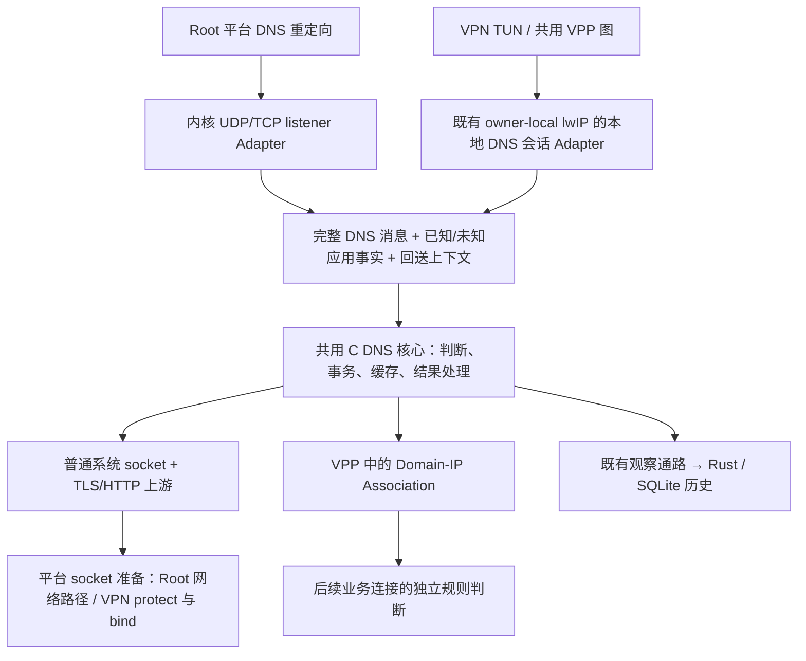

# DNS 首版 KISS 接入候选：以当前产品代码为依据

调查日期：2026-10-07。范围仅 Root/NFQ 与 VPN；KSU 留待未来扩展。
本文是候选比较，不接受新架构、不修改源码、不执行网络规则、构建或设备试验。
约束来自 [ADR-0006](../adr/0006-vpp-native-packet-io-adapters.md)、[ADR-0007](../adr/0007-owner-local-lwip-direct-egress.md)、[ADR-0011](../adr/0011-application-dns-filtering-root-and-vpn.md)。

## 结论

两种模式应共用 DNS 消息处理、规则、缓存和加密上游实现，差异留在应用侧传输 Adapter。
共用 DNS 核心没有必须依赖 HEV/lwIP 的理由；系统 socket 本身也不能取代 DNS 客户端、TLS、HTTP、缓存。
按长期总状态、故障路径和身份保真考虑，优先候选是“完整消息 seam + Root 内核 socket Adapter + VPN 既有 lwIP 本地会话 Adapter”。
这需要新增本地 DNS 会话，不是现有 HEV 接口已经提供的能力；本轮没有证明它的实现量必然小于 loopback 桥接。
VPN 的 local Adapter 可以直接交消息，也可以在内部用私有 socketpair 复用现有 fd 运输；两者仍是一个模块形状，后者不是新 listener 或新进程。

## 推荐候选的模块图

图是职责分配，非单个全局缓存、全局线程或已实现连接图。
TCP 的 DNS 长度前缀拆帧可共用帮助函数；应用侧 kernel TCP 与 lwIP TCP 的收发、回压仍由各 Adapter 负责。

## 接入候选

| 候选 | 对当前代码的改动 | 新增状态与故障路径 | KISS 判断 |
| --- | --- | --- | --- |
| A1：两个消息 Adapter，共用 DNS 核心 | Root listener；VPN local session，直接交消息并异步收答案 | DNS 事务与两种实际传输的回送上下文；保留已有 owner/generation | 优先候选之一。没有 VPN 到 listener 的额外内核往返；需要认真处理 local TCP 回压 |
| B：共用 kernel listener，VPN HEV 桥到 loopback | 改 Direct 目的地与授权路径；共用 listener；新增桥与元数据关联 | lwIP 会话 + 每会话桥接 socket + listener 端会话；桥接身份/代次关联 | 保留为次选。可能少改 HEV transport，但运行和身份链路更长 |
| C：VPN UDP 在 VPP 自行收消息/造回包，TCP 走既有 lwIP | 增加 UDP 特例与回包构造；TCP 仍需 local session 或桥接 | UDP 单独的地址/端口、校验和、MTU、回送、过期与停止账本 | 首版不优先。避开一次 lwIP 路径，同时增加另一种入口/回程实现 |
| A2：VPN 本地 socketpair 运输 Adapter，共用核心 | 给本地会话安装已连接的 AF_UNIX pair；复用 HEV fd 收发；DNS 端由 VPP 驱动 | 仍有一对 fd 与内核缓冲，但没有网络 listener 连接或地址/身份猜测 | 与 A1 并列待比较。减少 transport 改动的折中，尚未验证 |

以上优先级是工程推论，未做代码量、功耗、吞吐或错误注入对照实验。
如果 local TCP 适配需要重写大块可靠运输逻辑，应优先对照 A2，再比较 B；不能只因“少 socket”宣布 A1 最简单。
B 的实际简化成立条件是能保留已知应用身份、固定 owner 与停止语义，且不引入另一套优先级或可猜测关联。
若 B 为少写代码而把原本已知 UID 一律变成 Unknown，则偏离 ADR-0011 的已知应用查询判断，不能算等价简化。
C 不是“自己再写一个 TCP 栈”：它只特判 UDP，但它仍形成 UDP、TCP 不同的接入/回送路径。
A2 不要求 Root 与 VPN 都经由同一个 listener；它让 VPN 在运输层复用现有 fd 消费，仍然在 DNS 消息层共用核心。
当前 [Direct UDP patch](../../third_party/hev/patches/0004-direct-udp-session.patch)用 sendmsg/recvmsg，[Direct TCP patch](../../third_party/hev/patches/0011-direct-tcp-session.patch)用 sendmsg/readv/shutdown。
Linux 的 [socketpair 接口说明](https://man7.org/linux/man-pages/man2/socketpair.2.html)确认它建立未命名的已连接 socket 对；AF_UNIX 适合作为本进程运输，实际 Android 产品整合未验证。
因此 socketpair 可作为相容运输的假设；需要 local 会话分支、owner 绑定、pair 端 metadata、容量与关闭处理，不能简单把 fd 替换后宣布完成。
它不依靠“本地桥接流量的 UID”还原原应用，而在创建 pair 时把原会话事实直接交给 DNS Adapter。
Direct UDP 的 kernel sendmsg/recvmsg 没有 sockaddr 参数，AF_UNIX 可保留 datagram；回复 IP family 来自原 lwIP PCB，owner task 的目的地址/connect 分支必须替换，UDP payload 容量与 MTU仍应沿用真实内侧限制。
Direct TCP 的部分发送、窗口释放、ring 到 tcp_write 的 ACK 生命周期及 shutdown/EOF 可复用；DNS 端仍需 framing、回压、关闭后取消待办，不能把每次答复当整条 TCP 会话结束。
现有 socket 创建计数与析构围绕一个 Direct fd，broker 成功/失效围绕真实 underlay；A2 的两端容量/关闭必须纳入对应 owner 模块，local branch 跳过网络授权但不得伪造其成功或绑定事实。
这是内部运输 Adapter 的比较，不引入对外本地端口、跨进程 IPC 或额外调度线程。

## 当前实现能复用什么

| 已有实现 | 可复用的职责 | 不能据此声称已经存在的 DNS 能力 |
| --- | --- | --- |
| [product_rule_config.c](../../src/product/vpp/product_rule_config.c) | VPP-owned 保存、编译、有效快照发布 | 查询阶段事实、DNS 规则适用判断尚未实现 |
| [product_domains.c](../../src/product/vpp/product_domains.c) | 编译域名名单、精确/后缀匹配、内存归属 | 现有输入仅 LDH hostname；DNS wire QNAME、下划线/其他合法标签不能直接假定等价 |
| [product_l4_policy.c](../../src/product/vpp/product_l4_policy.c) / [packet graph](../../src/product/vpp/product_packet_graph.c) | 整条规则、Unknown 事实处理、owner/Flow 与正常完成 | 现有域名谓词读 SNI；不能将 DNS-IP Association 填成直接 SNI |
| [hev-owner.c](../../third_party/hev/product/hev-owner.c) | VPN 内侧 UDP/TCP PCB、会话、UID/代次、定时与 lwIP 输出 | UDP/TCP task 均连接原目的地；不存在 DNS local-message 回调 |
| [flow stack driver](../../src/product/vpp/product_vpn_flow_stack.c) | owner-local 文件订阅、timerfd、input node 有界推进、broker 完成 | DNS 外部 socket 的统一驱动与任务路由尚需增加 |
| [socket broker](../../src/product/vpp/product_vpn_socket_broker.c) | 非阻塞提交 fd 副本、protect/bind 结果、underlay epoch 失效 | 当前完成回调硬接 HEV session；DNS socket 任务需可区分的归属与回调 |
| [TUN Adapter](../../src/product/vpp/product_vpn_tun_adapter.c) | lwIP return → 独立 VPP buffer → 正常图 → TUN 完成 | 任意新造 UDP 包能自动满足这些前提并未验证 |
| [NFQ Adapter](../../src/product/vpp/product_root_nfqueue_adapter.c) | 捕获元数据、canonical owner、origin-lane verdict | verdict 仅 NFQA_VERDICT_HDR；没有 DNS MARK、DNAT 或 listener |
| [observation service](../../crates/product-core/src/observation_service.rs) / [store](../../crates/product-core/src/observation_store.rs) | 异步观察消费、SQLite 历史与有界存储 | DNS 查询记录类型、关联消费与缓存未实现；SQLite 不应成为查询同步依赖 |

源码核对基于当前工作区，包括既有未提交改动；没有恢复或参考 ADR-0008 移除的 C++、归档实现或 POC 源码。
[HEV 构建](../../third_party/hev/CMakeLists.txt)没有编译上游 mapped-DNS 模块；[lwipopts](../../third_party/hev/product/lwipopts.h)设 `LWIP_DNS=0`、`LWIP_SOCKET=0`。
因此当前 HEV 提供运输能力，不能用“有 HEV”推导出 DNS 核心已经存在。
[Mbed TLS 构建](../../third_party/mbedtls/CMakeLists.txt)只选八个 crypto/support 源文件；[来源说明](../../third_party/mbedtls/README.md)明确没有 TLS/X.509/随机源栈。当前也未接入 c-ares。

## DNS 上游究竟需不需要 HEV

VPP 固定版本 `9258530f3804a152578ce11cc7c8a1e9eab88ed0` 的
[file.h](https://raw.githubusercontent.com/FDio/vpp/9258530f3804a152578ce11cc7c8a1e9eab88ed0/src/vppinfra/file.h)
提供 worker 指定、fd 注册和读/写/错误回调；
[file.c](https://raw.githubusercontent.com/FDio/vpp/9258530f3804a152578ce11cc7c8a1e9eab88ed0/src/vlib/file.c)
实际使用每线程 epoll，按需启用 EPOLLOUT，并保留 eventfd 唤醒。DNS 可复用这个事件入口；这是实现途径判断，不是 DNS 运行证据。
当前 flow-stack driver 已用 timerfd 和就绪回调调度有界 input-node 工作，可沿用模式而非增加新线程或永久轮询。
TLS 的 WANT_READ/WANT_WRITE、DNS 事务 deadline 和 HTTP 进度仍必须有人维护；fd 就绪不会自动实现这些语义。

单独复用 HEV scheduler 也技术上可行：固定 task-system commit `b1afa0e21fb4ed5a69560e78e54baf0efdebe171` 的
[task 接口](https://raw.githubusercontent.com/heiher/hev-task-system/b1afa0e21fb4ed5a69560e78e54baf0efdebe171/src/kern/task/hev-task.h)
支持普通 fd 就绪、协作式等待和 task；产品 CMake 已将 `sakamoto_hev_task` 单独编译。
它不要求加载 lwIP，但会为 Root 增加 task runtime/栈与驱动，对异步 C DNS/TLS 库暂无已证明收益。
把整个 `hev-owner` 用作共用 DNS 上游，会顺带引入 VPN PCB/listener 与生命周期；这是当前候选里最不必要的依赖。
建议先用 VPP 原生 fd/timer 推进 DNS；只有具体库接口或测量证明 scheduler 明显减少复杂度，才复议调度层。

## 必须新增但应集中在模块内部的职责

- DNS 完整消息验证、QNAME 与查询事实、UDP/TCP framing、应答构造与协议错误行为。
- 查询应用政策判断，先判断再缓存/上游；Unknown 按 ADR-0011 允许，不等待推测身份。
- 查询事务、答案缓存、DoT/DoH、TLS 证书/随机源/HTTP、上游 bootstrap 与断网处理。
- Root listener 与平台重定向、VPN 本地会话，保留回送上下文、代次、已知事实与有界容量。
- DNS-IP 关联的来源、期限与业务 Flow 消费；不得等同唯一域名，也不写进 SNI 事实。
- DNS 记录接入既有观察通路；资源失败、查询拒绝和后续连接拒绝保持不同结果。

这些职责不会因为共用 listener 消失；B 只是将两个实际 ingress 先桥接到同一个 socket 表面。
答案缓存、执行所需 DNS-IP Association 和 SQLite 历史分别承担回复、连接证据、持久记录，不混成一个数据库。
复用是同一实现可在固定 owner 上实例化；没有必要为共用比例引入跨 owner 全局可变缓存。

## 仍会影响选型的未验证假设

1. Root 重定向 hook 与 NFQUEUE 的顺序、双栈 conntrack 回复、原 socket/UID 证据需要验证。当前 [Android hook](../../app/android-runtime/src/main/java/com/sakamoto/snort/androidruntime/RuntimeService.java)只装 mangle NFQUEUE，还限制 debug APK UID；没有 DNS NAT。
2. Linux 已记录的 [loopback bypass scope](../../CONTEXT.md)不能被新 DNS listener 悄悄改写；需明确新 hook 与 loopback 排除的位置。此调查未找到产品 Linux hook 实现，不把规划当运行证据。
3. VPN local TCP Adapter 是否能合理复用现有 pbuf/ring、窗口与 FIN/错误处理，需要实现前的定点 seam 检查；[固定 lwIP TCP 源](https://raw.githubusercontent.com/heiher/lwip/8c69dfbe537835d5f2a5fd8c08c859f667b108ea/src/core/tcp.c)提供 raw callbacks，但当前 HEV Direct 接口围绕 kernel fd。
4. B 中桥接 socket 的 local 目的地、protect/bind 与元数据映射方式尚未设计；现有 broker 的 underlay 绑定不能被原样认定适合 loopback。
5. DNS 上游应由产品自动准备保护与选网；[Android protect](https://developer.android.com/reference/android/net/VpnService#protect(int))提供避免 socket 进入 VPN 的操作。应用侧虚拟 DNS 地址与真实上游 socket 是两个不同路径。
6. VPN return 校验 provenance、generation，并携带 Flow incarnation；当前 epoch 用于事实/追踪，本接口没有强制非零。本地应答可以保持真实的 Unknown underlay/context，不应伪造 Direct 绑定来复用回送；异步答案仍需正确会话寿命与停止语义。

本轮没有覆盖性能验证或具体接口字段。若后续要用原型回答选择，最小问题应是“local TCP seam 与 loopback bridge，谁能以更少状态保留相同事实并正确停止”。
先确认完整消息 seam、共用 DNS 核心和平台准备职责即可；不要提前把“单 listener”或“单 scheduler”当成复用目标。
