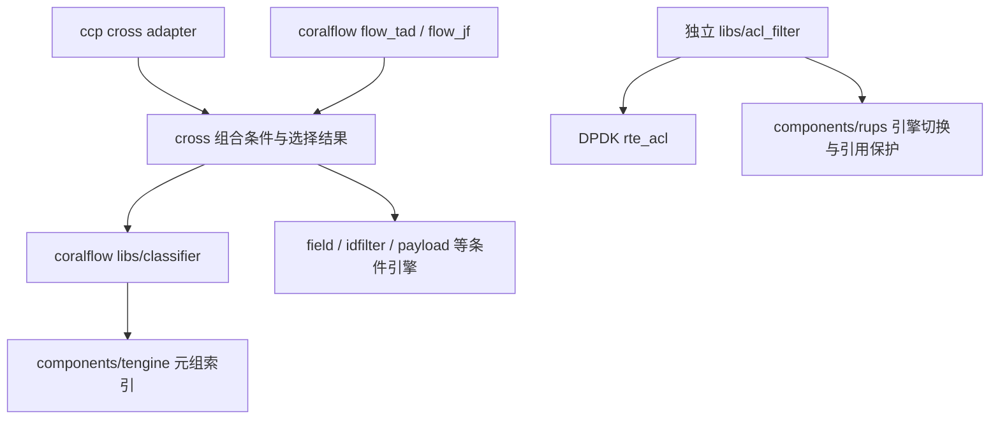

# CCP / Coralflow 规则匹配专项源码调查

日期：2026-10-08。范围：u22s 上的 ccp、coralflow 及实际检出的规则引擎子模块；对照 Sakamoto 当前 C 主线和已接受规则/DNS语义。
性质：源码调查与本地接口探针，供工程取舍使用。没有改变产品实现、规则语义、资源上限或 Plane 工作状态。

## 1. 结论与建议

**最有价值的参考是 tengine 的候选索引组织，以及 cross 将多种条件接入同一规则的分工方式。Sakamoto 当前已经具有同掩码子表、完整 Rank、范围计划、残余求值、结果缓存和受保护双 bank 发布；后续收益应从这些现有实现上验证。** 当前源码不支持直接把 tengine/cross 当作符合我们语义的完整规则引擎。

本次调查建议优先评估三个增量：

1. 在当前不可变应用视图内整理子表遍历顺序，用完整 Rank 下界减少无效子表访问；同时避免扫描其他应用的子表。
2. 在候选链确实较长时，评估短签名/非空桶过滤；保留原始 key、availability 和完整表达式核验。
3. 对掩码很多的配置，评估受预算约束的粗掩码聚合，用完整残余检查换取较少子表。计入候选增加、编译开销和内存峰值，再决定是否值得。

批量查询是另一项可测选择，但必须重新设计为**逐输入完整结果、独立求值状态**，并保留同 flow 的事实更新顺序。tengine 现有 batch 聚合结果、early-quit、动态结果数组和定时回收机制不满足我们需要。cross 的持久部分合取也不能进入我们的逐包规则求值。下文逐一给出源码依据。[T-MATCH](#t-match)、[C-MERGE](#c-merge)、[L-INDEX](#l-index)

## 2. 调查方法和版本边界

通过既有 SSH alias `u22s` 和 remote-ssh-dev helper 远端只读检查。没有同步/挂载仓库、修改远端、启动业务进程或运行远端压测。以具体函数实现和调用者为主要依据；README、源码注释、`uts_review/` 只提供线索，不能替代当前调用链。

| 对象 | 远端位置 | 调查时源码身份 |
| --- | --- | --- |
| ccp | `/home/u22s/Git/ccp` | `6e0b4426d365f9f4f69d9b5868a6c74f94e8e8d2` |
| ccp cross | `modules/cross_engine_l4lb` | `efc4848ad028d2045734fd127940cccca3709064` |
| coralflow | `/home/u22s/Git/coralflow` | `76139e4a4c0e65185c952e0f0b309e234805fc4b` |
| tengine | `coralflow/components/tengine` | `1e50b5aa21da751be9c0a604ff8140593757f789` |
| coralflow flow_tad cross | `pts/plugins/flow_tad/cross_engine` | `1773512fd47a8361674a5e13141759242b4b9e10` |
| coralflow flow_jf cross | `pts/plugins/flow_jf/cross_engine_jf` | `a04b0d94b0a1ec151ed361058293dc7dd269052f` |
| Sakamoto | 本仓库工作树 | HEAD `d5f014d9346ebe8f9426192f0d49884626ed6ff4`；关键文件哈希见附录 |

ccp 有一份诊断文档的未提交修改，coralflow 有 RPM spec 修改；它们没有参与本调查的匹配机制判断。Sakamoto 存在其他未提交工作；本次读取的核心匹配/配置/packet graph 文件无 tracked diff。规范和新增 ADR 按当前工作树读取，不能仅用 HEAD 代表它们。

以下区分三类证据：**源码事实**是当前路径可直接读到的行为；**推导案例**是按源码推演的冲突，没有声称远端复现；**实测**仅指本次执行的本地 C 接口探针和已有独立参考测试。历史设备性能单独标注来源和日期。

## 3. 我们需要的规则引擎

约束来自 [ADR-0009](../adr/0009-unified-rules-and-vpp-owned-configuration.md)、[统一规则规范](../product/UNIFIED_RULE_ENGINE_SPEC.md) §2–5、§13 和 [ADR-0011](../adr/0011-application-dns-filtering-root-and-vpn.md)。产品 packet domain 仍是 ADR-0006/0007/0008 规定的 VPP-native C。

| 需要 | 调查判定标准 |
| --- | --- |
| 统一优先关系 | priority 升序、显式 order 升序、稳定逻辑身份升序形成完整 Rank；具体度、子表顺序、匹配器类别不能额外赋优先权 |
| 完整逻辑规则 | AND/OR/NOT、availability 和协议适用性一起求值；候选命中不是逻辑命中 |
| 可用性 | NOT 不把未知变为命中；True OR Unknown 可为 True；显式 SNI 条件仍有整条规则适用性要求 |
| 安全 PRE/POST 放置 | 整条规则只占一个位置；无法证明安全就 post-flow；早期实际 DROP 不触及 Flow/CT/LPI |
| 完整结果与归因 | winner、Rank、effective mode、declared/actual action、身份/来源一致；一个逻辑 winner 只计一次 |
| 有界求值 | 编译时保证完整执行有界；资源不足选择完整保守计划或拒绝发布；不能截断候选后返回部分最佳结果 |
| 所有权与发布 | VPP main thread 编译；worker 读取同一个受保护不可变 snapshot；一个包的 PRE/POST 不混版本 |
| 缓存 | guards 覆盖整个适用程序及输入可用性、snapshot、flow incarnation、方向；更新事实不能只检查旧 winner |
| 域名与 DNS | SNI、HTTP/SOCKS直接域名、DNS association 有不同来源/适用性；DNS query decision 不等于后续连接 verdict |

当前源码已有前述多项机制；并不意味着最新 DTLS、HTTP/SOCKS、DNS ingress/association 等设计全部实现。举例：当前 `expression_matches` 的 SNI prerequisite 仍检查 TLS/QUIC 两个 catalog bit，domain predicate 仍消费 `sni_result/domain_lists`。本次不扩大其能力或验收声明。[L-TRUTH](#l-truth)

## 4. 实际依赖和调用链



这个图表示相关模块关系，具体 cross revision 必须分开读取。ccp 的 `ccp_cross_process_rt.c` 从 coralflow 取得 NUMA classifier context并注册 `tengine_based_classifier`，其中 `.op.compile/.op.flush=NULL`；`ccp_cross_classifier.h` 把规则管理回调转到 `libpdk_classifier_*`；coralflow classifier 再把元组转换为 tengine 的 rule/flow 并调用 `setup → match(_bulk) → retrieve`。ccp 通过 `pdk-libs` 使用这些库。[C-ADAPTER](#c-adapter)、[T-WRAPPER](#t-wrapper)

coralflow `__convert_rule_info` 将长期/超时 tuple条件分别赋priority 1/2；这里的 tengine priority并不是 cross业务规则完整顺序。tengine负责子条件命中，cross合并后才提供完整逻辑action/归因。仅把 tengine的best映射为我们的winner，会同时丢掉残余条件和真实优先关系。[T-WRAPPER](#t-wrapper)、[C-MERGE](#c-merge)

**bulk 的输入不应直接理解成多个网络包。** coralflow 当前 classifier process 对每个 packet 调 `cls_process_match`，其中 bulk 可以收集同一包的多个 hook/分类输入，再由 `p_batch_id` 对回输入；外层才遍历 packets。把这一 API 原样移到 VPP frame 会改变它的实际聚合范围。[C-BATCH](#c-batch)

`libs/acl_filter` 是另一个后端，调用 `rte_acl_build/classify` 并使用 RUPS。它适合研究构建与读者保护，不是 ccp 此处注册的 tengine classifier 实现。[R-ACL](#r-acl)

## 5. tengine：规则建表和候选查询

### 5.1 规则与上下文

tengine 的字段是 U32 元组，规则携带 baseid、ruleid、priority、guid，字段类型包括 MASK、PREFIXLEN、RANGE；IPv6 可以拆成多个 U32。`baseid` 是规则/结果命名空间，class-id mode 是可选子表过滤维度，它们不是 Android application identity 的现成映射。[T-API](#t-api)

当前常量为16个base、最多16个U32字段、32个class、256个bulk输入。规则校验还要求至少两个原始字段的 `mask_range` 非零，不能把无条件或单条件逻辑规则未经布局适配直接映射进去。这个检查不等于转换后有效mask数，更不是我们的应用视图/规则数量预算。[T-API](#t-api)、[T-MASK](#t-mask)

当前 API 支持静态 bucket-list、class-id、merge、rehash、match_early_quit 等设置。老 README 的结构体和说明没有完整反映当前接口。Flow 字节序注释与 rule/port 说明也不完全一致：实际 MASK 是直接按位 AND，PREFIXLEN 转成掩码时交换字节序，RANGE 的编码和核验会转换 U32。若要复用任何原语，需要通过真实 classifier 编码和测试向量确认 ABI，不能只依 README 复写数据结构。[T-API](#t-api)、[T-MASK](#t-mask)、[T-WRAPPER](#t-wrapper)

### 5.2 同掩码与粗掩码聚合

`first_mask_contains_second_mask` 在关闭 merge 且非 static mode 时要求掩码完全相同；启用聚合时要求逐字段 `coarse & fine == coarse`。子表匹配还要求原字段数量和 `minifield` 一致；class-id mode 下 class 也要相同。`minifield` 是非零掩码字段的位置位图，所以它并不会任意合并“一个规则约束 source IP、另一个完全不约束 source IP”的表。[T-MASK](#t-mask)

一个已有粗表可以接纳细规则；后来建立粗表也可以迁移已有细表中的条目。规则保留其原始 mask，查询时仍核验，所以粗 hash key 只决定候选。聚合选择/迁移受插入顺序影响，需要把这种物理组织视为编译决策，不能成为用户优先关系。[T-MASK](#t-mask)、[T-MATCH](#t-match)

聚合选择的是已有规则mask或显式static mask，并未计算所有mask的公共交集或按成本自动选最优聚合。`merge_limit` 是结构迁移的记录/判断，不是最大candidate数或完整query work bound。[T-MASK](#t-mask)

**对我们的增量：** 当前 `index_insert` 仅按 subject 和完全相等 mask 共享子表；粗 mask 聚合是真正新增的选择。它可能减少表数，也可能显著增加候选。我们的来源是完整 Boolean envelope，含 OR/NOT/availability，因此应保守地聚合候选索引，保留原始 source evaluator，而不是把合并后的 mask 当完整规则。[L-INDEX](#l-index)、[L-TRUTH](#l-truth)

### 5.3 范围处理

tengine 把范围转换为可以用于 hash 的掩码表示；非单点范围（转换mask不为`UINT32_MAX`）的字段记在 `rangefield`，真正上下界存在 target 扩展中，即使该范围恰好对应一个完整前缀仍标记并核验。候选通过 key 核验后，`__match_range_field_in_target` 再逐个比较 inclusive range。范围过滤利用置位枚举，不需要扫描所有字段。[T-MASK](#t-mask)、[T-MATCH](#t-match)

Sakamoto 已有更明确的计划取舍：小端口范围对做精确 disjoint prefix cover，超过 direct-entry 预算改用独立区间 factors 或 residual，始终执行完整规则求值。不存在从 tengine “补上范围支持”的空白；可比较的是粗 envelope、精确展开和 factor 的成本。[L-INDEX](#l-index)

### 5.4 当前实际查询路径

主要路径是：遍历有效子表 → class/字段数量过滤 → 掩码 hash → 非空位图 → 定位 bucket → 标量短签名过滤 → 原始 key/mask 和 exact range 核验 → 收集结果。`__stage1_hash_filter` 将通过过滤的输入压成 slots，并执行 prefetch。[T-MATCH](#t-match)

源码有 `__compare_sigs` 和 `__stage3_verify_candidates`，但当前 `__stage2_bucket_sig` 直接逐条遍历链表、比较签名并完成 `is_flow_match/get_matched_info`。这些 helper 没有进入当前查询调用链。因此不能把“三阶段 SIMD candidate buffer”的注释当作已经运行的优化。完整 key 比较的 architecture helper 则确实有 ARM64 NEON 分支，二者需分别判断。[T-MATCH](#t-match)、[T-PLATFORM](#t-platform)

### 5.5 查询内 mask 计算缓存

粗表里的不同原始 mask 需要重复投影字段，`is_flow_match` 用每输入的两路组相联 mask cache 避免反复计算；`tengine_match_setup` 清除对应 scratch。它缓存的是**当前查询的掩码投影**，并不是跨包的业务判定。[T-MATCH](#t-match)、[T-SETUP](#t-setup)

当前 Sakamoto 每个同掩码表只计算一次投影；直接移植这层 cache 会增加状态而未必减少工作。若新增粗表聚合，才应比较是否需要这种查询内 cache。已有完整结果 cache 必须继续使用全程序 guards，两种 cache 的职责和失效条件不同。[L-INDEX](#l-index)、[L-CACHE](#l-cache)

## 6. tengine：会改变我们结果的具体行为

### 6.1 Priority 和 tie

`get_matched_info` 使用 `h_priority <= entry->priority` 更新结果，即数值越大越优先，等优先级后遇到的条目覆盖。没有我们的 order/stable identity 比较。把完整 Rank 反向编码为唯一 priority 可以适配排序方向与tie；仍不能解决残余条件、batch 归属、截断和 snapshot 问题。[T-RESULT](#t-result)

推导案例：两个 tuple 都匹配的规则具有相同 priority、不同 order，物理插入/迁移顺序改变后，tengine tie 的结果可改变；我们需要固定较小 order 的逻辑规则获胜。又如高 Rank 候选的 CT/SNI residual 为 false，下一个完整规则仍必须被查询；只拿 tuple 的 `h_guid` 无法完成这一要求。[T-RESULT](#t-result)、[L-INDEX](#l-index)

### 6.2 Early-quit 是整个 batch 的退出

`__lookup_bktlist_bulk` 在 `match_early_quit && bkt_matched` 时结束子表遍历；`thash_lookup_bulk` 在有任意 match 时跳过后续子表组。条件是整个 batch 的命中计数，不是每输入已经找到完整最优结果。[T-EARLY](#t-early)

推导案例：输入 A 在表 X 命中，输入 B 只在后面的表 Y 命中。现有 early-quit 可以因 A 结束整批查询，B 的后续候选不会被访问。即便只查一个输入，也不能由“先访问的表命中”推出完整 Rank 最优；必须证明未访问表的 Rank 下界无法胜出，且当前候选已经通过所有 residual。

### 6.3 结果按 base、thread、整个 batch 聚合

`matches[baseid]` 中的 `h_guid` 是这个 base 在该次查询的全局最高 priority，不是每个输入一个 winner。完整数组通过 `p_guid/p_batch_id` 记录命中与输入的对应；classifier 再展开/转接。因此一个 frame 的所有包共享 `h_guid` 会产生错误归属。[T-RESULT](#t-result)、[T-WRAPPER](#t-wrapper)

### 6.4 容量不足和分配失败

默认 GUID array 每次增长 8；最大宏为 128，但分支是 `guid_len + 8 >= 128`，从初始零长度增长的列表实际到 120 后停止扩容。到上限走 `ret_ok`，仍继续命中计数。最高 priority 字段在此之前更新，因此“best 字段更新”和“完整命中列表收集”会出现不同完整性。[T-RESULT](#t-result)

这是 base 在整次 batch 的容量，不能当成“每个包最多 120 条”。推导案例：一个 base 中 64 个输入各产生两条命中，128 个对应项会超出 120 条列表容量；被省略项不能由一个全局 `h_guid` 恢复。

三处 `realloc` 的任意失败返回 `ret_err`，当前 stage2 调用者用 `continue` 处理，没有把 incomplete 作为匹配 API 的错误返回。classifier 自己也有第二层结果容量上限：`__set_res` 是 void，满时记录日志后 return；结果结构没有完整性标记，retrieve 仍能返回成功。[T-RESULT](#t-result)、[T-WRAPPER](#t-wrapper)

这足以说明其完整结果契约与我们的要求不同；没有在远端注入 OOM 或复现真实业务误判。我们需要编译时界定完整查询工作/存储，以流式候选遍历或固定 query state 产生完整 winner，避免把“列表满”伪装成 NoMatch 或部分最佳结果。

### 6.5 元组相同不等于逻辑身份相同

`is_trule_value_equal` 比较mask、值、range等，不比较base/rule身份；`search_add`在value相同而身份不同的时候仍可进入旧实体更新。`__thash_update_entry`保留旧GUID/baseid/ruleid，只更新priority/timeout等；新输入ID可能不成为独立规则。[T-IDENTITY](#t-identity)

普通add也可把相同tuple、相同priority、无timeout且不带用户target或range扩展target的不同ID压缩到一个实体的扩展target中，调用者再展开；已有的压缩target可继续追加身份。这种共享可省索引，但没有自动保存每条逻辑规则的order、mode、residual和来源。我们可以研究显式immutable posting list，仍让每项指向完整compiled rule，不能以tuple相同去重业务身份。[T-IDENTITY](#t-identity)

Target更新也不是全量替换。当前更新逻辑先遍历旧key，命中则直接修改旧target；只有遇到旧key未匹配而扩展时才换到新target对象。静态例：旧`{k1:v1}`，新`{k1:v2,k2:v3}`，旧k1被更新，但新增k2可能随新对象一起释放。这没有运行复现，却足以说明该更新路径不能用作我们的声明性配置替换合同；clone entry也没有令其target自动不可变。[T-IDENTITY](#t-identity)

## 7. tengine：更新、回收、平台与资源

### 7.1 写锁和延迟回收不等于读者保护

tengine 的规则写侧使用 hash-table spinlock，并有复制旧链再替换 head 的路径；读取路径不以同一锁保护。相关发布使用 compiler barrier 和指针替换，内部没有本项目式 packet reader claim、完整版本 acquire/revalidate 或旧对象读者归零条件。[T-UPDATE](#t-update)

延迟 pool 默认按时间回收条目，bucket pool 使用另一延迟；`tmalloc` 在 delay queue 达到 32,768 时还可提前处理未到 deadline 的对象。时间延迟不能证明一个被抢占读者已经结束。这里的结论是**tengine 自身未提供满足我们需要的 grace-period/snapshot 证明**；不将静态阅读升级成“已复现 UAF”，也不排除调用者另有停读/生命周期约束。[T-UPDATE](#t-update)

当前公共头还要求delete与match/setup/retrieve由调用者互斥。保护范围应覆盖setup、query、结果及target retrieve，不能只保住match函数：其结果中存在稍后才被读取的内部target指针。[T-UPDATE](#t-update)、[T-RESULT](#t-result)

合并失败也未体现整体rollback：`__copy_entire_bkts`调用`thash_copy_insert_entry`后未检查返回；后者有分配失败返回路径，前者仍扣源计数/reset源bucket，上层随后撤销源表。这里记录的是静态迁移失败路径，尚未注入OOM；我们的编译失败必须保留旧active snapshot，不能照搬在线迁移撤销顺序。[T-MASK](#t-mask)

我们的现有 bank 把 view、domain index、generation/revision/hash 作为一个发布单元；SC 的 reader claim/revalidation 保护读取，旧 bank 有 readers 时不能复用。`policy_on_owner` 从 PRE、Flow fact 生产到 POST 和 attribution 使用同一次 claim。应保持这条完整保护链。[L-PUBLISH](#l-publish)

### 7.2 Worker 路径分配与结果生命周期

`tengine_match_setup` 可在首次使用 thread 时 `aligned_alloc`；第一次实际 match 才开始分配 GUID 等数组，并随更多结果 `realloc`。已有 thread-private 空间说明所有权较清晰，但“thread-private”不能证明热路径无分配。retrieve 返回引擎拥有的结果/target，下一次 setup 会清理或复用，不能跨调用保存借用指针。[T-SETUP](#t-setup)、[T-RESULT](#t-result)

Sakamoto 当前 query scratch 和结果都是有界值；cache 不持有 view/Flow 指针。扩展索引或批量原语时，应把额外 scratch 在 admission 前分配并计入每 owner 与 publication overlap 的预算。[L-CACHE](#l-cache)、[L-RESOURCES](#l-resources)

### 7.3 ARM64 能力与 Android 集成

当前源码包含 AArch64 CRC32、NEON key compare，不是纯 x86 实现。但构建和内存路径同时带有 host tuning、libnuma/numaif、mlock/mempolicy 等依赖；源码有 ARM64 分支并不等于已有可链接、可运行的 Android/VPP 库。[T-PLATFORM](#t-platform)

对移动端的主要问题是可控的小内存布局、更新峰值、短批次和非阻塞 worker。NUMA/hugepage、大批量 server 吞吐假设不能成为我们的默认配置，也不能拿本次源码阅读替代 ARM64 编译及设备测量。

### 7.4 Hash、bucket规模和限额不能原样采用

tuple hash对各U32使用同seed CRC32-C后XOR。这个组合对字段交换不敏感，相同贡献还能抵消；在相同mask/有效布局下可以推导碰撞族。完整key核验仍保持正确性，但链扫描工作可能退化。硬件CRC的吞吐不是tuple hash分布质量的证明，位置敏感的hash与对抗分布要单独评估。[T-HASH](#t-hash)

动态非merge/nonstatic新表默认从4096 buckets起；显式rehash依据density和max chain扩缩，不是每次add自动做。可参考其density/chain观测在**本地离线编译时**选布局；不把在线rehash加入现有worker不可变snapshot。[T-HASH](#t-hash)

pool `mem_limitation`在当前`tmalloc.c`中只有声明/赋值，`t_malloc`未用它检查限额，系统pool callback直接malloc。底层bucket heap另有内存检查，因此也不能反向声称所有分配均无限；准确结论是配置的`limit_size`不是覆盖entry pool、query realloc等全部内存的已证明hard cap。[T-HASH](#t-hash)

## 8. cross：组合条件应借鉴到什么程度

cross 的分工值得研究：规则分发给 classifier、idfilter、field、payload 等引擎，命中结果编码为 rule/field 身份，再按条件位合并。ccp 和 coralflow 的 cross commit 不同，以下以 ccp 的实际子模块为主要消费路径，不能把其中一个 revision 的行为推广给全部 fork。[C-MERGE](#c-merge)

源码中的 `cmbits` 是 flow 状态。部分 bits 被持久保留，部分通过 `tmp_bits` 在相关查询路径清除，`match_multi_pkt` 又影响缺失条件的保留。ccp classifier 的合并 flags 为 NULL；field 结果则标记 NOT_PERSISTENT。它提供的是可以跨包累计的组合匹配，并非我们每次 query 从当前事实重新评估完整逻辑规则。[C-MERGE](#c-merge)

推导案例：包 P1 满足条件 A，包 P2 满足 B，但 P2 的 A 为 false。若 A 作为持久 bit 保留，则 cross 的 A∧B 可完成；我们的当前包规则 A∧B 应为 false。协议识别器可以跨包生产一个已发布事实，但这个生产过程不应让规则的部分真值跨包残留。[C-MERGE](#c-merge)、[L-TRUTH](#l-truth)

winner 还可能先按引擎类别的 `rtype_priority` 选择，再比较规则 priority；相同 priority 使用后遇到者覆盖。这与一个应用下所有逻辑规则共享完整 Rank 的约束不同。分发/条件适配的模块边界可参考，winner 的权威仍应留在我们现有 complete matcher。[C-MERGE](#c-merge)

### 8.1 平面位图的AND/OR/NOT能力

正条件设置要求位，负条件不设置；子条件正匹配仍在结果中置对应位。最终是`cmbits->bits == hrule->bits`，所以负条件的正命中增加额外位而拒绝该规则。全NOT规则还要通过`single_not_rule`补入零位候选。不同field-id位形成AND，共用一个field-id的多个片段可供给同一位，形成局部OR；后者是按位映射推导，不是已验证外部生成器的完整Boolean能力。[C-MERGE](#c-merge)

这个平面模型没有我们bounded AST的节点级availability。纯NOT“没有匹配位”不区分false、尚未生产事实、parse error或budget exhaustion；不能替代三值语义，也不能用HTTP method/ALPN的特化检查推广为所有协议的适用性证明。

此外，flowbits 有配置结构和分发痕迹，但本次看到的 `merge_check_flowbits` 核心实现被注释，函数返回 0。不能据此声称 cross 当前实现了通用 Boolean DSL、三值 NOT 或完整 flowbits。引用字段名不足以证明能力。[C-MERGE](#c-merge)

### 8.2 状态容量、版本和确认

res_merge每flow有32个静态cmbits，满后可分配2048个16-byte条目，即约32 KiB扩展空间；动态表满返回NULL，插入调用者继续处理而不提供完整失败结果。这里的数量来自结构/常量计算，并非实测RSS；不能把这种运行时扩容和drop-candidate当我们的query资源模型。[C-STATE](#c-state)

flow记录cross_version，输出attr含rule.version，另有`cross_rule_been_modified`helper。然而已读CCP调用者没有闭合该helper的实际缓存使用，也没有看到覆盖整个程序的fact/value/availability guards；这不证明部署缓存一定错误，只说明这些字段名不足以替代我们的完整cache合同。[C-STATE](#c-state)、[L-CACHE](#l-cache)

ccp `cross_rule.c`的confirm逐规则清UNCONFIRM/更新rule.version，再依次confirm payload engines，payload错误可只记录warning而整体仍return 0，最后才更新confirmed version。这不是classifier、field/payload、IR/Rank/归因组成一份bundle后一次切换。外部平台是否暂停/串行workers未追到完整闭环；本报告仅确定这些模块API不直接提供我们的whole-snapshot保证。[C-STATE](#c-state)

## 9. ACL / RUPS：发布机制参考

ACL 将 rule list 转换到新 `rte_acl_ctx`，build 成功后提交 RUPS，再 confirm 切换；classify 通过 thread get/put 持有引用。当前 ACL confirm 检查返回值，失败保留 `confirm_required` 可重试；旧 `uts_review` 关于忽略返回值的指控不能直接套到当前源码。[R-ACL](#r-acl)

RUPS实际位于`components/rups/`，两份`rups_info`各含一个共享engine和每worker space；thread get读取pointer/version，宣布持有version，再重读核对pointer与valid，thread put清除持有。mgmt compile构建非运行bank及worker spaces，失败回滚新spaces。[R-RUPS](#r-rups)

confirm依次切换worker的info_ref，并等待该worker释放旧version；最多1,000,000次pause后返回`-EBUSY`并保留confirming供重试。此时可能已有worker看到新engine，**busy不是“完全没发布”**。ACL IPv4/IPv6/pattern各自拥有RUPS，顺序compile/confirm；其中一个失败不代表其他类型已成功的更新回滚。thread get失败返回NULL，ACL classify转成`-ENOENT`，也不能当完整NoMatch。[R-RUPS](#r-rups)、[R-ACL](#r-acl)

现有acquire/release和pin后重读是源码事实，本次没有对全部C内存模型、version wrap/ABA、thread注册/退出做并发证明。它的单engine引用协议不能默认赋给未使用RUPS的tengine classifier，更不能推出跨程序的同一逻辑snapshot原子可见。

可借鉴其新旧对象生命周期、失败后的重试状态和控制面/读侧职责分离。我们的已有 SC 双 bank 是适用现状，不需要为了引用库再叠一层发布权威。多程序、应用视图、Rank、domain index、依赖 metadata 仍应在一个完整 snapshot 下 acquisition。[L-PUBLISH](#l-publish)

## 10. 当前 Sakamoto 的基线和本次探针

### 10.1 已有机制及真实限制

`product_l4_policy.c` 的 `build_index` 按完整 Rank 反向插入，让候选链保持正确顺序；同 subject、同 mask 共享表，表保存 minimum Rank。查询只在通过完整 residual 后设置 best；key collision、位置不符、未知或 false residual 继续搜索。`checked[rule]` 是单次 ALL/PRE/POST 的局部数组，多个 fragment 不增加逻辑命中。[L-INDEX](#l-index)

`expression_matches` 使用 true/false/unavailable 值，`cache_guard` 对整个应用 bucket 取 dependency union，再包含当前静态输入、相关动态事实、位置和完整 identity；cache 值保存完整结果，命中路径复用归因。更新 snapshot 不扫描清空所有 flow/cache。[L-TRUTH](#l-truth)、[L-CACHE](#l-cache)、[L-PUBLISH](#l-publish)

当前表数组是全 view 数组，查询每次遍历它再判断 subject；子表按反向建表顺序组织。完整 Rank 已能跳过不可能更优的候选，但目前每表检查的计数仍存在。此处有值得测试的组织优化，不能根据“已经有 hash index”就假设多掩码开销解决了。[L-INDEX](#l-index)

现有发布在复用inactive bank前等待其reader归零；该等待循环本身没有计时上限。本报告确认保护次序，不宣称发布延迟已经有deadline保证。任何批量化延长packet claim都会影响这段等待，需要测量。[L-PUBLISH](#l-publish)

### 10.2 本次实际运行

执行已有 [独立 reference test](../../tests/host/product_static_reference_test.py)，退出码 0，输出 **55,470 complete winner comparisons PASS**。覆盖已有 T06–T18 的 ordered/split、三种计划、cold/hot cache 和事实变化比较。它验证的是该测试覆盖的当前行为，不验证新增 DNS/HTTP/SOCKS/DTLS 范围，也不验证远端引擎或设备转发。

另编译了仅调用现有 C 接口的 [local-probe.c](assets/2026-10-08-rule-engine-source/local-probe.c)，编译和执行退出码均为 0。命令及原始输出保留于 [verification.txt](assets/2026-10-08-rule-engine-source/verification.txt)。

| 探针配置 | rules / masks / entries | 完整 winner | 子表检查 | key 检查 | 完整 residual |
| --- | --- | --- | ---: | ---: | ---: |
| 同 mask、exact miss | 128 / 1 / 128 | 无 | 1 | 8 | 0 |
| 同 mask、exact hit | 128 / 1 / 128 | rule 64、Rank 64 | 1 | 4 | 1 |
| 128 mask、miss | 128 / 128 / 128 | 无 | 128 | 20 | 0 |
| 128 mask、最高 Rank wildcard winner | 128 / 128 / 128 | rule 1、Rank 1 | 128 | 20 | 1 |

这些是具体构造的工作计数，**不是延迟/吞吐测量或普遍平均值**。最后一行说明早胜出规则的物理位置与遍历顺序值得研究；不构成直接修改排序、聚合或缓存的性能结论。

本机 x86-64、GCC 12.2.0 下，当前真实布局为 view **63,512 B**、packet **88 B**、guard **128 B**、cache entry **200 B**、owner cache **25,632 B**。现有 compiler publication representation subtotal 为 **386,932 B**，上限 **393,216 B（384 KiB）**，只剩 **6,284 B**；这是含四份 view 等表示重叠的模型，不是 RSS。增加每表 metadata、签名和 vector scratch 要重新核算，不能复制 tengine 的 pool sizing。[L-RESOURCES](#l-resources)、本次探针

配置模块的总表示预算当前为 **2 MiB**，其中还包括 domain storage、新旧配置、序列化、owner caches 等。不能把较宽总预算用于绕过较窄 compiler subtotal，也不能照用旧接口文档的布局数字。[L-RESOURCES](#l-resources)

### 10.3 已有设备证据只作方向线索

[2026-09-25 T09 报告](../testing/2026-09-25_T09_MASK_INDEX.md) 曾记录 ARM64 indexed/ordered query 比值：128 条 exact 分布键 **0.21**，dense residual **1.22**，immediate first winner **4.82**，distinct-mask miss **14.05**。这些是当时固定源码/实验下的历史观测，并非本次 HEAD 的测量，也不是 tengine 对比。

[同日 T11 报告](../testing/2026-09-25_T11_COMPLETE_RESULT_CACHE.md) 中，ARM64 cheap exact、256 flows 的 direct→cached 为 212.5→659.6 ns，而 expensive residual 的 hot query 明显受益。这支持将 mask/候选密度、cache guard 成本和命中率分开研究；不支持“再加一层 cache 或 SIMD 就会整体更快”。

## 11. 可借鉴机制与适配成本

| 参考机制 | 我们已有情况 | 适用建议 |
| --- | --- | --- |
| 同 mask 共享子表 | 已实现 | 保留现有语义，不作为新功能重建 |
| 范围 coarse hash + exact residual | 已有 envelope、direct/factor/residual | 对照相同输入测成本；保留 complete evaluator |
| minifield 压缩有效字段 | 当前 key 固定 42 bytes | 可以研究小而固定的 key 投影，必须保留 family/availability 的保守性和 compile budget |
| 粗 mask 表合并 | 当前仅精确同 mask | 候选新增方案；需要完整 Rank 下界、原 key/residual、候选成本约束 |
| 短签名/非空桶位图 | 当前直接按 masked hash 链查 key | 长碰撞链才有可能受益；用本地实测密度判断 |
| 查询内 mask cache | 当前同 mask 表每 query 投影一次 | 新增 coarse merge 后再考虑，不与完整结果 cache混同 |
| bulk slots/prefetch | 当前 policy seam 逐输入 | 单独研究，逐包 result/state、原始事实生产顺序不变 |
| class-id/bucket bitmap | 当前按应用 bucket选择后检查全表 | 可参考 subject-local 可达表组织；不沿用 32-class/有限 baseid 作为产品能力限制 |
| GUID/target 扩展结果 | 当前索引指向完整 compiled rule | 保留 logical rule/attribution；不以 tuple 相同合并掉不同业务身份 |
| cross 条件分发 | 已有 typed事实生产与完整表达式 | 参考 adapter边界，不引入持久 partial conjunction 或第二套winner优先级 |
| ACL/RUPS publish | 已有完整双 bank snapshot | 参考失败状态/生命周期；不替换成逐 engine、逐 worker独立发布 |

## 12. 适合我们现有模块的候选设计

以下是调查产生的**验证候选**，没有改变 ADR 或建立另一份待办清单；如决定实施，工作状态仍进入 Plane。

### 12.1 先减少无效的表遍历

保留 `product_l4_policy_compile_with_budget/match_position` 接口，在编译输出内组织 subject-local table 范围或有界列表，按 minimum complete Rank 排序。完全有效 winner 出现后，剩余所有表的 minimum Rank 不能更优时可停止。PRE/POST 共表时下界必须保守，position/residual 不匹配仍继续；不得按 priority 数值或物理 first hit 停止。

额外 metadata、排序 scratch 和全部固定数组 padding 都计入 publication peak。这个方向贴合本次 first-winner/128-mask 探针；其净收益仍需真实场景比较。[L-INDEX](#l-index)、[L-RESOURCES](#l-resources)

### 12.2 把粗 mask 聚合限定为编译优化

只有在现有 table count/候选密度显示问题时，尝试把兼容 mask 放入更宽子表。条件必须保证没有 false negative；table bound 用完整 Rank，entry 保留 logical rule reference 和原始 key/mask。高 Rank 候选 residual 失败后，继续找后续候选。

聚合后的最低成本正确路径必须始终存在。若无法证明候选工作和内存界，回到现有 exact-mask/factor/residual 计划或拒绝新发布；不在 runtime按“查询用太久”截断返回。tengine 的结构选择可参考，merge policy、结果和回收契约需要按我们的需求设计。[T-MASK](#t-mask)、[L-INDEX](#l-index)

### 12.3 批量化限定在正确的求值时间点

若测量证明批处理值得，把 bulk 看作多个独立的 complete match 调用共享访存准备；每输入保留 result、best Rank、checked/workspace 和 snapshot identity。一个输入的命中不使其他输入退出。无需生成整个 batch 的 GUID大列表；每输入可直接产生完整 result。

同一个 flow 的包可能依次改变 CT、LPI、SNI 或域名事实；不能先收集全部包的旧事实再批量查询，或使后一个包的新事实影响前一个包。当前 `policy_on_owner` 明确 PRE→Flow fact production→POST→attribution 的顺序，需要保持。snapshot 持有时长、批次大小、闲时延迟、每 owner scratch 和更新等待也必须一起测。[L-PUBLISH](#l-publish)

### 12.4 域名与 DNS 继续作为 typed facts

域名 membership 可以为 candidate engine 提供有界集合，但 direct SNI、HTTP/SOCKS target、DNS association 的来源和可用性不能只编码成一个“没有就是零”的 tuple值。显式 SNI prerequisite 和 pending/no-name/error 仍在完整求值中；DNS association 多候选时 unavailable，网络切换清理 active association，query前当前策略与后续connection策略分别求值。

class-id 或粗表筛选只能是必要条件，不能替代这些来源/适用性检查。query/result缓存须加入整个应用程序对新事实及可用性的依赖；answer cache 不能顺带缓存另一应用的permission。详细事实生命周期遵循 ADR-0011 已明确项，其余未定项仍需单独规格化。

## 13. 后续验证应回答的具体问题

语义比较继续用现有独立 ordered reference 和实际控制/包路径，比较 full winner、mode、declared/actual action 和归因。特别需要包含下列源码推导案例；它们不是本次远端测试结果：

| 案例 | 必须保持的结果 |
| --- | --- |
| 同 priority不同order/identity，打乱插入和表顺序 | 仍由完整Rank选winner |
| 高 Rank tuple候选匹配但 CT/SNI residual失败 | 继续发现后续完整winner |
| A命中早表、B仅命中后表的同批输入 | B完成自身查询；无全批 early-quit |
| 64输入×2 overlapping rules，或更多候选 | 每输入完整结果；不能靠截断GUID列表 |
| P1命中A、P2只命中B | 不把跨包partial bits当P2的A∧B |
| unknown 与 NOT、true OR unknown、explicit SNI prerequisite | 与现有三值/整条适用性一致 |
| 同 tuple不同身份/observe mode/attribution | 不通过扩展target或压缩去掉身份 |
| 旧reader暂停、连续更新/银行复用、失败编译 | 一个包同一snapshot；旧运行结果保留；对象不提前回收 |
| losing predicate事实变化、方向互换、flow slot复用 | cache guard失效或安全等价命中 |
| DNS单/零/多候选、SNI pending→name/finished-no-name | typed domain输入与适用性正确，不把association填进显式SNI |

性能比较至少分开：1/8/32/128规则、1/多应用、1/少/多mask、低/高candidate密度、first/last winner、miss、exact/factor/residual、cache cold/hot/pressure、事实变化频率、scalar/不同批次和旧reader重叠更新。记录 compile时间、完整query工作/时延、固定表示/峰值/RSS、每owner scratch、发布等待；ARM64 Root与VPN在同语义/可比artifact下验证。短批次与闲时延迟不能被满批吞吐掩盖。

本调查不新增性能门槛，也未选择候选 winner；是否采用取决于这些证据，不取决于参考库的算法名称、函数注释或代码量。

## 14. 验证范围与未验证项

本次完成：远端固定版本源码/caller追踪、本地现有规则/配置/snapshot/cache对照、55,470完整参考比较和可重复本地C布局/工作计数探针。远端缺陷描述是源码路径及不兼容性判断，不是执行过的漏洞或业务故障复现。

本次没有执行：远端 tengine/cross动态测试、OOM/并发故障注入、与tengine的同语义性能对比、Android编译/设备部署、Root/VPN新集成验收、持续功耗/热/延迟预算测试。也没有复用被移除的C++产品/host模型或导入C/VPP POC实现。

## 15. 源码定位与复查入口

下列远端路径按上述固定revision解释；行号用于快速定位，函数是长期复查锚点。`T-*`、`R-*` 路径相对于 `/home/u22s/Git/coralflow`，`C-*` 会明确注明 ccp或coralflow。

<a id="t-api"></a>
**T-API**：`components/tengine/include/tengine.h`，容量宏（23–37）、`tengine_config`、`tengine_flow/rule/rinfo/match_result`、`tengine_match(_bulk)/setup/retrieve`（约65–220、577–668）。

<a id="t-mask"></a>
**T-MASK**：`components/tengine/source/src/thash.c`，`first_mask_contains_second_mask`（153–172）、`__init_trule_context`（176起）、`__thash_bktlist_match_trctx/thash_search_bucket_list`（628–648起）、`__copy_entire_bkts/thash_create_bucket_list`（702–873，未检查复制失败在759）、`__trule_ck`（1121起，1159–1186为相关校验段）、`thash_copy_insert_entry`（1454–1517，OOM返回1491–1506）、`thash_insert_specified_bucket_list`（2319起）；`tengine_internal.h` range转换（742–758）。

<a id="t-match"></a>
**T-MATCH**：`components/tengine/source/src/thash_match.c`，`__match_range_field_in_target`（121起）、`is_flow_match`（151起）、`__stage1_hash_filter`（395起）、`__stage3_verify_candidates`（505起）、实际`__stage2_bucket_sig`（552–597）、`__lookup_bulk`（602起）。

<a id="t-result"></a>
**T-RESULT**：同文件`get_matched_info`（253–373，最高priority在281–290、容量/realloc在293–351、batch关联在359–362）；`include/tengine.h`的GUID容量宏及match-result结构。

<a id="t-early"></a>
**T-EARLY**：同文件`__lookup_bktlist_bulk/thash_lookup_bulk/thash_lookup`（约630–828），early-quit分支在671、736、743、751、808、816、824。

<a id="t-setup"></a>
**T-SETUP**：`components/tengine/source/src/tengine.c`，`tengine_match(_bulk)`（1603、1637起）、`tengine_match_setup`（1683起）；setup首次aligned_alloc及query-reset约1705–1755。

<a id="t-wrapper"></a>
**T-WRAPPER**：`libs/classifier/classifier.c`，`__convert_rule_info`（179–205）、v4 add（463–499）、`__set_res`（953–1000）、`__classifier_lookup`（1105起）、bulk/retrieve（1156–1227、1407–1442）；`libpdk_classifier.h`的result layout/capacity（32、253–259）。

<a id="t-identity"></a>
**T-IDENTITY**：`components/tengine/source/src/thash.c`，`is_trule_value_equal/is_trule_equal`（1196–1261）、`__thash_update_entry`（1296–1371）、search-add/压缩分支（1625–1644）、`thash_add_compress_target`（303–351）、mask interning（1933–2030）；`tengine_internal.h` entry layout（205–237）。

<a id="t-update"></a>
**T-UPDATE**：`components/tengine/source/src/thash.c` clone（61–107、1582–1596）、compiler-barrier后pointer发布（1683–1686）、写锁（2434–2459）、rehash更新（3238–3290）；`tengine_internal.h` reader普通指针读取（686–692）；`libtengine_utility.h` compiler barrier（280–283）；`tengine.c` delaypool创建（359–382）；`tmalloc.c` delayqueue（19–50）、队列压力回收（248–250）；`include/tengine.h` delete与match互斥要求（455–473）。

<a id="t-hash"></a>
**T-HASH**：`components/tengine/source/inc/tengine_internal.h`，`t_thash_hash`（894–909）、`t_cal_minifield_hash`（1143–1167）；`source/src/thash.c`默认bucket数（799–802）、rehash density/chain判断（3008–3042、3075–3091）；`tmalloc.c` mem_limitation声明/赋值（36、330）、malloc路径（101–155）；`tengine.c`系统malloc（150–158）、pool参数（376–382）；`theap.c`另一层限额判断（201–212）。

<a id="t-platform"></a>
**T-PLATFORM**：`components/tengine/source/inc/libtengine_hash_crc32.h`（AArch64约110–181）、`tkey_cmp.h`（26–30、62–84）、`libtengine_utility.h`的platform分支；`components/tengine/CMakeLists.txt`（7–13、35–46）和`tengine.c/thash.c/theap.c`内`numaif/mlock/mempolicy`使用。

<a id="c-adapter"></a>
**C-ADAPTER**：ccp `modules/cross/ccp_cross_process_rt.c`（265起注册）；`modules/cross/include/ccp_cross_classifier.h`（9–135转接）；根`meson.build`（17）的`pdk-libs`；coralflow `pts/plugins/flow_tad/cross/cross_process.c`（196起注册）。

<a id="c-batch"></a>
**C-BATCH**：coralflow `modules/classifier_process/cls_process.c`（217–271、367–385、395–439、502–514）；ccp`sources/ccp_worker.c`（1443–1523）及`modules/cross/ccp_cross_process.c`（259–345）。classifier保存ruleid/batchid；CCP的cls_insert_proc按单包已编码ruleids合并，仅传count/ruleids/NULL，不消费batchids。

<a id="c-merge"></a>
**C-MERGE**：ccp `modules/cross_engine_l4lb/source/cross/cross_distribute.c`正/负bit要求（398–404）、pure-NOT补候选（1510–1526）；`cross_merge.c`结果合并（145–241）、pure-NOT confirm（623–646）、逻辑action/归因/计数（694–701、821–827）、winner/mirror/default输出与临时结果清理（911–943）；`cross_hash.c` flowbits空实现（779–806）、部分bits保留（825–862、974–988）、残余与winner（894–970，其中type priority比较945–965）；ccp`ccp_cross_process.c`（393–412）的NOT_PERSISTENT field；coralflow flow_tad `cross_merge.c`（994–999）、flow_jf `cross_merge.c`（358–359）及`cross_hash.c`（935–960）的对照。

<a id="c-state"></a>
**C-STATE**：coralflow `libs/res_merge/libpdk_res_merge.h`（24、33、59–65、334–358、617–618、673–681、828–854），静态/动态cmbits、满容量和tmp清理；ccp`cross_merge.c`（165–171、223–229）插入失败continue、`cross_rule_been_modified`（405–436）；ccp`ccp_cross_process.c`（138–193）flow版本/生命周期；ccp`cross_rule.c`逐IR/payload confirm（202–234、504–589）。

<a id="r-acl"></a>
**R-ACL**：coralflow `libs/acl_filter/acl_filter.c`，`libpdk_acl_filter_compile`（1232起）、`confirm`（1310起）、`classify_v4/v6/pattern`（1372起）；`include/acl_filter.h`每engine type拥有独立RUPS实例。

<a id="r-rups"></a>
**R-RUPS**：coralflow `components/rups/libpdk_rups.h` layout（64–96）、free-engine（199–219）、confirming guard（222–235、567–583）、`thread_get/put`（436–505）、`mgmt_confirm`（517–557）、`mgmt_compile`（595–636）及pending保护（652–655）。

<a id="l-index"></a>
**L-INDEX**：[product_l4_policy.c](../../src/product/vpp/product_l4_policy.c)，`rule_precedes`（53）、`rule_envelope/place_rules`（208–282）、`index_insert/build_index`（349–444）、`compile_with_budget`（553–623）、`match_position`（901–1005）。

<a id="l-truth"></a>
**L-TRUTH**：同文件`expression_matches`（731–814）、`rule_matches`（826起）；[product_l4_policy.h](../../src/product/vpp/product_l4_policy.h)的packet事实/availability字段。

<a id="l-cache"></a>
**L-CACHE**：同文件`cache_guard/match_cached`（1044–1130）；同头文件的`product_policy_cache_identity/guard/entry`和private ownership contract。

<a id="l-publish"></a>
**L-PUBLISH**：[product_packet_graph.c](../../src/product/vpp/product_packet_graph.c)，bank/snapshot layout（216–245）、acquire/release（435–489）、`publish_policy_bundle`（3442–3606）、`policy_on_owner`（3898–4040）；[product_rule_config.c](../../src/product/vpp/product_rule_config.c) activate（649–781）、replace/save路径。

<a id="l-resources"></a>
**L-RESOURCES**：[product_l4_policy.c](../../src/product/vpp/product_l4_policy.c)（447–528）及[h](../../src/product/vpp/product_l4_policy.h)的固定容量；[product_rule_config.c](../../src/product/vpp/product_rule_config.c)（27–39）和[h](../../src/product/vpp/product_rule_config.h)（17）总峰值/预算。

## 附录：本地源码身份和可重复命令

本次读取的SHA-256：

```text
c840d0910588d11fcb5b483bba1f1fed9f0eca032a313f14e3155a3e08de0320  src/product/vpp/product_l4_policy.c
d097310cc160381045da9e41ae1d2972a2059486e6aef6d4174cf76d098386e8  src/product/vpp/product_l4_policy.h
d7fa94d4143020d8e3deeb72a766513313a7960b15a4b924f9f199188886ffb3  src/product/vpp/product_packet_graph.c
934cee7297775a85a3573a26ef9e2dd24712b6012fb304f58310b5dd157bb887  src/product/vpp/product_rule_config.c
44a00354597d7183d7b397a82394de76d506a059755a44539410078e601a408e  src/product/vpp/product_rule_config.h
4bbee699022c27523f4f76249e121634d4cd7e4fb5137f475ee8cdced04cf32d  docs/product/UNIFIED_RULE_ENGINE_SPEC.md
3686a46da253767365d739c3745ad79731236410266a19fa30198bc5d88dd879  docs/adr/0009-unified-rules-and-vpp-owned-configuration.md
a828081f5872aaed55439596e96d504d7837bb983771973786682fe9074e5ade  docs/adr/0011-application-dns-filtering-root-and-vpn.md
3dc7a8ed7ebea28a0a38d8567e44df1f8fe22719b0865a86c60c47c13116edb5  tests/host/product_static_reference_test.py
2743167c4254603782c6bbd3c231a369c677dae2d0a84e6f942eebd6a4da1498  docs/reviews/assets/2026-10-08-rule-engine-source/local-probe.c
e952d0cfcf75c1dbd1b6eed4beb831dbb554274429a7b737d005bcf40291f941  docs/reviews/assets/2026-10-08-rule-engine-source/verification.txt
```

本地复查：

```sh
rtk proxy python3 tests/host/product_static_reference_test.py
rtk proxy cc -std=c11 -Wall -Wextra -Werror -O2 -Isrc/product/vpp docs/reviews/assets/2026-10-08-rule-engine-source/local-probe.c src/product/vpp/product_l4_policy.c -o /tmp/sakamoto-rule-source-probe
rtk proxy /tmp/sakamoto-rule-source-probe
```

远端复查示例（保持只读；先确认HEAD/子模块身份）：

```sh
rtk proxy python3 /home/js/.codex/skills/remote-ssh-dev/scripts/remote.py u22s /home/u22s/Git/coralflow exec 'git rev-parse HEAD; git submodule status'
rtk proxy python3 /home/js/.codex/skills/remote-ssh-dev/scripts/remote.py u22s /home/u22s/Git/coralflow read components/tengine/source/src/thash_match.c --start 253 --end 373
rtk proxy python3 /home/js/.codex/skills/remote-ssh-dev/scripts/remote.py u22s /home/u22s/Git/ccp read modules/cross_engine_l4lb/source/cross/cross_hash.c --start 779 --end 988
```
