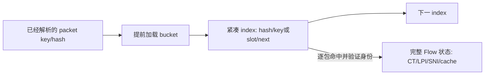

# VPP 批处理与预取：具体代码差距地图

日期：2026-10-11。产品 HEAD `54f2566f26cbbd2ae2cdfd3a1796e4e0f19041e6`；官方 VPP pin `9258530f3804a152578ce11cc7c8a1e9eab88ed0`；参考 fork `/home/js/backup/backup/Git/vpp` HEAD `837432be3b6cf496755cfa27b7cca439734eb726`，提交时间 `2026-04-07T15:49:22+08:00`。

本轮按用户要求重新启动四个子代理，核对当前产品、固定官方源码及真实参考 fork 的函数、调用者和构建声明。下文是具体改法评估，承接[设计走读](2026-10-11_VPP_ROOT_BATCH_DESIGN_MAP.md)；没有产品实现、设备操作、新性能测量或实施票。此前接受的 Root 先行、整链收益和相同资源预算仍有效，具体 Interface 与布局尚待设计收敛。

后续推进方式已明确为[整链批处理实验](../testing/2026-10-11_ROOT_WHOLE_PATH_BATCH_EXPERIMENT.md)：用一份实验流水线和尝试备忘录累积实装，再评估完整候选；不创建对应 Plane 子任务。

## 核心判断

当前缺的是让已有多包在入口、准备、查表、发布和返回之间连续组织起来。Root 首跳独立 singleton frame、两个方向的 producer `count=1`、node 逐包准备和 Flow 索引布局，是可以准确定位的结构差距。仅替换 enqueue wrapper，或者给标量循环加几个 prefetch，都不能覆盖这条链。

参考 fork 确实提供了可借鉴的执行组织：dissector 的 x4/lookahead、handoff 的整帧 pointers/x4/发布，以及部分下游 node 的下一包预取。它的自定义 ACL、LPI 和主 scanner 并没有因此成为跨包 SIMD 分类器。官方 VPP 的 ACL 提供了更完整的多层查表预取例子；两种参考要分别使用。

VPP 将输入向量沿 graph 推进，node 的后续元素复用已暖的指令缓存；buffer header 与数据也适合一起提前加载。这解释了这些改动的机制依据，具体效果仍由完整产品候选验证。[官方 VLIB 架构](https://docs.fd.io/vpp/25.10/developer/corearchitecture/vlib.html#graph-node-dispatcher)、[buffer 组织](https://docs.fd.io/vpp/25.10/developer/corearchitecture/vlib.html#buffers)。文档用于解释机制；具体 helper 行为以本轮固定源码为准。

## 参考 fork 实际用了什么

| 实际路径 | 本轮重新核实的机制 | 当前产品对应差距 | 证据范围 |
| --- | --- | --- | --- |
| `stellar-flow-dissector-*` | 剩余输入至少 8 包时，预取后 4 包 header/data，展开当前 4 次独立 parse；末尾 scalar；parsed/error 局部累计后更新 node counter | admit 每包 get-buffer、parse、key/hash/assignment 后才处理下一包，无 lookahead | [dissector:117](/home/js/backup/backup/Git/vpp/src/plugins/stellar_dissector/dissector_node.c:117)；CMake 声明 multiarch，node/feature 注册可查 |
| fork 修改的 `worker_handoff_node` | 整帧 `vlib_get_buffers`、x4、header/data/opaque2 预取，末尾一次 `enqueue_to_thread` | primary/completion 均传 `count=1`；未利用一次调用按目标压缩 indices 的能力 | [handoff:456](/home/js/backup/backup/Git/vpp/src/vnet/handoff.c:456)、[发布:584](/home/js/backup/backup/Git/vpp/src/vnet/handoff.c:584)；core CMake 声明 multiarch |
| fork 自定义 `stellar_acl` | 整帧 pointers 与末尾 bulk next；中间每包构造 tuple、每 mask 做单 key bihash lookup | policy 缺 frame 查询准备；已有单 key 编译器 NEON 证据，缺跨查询执行组织 | [node:130](/home/js/backup/backup/Git/vpp/src/plugins/stellar_acl/node.c:130)、[lookup:307](/home/js/backup/backup/Git/vpp/src/plugins/stellar_acl/look_context.c:307)；与官方 ACL pipeline 是两条实现 |
| `stellar-lpi`、`stellar-transaction` | 整帧 pointers，提前加载下一包 header/exdata；检测停止、payload/HTTP 等 guard 仍逐 session/逐包 | consumer/terminal 缺 pointers/lookahead；产品 LPI/SNI 已有自己的停止条件，不能照搬 fork 业务 guard | [LPI node:676](/home/js/backup/backup/Git/vpp/src/plugins/stellar_lpi/stellar_lpi_plugin.c:676)、[transaction:1028](/home/js/backup/backup/Git/vpp/src/plugins/stellar_scanner/stellar_scanner_node.c:1028) |
| 主 scanner、enforcer、appsketch | 主要 packet 入口仍标量；部分使用条件跳过/缓存 | 不能据此宣称 fork 全图已批量化，或产品缺少整个成熟框架 | [scanner:1118](/home/js/backup/backup/Git/vpp/src/plugins/stellar_scanner/stellar_scanner_node.c:1118)、[enforcer:412](/home/js/backup/backup/Git/vpp/src/plugins/stellar_security_enforcer/stellar_security_enforcer_node.c:412) |

官方 pin 的 [handoff:110](https://github.com/FDio/vpp/blob/9258530f3804a152578ce11cc7c8a1e9eab88ed0/src/vnet/handoff.c#L110) 已有整帧 pointers 和 bulk publication；fork 的额外证据是其 parse/hash x4 和预取组织。基础 helper 不能记作 fork 独创算法。

fork 相关源码与构建文件由子代理逐字节对照 `git show HEAD:<path>`；工作树的 `build/external` 删除和 `test` 改动不参与结论。CMake 纳入、node/feature 注册及 enable 调用证明源码可达性；本轮没有 fork ELF、实际启用图或运行负载，不能把它们写成部署或收益证明。其 feature-set 代码自称过渡方案，部分 callback 错误只记录日志，统一 enable 返回成功也不足以证明整条 arc 已开启。[feature_set.h:60](/home/js/backup/backup/Git/vpp/src/plugins/stellar_feature_set/feature_set.h:60)、[feature_set.c:135](/home/js/backup/backup/Git/vpp/src/plugins/stellar_feature_set/feature_set.c:135)。完整区别见[参考机制报告](vpp-practices-20261011/reference-fork-mechanism-map.md)。

## 具体改哪些位置

| 执行段与当前函数 | 当前操作 | 候选修改 | 必须一起处理的依赖 |
| --- | --- | --- | --- |
| [Root read_ready](../../src/product/vpp/product_root_nfqueue_adapter.c#L1009) → [submit_external](../../src/product/vpp/product_packet_graph.c#L4043) | 最多 read 64 项；每项在 graph 内新建 `n_vectors=1` frame | 本 readiness 用有界 builder 收集已准备 indices，提交一个或几个 native frame；batch submit 内逐项初始化 facts/obligation 与 debt | EAGAIN、错误、非 packet、容量不足、故障注入和全部提前退出都处理已准备子集；不等待未来输入凑满 |
| [admit_node](../../src/product/vpp/product_packet_graph.c#L1245) → [packet_admit](../../src/product/vpp/product_packet.c#L386) | 每包 pointers/解析/key/hash/owner 一路做到分发 | 整帧 pointers；短 x2/x4 窗口预取、独立 parse/canonical/hash 准备；按输入序提交 metadata、分支和分发 | fragment detection/已准备重组包、parse failure、trace、typed key/hash/owner 保持原语义；不再次算 owner |
| [primary_handoff](../../src/product/vpp/product_packet_graph.c#L1185) | reserve 一个 packet credit，stored metadata，retained enqueue 一个 index | 当前 dispatch 内有界按 target 组织 indices；批量调用已有 retained helper，failed indices 映射回逐项失败路径 | credits 仍是 32 个 packet；窗口/credit 边界及时 flush；成功发布后禁止再访问 buffer |
| [policy_node](../../src/product/vpp/product_packet_graph.c#L1587) / [policy_on_owner](../../src/product/vpp/product_packet_graph.c#L3899) | 逐包 lease、protected snapshot、PRE/Flow/POST | pointers/lookahead 与静态输入提前准备；保护 snapshot 的范围与单包执行上下文分离；按序执行可变状态阶段 | bounded batch claim 可选；CT、UID、LPI、SNI、cache/winner 与 revision 行为仍逐包正确，POST 使用当包更新后的 facts |
| [find_entry](../../src/product/vpp/product_flow_entry.c#L72) / [flow_slot_t](../../src/product/vpp/product_flow_entry.c#L8) | bucket → 大 slot 的 hash/key → 末尾 next；每个查询依赖前次访存 | Module 内紧凑 index 与 state 分层；准备 bucket hints、分层预取，再逐包受检查找/observe | create/close/replacement/expiry、END/free-list、generation/incarnation 与索引同步；不能冻结全帧 miss 或裸 entry 指针 |
| [rule match_position](../../src/product/vpp/product_l4_policy.c#L901) / [cache/index](../../src/product/vpp/product_l4_policy.c#L953) | 单查询构造/cache guard/candidate probes | 在相同 snapshot 内准备静态 projection/key 的共有部分，按依赖提前加载 cache/index/candidates，保留标量 residual/赢家归约 | 动态 facts/cache 失效不可提前冻结；规则位置、availability、priority、完整 winner 与 NoMatch 一致 |
| [consumer](../../src/product/vpp/product_packet_graph.c#L1747) / [terminal](../../src/product/vpp/product_packet_graph.c#L1955) | 逐包 pointers/metadata/较完整 lease，再 completion 转换 | 整帧 pointers、stage 所需小投影、metadata lookahead；按 origin 组织原 completion carrier | END、fragment bundle、span/generation/trace 分支和 overlay 转换保持；不扩 opaque 或新增 packet heap |
| [return_try](../../src/product/vpp/product_packet_graph.c#L1851) / [retry_node](../../src/product/vpp/product_packet_graph.c#L1904) | return count=1；retry budget=64 但逐项发布，遇到首个实际失败停止 | 当前 terminal 窗口 bulk return；从原 backlog 提取有界 ready 子集，批量尝试并压回 failed 子集 | 保持原 holder、容量、held 分支、timeout/progress 与部分成功债务；不新增 payload queue |
| [origin_completion](../../src/product/vpp/product_packet_graph.c#L2194) / [Root complete_from_graph](../../src/product/vpp/product_root_nfqueue_adapter.c#L895) | frame 内逐项校验、一次 NFQUEUE verdict、receive-pool return | pointers/identity/metadata lookahead，按 origin lane 组织准备与回收；首个完整候选仍保留逐 identity verdict | lane 独占 fd/packet-id；一次平台尝试；成功、明确失败、未知结果分开；Root buffer 归还原 pool |

这些改动组成同一候选。顺序上先确保实际多包输入与两端 publication 有合法的生命周期，再让 node/Module 的准备和访存流水线利用它；紧凑索引、snapshot 与规则准备的选择同时评估。局部正确性/机制证据可以累积，默认采用的收益门槛针对完整链路。

## 入口和 publication 的新控制流应是什么

下面是 Interface 行为草图，不是待复制的源码或冻结的函数签名：

```text
Root readiness:
  接收并登记各自 obligation → 收集本次 ready indices
  任一出口：提交已准备子集，未提交项走原结算路径

Admit frame:
  整帧 pointers → 短窗口独立 parse/key/hash 准备
  按序提交每包 metadata 与 local/remote/terminal/fragment 分支
  remote 项逐包 reserve credit，窗口或 credit 边界 flush
  retained bulk 返回 failed indices；只对 failed 项恢复/结算
  dispatch 出口 flush 所有已准备窗口

Terminal/return:
  校验并转换现有 completion carrier → 按 origin 组织当前 ready 子集
  bulk retained publication → 仅 failed 项进入原 bounded backlog
  retry 从原 backlog 提取 ready 子集 → publication → 压回失败子集

Origin:
  frame 内提前准备 metadata/identity → 逐 obligation 平台 attempt
  分别记结果 → Root pool return / 适用 native buffer free
```

不能先 reserve 64 个 remote packet、最后才第一次 flush：现有目标 owner credit 上限为 32，早先准备的窗口还没到 receiver，后半 frame 会被人为挤出。应在有界窗口/credit 边界发布已准备项；没有可用 credit 时仍保持非阻塞处理，不等另一 worker 为当前循环腾容量。具体窗口和服务预算联动设计，不把 32 packet credits 改称 32 frames。

现有 [retained core patch](../../src/product/vpp/patches/core/0001-vlib-nonblocking-retained-enqueue.patch#L78) 已接受 indices/targets/count 并返回 failed indices，首轮可复用。它是本产品 patch，官方与 fork 的 drop-on-congestion helper 会 free rejects，不能直接替换。本轮 source 证据显示每次、每个目标实际申请一个 FQ element；同目的、容量足够的八项从八次调用改成一次，可从八个 elements 变为一个，八个 packet 的 credits 与 obligations 都仍独立。[固定 producer](https://github.com/FDio/vpp/blob/9258530f3804a152578ce11cc7c8a1e9eab88ed0/src/vlib/buffer_funcs.c#L291)。逐项失败映射不能用整体布尔值替代。

两处容易误用的预取/数组细节也需在 node 准备层处理：pin 的 `vlib_get_buffers_with_offset` 在特定编译已知输出对象大小的情况下，将动态 `count` 向上凑到 8 项再读 indices/写 pointers；紧凑 retry 切片须有足够 padding，尾部可填有效占位 index，只消费真实 `n`。另外 `vlib_prefetch_buffer_header` 仅覆盖前 64 bytes，产品 packet/completion overlay 在第二 cacheline 的 `opaque2`，须按需要单独预取；Root 的 L3 payload 位于 `current_data` 指向的 NFQA payload，数据预取用 `vlib_buffer_get_current`，不能一律暖 `b->data` 的 netlink 起始内容。[pointer helper](https://github.com/FDio/vpp/blob/9258530f3804a152578ce11cc7c8a1e9eab88ed0/src/vlib/buffer_funcs.h#L186)、[buffer layout 与 header prefetch](https://github.com/FDio/vpp/blob/9258530f3804a152578ce11cc7c8a1e9eab88ed0/src/vlib/buffer.h#L148)、[Root payload span](../../src/product/vpp/product_root_nfqueue_adapter.c#L1187)。

详细出口、holder、credit 和 retry 分析见[入口报告](vpp-practices-20261011/root-ingress-batch-map.md)与[发布/返回报告](vpp-practices-20261011/return-publication-batch-map.md)。

## Flow 索引和 lookup 不能只加一个 prefetch

当前 slot 是 `[完整 entry, next]`。entry 的协议状态包含两个 4096-byte SNI/stream buffers；查链只读 linked/hash/key/next，不会因此读取全部 8 KiB，但 lookup 字段所在大 stride 与尾部 next 会带来分散的依赖读取。预取下个 packet 的 buffer 只能帮助 packet metadata，不能自动提前知道下一次 Flow bucket/slot/state 的地址。

候选方向是在 opaque FlowRuntime 内组织紧凑索引层：



有两个需要比较的布局选择：

- 保留现有 entry slots，新增/重排 Runtime 私有 compact index，命中后才访问原 entry。全 key 放 index 可减少 miss 时冷状态读取，但需计入固定内存预算及唯一权威；只放 hash/slot/next 则仍需访问 entry 校验完整 key。
- 真正拆开热 index 与冷状态池，需要同步重构所有假定旧 slot 布局的路径。尤其 [set_decision:702](../../src/product/vpp/product_flow_entry.c#L702) 用 borrowed entry 地址减 `pool->slots`、按 `sizeof(flow_slot_t)` 整除验证身份，依赖 entry 位于 slot offset 0。只把 header 挪到前面会破坏它。

Node 的 Interface 应隐藏 index/table/pool，表达“为这些已验证 key 准备/预取”和“按当前状态受检查找/observe”；内部可以传 slot + generation/incarnation hint，调用时重验。前包创建、关闭、替换或 expiry 可能改变后包查询结果，整帧预先 lookup 的 miss 和 entry pointer 不能直接成为后续权威。

官方 ACL 的 [dataplane_node.c:354](https://github.com/FDio/vpp/blob/9258530f3804a152578ce11cc7c8a1e9eab88ed0/src/plugins/acl/dataplane_node.c#L354) 明确区分 bucket、bihash data、session record 三级预取；它还在前包建/删 session 后修正下一包预测。值得借鉴的是依赖层次与同 flow 修正，产品不导入其 session manager、classifier 或 metadata 布局。

**Root 首个场景须按真实调用量评估。** 当前普通完整 TCP/UDP 的成功 policy 路径通常经 observe 做一次 `find_entry`；PRE 终态 DROP 或不合格 typed assignment 可不查 Flow。额外重复查询主要来自 VPN resolver/current/enrich/observe/refresh/egress 的条件组合，部分分支可达六次，不能将六次当作 Root 每包成本。两者共同受益于查找 Interface 和索引局部性，但重复查询消除的预期贡献不同。详细 callchain 见[Flow/policy 报告](vpp-practices-20261011/policy-lookup-batch-map.md)。

## 规则与 snapshot 应怎样接进流水线

当前 [snapshot_acquire:435](../../src/product/vpp/product_packet_graph.c#L435) 同时保护 bank，并初始化 CT、cache、protocol、SNI 等单包查询上下文。若选择 bounded batch claim，应拆分这两种职责：外层短窗口持有 bank 的 reader protection，每包仍有独立执行上下文。`acquire` 一次不能意味着整帧共享一份可变 `snapshot.ct/cache/protocols`。

已接受的选择允许开始执行的短批次固定一个规则版本；后续批次取新的 active version。同包 PRE/POST 共用保护的 snapshot，Flow revision 失效行为保持。额外可见性延后由当前批次剩余工作决定，须直接记录持有时间；不能用输入间隔推算。reader count 与 publisher reuse 的 SC 保护不能为省原子而删掉。

查询准备分成两个层次：packet family/address/ports/direction 等静态字段可提前投影；CT/UID enrichment、protocol/SNI、cache guard 和 POST availability 必须在对应状态变化之后形成或重验。随后交错不同包的 cache/index/candidate 读取。首个候选可保留现有标量 residual 与 winner 归约；x4 展开、单 key NEON 和多包 SIMD 是不同投入。当前已有[单 key 编译器 NEON 证据](../testing/2026-10-11_PIXEL6A_INCREMENTAL_BATCH.md)，源码没有 intrinsics 不能证明没有 SIMD。

规则 Module 还有两处可一起收敛的具体组织问题：

- [match_cached:1087](../../src/product/vpp/product_l4_policy.c#L1087) 已查找 UID subject，cache miss 后调用 [match_position:932](../../src/product/vpp/product_l4_policy.c#L932) 又查一次。prepared query 可复用本 snapshot 内已验证 subject，静态 projection 在 PRE/POST 之间也可复用；动态 guard 仍随本包 facts 形成。
- [match_position:953](../../src/product/vpp/product_l4_policy.c#L953) 遍历整个 view 的 subtables 再过滤 subject，而 [build_index:391](../../src/product/vpp/product_l4_policy.c#L391) 本来按 subject 构建。可在编译结果中保存各 subject 的 subtable range，查询只访问对应范围，再做 mask/hash 与 head/candidate 分层预取。空 view、未知 UID、无 subject 的合法 NoMatch 可提前结束无益 cache 准备，但继续必要 Flow 维护；计数口径需随实际 probe 行为明确更新。

这些改动压缩查询的准备和访存工作，不改变完整表达式、动态 availability、checked-rule 去重、rank pruning 或 winner 归约。具体 prepared query 的字段、compiled dependencies 与私有 range 设计见[规则接口评估](vpp-practices-20261011/policy-lookup-batch-map.md)。

## 已经接上的机制与适用边界

| 当前已用机制 | 本轮应保留/接续的作用 |
| --- | --- |
| 普通 `enqueue_to_single_next(...,1)` | native next frame 已累积；它不等于每次新建 external frame，bulk next 主要省 caller 准备/helper 工作 |
| FQ receiver merging | 多个 producer elements 可合成 dispatch frame；producer singleton 的 slot/CAS/publication 成本仍已发生 |
| W2 owner 私有 Flow/HEV、固定 canonical hash/assignment | 提供状态 locality；批处理不改变 owner、共享 transport state 或迁移 live flow |
| Android eventfd notification latch | 已合并 wake writes；bulk publication 可摊薄 publication 级 ordered exchange，不能宣称当前每包必有一次 eventfd syscall |
| parse-once compact metadata、LPI/SNI 停止条件 | 保留当前 typed facts 与识别预算，避免用 fork 扩 opaque、动态 exdata 或不同识别 guard 替代 |

统计计数可以在纯统计语义成立时先本地累计、frame 末合并。跨线程 credits、publication authority 和 stop/teardown 读取的真实 lifecycle debt 必须在正确的转移时点反映，不能统一延迟到 frame 尾。[notification patch](../../src/product/vpp/android/patches/0019-vpp-worker-notification-latch.patch#L122)、[receiver 合并](https://github.com/FDio/vpp/blob/9258530f3804a152578ce11cc7c8a1e9eab88ed0/src/vlib/buffer_funcs.c#L476)。

Root origin 段可先做准备/回收批循环，逐 packet-id verdict 仍独立。`complete_from_graph` 返回真只表明有效 identity 已处理且 buffer 已归 receive pool，verdict syscall 失败也可能返回真；不能当作 `SUCCEEDED` 或有效策略包指标。进一步 syscall batching 尚无可直接采用的 fork 实现，需要先解决逐 identity 一次尝试、部分成功与未知结果；NFQUEUE 按 packet-id 范围决定同一 verdict 的操作不能代替任意 verdict 集合。

fork 的 deprecated NFQUEUE 逐包 verdict 也没有证明完整 origin 批量闭环，按项目约束不作为产品实现参考；fork TUN 的一次 `readv` 是一个 packet 的 scatter I/O，不是多包 receive。VPN 的 HEV 输入/drain 服务预算属于后续共享图回归与切片，不把 NIC/DPDK/RSS/NUMA 或 router fork 的拓扑强塞到 Android 本机端点。

## 本轮产物与尚未证明的部分

四个独立核源报告：

- [Root 入口与 admit 准备](vpp-practices-20261011/root-ingress-batch-map.md)。
- [Flow/policy 查询与布局](vpp-practices-20261011/policy-lookup-batch-map.md)。
- [Primary/completion/retry/origin](vpp-practices-20261011/return-publication-batch-map.md)。
- [参考 fork 机制、调用者与开发状态](vpp-practices-20261011/reference-fork-mechanism-map.md)。

已确定的是改动地点、现有 caller 的执行粒度、可复用的 helper 和方案约束。待设计收敛的是 compact index 布局与内存分配、prepared query/hint 的有效期、snapshot 窗口和 publication/service budget 的配合；可用源码证据没有证明这些选择的 CPU 或吞吐收益。首个完整 Root 候选应把整条链接起来，正确性与资源有界验证后，再按既定整体指标验收。
