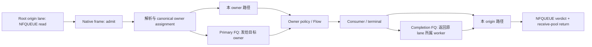
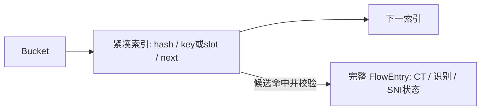

# Root 批量执行：现状到候选改法的设计走读

2026-10-11。产品基线 `54f2566f26cbbd2ae2cdfd3a1796e4e0f19041e6`，VPP pin `9258530f3804a152578ce11cc7c8a1e9eab88ed0`。这是方案评估图，不是实施票或已完成的技术方案。

用户在规格发布后指出具体改造尚未形成可理解的对应概念。此前确认的是 Root 先行、整链收益、资源上限和 CPU 指标，不能据此推定用户已理解所有 Interface 和结构改动。本次回到设计走读；没有创建子票、修改父规格、实现产品或运行基准。

同日补充：[批处理/预取代码差距地图](2026-10-11_VPP_BATCH_CODE_GAP_MAP.md)由四个新子代理进一步核对当前函数、真实参考 fork 的调用者与构建声明，以及固定官方源码。它把下文的方向展开为具体改动点和 Interface/布局依赖，不代表方案已完成评审。

## 一条 packet 经过什么

Origin lane 负责捕获和平台 completion；ExecutionOwner 负责 Flow/CT/识别和规则判定。它们可能是不同 worker。Payload 保持现有 native buffer，frame 与 FQ 传 indices；没有引入第二种 packet 实现。

## 五组联动改动

| 位置 | 当前具体实现 | 候选如何改 | 对相邻阶段的作用 |
| --- | --- | --- | --- |
| 入口成帧 | readiness 最多读取 64 次，但每包各自提交 `n_vectors=1` 的独立 external frame | 将本次已接纳 indices 交给有界 batch submit；每包保留自己的 facts、generation、obligation，处理所有提前退出的已准备子集 | 给 admit 实际多包输入，后续准备窗口才有工作可重叠 |
| Admit 准备 | 每包取 buffer、解析、构造 key/hash、决定 distribution，完成后才到下一包 | 一次取得本 frame 的 pointers；短窗口交错独立包的 header/data/parse/key/hash 准备，按原序提交 metadata 与分发 | 解析时提前加载后续包，形成可送往各 owner 的 indices 集合 |
| 两端跨 worker 发布 | primary 和 completion/retry 各逐包 retained publish | 同一 dispatch 内按 target/origin 组织多包 publication，保留 failed-index 集合和旧 credits/backlog；credit 边界处及时发布已准备窗口 | 往 owner 与回 origin 都摊薄真实 queue reservation/publication，不只省本地 helper |
| Policy/Flow 查表 | 对单包立即查 linked buckets、访问完整 entry、规则 cache/index，再更新状态 | 在 Module 内准备查询和预取 bucket/index/state；按原顺序查找/验证并更新；评估紧凑热索引及有界批级 snapshot | 使多包的访存延迟相互重叠，前包建流/关闭仍对后包可见 |
| 末端结算与回收 | consumer/terminal 重建较完整 lease；origin frame 逐包验证义务、发送 verdict、归还 buffer | Stage 所需小投影、pointer/metadata 预取，批内组织 completion 与回收；评估安全的 syscall batching | 将准备、返回和真正资源归还接起来，避免只优化前半条路径 |

入口与 admit：[Root read callback](../../src/product/vpp/product_root_nfqueue_adapter.c#L1027)、[external submit](../../src/product/vpp/product_packet_graph.c#L4043)、[admit](../../src/product/vpp/product_packet_graph.c#L1245)。来回 publication：[primary](../../src/product/vpp/product_packet_graph.c#L1185)、[completion](../../src/product/vpp/product_packet_graph.c#L1851)、[retry](../../src/product/vpp/product_packet_graph.c#L1904)。Owner 与末端：[policy](../../src/product/vpp/product_packet_graph.c#L1587)、[Flow lookup](../../src/product/vpp/product_flow_entry.c#L72)、[origin completion](../../src/product/vpp/product_packet_graph.c#L2194)、[Root platform operation](../../src/product/vpp/product_root_nfqueue_adapter.c#L895)。

这里的数组 carrier 仍是 VPP native frame。普通 `single_next(...,1)` 已向 next frame 累积，FQ receiver 也已合并多个 elements；候选不重建这些机制。真正的独立 external frame 和逐次 producer publication 是不同的改动点。[固定 VLIB next-frame helper](https://github.com/FDio/vpp/blob/9258530f3804a152578ce11cc7c8a1e9eab88ed0/src/vlib/buffer_funcs.c#L195)、[producer](https://github.com/FDio/vpp/blob/9258530f3804a152578ce11cc7c8a1e9eab88ed0/src/vlib/buffer_funcs.c#L291)、[receiver](https://github.com/FDio/vpp/blob/9258530f3804a152578ce11cc7c8a1e9eab88ed0/src/vlib/buffer_funcs.c#L471)。

## 四包例子

假设 origin 属于 worker 0，一次读到 `A1, A2, B1, A3`；A 的三个包属于同一 flow，其 owner 是 worker 1；B 的 owner 是 worker 0。假设没有容量拒绝。

- 当前入口形成四个独立 admit frames。A 的三个包分别发布到 worker 1，消耗三次 producer publication；receiver 之后仍可能将它们合成一个 policy frame。
- 候选入口形成一个四包 frame，在短窗口内准备 pointers/header/key。A 的三个 indices 按原序合为一次 publication；B 保留本 owner 路径。
- worker 1 可提前加载 A 后续查询需要的数据，仍执行 A1 → A2 → A3；A1 建立的 flow 对 A2 可见，A2 的更新对 A3 可见。
- A 的 completion 按当前可用 frame/window 合批返回 worker 0，original lane 对三个 packet-id 分别完成其 verdict 和 pool return。B 可独立完成，不等待另一 owner 的包到齐。

这个例子展示了批量改法如何贯通：一个 ingress carrier、多包准备、两端真实 publication、查表预取和实际回收协作。同 flow 状态仍串行，独立包的准备和内存访问可以重叠；不要求每一段都独立产生测速收益。

## 尚需完成的工程设计评估

### Flow 热索引具体是什么

当前 `flow_slot_t` 是 `[完整 FlowEntry, next]`，其 entry 包含大协议状态。候选方向是让 bucket 链主要经过紧凑索引，命中后再取对应 slot 的完整状态。

必须评估索引放完整 key 还是仅放 hash/slot、哪些字段仍有唯一权威、free/unlink/FlowEnd 如何同步，以及有界内存成本。原固定链的紧凑布局与 VPP bihash 是不同候选；不能因上游使用 bihash 就忽略本项目预分配与固定容量合同。Node 侧 Interface 应只表达准备/预取与受检观察，不暴露 table 或裸 entry ownership。该结构选择尚未完成设计评审，现有规格仅给出方向。

### Policy 查询准备与 snapshot 生命周期

需要设计哪些静态输入可提前形成、哪些动态事实必须等当包 Flow 更新、prepared 查询如何在 snapshot 内有效，以及相同 flow 前包改变 cache/state 后后包如何重新验证。用户已允许包级或有界批级 snapshot；这一点可以由整链证据选择，不再先冻结逐包取得快照。

### Batch 的占用与失败状态

需要把一组 indices 在本 holder、已 reserve credits、已 publication、retained rejected、已完成 origin operation、已归还 pool/free 各状态的授权点画清楚，并定义 batch submit/publication/completion 的输入和逐项结果。32 个 packet credits 保持原单位；prepare window 不应先 reserve 整帧再首次发布。新 Interface 应隐藏这些复杂度，保留原 single-item caller 的迁移路径，而非引入公共 batch manager。

### Origin syscall 能不能也合批

当前 Root completion 对每个独立 identity 构造并发送 verdict；函数返回真还可能只是已经处理并归还 Root buffer，不能直接作为成功 verdict 计数。安全 syscall batching 必须保留逐 packet verdict、一次平台尝试和结果分类。

`sendmmsg` 可以一次提交多个 message，但只报告已发送数量；部分成功后后续错误码可能丢失。这是需要原型/真实系统反馈的问题，不能简单把普通 socket 示例的重试方式移植到本产品 completion 合同。[Linux man-pages](https://www.man7.org/linux/man-pages/man2/sendmmsg.2.html) 若该选择需要 runnable 证据，原型只验证 identity/partial-result/settlement，不以单点速度决定整链前置机制去留。

## 当前适合的流程

本阶段使用 `zoom-out` 给出 Module/caller 地图，再用 `codebase-design` 收敛 Interface、布局、生命周期与少数候选方案。沿用 `grill-with-docs` 已明确的目标，不再反复让用户选择常规调参。需要 runnable 答案的局部机制通过原型获得证据；整体速度留给完整候选的验收。

具体方案完成走读、关键选择有依据之后，再补齐规格并进入 `to-tickets` 的拆分评审。这里列的是改动地图，不是把五个 Module 横向拆成五张实施票。现有 SAKAMOTO-291 保留为目标/验收与候选方向记录；本阶段不发布子票或修改父项。
