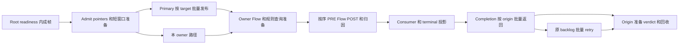
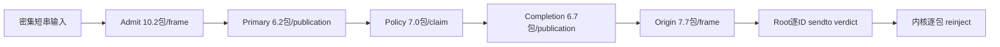

# Root 整链批处理实验记录

2026-10-13 当前TCP/UDP真机基线：端点TCP305–444Mbps、UDP537–554Mbps均含绕过；
无绕过完整检查最高UDP点为8kpps/76.74Mbps，16k开始direct ACCEPT及乱序。CPU采样内核
TCP83.41%/UDP77.25%，14个实际流量窗口及对应函数表/火焰图保留，原设备状态已恢复。
见[当前吞吐基线](#当前tcp与udp吞吐基线--2026-10-13)。

2026-10-13 匹配证据优化已实际安装到Pixel，前后六窗全部执行、60000包全部送达，
两版ALLOW/DROP语义通过。记录热点采样占比2.15%→1.22%，但**未证明整链CPU下降**：
全窗口CPU/Q描述性观测+4.82%，最后一窗内核快照竞态未通过，未重采样。原APK、配置、
Stopped与Openwrt连接已恢复/保留。见[真机对照](#匹配证据真机前后对照--2026-10-13)；
此前[Host等价/局部耗时](#匹配证据计算复用--2026-10-13)仍保持原范围。

2026-10-13 通用 I/O 尝试已结束：7个实际流量窗口后触发 owner-live 启动护栏，
冻结对照中止，所有窗口均未通过交付资格，没有可采用的收益结论。原 APK、原配置和
Stopped 已恢复；实际双队列、读取预算和普通 socket 容量证据保留。详见
[通用 I/O 对照](#通用-io-配置与预算对照--2026-10-13)。

2026-10-13 后续推进完成：64-slot completion 碰撞已修复，Host 与真机可控复现验证通过；
固定九窗全部执行并保留，修复版 packed 比同源码 scalar 的 CPU/Q 低8.69%。末轮 p99
为25.2 ms，scalar15.7 ms，增加9.5 ms；用户确认这一量级不应阻断批处理推进，继续以
整链 batch+packed 为主候选。原预注册相对护栏与快照资格结果保留。原配置与 baseline APK 已恢复，九张
CPU-only 火焰图、逐 probe 分段和独立 off-CPU 记录保留。原十二窗保持原样；详见
[槽位修复与延迟分段](#64-slot-completion-碰撞修复与延迟分段--2026-10-13)。

整组代码已接通，首轮 18 窗口已执行，但**该轮实际批量仅 1.1–1.2，未满足密集批处理/预取的测试前提，也未采集候选火焰图，不能据此判断密集负载下的整链收益**。已补独立密集诊断：4kpps、32 包/8 ms 的候选在各段形成平均 6–10 包，Q=100%、无图前放行或结算失败；匹配 APK 的火焰图显示 Root verdict 调用链仍逐 ID 执行，占约 60.8% CPU。八段候选和原始数据保留，默认 OFF；尚无正式密集收益或采用结论。

前次结果，2026-10-12：同 source、同 origin window 的 scalar / sendmmsg / packed
已执行全部 12 个固定窗口。packed 密集平均 7.182 条/datagram，CPU/Q 比 scalar 低
10.91%、比 sendmmsg 低 9.03%；这些区间均低于 1，但 p99 和零图前旁路护栏没有全部
通过，继续默认 OFF。12 张 exact-APK 火焰图、所有失败窗和设备恢复证明保留。
详见 [三发送器对照](#三种同窗口-verdict-发送器的对照--2026-10-12)；
此前 [八窗 sendmmsg 尝试](#root-独立-verdict-的-sendmmsg-尝试--2026-10-12)仍按原范围保留。

## 目标和推进方式

先把入口成帧、节点准备与预取、查表、两端 publication、completion retry 和 origin 回收接成一个完整 Root 候选，再评估整体效果。各次修改累积到同一候选；必要前置机制不因单独部署暂时没有收益而撤回。每步先检查语义、资源和生命周期，完整链路形成后统一进行性能比较。

本次以一份实验记录持续推进，不创建 Plane 子任务。既有[代码差距地图](../reviews/2026-10-11_VPP_BATCH_CODE_GAP_MAP.md)负责解释代码依据；本文记录实际选择、实现覆盖、验证结果和下一次尝试的接续点。修改方向已有固定源码依据，具体收益由完整候选验证。

## 基线和实验边界

基线产品 commit：`54f2566f26cbbd2ae2cdfd3a1796e4e0f19041e6`。VPP pin：`9258530f3804a152578ce11cc7c8a1e9eab88ed0`。先前已撤回的局部 batch 实验及其失败记录保留，不能直接作为本轮候选的结果。

首个场景是 Root 普通未分片包，修改共享 C/VPP graph，并保留 VPN 代表性回归。worker 数、packet credits、native queue 深度、Flow/receive/completion/backlog 容量保持基线；批次窗口、预取距离和服务预算可以联合调整。新索引的固定内存开销须明确记录。

同 flow 的 Flow、CT、UID、LPI、SNI 和缓存状态按原序处理。每包保留独立 facts、generation、AdapterObligation 与结算结果；batch 不等待未来包，不将失败子集当作整批失败，成功 publication 后不访问已转移 buffer。Root buffer 归还原 receive pool，平台 verdict 保持逐 identity 一次尝试。

## 完整候选的流水线

实现顺序按依赖推进，候选形状可以随实际验证修正。阶段之间不设置孤立的吞吐或百分比收益门槛。

| 实验单元 | 累积修改 | 接通后检查的行为 | 当前状态 |
| --- | --- | --- | --- |
| 入口和 admit | 批量 external submit；Root callback 所有出口 flush；bulk pointers、current-data/opaque2 lookahead、短 x4 准备 | 每包独立接纳；异常、分片与 fault fixture 不遗留已准备项 | 已接入；实际函数测试、早期 Linux 图及最终 Pixel 多包计数通过 |
| Primary publication | 有界按 target 窗口；复用 retained helper；失败 indices 逐项映射 | 32 packet credits 单位不变；credit 边界及时 flush；部分成功不重复结算 | 已接入；乱序失败和转移后禁读测试通过 |
| Flow 查询和布局 | Runtime 私有 compact index；bucket/index/state 预取；消费时重新验证 | 同 frame 建流、close、expiry、replacement 对后包可见；END 仍持有旧槽 | 已接入；ON/OFF 各三项 Flow 回归通过 |
| Policy 和规则查询 | bounded snapshot protection 与单包上下文分离；静态 projection/subject 复用；subject subtable range | PRE/POST 同版本；动态事实使用正确时点；winner、NoMatch 和 availability 一致 | 已接入；ON/OFF、独立 winner 对照、bank reader/双切换与 16 包窗口验证通过 |
| Consumer 和 terminal | pointers/metadata 准备；较小 stage 投影；原 completion overlay 转换 | END、fragment、span/generation、trace 及原义务不丢失 | 已接入；普通投影审查通过；trace/fragment 保留完整 lease |
| Completion 和 retry | 当前 dispatch 内 bulk return；原 bounded backlog 提取/压回失败子集 | held 分支、1 ms deadline、部分成功及实际 debt 守恒 | 已接入；多 target、held、512 回绕和 64 retry 测试通过 |
| Origin 结算和回收 | header/opaque2/pending 准备；原 lane 逐 ID verdict；适用的 native free 和图计数汇总 | verdict 逐项一次尝试；成功、明确失败和未知结果独立；pool return 不冒充 verdict 成功 | 已接入；混合 Root/VPN/replay 实际函数测试通过 |
| 整体关联计数 | 关联完成策略判定与成功 Adapter Completion；记录真实 frame/publication/hold duration | CPU 分母排除旁路、未接纳、runtime fault 和内部 carrier | 已接入；资格负例、matched ALLOW/DROP 分项与 Pixel 固定负载预检通过 |

首个候选使用已有 retained queue 能力和逐 packet-id verdict，不把 NFQUEUE syscall batching 或完整识别状态池拆分设成前置条件。这些额外选择若需要尝试，另记其适配语义和结果。

## 每次尝试怎样记录

每次追加一条记录，保存候选源码身份、累积修改集合、具体参数和实际 artifact。记录分别回答三个问题：代码是否已接入，目标机制是否实际执行，整链是否产生可复现收益。局部 clocks 或 endpoint Mbps 可保留为观察，不据此决定必要前置机制的去留。

| 日期和尝试 | 候选身份与累积集合 | 本次选择和修改 | 验证及原始证据 | 结果和接续点 |
| --- | --- | --- | --- | --- |
| 2026-10-11 建立实验 | 基线 `54f2566f`；候选尚未形成 | 接受整组累积实现后评估；采用本记录持续接续 | [代码差距地图](../reviews/2026-10-11_VPP_BATCH_CODE_GAP_MAP.md)与四份核源报告 | 先接通入口和两端 publication 的生命周期，再累积查表与节点准备；没有新的性能结论 |
| 2026-10-11 实装第一组 | `SAKAMOTO_PRODUCT_ROOT_BATCH_EXPERIMENT=ON`，整组代码已累积 | Root input 32；admit prepare 4；两端 publication 和 policy 16；retry 64；Flow bucket/index/state lookahead 6/3/1 | [外部提交测试](../../tests/host/product_external_batch_test.py)、[批量生命周期测试](../../tests/host/product_packet_batch_test.py)；随后完成 fresh Host/Android 构建和分层验证 | 保留固定容量、同 flow 顺序及逐 ID verdict；此条为实装记录，不代表收益 |
| 2026-10-11 集成审查修正 | 第一组候选，不撤回前置机制 | 未来 Flow 预取只允许 complete L3，避免短包越过逻辑 span；有效策略分母还要求本 UID 存在 subject/candidates，不能仅看全局规则表非空 | 实际函数负例与独立审查；Host 插件实际编译通过 | 修正后重新构建源码绑定 artifact，再进入整组比较 |
| 2026-10-12 启动与停止修正 | 两种比较模式共同修正 | 实际 failed-start rollback 的控制栈需要超过 282 KiB，统一使用 512 KiB；adapter 启动前退出时不访问不存在的 worker graph | Host v3 部分启动实际回滚；Host v4 过长 socket 路径触发启动前退出，正常返回且无 SIGSEGV；实际 callback 的 RED/GREEN 回归 | 控制栈不属于 packet 容量；基线/候选都采用同修正，保留早期失败 |
| 2026-10-12 PRE ALLOW 与计量修正 | 两种模式同源码 `c222ac36…` | PRE 完整 ALLOW 观察 Flow 后漏写 winner，改为所有成功观察后统一提交；新增 immutable completion 的 matched ALLOW/DROP 成功分项 | OFF/ON RED/GREEN；Pixel generation 1872 的 72 个真实 PRE ALLOW 关联到同 obligation 的成功 NF_ACCEPT；106 个反向 NoMatch 证明最后 Flow.rule 不能作为持久 winner | 主分母定义不变；冻结 ALLOW 负载还要求 matched-allow delta 等于 Q，matched-drop delta 为零，且 UID/端点/协议有进展 |
| 2026-10-12 网络恢复与最终构建 | Android v4 ON / baseline-v4 OFF，qualification 均 ON | Pixel 从 `192.168.1.104` 切回 `192.168.4.151`；两 APK 同产品 source closure、同 dex，只有 product plugin 不同 | 候选 generation 1874 的普通 VPN TCP/UDP 回归与正常 stop 通过；generation 1875 的 8kpps Root 预检通过，Q=25,189=matched ALLOW，failed/duplicate/Flow capacity miss 均零 | 预检只检查资格，不作为正式收益样本；正式执行次数和顺序在采集前冻结 |
| 2026-10-12 冻结协议修订 | 正式样本仍为零 | v1 的 TCP 400 CPS/10 s 会超过原 Flow 容量，且不足以观察真实 END；开测前改为 50 CPS/40 s，形成 v2 | [冻结协议 v2](../../build-output/root-whole-path-20261011/frozen-protocol-v2.json)保存 predecessor、18 窗口顺序和禁止重试条件 | 不修改容量；修订未解决后续实际 END/容量问题，失败样本仍完整保留 |
| 2026-10-12 首轮整体对照 | 同源码 `c222ac36…` 的 A=batch OFF、B=batch ON | 每组 3 对，顺序 AB/BA/AB；UDP 稳态 8kpps/64 tuples、TCP 新建 50 CPS、UDP 轻载 100pps/1 tuple；合计 360 s client 窗口 | [全部原始结果](../../build-output/root-whole-path-20261011/formal-v2/result.json)、[逐项护栏和配对统计](../../build-output/root-whole-path-20261011/analysis-v2/summary.json)；18 次 stop 均无残留 | 稳态无可复现 CPU/Q 收益；TCP 六窗资格失败；轻载首对 p99 失败。没有补跑或筛选有利结果，默认 OFF |
| 2026-10-12 恢复设备 | 安装 baseline-v4 OFF，UID 12632 保留 | 用原 import API 恢复实验前空规则配置，再正常 stop | [恢复结果](../../build-output/root-whole-path-20261011/final-restoration/result.json)；saved=active=909、rules=0、batch=0；native debt、hooks、queues 均清；[本轮 peer 清理](../../build-output/root-whole-path-20261011/peer-cleanup.json) | 候选源码、两套 artifact 和所有失败记录保留；恢复的是规则语义，版本按正常提交前进 |
| 2026-10-12 纠正测试前提并补火焰图 | Product source 和两套 APK 均不变 | 不限速 UDP 的 B/A 各 6 s，只检查密度与 CPU 热点；保留原容量 | [诊断协议](../../build-output/root-whole-path-20261011/density-protocol.json)、[候选图](../../build-output/root-whole-path-20261011/density-profile/B/graphs/root-udp-fixed-flamegraph.html) | 候选实际入口 24.5、primary 8.3、policy 11.8、completion 10.5、origin 21.7；Q/succeeded=72.64%、大量未接纳放行/underlay loss，只作饱和机制诊断 |
| 2026-10-12 增加受控短包串 | 只改测试发生器和采集器，Product 不改 | 同一平均速率改为全局 32 包短串；独立接收端 RED/GREEN 证明时序、尾段和 identity，旧模式全部回归通过 | [接收端测试](../../tests/benchmark/check_udp_burst.py)、[旧模式回归](../../build-output/root-whole-path-20261011/socket-burst-regression.log)、[8kpps 预检](../../build-output/root-whole-path-20261011/burst-profile/B/result.json) | 8kpps/32 包每 4 ms：各段已成批、payload 全送达，但图前放行 110；严格零旁路预检失败，未执行该负载的 A 臂 |
| 2026-10-12 降低平均负载，保持短串密度 | 只改速率 8k→4k，其余 source/规则/资源/32 包串固定 | B/A 各 6 s、每 8 ms 一串 32 包；不加入原 18 窗口或收益统计 | [预检协议](../../build-output/root-whole-path-20261011/burst2-protocol.json)、[综合诊断](../../build-output/root-whole-path-20261011/dense-diagnosis-summary.json) | B 全链平均批量 ≥4、Q=100%、图前放行 0、24,000/24,000 payload；A 图前放行 9、Q=99.966%；仅一对，且 p99 相差明显，不给整体收益结论 |
| 2026-10-12 诊断后恢复 | baseline-v4 OFF 仍为当前设备 artifact | 原空配置经 API 恢复，保留所有成功/失败预检和当前图 | [最后恢复](../../build-output/root-whole-path-20261011/burst-final-restoration/result.json)：generation 1904、saved=active=913、rules=0、债务/hooks/queues 清；两个诊断 peer 均已停止 | 下次从 Root 平台逐 ID 成本和时延等待继续；不因稀疏结果撤回整组候选 |

失败尝试保留具体触发条件、原始结果和修正。正确性或资源错误先修复再累积；单点暂无速度收益不自动停止整组实验。若某一机制必须调整，也记录它与其他段的依赖，避免只回退局部却使后续机制失去输入。

## 完整候选的评估

开测前固定基线和候选 artifact、相同资源、非空适用策略、流分布、packet 大小、负载、计量窗口和判定口径。主指标是 **VPP CPU 时间 / 有效策略处理包数**：适用策略判定已完成且 Adapter Completion 为 `SUCCEEDED` 才计入，正常 ALLOW/DROP 都包括。`complete_from_graph` 的回池布尔值、admitted packets 和 endpoint delivery 都不能直接替代这个分母。

机制证据覆盖 input/policy vectors per frame、两个方向的 vectors per physical publication、lookup/snapshot 次数、批次持有时间、credits/rejections、origin outcomes 与资源守恒。正确性覆盖同 flow 的相邻和非相邻包、首次建流/结束/替换/expiry、静态与动态规则、配置发布、部分 publication、stale/duplicate identity、平台失败、END/fragment 混合 frame 和 stop drain。

完整候选通过上述检查后进行整体比较，吞吐、尾延迟、拒绝、旁路和结算结果作为护栏。未证明整体收益的候选仍保留实验价值，默认实现的采用结论另记，不能把“已实装”写成“已证明优化成功”。

## 首轮冻结对照结果

2026-10-12 用户纠正测试前提：批处理/预取需要密集输入，并且批量应贯穿各段。此前把“18 窗口执行完且稀疏负载无显著收益”概括为“整链无收益”不准确。以下数值保留为稀疏输入观察，不作为密集批处理候选的有效收益判定。原协议未设置实际 batch density 的前置检查，且 `profiling=false`；该缺口不能由旧版本火焰图补足。

最终产品 source closure 为 `c222ac36d57081eb62bf4221302d0003a5757714f8964e22104fe0b877e1f117`。A 为 `android-baseline-v4`，APK SHA `c76f5c25…ab289`；B 为 `android-v4`，APK SHA `d5cc7ad2…6b1f8`。[配对 artifact 核验](../../build-output/root-whole-path-20261011/paired-artifacts-v4.json)证明同 source closure、同 dex、其余 native payload 相同，仅 product plugin 随 batch 开关变化。共同的启动/停止与 PRE ALLOW 修正均在两种模式中。

协议 SHA 为 `c0b41c29fae3cae9a445f6650f2df957556942483e14a62f11a85227fa041a98`，先冻结后采样。W2 固定在 cores 1/2，Flow 1024/owner、credits 32、primary slots 64、completion slots 128、Root receive 72/lane 保持相同。两条完整适用规则为 UID 12632 的 TCP/UDP ALLOW，revision 908。helper、规则、placement 和资源身份贯穿全部窗口，采集器本身不改规则或安装 APK。

主 CPU/Q 使用同一次 batch CLI 边界的 `CLOCK_PROCESS_CPUTIME_ID` 和 Q 差值，包含边界诊断开销；另保留仅在 client start/end 内的 CPU sampler。endpoint delivery、offered rate 和 p99 使用 client 窗口，不能将不同窗口的 CPU 和 Q 混合。UDP latency probes 及响应也进入普通 app-UID 策略路径，Q 不是纯 payload 数量；轻载尤其受 probe 数量影响，已保留各窗 `probe_requests`。

| 组 | A CPU/Q，三轮（µs） | B CPU/Q，三轮（µs） | 配对 B/A 几何均值与 95% 区间 | 结论 |
| --- | --- | --- | --- | --- |
| UDP 稳态，8kpps/64 tuples，10 s | 92.51 / 95.12 / 94.41 | 94.85 / 94.18 / 93.32 | 1.00119；0.95113–1.05388 | 三对护栏通过；区间跨 1，未证明收益 |
| TCP 建流，50 CPS，40 s | 缺失 / 缺失 / 缺失 | 778.16 / 797.45 / 缺失 | 无合格配对，不计算 | 六窗均触发 Flow capacity miss，Q/succeeded 约 0.867–0.869，低于 0.95 |
| UDP 轻载，100pps/1 tuple，10 s | 1100.15 / 1037.73 / 1120.97 | 1060.34 / 1111.43 / 1044.86 | 0.98723；0.82451–1.18206，仅描述性 | 首对 p99 57.9→123.0 ms，B/A=2.124，高于 1.25；该组护栏失败 |

按开测前口径对三轮 log(B/A) 计算几何均值及 t(2) 95% 区间，临界值 `4.302653`。稳态三对 CPU/Q 变化为 `+2.53% / −0.98% / −1.15%`，方向不一致；A 末轮比首轮高 2.05%，B 末轮比首轮低 1.61%。三对样本不足以可靠校正漂移，也不能把轻载中失败的一对删除后声称收益。

TCP 每窗都完成约 2000 个 endpoint 连接，但实际 capacity misses 为 A `424/448/424`、B `416/416/416`。A 三窗及 B 最后一窗 `Flow.closed=0`，采集器拒绝，正式 CPU/Q 缺失；其 raw CLI 计数仅作诊断。B 前两窗虽然标为 `COMPLETE`、各观察到一个 END，仍未通过容量和资格比例护栏。endpoint 完成连接不能替代完整策略建流/结束的证明；这些结果不能支持单独的 B 性能退化结论。

18 窗口全部执行，14 窗口采集器 `COMPLETE`，12 窗口通过基础资格护栏，5/9 对通过配对护栏；所有 18 次 stop 的原生债务均为零，product hooks/queues 清理通过。UDP 稳态小量 pacing missed 为 B 第零轮 2、A 第二轮 68、B 第二轮 1，actual offered 均在冻结的 ±5% 容差内。记录这些计数，不事后新增零 miss 门槛。

### 实际机制覆盖

候选三次稳态窗口按实际计数加权：

| 执行边界 | 实际平均批量 |
| --- | ---: |
| Admit frame | 1.179 包/frame |
| Prepare window | 1.170 包/window |
| Primary physical publication | 1.101 包/publication |
| Policy snapshot claim | 1.132 包/claim |
| Completion physical publication | 1.160 包/publication |
| Origin frame | 1.146 包/frame |

这证明整链机制已执行，但该固定负载产生的 batch 密度很低；配置窗口 16/32 不代表实际每批有 16/32 包。平均 policy protection hold 约 14.75 µs；raw max 是整次 lifetime 的累计最大值，不能当成当前窗口 p99。轻载 primary/completion 几乎仍为 singleton。该现象是后续实验的机制接续点，不据此预测更高密度的收益。

Flow 原 entry 保持 9024 B，实测总 allocator footprint 从 A `18,522,768 B` 到 B `18,637,472 B`，增加 `114,704 B`，恰为两个 owner 的 compact index 开销。packet 资源容量不变。

原始结果和机器可读分析保存在 [formal-v2](../../build-output/root-whole-path-20261011/formal-v2/result.json)、[summary.json](../../build-output/root-whole-path-20261011/analysis-v2/summary.json)；[离线分析脚本](../../build-output/root-whole-path-20261011/analyze-formal.py)重新读取每窗 CLI、client、peer、身份、stop 和冻结协议，保留采集失败与护栏失败的区别。另有独立只读复核，数值和口径一致。

## 密集输入与全链连续性诊断

火焰图与实际 batch counters 必须同时看：图定位在 CPU 上付出的成本，计数说明每段实际收到几包，不能用 configured window 或火焰图中的函数宽度代替批量证明。分流到两个 owner 后批量自然变小，判断重点是后续是否持续退回 singleton。

测试发生器增加 `UDP_BURST_SIZE`，仅适用于 paced `udp-fixed`；把全局 tickets 成串放在同一个 deadline，不增加每线程最多 16 个 sendmmsg 消息的预算、不更改总 scheduled work。默认 1 保留均匀发包。4kpps/32 表示每 8 ms 发一串 32 包；[独立接收端测试](../../tests/benchmark/check_udp_burst.py)验证前 32 包集中到达，最后 13 包按下一串 deadline 到达，总 45 个 identity 精确且窗口保持原长度。Root collector 验证 client 回报的 burst 和 rate 与 manifest 相同。

| 候选场景 | Admit/frame | Prepare/window（上限4） | Primary/publication | Policy/claim | Completion/publication | Origin/frame | 有效策略覆盖与压力 |
| --- | ---: | ---: | ---: | ---: | ---: | ---: | --- |
| 原均匀 8kpps | 1.179 | 1.170 | 1.101 | 1.132 | 1.160 | 1.146 | 属于稀疏批次观察，不能评估密集预取 |
| 不限速，6 s | 24.534 | 3.874 | 8.331 | 11.774 | 10.510 | 21.663 | Q/succeeded=72.64%；62,542 图前放行，只作饱和诊断 |
| 8kpps，32 包/4 ms，6 s | 8.947 | 3.404 | 5.514 | 6.954 | 6.403 | 7.864 | Q=99.78%；47,944/47,944 payload；110 图前放行，严格预检失败 |
| 4kpps，32 包/8 ms，6 s | 10.194 | 3.589 | 6.222 | 7.050 | 6.736 | 7.693 | Q=100%；26,240 成功结算；24,000/24,000 payload；无放行、miss、failure、duplicate 或 pacing miss |

这些阶段计数与 `show runtime` 的真实 node calls/vectors 一起保存，证明密集输入时当前 graph 能把批次保留到 origin。Prepare 上限只有 4，3.589 是正常尾窗口下的实际填充，不能与 publication 的 16 包上限混为一谈。Flow/CT 与 winner 状态仍按包顺序更新，批量提供准备、预取和摊销机会，不把同 flow 的可变状态更新改为并行。

### 当前 APK 的火焰图定位

此前 Android stage 构建会删除未 strip 的临时产物。最初利用旧编译缓存重建的符号不匹配，全部拒绝。最终在原构建路径重新编译真实源码，strip 后分别与 A/B APK plugin **逐字节 SHA 相同**，再检查 recording 与 cache 中每个 ELF build ID。正确符号：[A 身份](../../build-output/root-whole-path-20261011/density-symbols/A-fresh-original-path/identity.json)、[B 身份](../../build-output/root-whole-path-20261011/density-symbols/B-fresh-original-path/identity.json)；失败重建目录保留，但没有用于解释图。

4kpps 受控候选的 [交互火焰图](../../build-output/root-whole-path-20261011/burst2-profile/B/graphs/root-udp-fixed-flamegraph.html)含 605 个实际 client 窗口内样本，unknown leaf 按 period 为 2.31%。[基线图](../../build-output/root-whole-path-20261011/burst2-profile/A/graphs/root-udp-fixed-flamegraph.html)含 635 个样本，unknown 为 1.73%。以下按 `cpu-clock` sample period 加权，不按样本数或 wall time估算；inclusive 调用链占比有重叠，不能相加。

| 受控候选的 CPU 成本 | period 占比 |
| --- | ---: |
| 内核执行 | 73.06% |
| `product_nfqueue_send_verdict` 调用链 | 60.83% |
| origin completion node 整条调用链 | 62.98% |
| Root receive callback 整条调用链 | 7.93% |
| Policy node 整条调用链 | 11.40% |

因此，当前主要缺口不是 graph 中某个阶段完全没接通 batch，而是 **origin 虽然按 frame 收到约 7.7 包，Root verdict 仍逐 identity 调用 sendto，并进入内核逐包 reinject**。接收侧也逐 datagram recv。此负载全部 IPv4 数据集中在 lane 0/worker 0，其他 lanes 没有 datagram；这描述实际 placement，不以 queue identity 替代 canonical owner，也不承诺改变 kernel hash。

下一步把 Root 平台收发/结算的剩余逐包成本纳入整链设计和验证。继续保留 origin lane 独占、每 ID intent、一次尝试、逐项成功/失败与原 pool 回收；不能借 `NFQNL_MSG_VERDICT_BATCH` 的 packet-ID 范围语义合并不同义务。是否增加独立消息的 syscall aggregation，由实际接口与部分失败证明决定，当前没有实装该额外选择。

这次是前提和热点诊断，不是新的正式收益 campaign：4kpps 基线仍有 9 个图前直接放行，Q/succeeded=99.966%；仅一对，候选 p99 120.4 ms、基线 16.5 ms。保存这些实际差异，不从单对 CPU 数字给收益结论，也不把尾延迟直接归因于 batch。CPU 图不能覆盖 off-CPU 等待；下一轮需要关联 capture、publish、owner、origin 与 endpoint 的时点定位等待，再冻结整体比较。

## 接续备忘录

当前整组实现由 `SAKAMOTO_PRODUCT_ROOT_BATCH_EXPERIMENT` 控制，默认 OFF；它会同时启用 `SAKAMOTO_PRODUCT_POLICY_QUALIFICATION_COUNTERS`。性能基线使用 batch OFF、qualification ON，与候选采用同一分母逻辑。`show product batch` 输出实际 frame/publication/claim/hold 计数和普通 Root 有 subject 的 L4 成功结算数。分片 carrier 不进入首个计量场景。

Flow compact index 固定增加 `56 × capacity + 8` B/owner，1024 槽为 57,352 B；原 9,024 B entry、9,032 B slot 和权威状态不拆分。规则 view 的 UID subtable range 固定增加 512 B/view；prepared query 160 B，借用保护中的 snapshot，只活在当前包 PRE/POST。没有增加 packet credits 或 backlog 容量。

原 18 窗口协议已结束，不往该协议追加或重选样本。用户指出的密集输入和全链批量前提已经补短诊断；4kpps 候选满足各段实际批量 ≥4、零旁路和完整 Q，但 Root 平台 verdict 仍是逐 ID 的主要成本，尾延迟也待逐段定位。下一次从这两个证据点接续，不再用均匀 singleton 负载判断 batch/prefetch 收益。新的完整性能比较仍需开测前冻结 workload、各段密度检查、匹配 profiler/符号、Q 覆盖和时延护栏。TCP 先证明真实 owner occupancy、CT timeout 与 END 的可达性，再选择不触发容量旁路的负载。不得因局部暂无收益拆掉整链前置机制，也不修改历史护栏来补齐采用结论。

Host 全套首轮 53/54 通过；唯一失败因沙箱拒绝 Unix socket 绑定，必要权限下重跑该检查通过。最新四项 batch/early-stop 检查 4/4 通过，[最终测试日志](../../build-output/root-whole-path-20261011/final-batch-ctest.log)中的 policy 检查执行 OFF/ON 的真实源码。Linux 早期实际 packet/END/pressure 验证绑定 `681f7d5a…`，S242 故障、重启、异常终止与恢复绑定 `4cb1c639…`；不能借这些旧 source 结果声称最终 `c222ac36…` 重跑了所有矩阵。后续部分启动回滚通过、最终 source 的启动前退出无 SIGSEGV；最终 Android v4 完成普通 VPN TCP/UDP 回归及本轮实际 Root 采样。由于没有采用收益结论，未宣称全面 release qualification。

当前对照基线是相同 source closure 的 batch OFF + qualification ON，包含共同的启动/停止和 PRE ALLOW 修正；不是未经修改的 `54f2566f` 或旧 B0。新测试发生器支持固定 UDP packets/s 和 TCP attempts/s，worker 初始化后统一开始窗口，并审计 scheduled/offered/missed。其默认旧模式保留，固定负载主结果不能混入旧不限速窗口。

设备当前安装 baseline-v4 OFF（APK `c76f5c25…ab289`），UID 12632 和 Superuser grant 保留，generation 1904 正常停止，无 VPP 进程或 product capture 残留。最后诊断后原空配置通过同一 import API 恢复，saved=active=913、rules=0；版本和 retained identity 历史按正常提交保留，因此文件不回写旧 revision 907 的字节。当前规则 SHA 为 `01536199…0c43`；原 18 窗口 revision 908、密集诊断 910、受控短串 912 的规则身份只属于各自保存的历史窗口。两个诊断 47320 peer 已停止；更早的 41320 peer 未动。

每次继续时先看上面的累积集合和最后一条尝试，再核对当前 git diff、构建和 artifact 身份。graph 八段已接通且密集连续性已有证据，后续处理 Root 平台逐 ID 成本、尾延迟等待和 TCP 资格，不重新开启逐 helper 性能筛查或自动拆 Plane 任务。未修改 Product source 或 APK；本次代码改动仅为测试发生器/采集器的 burst 支持。历史 measurement manifest 仍保留旧规则/旧 helper 身份；恢复设备后不能直接拿它开新采样，下一轮须重新准备并冻结。

## Root 独立 verdict 的 sendmmsg 尝试 — 2026-10-12

用户授权补上平台发送边界。两臂都保留完整 graph batch ON，只以
`SAKAMOTO_PRODUCT_ROOT_VERDICT_BATCH_EXPERIMENT` 区分 A 的逐包 `sendto` 与 B 的
`sendmmsg`；新开关默认 OFF，要求原 origin batch window 已开启。当前 origin 的
16 项 reclaim window 收集同 lane/socket、相同 syscall flags 的已完成独立判决，
在该 dispatch 内立即发送。仍使用逐 ID `NFQNL_MSG_VERDICT`，ALLOW/DROP 可以混合；
不使用按 ID 上界覆盖整个内核队列的 `NFQNL_MSG_VERDICT_BATCH`。

prepare 在原 origin 上验证 generation、lane、worker、token、packet ID、carrier 与
intent，并消费原 pending identity；每个工作项沿用该 pending 中的 immutable completion。
send/finish 完成后才归还原 receive pool，最后由 graph 原 reclaim 路径清债。没有未来包等待、
新增 packet credits、跨 dispatch 队列或平台判决重试。

`sendmmsg` 的返回数量确认成功前缀。出错边界的 errno 在非空前缀后丢失，写回
`msg_len` 失败还可能遮蔽已发送结果，因此边界项独立记为 outcome unknown，绝不重发。
后面的未尝试尾部在当前有限窗口内各获得一次首次尝试；零成功且 errno 明确的失败独立
记为 definite failure，EFAULT/EINTR 保守记为 unknown。仅完整、成功发送的逐项结果进入 Q。
Netlink datagram 是原子消息；本实现不作为 stream socket 的通用 partial-write helper。

[实际函数测试](../../tests/host/product_nfqueue_verdict_batch_test.py)覆盖混合 verdict、
同 worker 的两个不同 lane、部分成功、首项/末项失败、errno 丢失、写回失败、异常长度、
单次和整组负向 flags、draining、stale/replay/duplicate 以及逐项回池；graph origin 的
保护页测试分别编译开关 OFF/ON。真实 kernel partial send 尚未出现，相关边界由 socket
依赖 fixture 验证，不能写成真机故障覆盖。

两套新 APK 共用 source closure `cff2dc6a…ae4a71`、同 dex 和其它 native payload；
[配对证明](../../build-output/root-sendmmsg-20261012/paired-artifacts.json)确认只有 product
plugin 不同。构建在删除临时目录前保存精确 unstripped companion，重新 strip 后逐字节
匹配 APK plugin，后续火焰图不再使用旧符号缓存。

Pixel generation 1907 的真实混合策略验证：512 个 payload 中 256 个被 DROP、256 个
送达，另含允许的 latency probe；522 个独立 verdict 通过 44 次 `sendmmsg` 完成，
没有重复或部分发送。一次 `MSG_OOB` 真实负向 syscall 返回 errno 95，只计一个失败，
正常 stop 后 native debt、hooks、queues 全清。generation 1908 的 ingress fault 后，
已接纳 packet 1 仍有恰好一次成功判决，最终清零。首次语义探针错误地假定 400 个
payload 按包在两个 socket 间均分；发生器实际按 16 包一组切换，208/192 与判决计数一致。
该失败断言和原始日志保留，修正为可整除的 512 包后通过，未修改产品代码。

[冻结协议](../../build-output/root-sendmmsg-20261012/protocol.json)已在首个比较窗口前绑定
源码、APK、helper、规则 revision 917 与同一资源身份。密集负载为 4kpps、32 包/8ms，
三对顺序 AB/BA/AB；另有一对 100pps 轻载。每窗 6 s，加 1 s 同负载 warmup，所有窗口
均采匹配 APK 的火焰图。CPU/Q、实际发送批量、payload delivery、p99、旁路、失败及
stop residue 一起评估；固定八窗，不重试筛选有利结果。固定八窗现已全部完成，采集器均 COMPLETE，所有 stop 的 native/OS 清理通过；没有补跑。
本次结论为 **sendmmsg 可用且确实减少 syscall，但尚未证明可采用的整链收益，保持默认 OFF**。

| 窗口 | A sendto CPU/Q（µs） | B sendmmsg CPU/Q（µs） | A / B p99（ms） | A / B 图前放行 | B 实际 verdict/syscall |
| --- | ---: | ---: | --- | --- | ---: |
| 密集第 0 对，AB | 125.49 | 118.28 | 17.2 / 60.9 | 9 / 22 | 7.284 |
| 密集第 1 对，BA | 123.33 | 121.48 | 68.7 / 16.8 | 3 / 0 | 6.874 |
| 密集第 2 对，AB | 124.61 | 121.40 | 60.0 / 19.4 | 15 / 8 | 7.200 |
| 轻载一对，BA | 1169.94 | 1112.36 | 50.5 / 57.9 | 0 / 0 | 1.000 |

三对密集样本全部纳入描述性 log(B/A) 统计：几何均值 `0.967096`，即 CPU/Q 低约
3.29%；t(2) 95% 区间 `0.913525–1.023809`，对应变化 −8.65%～+2.38%，仍跨 1。
逐对 CPU/Q 比值为 `0.942552 / 0.985045 / 0.974198`。虽然方向都较低，但样本仅三对，
不能据此宣布稳定收益。轻载只有一对，CPU/Q 比值 `0.950788`，p99 比值 `1.146535`，
护栏通过；不计算单对置信区间，不将其外推为 idle/power 或稳定轻载收益。

密集六窗各有 24,000 个 payload，全部唯一送达；无 verdict failure、unknown 或 duplicate，
Flow capacity miss 和 reserve loss 均零。Q/succeeded 在 A 为 `99.962%/99.973%/99.919%`，
B 为 `99.912%/100%/99.954%`。但 A 三窗及 B 两窗存在上述少量图前放行，因此三对均不满足
冻结的严格零旁路条件；第 0 对 p99 比值 `3.540698` 也超过 1.25。其余两对 p99 比值为
`0.244541/0.323333`，波动方向不一致；不能删掉第 0 对，也不能仅凭 CPU-clock 图断言
延迟变化来自批量发送。CPU/Q、递交量与 p99 使用各自原定窗口，probe 也进入 Q。

[发送机制汇总](../../build-output/root-sendmmsg-20261012/mechanism-summary.json)：A 的
78,379 个 graph verdict 使用 78,379 次 sendto；B 的 78,862 个 graph verdict 使用
11,085 次 sendmmsg，平均 `7.114` 个/call。按每 10,000 个 graph verdict 归一化，调用次数
`10,000 → 1,405.62`，减少 **85.94%**。图前旁路仍沿用原即时 sendto，明确排除在这些
origin graph syscall 计数之外；分析最初将 graph calls 与包含 ingress bypass 的 lane
attempts 比较，形成额外不一致项，已纠正该汇总口径，原始数据与初始分析均留存。修正
不改变零旁路和第 0 对 p99 失败，也不改变 CPU/Q 的统计结果。

所有八窗的 profiler record 已在 runtime stop 前落盘拉回，并匹配本次 APK 的 unstripped
plugin 和全部可取得的 DSO build ID。离线 renderer 重用已验证 SHA 的本地 record；最初
复用 collect 时重复 pull 被 WSL sandbox 拦住，失败输出保留，改为纯离线读取后全部渲染
通过，没有重新采样或改变 profiler 数据。

[候选第 0 窗火焰图](../../build-output/root-sendmmsg-20261012/runs/dense0-B/graphs/root-udp-fixed-flamegraph.html)、
[同对 A 图](../../build-output/root-sendmmsg-20261012/runs/dense0-A/graphs/root-udp-fixed-flamegraph.html)及
[六窗加权 CPU 热点](../../build-output/root-sendmmsg-20261012/profile-weighted.json)显示：按实际
client 窗口内 sample.period 加权，A/B 内核占比为 `75.51% / 75.12%`；A sendto 调用链约
`58.95%`，B sendmmsg 调用链约 `57.69%`。两臂的 Netlink sendmsg 调用链仍占约一半 CPU，
NFQUEUE verdict 处理约 `46.17% / 43.70%`。这些 inclusive 数值互相包含，不可相加。
sendmmsg 减少了用户/内核往返和部分重复检查，但内核仍逐消息执行 Netlink/NFQUEUE 判决；
当前热点并未按 syscall 次数下降的比例消失。火焰图是 CPU 成本证据，未采 off-CPU wait，
尚不能解释本次 p99 波动。

[全部窗口与护栏统计](../../build-output/root-sendmmsg-20261012/summary.json)、
[CPU profile 明细](../../build-output/root-sendmmsg-20261012/profile-summary.json)和原始失败记录
均保留。下一步若继续，需要在相同逐 ID 语义下区分每条 Netlink 消息的内核成本与发送
边界的重复成本，并单独定位图前放行及等待来源；本次没有引入范围判决、资源扩容或
额外实验循环。

[最终恢复](../../build-output/root-sendmmsg-20261012/final-restoration/result.json)：已安装实验前
baseline-v4 OFF（APK `c76f5c25…ab289`），UID 12632 和 Root grant 保留；原空配置经普通
import API 恢复为 saved=active=918、rules=0，历史版本 1869 按正常接口保留。generation
1918 正常停止，native debts、hooks、queues 与 VPP process 均清；恢复规则语义，版本
没有倒退到 913。当前 rules SHA 为 `6590a58a…1f29748`。本次自建 LAN peer PID 2340283 的
exe/argv 经核对后停止，[peer 清理](../../build-output/root-sendmmsg-20261012/peer-cleanup.json)
通过。源码、两个对照 artifact 和 sendmmsg 候选保留，新开关默认 OFF。

本次最终补充校验：Host generated-VAPI build contract 通过；独立逻辑参考分别在 baseline
与 root-batch prepared 模式完成 55,470 次完整 winner 比较，均通过。实际 verdict 函数测试、
origin OFF/ON 保护页测试、VPP contract、两套 Android 构建、配对 payload 与 exact-symbol
证明通过；[最终核验](../../build-output/root-sendmmsg-20261012/final-proof.json)确认源码未在
构建后改变、81 个本地文档链接有效及八个固定窗口、清理证据齐备。

### 2026-10-12 后续归因与数据报研究

“verdict 调用链宽”不能直接写成“NFQUEUE 自身管理开销大”。内核同步执行放行后的
网络协议栈，IP 输出与 Wi-Fi driver 因而记在发送 verdict 的 VPP worker 上。
[原六个密集记录的离线互斥分层](../../build-output/root-verdict-datagram-research-20261012/stack-attribution.json)
保留原 client 窗口、sample period 和 exact-APK 符号，没有重采样或增加 benchmark：

| 可见调用栈分层，占所采 VPP 进程 CPU | A sendto | B sendmmsg |
| --- | ---: | ---: |
| verdict 下的 `nf_reinject` 及后续协议栈 | 45.09% | 42.31% |
| NFQ callback，排除已显示的 `nf_reinject` 子链 | 1.24% | 1.39% |
| Netlink 发送子链，排除已显示的 NFQ callback | 8.90% | 10.72% |
| verdict syscall 外层，排除已显示的 Netlink 子链 | 3.34% | 3.28% |
| 其他内核调用栈 | 16.94% | 17.43% |
| 用户态 | 24.49% | 24.88% |

每列按可见 frame 互斥分类后合计 100%；不是精确的函数 intrinsic cost，也不是可实现收益
上限。B 的 Wi-Fi `dhd_start_xmit` inclusive 链为 18.60%，`queue_work_on` leaf 为 13.66%，
两者已包含在上表的 reinjection 分层内，不能额外相加。所采范围只含 VPP 进程，排除
原应用的 capture/enqueue CPU 和之后 driver worker 的执行，未覆盖 off-CPU 等待。

[单数据报研究](../reviews/2026-10-12_ROOT_NETLINK_VERDICT_DATAGRAM_RESEARCH.md)确认可在
一个有界 Netlink datagram 中提交多个独立 verdict。它有机会合并 datagram 的 SKB 分配、
复制调用、socket 查找/accounting 和 receiver capability 检查，仍逐消息执行 SELinux
Netlink 消息检查、NFNL parsing、NFQ 查找/摘链与 reinjection；因此没有“把 43.70% 一起
优化掉”的依据。本轮只是源码调研和隔离协议探针，未实装数据报候选或改变设备状态。

原八窗的 `verdict_succeeded` 与 Policy-Qualified Packet 分母遵循现行 native-operation
返回值合同；普通 verdict 不请求/等待逐条成功 ACK。完整发送字节数不是每条 callback
成功的独立证明；callback 错误可另发 `NLMSG_ERROR`。此限制同时适用于原 scalar、
sendmmsg 和候选 packed 路径，不改写原数据或通过修改分母使旧护栏转为通过。实际
ALLOW/DROP、唯一递交与 teardown 证据保持各自范围；见 [ownership 范围澄清](../decisions/PER_WORKER_FLOW_OWNERSHIP.md)。

## 三种同窗口 verdict 发送器的对照 — 2026-10-12

状态：实装、Host 与 Android wire gates、全部 12 个固定对照、离线归因及最终恢复完成。
packed 显示 CPU/Q 下降，但完整性能护栏失败，开关仍默认 OFF。用户授权“都上”并
要求记录和对比。本轮不向已结束的 scalar/sendmmsg 八窗追加数据；新增
[独立证据目录](../../build-output/root-verdict-datagram-20261012/)。

最终产品 source closure 为 `7464d472bc44905e8e2a5a93ecf059d57d359916a9bb5ff87ee3f852053dc135`。
`SAKAMOTO_PRODUCT_ROOT_VERDICT_BATCH_EXPERIMENT` 仍默认 OFF；启用后，以
`SAKAMOTO_PRODUCT_ROOT_VERDICT_BATCH_MODE=scalar|sendmmsg|packed` 选择发送器。
三种模式均由同一 origin window 执行 prepare/flush/finish；不同 lane/flags 分组，最多
16 个现成 completion，不等待未来包。packed 直接发送连续的 32 B request 数组，最大
512 B，保留每条 `nlmsg_len`、原 packet ID 和独立 verdict。完整字节返回沿用 native
submission `SUCCEEDED` 范围；当前 port-0 sendto 的负返回发生于 callback 之前，按整组
明确失败；异常短返回按整组 unknown，均不重发。

四 lane 的 `root.verdict_io` 区分窗口、消息、syscall 和 packed datagram/bytes/mixed/max
计数；`root.control` 单独记录 ACK/error、畸形 envelope 和首末错误，不建立 ACK 等待或
在途关联表。控制回包先全 envelope 校验再计数和归还原 receive slot；含 packet 的混合
envelope 仍走原 unadmitted identity 扫描，不会当成纯 control 丢弃。

真实负例另由一次 `MSG_OOB` 和一次 bad-middle-ID CLI 探针触发。ID 探针仅可在新
generation 的初始低 ID/低 attempt 窗口内使用；达到 4096 或出现 identity/reserve/overrun
loss 即永久失效并解除 armed，后续低 ID 或 wrap 不会使旧 generation 重新可用。它不
改写原 obligation；故障 generation 的 kernel residue 由正常 stop/queue teardown 清理，
不伪称收到成功 send 返回的每个包已经 reinjected。

[实际 verdict/control 函数检查](../../tests/host/product_nfqueue_verdict_batch_test.py)覆盖
三个 mode 及默认 mode、0/1/2/7/15/16 windows、混合/乱序 ID、lane/flags、stale/replay/
duplicate、draining、负/短返回、逐 loan 归还、control 先验证后计数和诊断 sticky expiry；
[日志](../../build-output/root-verdict-datagram-20261012/host-verdict.log)通过。
[实际 origin 保护页检查](../../tests/host/product_packet_batch_test.py)在 OFF 与三个 mode
通过，覆盖归还后不得访问及精确债务结算。增量源码审查发现的诊断延期跨 wrap 风险已
修复后复核；普通 packet identity 和 pool/credit 容量未改。

[协议草案](../../build-output/root-verdict-datagram-20261012/protocol-draft.json)计划三个密集
round，顺序 ABC/BCA/CAB，再一组轻载 ABC；A scalar、B sendmmsg、C packed，均 graph
batch ON、同窗口、相同规则与容量。密集为 4kpps、32 包/8 ms、4 threads/64 flows/1200 B，
每窗 6 s 加 1 s warmup；全部匹配符号采 `cpu-clock` 199 Hz 火焰图。最终 artifacts、规则
和语义资格齐备后才冻结；零旁路、reserve loss、capacity miss、failed/unknown/duplicate、
control error/malformed、delivery、实际密度和 p99 同时审计，全部失败窗保留，不补跑、
筛选或按结果放宽门槛。原 APK、配置、UID 和 grant 已重新核对并创建独立恢复材料。

### 冻结前的 trace 诊断

最初两次 scalar wire 检查均失败并完整保留。generation 1920 的 512 payload 仅有
374 次 native capture，而 peer 收到 321 包；不能将这些接收计为 ALLOW 正确性证明。
generation 1923 的生成器实际发送 496 包、missed 16 个 pacing ticket，peer 收到 222 包，
在严格 512 包 fixture 条件前退出。两次 stop 均证明 native debt、hooks 和 queues 清零。
它们不是性能采样，也不加入后续固定窗口。

检查原始 CLI 和 VPP stdout 后发现：harness 使用了不存在的 `product packet trace` 命令，
实际 CLI 路径是 `product packet-trace limit`，且旧 CLI 只接受 256..4096。因此两次都仍
使用 Root 默认 256 包 trace；此前“trace=64/0”的参数只表达请求，不能表达生效状态。
保留[第二次失败的真实 CLI](../../build-output/root-verdict-datagram-20261012/semantic-failed2-trace-command-scalar/trace.txt)
和[生成器结果](../../build-output/root-verdict-datagram-20261012/semantic-failed2-trace-command-scalar/mixed-client.json)。
本轮修正 harness，并要求唯一、完整的 `packet.trace_limit=0` 成功响应；产品诊断 CLI
新增允许 0，正数 cap 首包后仍只允许增大，默认值保持 256。三种 APK 均按修正后的同一
source closure 重建；[旧三个 artifact](../../build-output/root-verdict-datagram-20261012/before-trace-control/archive-paths.json)
与原 manifest、配对证明保留，不混入新比较。

内核源码还表明，capture socket 的 unicast 失败若走 FAIL_OPEN，不增加常规
`queue_dropped` / `queue_user_dropped`。后续 healthy wire 与性能窗口额外核查四 lane 的
kernel `id_sequence` 和 native verdict attempts：原 CLI 后读取 `/proc`，再读最小 native
lane counters，只有计数稳定、pending/queue 为零且无 failed/control error 时才判定
`id_sequence == verdict_attempts + queue_total`；竞态或不完整证据记为未资格，不猜零。
这个检查不覆盖 ID 分配之前的 queue-full FAIL_OPEN，不能宣称发现所有 kernel bypass。

重建后的[三 APK 配对](../../build-output/root-verdict-datagram-20261012/paired-artifacts.json)
通过：同 source closure、DEX 和另外 11 个 native payload；每个 unstripped companion
再次 strip 后都精确匹配本臂 APK plugin。首个真正 trace=0 的 generation 1925 发出
512 payload，native capture/attempt/SUCCEEDED 为 513（含一个 probe），matched DROP
恰好 256，matched ALLOW 257，四 lane kernel/native ID invariant 全部为零缺口。
[原始观察](../../build-output/root-verdict-datagram-20261012/semantic-failed3-true-trace0-scalar/mixed-observation.json)
闭合了 native 捕获和策略分项，但 peer 即时 165 包、停止后稍晚 229 包，仍未满足严格
wire 资格，因此本次失败保留，不记为通过。

只读 host socket 检查另发现 peer 基础端口 `SO_RCVBUF=212992` 和累计 28 次接收丢包；
这个数未有该 generation 之前的快照，不能全部归因于本窗。即时统计还少了稍后到达
的 64 包。后续 wire gate 使用独立的精确 count、短 payload、交错目的端口探针，并在
固定 drain 后读取 peer 及 socket drop 增量，确保接收端缺口可见。原性能客户端源码、
1200 B payload、12 窗负载和产品容量不变；wire probe 的源、二进制和实际混合窗口
计数将独立保存。

定量探针在初次修正 source `3ddff5ba…b1465f0` 上的 scalar 检查通过：generation 1927
恰好 capture/attempt 512、ALLOW/DROP 各 256、peer 256，host socket drop 增量为零；
MSG_OOB 负例恰好一次 native failed 和 peer 511，正常 stop 全清。
[该前驱通过记录](../../build-output/root-verdict-datagram-20261012/semantic-predecessor-scalar-pass/result.json)
保留为 wire 证据，不代替最终同源三 APK 的资格。

后续 sendmmsg generation 1928 在测试流量发出前遇到一个 LAN SSDP 广播包，首包前
才能关闭 trace 的 guard 因此拒绝 0。
[启动失败记录](../../build-output/root-verdict-datagram-20261012/semantic-failed4-ambient-trace-sendmmsg/result.json)
和[原始 CLI](../../build-output/root-verdict-datagram-20261012/semantic-failed4-ambient-trace-sendmmsg/trace.txt)
完整保留，stop 全清，未修改临时规则。最终诊断 CLI 允许在原 CLI barrier 下随时以 0
关闭未来 capture trace，保留 monotonic packet ordinal 和每个既有包的 trace flag；已
在途的 trace 包仍按原路径记录和结算，正数 cap 的校验仍按当前 active cap。只读复核
确认 identity、outcome、pool 与 debt 路径未变。三种 APK 再次同源重建；
[前驱三个 APK 与配对证明](../../build-output/root-verdict-datagram-20261012/before-runtime-trace-disable/archive-paths.json)
保留。正式窗口仍在 trace 0 成功、warmup 和稳定 kernel/native 边界之后开始。

最终 source `7464d472…53dc135` 的首个 packed wire 检查（generation 1931）已有完整
512 capture/attempt、256 ALLOW / 256 DROP / peer 256，以及稳定零 kernel gap；但
70 个 datagram 的 `packed_mixed_calls=0`，最大 8 条，故实际混合资格失败并保留
[原始计数](../../build-output/root-verdict-datagram-20261012/semantic-failed5-split-owner-packed/result.json)。
native 记录为 local/remote 各 256，两个相邻目的端口分别落在两个 FlowOwner。
当前 canonical FNV owner 的低位在相邻端口间翻转；wire-only 目的端口间隔改为 2，使
两类包进入同一 owner。探针仍为精确 512×64 B、512pps、16-message burst、同一 socket，
固定 drain 和零 host drop 资格保持；[前驱 wire 工具与 A/B 通过](../../build-output/root-verdict-datagram-20261012/before-wire-owner-stride/archive-paths.json)
保留。产品、三个最终 APK 和原 12 窗性能负载均未改。

修正探针后的 packed generation 1933
[wire 检查](../../build-output/root-verdict-datagram-20261012/semantic-android-packed/result.json)通过：
512 capture/attempt、ALLOW/DROP 各 256、peer 256，57 个 datagram 全为真实混合判决，
平均 8.982 条/datagram、最大 16 条；512 requests 的字节数恰为 16384。
MSG_OOB 恰好一次 native failed / peer 511。bad-middle-ID 在 16 条窗口的 position 8
把原 ID 1033 的 wire ID 改为 UINT32_MAX，收一条 ENOENT，malformed=0；native send
仍返回完整字节数，peer 收到其余 511 包。所有阴性 generation 残留按正常 stop 清零，
没有重发或把 native SUCCEEDED 写成逐 callback 成功证明。

### 最终语义资格、冻结与 artifacts

最终三个 APK 均来自 source `7464d472…53dc135`，DEX 和另外 11 个 native payload
相同；[配对与 exact-symbol 证明](../../build-output/root-verdict-datagram-20261012/paired-artifacts.json)
保留完整 SHA。A scalar APK `faba38c4…338a642`、B sendmmsg `e731a4c2…3226c3d`、
C packed `afdad014…beb773`。三臂实际 healthy wire 均 capture/attempt 512、独立 ALLOW
256 / DROP 256、peer 256，host 接收 socket drop 增量为零，四 lane 的稳定 kernel/native
边界无缺口。它们都验证先 capture 512 包、再以实际 CLI 关闭 future trace。

| 发送器 / healthy generation | 独立消息 | syscall | Netlink datagram | 消息/call | MSG_OOB 负例 |
| --- | ---: | ---: | ---: | ---: | --- |
| [A scalar / 1934](../../build-output/root-verdict-datagram-20261012/semantic-android-scalar/result.json) | 512 | 512 | 512 | 1.000 | 一次明确失败，peer 511，stop 全清 |
| [B sendmmsg / 1935](../../build-output/root-verdict-datagram-20261012/semantic-android-sendmmsg/result.json) | 512 | 53 | 512 | 9.660 | 一次明确失败，peer 511，stop 全清 |
| [C packed / 1933](../../build-output/root-verdict-datagram-20261012/semantic-android-packed/result.json) | 512 | 57 | 57 | 8.982 | 一次明确失败，peer 511，stop 全清 |

C 另完成 rejected-middle-ID：完整 native return 对应 512 个 submission success，
中间一条 ENOENT、peer 511，后续消息仍执行。这个真实负例证明 native SUCCEEDED
的合同边界，没有等待 ACK、关联在途包或重发。保护页 origin 测试覆盖默认 OFF 与三臂；
实际 verdict/control/sticky-expiry、VPP contract 和 generated-VAPI build 检查通过。
这些 Host seam 测试没有替代真实 kernel 的部分返回证明；异常短返回与 sendmmsg
部分返回由实际函数的 stub 注入验证，本机 wire 负例为 MSG_OOB 和 rejected ID。

[VPN 代表性 smoke](../../build-output/root-verdict-datagram-20261012/vpn-representative-android-packed/result.json)
在 C generation 1936 完成 UID 2000 的 TCP/UDP、peer 有实际流量、正常停止。
满速 smoke 同时记录 `runtimeDrops=17866`、`rejected=33681`，只证明启动、流量路径及
清理，没有取得 VPN 投递率或性能资格，也不加入 Root CPU 比较。

[正式协议](../../build-output/root-verdict-datagram-20261012/protocol.json)在任何性能窗口之前
冻结，SHA `673291e214873b61c3f814f6ee24ecd66997ea0d8daea628730e95b6185f53ee`。
顺序为 dense0 ABC、dense1 BCA、dense2 CAB、light0 ABC，共 12 窗，不补跑或筛窗。
原 1200 B benchmark helper 未改；密集 4kpps、32 包/8 ms、4 threads/64 flows，轻载
100pps、单 tuple；每窗测 6 s、warmup 1 s，199 Hz cpu-clock / callgraph，使用实际 client
MONOTONIC interval。W2 / CPUs 1、2、32 credits、64 primary slots、128 completion
slots、1024 FlowEntry/worker、72 receive buffers/lane 与 NFQUEUE maxlen 1024 不变。
两条临时 ALLOW 规则固定 revision 939、SHA `9b958a1d…24a4c3d`；trace=0 生效后 warmup。

Q 沿用 Policy-Qualified Packet 与 native-operation 结果定义；CPU 为整个 VPP 进程的
CPU 增量，包括线程调度与该进程执行的 kernel work。Q 包含实际捕获并关联成功的
策略包，不能等同于生成器 payload 数或逐 kernel callback success。三臂共享同一 wrapper
和原计数 barrier；native/规则/容量/源/profiler 身份逐窗检查。

### 全部固定窗口与护栏

[对照浏览页及十二张火焰图](../../build-output/root-verdict-datagram-20261012/comparison.html)、
[原始结果和全部检查](../../build-output/root-verdict-datagram-20261012/summary.json)保留执行顺序。
以下“窗口检查”尚不包含 candidate/control 的 p99 比值护栏。

| 窗口 / 臂 | Q | VPP CPU µs/Q | p99 ms | graph 消息/call | 消息/datagram | 图前放行 | 窗口检查 |
| --- | ---: | ---: | ---: | ---: | ---: | ---: | --- |
| dense0 A | 26273 | 135.993 | 34.4 | 1.000 | 1.000 | 35 | 零图前旁路失败 |
| dense0 B | 26332 | 136.745 | 30.5 | 7.166 | 1.000 | 4 | 零图前旁路失败 |
| dense0 C | 26283 | 124.084 | 44.2 | 7.264 | 7.264 | 17 | 零图前旁路失败 |
| dense1 B | 26336 | 133.877 | 26.9 | 7.303 | 1.000 | 0 | 通过 |
| dense1 C | 26316 | 121.977 | 33.1 | 6.917 | 6.917 | 0 | 通过 |
| dense1 A | 26352 | 139.542 | 25.0 | 1.000 | 1.000 | 0 | 通过 |
| dense2 C | 26354 | 122.337 | 25.2 | 7.381 | 7.381 | 0 | 通过 |
| dense2 A | 26340 | 138.002 | 17.1 | 1.000 | 1.000 | 4 | 零图前旁路失败 |
| dense2 B | 26161 | 134.364 | 67.1 | 7.618 | 1.000 | 7 | 零图前旁路失败 |
| light0 A | 1177 | 1192.116 | 25.8 | 1.000 | 1.000 | 0 | 通过 |
| light0 B | 1179 | 1234.632 | 18.2 | 1.000 | 1.000 | 0 | 开始边界竞态，未取得资格 |
| light0 C | 1178 | 1180.526 | 23.1 | 1.000 | 1.000 | 0 | 通过 |

所有密集窗发送/peer payload 均 24000/24000；轻载均 600/600，重复为零。qualified
fraction 均 ≥99.83%，reserve accept/loss、identity loss、Flow capacity miss、native
failed/unknown、duplicate、control error/malformed 均为零；实际 graph 与 origin-window
密度护栏通过。每窗 native debt、hooks、queues 和 runtime stop 均通过。

light0 B collector `INCOMPLETE` 完整保留：开始边界的最小 native 重读由 192 变为 193
attempts，而夹在两次 CLI 之间的 kernel snapshot 仍为 192；因此无法把这三个时点作为
稳定边界。结束边界 1373/1373、pending/queue 零并可评估，但不能回填开始边界为零。
这项是未取得资格，不是已证实 hidden unicast loss；没有补跑。其 CPU 和火焰图作为
描述性失败窗留存，所有与 B 的轻载对比均不合格。A/C 轻载只有一组，C/A CPU/Q
为 −0.97%、p99 23.1/25.8 ms，仅描述，不作置信区间或一般化结论。

| 密集配对，三轮全部纳入 | CPU/Q 几何平均变化 | t(2) 95% 区间 | p99 candidate/control，dense0/1/2 | 完整护栏通过轮数 |
| --- | ---: | --- | --- | ---: |
| B/A | -2.07% | [-7.74%, +3.95%] | 0.887 / 1.076 / 3.924 | 1/3 |
| C/A | -10.91% | [-15.62%, -5.94%] | 1.285 / 1.324 / 1.474 | 0/3 |
| C/B | -9.03% | [-9.52%, -8.54%] | 1.449 / 1.230 / 0.376 | 1/3 |

CPU 统计保留全部三轮，包括失败护栏；没有先筛出通过窗再求平均。三轮 log-ratio 的
Student t 区间只刻画这次固定短实验的配对变化，不建立发布 SLO 或长时无线负载结论。
C/A 的 CPU 区间低于 1，但 p99 比例 1.285 / 1.324 / 1.474 全部超过预设 1.25；C/B
区间也低于 1，第 0 轮 p99 比例 1.449 失败，第 1 轮完整通过，第 2 轮 B 存在图前放行。
B/A 区间跨 1，仅第 1 轮完整通过。没有任何 contrast 通过全部三轮护栏；结果为
**packed 有 CPU 信号，尚未取得整链 CPU/覆盖/延迟的采用资格，继续默认 OFF**。

### syscall 与 datagram 的不同收益

[机制汇总](../../build-output/root-verdict-datagram-20261012/mechanism-summary.json)按 graph
消息归一化，排除直达 ingress bypass；不将所有 lane attempts 误算成 graph syscall。

| 三密集窗累计 | 独立 graph 消息 | syscall | datagram | 消息/call | 消息/datagram | 每万消息 syscall | 每万消息 datagram |
| --- | ---: | ---: | ---: | ---: | ---: | ---: | ---: |
| A | 78982 | 78982 | 78982 | 1.000 | 1.000 | 10000.00 | 10000.00 |
| B | 78833 | 10715 | 78833 | 7.357 | 1.000 | 1359.20 | 10000.00 |
| C | 78963 | 10995 | 10995 | 7.182 | 7.182 | 1392.42 | 1392.42 |

B syscall 密度比 A 少 86.41%，仍是一条独立消息一个 datagram；C syscall 和 datagram
密度比 A 少 86.08%，datagram 密度比 B 也少 86.08%。C 本轮窗口密度略低于 B，因此
每万消息 syscall 为 1392.42 vs 1359.20，不能称 C 相对 B 又少 syscall。其新增机制是
减少 Netlink datagram 次数，而不是把独立 verdict 或 NFQUEUE reinjection 合成范围判决。

### 九个密集 CPU record 的归因

12 个 profiler record 都已在 stop 前拉回；逐个核对本臂 unstripped companion、APK
payload、可取得 DSO build ID 和 record SHA 后纯离线渲染，没有重采。以下按实际
client interval 中 `sample.period` 加权；[全部 profile](../../build-output/root-verdict-datagram-20261012/profile-summary.json)、
[密集加权](../../build-output/root-verdict-datagram-20261012/profile-weighted.json)与
[离线重现脚本](../../build-output/root-verdict-datagram-20261012/analyze-final-evidence.py)保留。
火焰图 inclusive 数值互相包含，不能相加。

| 密集加权 CPU | A scalar | B sendmmsg | C packed |
| --- | ---: | ---: | ---: |
| 实际窗 sample 数 | 2026 | 1986 | 1786 |
| 内核占比 | 76.41% | 75.48% | 73.52% |
| unknown leaf | 1.38% | 1.96% | 1.74% |
| verdict syscall inclusive | 61.60% | 58.31% | 51.40% |
| Netlink sendmsg inclusive | 57.50% | 55.44% | 50.56% |
| NFQ verdict inclusive | 47.73% | 46.98% | 45.91% |

[互斥可见栈分层](../../build-output/root-verdict-datagram-20261012/stack-attribution.json)沿用
前次源码归因的分类顺序，先划出 verdict 下的 `nf_reinject`，再划 NFQ、Netlink 和 syscall
外层；每臂合计 100%。这更准确地显示被 packing 减少的发送外层，与必须逐包执行的
放行后网络栈之间的区别。

| 分层，占所采 VPP CPU | A | B | C |
| --- | ---: | ---: | ---: |
| verdict 下 reinjection 与后续协议栈 | 46.15% | 45.67% | 44.96% |
| NFQ callback，排除可见 reinjection | 1.58% | 1.41% | 1.01% |
| Netlink，排除可见 NFQ callback | 9.77% | 8.36% | 4.59% |
| syscall 外层，排除可见 Netlink | 3.80% | 2.82% | 0.78% |
| 其他内核 | 15.10% | 17.22% | 22.17% |
| 用户态 | 23.59% | 24.52% | 26.48% |

C 的可见 Netlink 非 NFQ 层为 4.59%，B 为 8.36%；verdict syscall 非 Netlink 层为
0.78% vs 2.82%。这是发送外层成本减少的 profile 信号，不能将百分比差直接解释为
intrinsic cost 或整机收益。reinjection 仍占约 45%，其中 C 的 Wi-Fi tx inclusive 为
20.83%、`queue_work_on` leaf 为 15.23%，都与该层重叠。采样只包含 VPP 进程，排除
原应用 capture/enqueue 与之后 driver worker；未采 off-CPU 等待，不能断言 p99 变坏
由 packing、无线调度或某把锁导致。unknown leaf 在密集 A/B/C 为 1.38/1.96/1.74%，
这些不完整栈和采样粒度也限制精确成本分解。

### p99 和入口旁路的已知原因范围

本轮的三个 arm 是 scalar 基线、sendmmsg 和 packed 两个发送候选；前面的 VPP 整链
batch 在三臂均 ON，因此这些结果只比较发送边界，不能独立评价共同 graph batch 的收益。
sendmmsg 的 syscall 减少已实测成立，但本轮 CPU/Q 区间跨 1；packed 进一步减少
datagram，CPU/Q 区间低于 1。机制减少与整体采用资格应分别判断。

旁路在三臂都出现：A 三轮 35/0/4、B 4/0/7、C 17/0/0，不支持把它归为 packed
独有问题。回查九个原始窗，receive datagrams 都等于 parsed `captured`，且
`captured - submitted == ingress_accepts`；reserve accept/loss 与 identity loss 为零。
因此这些包已通过普通入口解析，问题范围缩小到 completion reserve 或 graph submit
之前/失败后的直达放行。C 第 0 轮 primary rejected 为零，也与图内 Primary enqueue
拒绝不同。trace=0 没有留下逐包 `reason`，当前记录不能把每个入口直接放行分配到具体
原因。现有 reserve 用 `packet_id % 64` 定位，槽仍 active 时即拒绝；这允许尚未结算的
旧 ID 与后来 ID 碰撞，即便 pending 表没有全部占满。它是明确存在的触发机制和诊断
候选，尚未被本轮逐包时序证明为这 17 次的实际原因。

本轮 p99 来自 benchmark 的 UDP probe：手机向 LAN peer 发请求、peer 回包，手机
客户端再读到回复时计 RTT，使用 100 µs 直方图上界。它包含双向策略路径、Wi-Fi、peer
和客户端的运行/等待时间；不是孤立的 verdict 函数执行时间。每密集窗约 1084–1176
个成功延迟样本，A p99 为 17.1–34.4 ms、B 26.9–67.1 ms、C 25.2–44.2 ms。
CPU-clock 没有记录 off-CPU 及逐包释放时序，因此目前只能确认 CPU 信号和尾延迟
护栏失败，尚不能确定后者来自发送批次的执行节奏、线程调度或网络等待。当前窗口
不等待未来包来凑批，不能直接用“等凑批增加延迟”解释现象。

后续最小 Host 诊断运行了[从当前源码抽取的实际函数](../../build-output/root-verdict-followup-20261012/probe.py)，
[结果](../../build-output/root-verdict-followup-20261012/result.json)复现：保留 ID 1 的原 loan，
让 ID 2..64 正常占位并逐个退休；ID 65 被 reserve 拒绝，当时只有一个 active、63 个空槽，
ID 66 却可正常申请。这证明按 ID 取模会在允许的乱序结算形状下产生提前接纳失败；
它仍不代替原 Pixel 17 次逐包 reason 的证据。实际 `udp_wait` 另用可读 pipe 验证其
`ppoll` 就绪路径，指定 1 s pacing deadline 时约 2.3 µs 返回，排除了该 helper 硬等
节拍的解释；没有覆盖 Android 被调度等待或网络 RTT。这次仅做源码抽取与隔离 Host
探针，原 Product source、三个 APK、性能 helper 和冻结数据均未改，没有新设备窗口。

配置组合方面，VPP 整链 batch 与 verdict sender 是两个层次：可组合为
`ROOT_BATCH_EXPERIMENT=ON`、`ROOT_VERDICT_BATCH_EXPERIMENT=ON`、
`ROOT_VERDICT_BATCH_MODE=packed`。sendmmsg 与 packed 是同一窗口的替代发送器，
不是两个需要重复提交同一批 verdict 的步骤。当前 packed 同 lane/flags 的最多 16 条
独立 request 已组成一个 datagram、一次 sendto；继续套一次 sendmmsg 不会进一步
减少这一窗口的 syscall。保留 sendmmsg 用于对照与后续切换验证。这个组合说明不
修改当前默认 OFF 的构建值，也不将尚未证明的尾延迟因果当作撤回 CPU 优化的依据。

### 最终状态与接续点

当前源码保留三个 experimental sender、control diagnostics 和 trace=0 支持；两个实验
开关默认 OFF。CPU 信号足以保留 packed 候选，但完整采用资格尚缺。下一次若继续，
应分别定位图前放行和 p99/off-CPU 来源，再重新预注册同窗口比较；本轮不改变门槛、
容量、判决语义或增加数据。此前八窗与研究报告保留各自日期和来源，不拿旧窗替换本轮。

[最终设备恢复](../../build-output/root-verdict-datagram-20261012/final-restoration/result.json)：
重新安装实验前 baseline-v4 OFF（APK `c76f5c25…ab289`、source `c222ac36…77e1f117`），
UID 12632 和 Root grant 保留；原空配置通过普通 import API 恢复为 saved=active=
940、rules=0、历史版本 1883，没有把版本二进制倒退到
918。当前 rules SHA 为 `181b1993c47b79c0cb3a676ce2f98095803433a029b295f02d625515c8e2364a`。
generation 1949 正常停止，native debt、hooks、queues 与 VPP process 全清。
本次自建 peer PID 2429525 在全部测量和恢复完成后通过原 PTY SIGINT 停止，
[进程身份清理](../../build-output/root-verdict-datagram-20261012/peer-cleanup.json)通过。
[最终证据核验](../../build-output/root-verdict-datagram-20261012/final-proof.json)核对 frozen
协议与 harness、三个源/构建/符号闭合、12 个原始窗及火焰图、语义和恢复材料。

## 64-slot completion 碰撞修复与延迟分段 — 2026-10-13

状态：实际函数 RED/GREEN、三组新构建、wire、可控真机复现、固定九窗、离线归因和
设备恢复完成。用户授权继续推进 VPP 整链 batch + packed；本节使用
[独立证据目录](../../build-output/root-verdict-slot-fix-20261012/)，不追加或改写前十二窗。

修复保留 packet ID、token、generation 与 64 个 40 B completion record。原 ID 取模
home 仍是常规命中路径，home 被另一未结算 ID 占用时选择现成空槽，completion 按完整
原身份找回。两张位图追踪物理占位与 retained displaced identity，每 lane 增加16 B；
旁路细分与 collision/full/duplicate 计数另增加56 B/lane，四 lane 合计288 B 固定私有状态。
没有增加 packet credit、buffer、队列、等待、重发或跨 worker 归还。

[实际 reserve/prepare/finish 与 receive-pool 回归](../../tests/host/product_root_pending_test.py)
先复现旧函数在63个空槽时拒绝 ID65，再证明修复后 ID1/65/129 可独立保存和结算；
64个同 home 的 ID、真正满池、逆序结算含 UNKNOWN、重复/stale、UINT32回绕及错误
carrier/token/generation 均通过 ASan/UBSan 检查。实际四 sender/default verdict suite
与 VPP contract 通过。保持旧 token 数值格式与 record 大小，CLI replay 查 retained
identity 的行为也随新索引接通。

[新 classic/fixed packed 配对](../../build-output/root-verdict-slot-fix-20261012/paired-artifacts.json)
来自分别冻结的1338文件 source snapshot；仅 Root allocator 分支不同，DEX 与另外11个
native payload 相同，均有 exact unstripped companion。classic source `7612457e…d65d394`、
fixed source `c9d4552d…83cb5ae`。另有同 fixed source 的 scalar control，用于独立判断
修复后的 packed/scalar CPU 与尾延迟。

延迟诊断使用独立生成的测试 helper，原 `socket_load.c` 与旧性能 helper 保持原样。
P 请求仍24 B，回包新增8 B peer 本地 kernel-RX 到 send-call duration；手机使用实际
接收软件时间戳与客户端 read 时点，按每个 probe 分成 phone-receive/read gap、peer
turnaround、其余 RTT。只相减同机器的 duration，不要求两机时钟同步，保留 clock
bracket/drift、missing/invalid timestamp 与 overflow 限制。
[Linux 6.1 时间戳接口](https://docs.kernel.org/6.1/networking/timestamping.html)。
phone gap 包括实际报告的 RX timestamp 之后的入站路径与客户端等待；remaining RTT
包含出站策略、发送和网络，不把它直接命名为 Wi-Fi 时间，也不将不同分位数相减。

Host 回环4kpps/32-burst/4×16/1500ms 完成6000 payload、300个有效延迟分段、无无效
timestamp/overflow且逐 probe 总和守恒。Pixel 在停止 runtime 的 app UID 预检无法发包，
同 helper shell UID 正常；正常 Root 启动上下文下 app UID12632 的100个 payload 与
49个有效分段通过，不能把前一个不同运行上下文当作零保护对照。原失败保留。随后
record 的 Windows-ADB pull 因本地目标文件未预创建失败，已 touch 后拉回原 record 并
核对 remote/local SHA，未重采；[恢复身份与能力证明](../../build-output/root-verdict-slot-fix-20261012/preflight-timing-running-app/recovered-identity.json)。

本轮 profiler 同时请求 cpu-clock199Hz 和 sched-switch off-CPU；Pixel 与 ReportLib
已验证支持。CPU 报告明确选择 on-cpu mode，等待报告独立选择 off-cpu mode，避免默认
mixed 模式将等待混成 CPU 成本。[AOSP simpleperf 接口说明](https://android.googlesource.com/platform/system/extras/+/refs/heads/main/simpleperf/doc/executable_commands_reference.md)。
当前候选开关仍默认 OFF；本节下方记录最终结果和适用限制。

### 可控真机复现与 wire 前置门槛

使用既有 `product policy hold-next 1 50000` 保留一个 owner loan 约50 ms，其他本地
flow 继续推进。这两个窗口仅用于诊断，不进入 CPU、p99 或零旁路性能验收。

| 相同故障触发 | classic packed A | fixed packed B |
| --- | ---: | ---: |
| 实际 hold max | 50.084 ms | 50.084 ms |
| pending home collisions | 68 | 113 |
| pending full / duplicate-ID 拒绝 | 0 / 0 | 0 / 0 |
| ingress completion 拒绝 | 68 | 0 |
| ingress normal 资源不足 | 0 | 1 |
| reserve accept / loss | 0 / 0 | 1 / 0 |

[A 原始诊断](../../build-output/root-verdict-slot-fix-20261012/held-probe-A/result.json)与
[B 原始诊断](../../build-output/root-verdict-slot-fix-20261012/held-probe-B/result.json)均
记录原生结算和 OS hooks/queues 清零。旧版的拒绝伴随 collision 而非真正满池；修复版
能接纳 displaced ID。B 的一个 normal-resource bypass 明确保留，修复没有消除真实
资源压力。这证明受控 trigger 的原因与修复，不能补造原十二窗17次事件的逐包历史。

classic packed、fixed packed、fixed scalar 的独立512×64 B wire 夹具均通过：
capture/attempt512、ALLOW256/DROP256、peer256，无正常控制错误、重复或边界隐藏
gap；MSG_OOB 真实负返回各1次、peer511，正常 stop 清理残留。fixed packed 另通过
错误 middle-ID：一个 ENOENT、该包未交付、后续请求仍执行，而 full native send 仍成功。
[A wire](../../build-output/root-verdict-slot-fix-20261012/semantic-android-classic/result.json)、
[B wire](../../build-output/root-verdict-slot-fix-20261012/semantic-android-fixed-peer-fixed/result.json)、
[S wire](../../build-output/root-verdict-slot-fix-20261012/semantic-android-fixed-scalar/result.json)。
S 的[构建配对](../../build-output/root-verdict-slot-fix-20261012/fixed-sender-artifacts.json)
确认与 B source、DEX、其他11个 native payload 相同。
[fixed VPN 代表性检查](../../build-output/root-verdict-slot-fix-20261012/vpn-representative-android-fixed/result.json)
仅确认 TCP/UDP 正常启动、发送及停止，不作为交付率或吞吐采用证据。

准备失败也保留：第一次 wire 操作拿到旧 peer PID，流量前失败并通过普通 API 撤去临时
DROP；更正 peer identity 后运行独立 gate。第一次九窗协议的首窗则在 runtimeStart、
流量和 profiler 之前被 unchanged collector 的 helper-source 校验拦截，耗时0.434 s、
measurement/client/perf 均不存在。wrapper 遗漏选择新计时 helper 的源码。
[原协议、原失败窗与路径映射](../../build-output/root-verdict-slot-fix-20261012/before-helper-source-selection/path-map.json)
保留；修正源文件选择与精确 SHA 校验后，重新冻结以下协议。没有丢弃或替换已采样
性能窗。原停止上下文发包失败、pull 准备失败也仍保留。

### 固定九窗与对照结果

[新协议](../../build-output/root-verdict-slot-fix-20261012/protocol.json) SHA
`7a1ef3d86500d581fe4e8d7bea086dfb3508afa460a3140dcf0c9615806f6048`，
在任何成功性能采样之前冻结。三轮 ABS / BSA / SAB；每窗6 s、warmup1 s，4kpps、
32包/8 ms、4线程×16flow、1200 B。相同W2/core1,2、32 credits、64 primary slots、
128 completion slots、每 worker1024 flow、每 lane64+8 receive/maxqueue1024。
三臂 graph batch 和16条现成 origin window 均 ON，packet trace=0。A 是 classic
allocator+packed；B 是 fixed allocator+packed；S 是同 fixed source+scalar。
只比较本轮新 helper 与相同 `--trace-offcpu` 的记录，不直接与旧 CPU 值配对。

全部九窗只执行一次，无采样重试、删窗、扩容或放宽护栏。
[完整 raw checks 与 contrast](../../build-output/root-verdict-slot-fix-20261012/summary.json)；
[九张火焰图比较入口](../../build-output/root-verdict-slot-fix-20261012/comparison.html)。

| 轮次/arm | CPU µs/Q | p99 ms | Q | ingress bypass | collision / full | 窗口检查 |
| --- | ---: | ---: | ---: | ---: | --- | --- |
| 0 A | 121.047 | 28.9 | 26224 | 8 | 8 / 0 | 零入口旁路失败 |
| 0 B | 124.096 | 24.5 | 26333 | 0 | 27 / 0 | 通过 |
| 0 S | 135.565 | 19.6 | 26364 | 0 | 9 / 0 | 通过 |
| 1 B | 123.733 | 18.9 | 26245 | 0 | 1 / 0 | 通过 |
| 1 S | 135.778 | 16.6 | 26332 | 0 | 4 / 0 | 通过 |
| 1 A | 119.758 | 14.5 | 26360 | 0 | 0 / 0 | 通过 |
| 2 S | 135.549 | 15.7 | 26364 | 0 | 3 / 0 | 通过 |
| 2 A | 121.323 | 17.4 | 26360 | 0 | 0 / 0 | 通过 |
| 2 B | 123.686 | 25.2 | 26310 | 0 | 5 / 0 | 初始 kernel/native 快照未评估 |

每窗 payload24000/peer24000、延迟分段完整；reserve accept/loss、identity loss、
pending full/duplicate-ID、verdict failed/unknown/duplicate、control error/malformed
和 flow capacity miss 均为零。有效Q至少99.9657%，各段实测 density 与 origin window
均达冻结门槛。A 第0轮8次旁路明确全部为 `ingress_completion`，对应 collision8/full0；
B/S 合计6个修复版窗口碰撞49次而入口拒绝为零。

末轮 B 的 initial kernel id_sequence4376，但验证 CLI 的 captured/verdict已到4377，
原 CLI 与核查间发生包计数变化，因此 `assessed=false`。最终30687/30687、pending/
queue0；记录不证明实际丢包，也不将初始边界猜成零 gap。这一资格失败保留原窗，
CPU 与 p99 仍进入全部三轮的描述性计算。

| 三轮全部保留的 CPU/Q 对照 | 几何均值变化 | paired log-ratio t(2) 95% 区间 | 当时预注册护栏 |
| --- | ---: | --- | --- |
| fixed packed B / classic packed A | +2.59% | [+0.90%, +4.32%] | 失败 |
| fixed packed B / fixed scalar S | −8.69% | [−9.22%, −8.17%] | 失败 |
| fixed scalar S / classic packed A | +12.36% | [+10.19%, +14.58%] | 失败 |

B/S 的 p99 比例为1.250 / 1.139 / 1.605；前两组通过≤1.25，末组失败且 B 的初始
边界资格不完整。B/A 为0.848 / 1.303 / 1.448；A 首轮旁路也使该对照不具完整资格。
修复版 packed 相比自身 scalar 有稳定 CPU 信号，正确接纳旧版提前放行的包并非免费；
B/A 的+2.59%是此短对照中的开销信号，不是每次 slot 查找的 intrinsic cost。短窗、
动态 Android/LAN 环境和未隔离的客户端/profiler 调度限制外推。当前构建开关的 OFF
与 slot 修复保留状态记录实施现状；产品对该延迟代价的判断见下节。

### 用户确认后的延迟判断 — 2026-10-13

用户查看绝对数值后明确指出：25.2 ms 对15.7 ms的这一级别差异不应成为批处理推进的
阻断理由。此前汇报突出“+60.5% / 护栏失败”，将实验预设的相对≤1.25门槛放大成了
产品层面的否决，判断过重。末轮实际增量为**9.5 ms**，需与**CPU/Q减少8.69%、发送
调用/数据报减少85.91%**一起评价。

因此整链 batch+packed 继续作为主推进候选，这次绝对延迟代价不单独阻断后续工作。
未来报告先列绝对毫秒与增量，相对比率作为诊断辅助。冻结协议、原始数据、末轮初始
快照未评估和当时护栏失败仍完整保留，不事后改成“原协议通过”。25.2 ms也仍是UDP
探针往返延迟；现有窗口没有等待未来包凑批，不能将全部9.5 ms归因于凑批等待。
随后用户进一步明确：继续看 p99，并把它与总 CPU 成本和个人用户体验一起衡量；
10–20 ms与100–200 ms这两个量级的影响不同。此处是产品权衡口径，不把100或200 ms
自动设为新 SLA，也不把 p99 从评估中删去。

### syscall、CPU 和延迟诊断

[三轮计数聚合](../../build-output/root-verdict-slot-fix-20261012/mechanism-summary.json)：
A78945条/11310calls与datagrams，B78892条/11116calls与datagrams，S79067条/79067。
B 平均7.097条/call/datagram，按每10000条 verdict 的发送次数为1409.015，较 S
减少85.91%。不同采样包数已归一化；direct ingress bypass 不进入 graph sender 计数。

[CPU-only profiles](../../build-output/root-verdict-slot-fix-20261012/profile-weighted.json)
在明确 on-cpu mode 下聚合 A/B/S1837/1906/2111 samples，kernel74.31/74.13/78.68%。
互斥可见栈中，Netlink 排除 NFQ 为3.54/3.46/8.05%，verdict syscall 排除 Netlink 为
0.98/0.73/3.46%，reinjection 与后续栈仍为43.66/45.75/43.87%。
[互斥归因](../../build-output/root-verdict-slot-fix-20261012/stack-attribution.json)每臂合计100%；
inclusive 边界重叠，百分比仍仅属于 VPP 进程，不代表整机、函数 intrinsic cost 或收益上限。

[逐 probe 与独立 off-CPU 诊断](../../build-output/root-verdict-slot-fix-20261012/diagnostic-summary.json)
保留各窗所有有效 rows。下表使用**每窗最慢1%的同一批 probe 的均值**，每列各取12个，
phone+peer+residual 等于 RTT；不是把独立分量的 p99 相加。

| 窗口 | RTT ms | phone RX→read ms | peer RX→send-call ms | residual ms |
| --- | ---: | ---: | ---: | ---: |
| 0 A | 46.436 | 1.890 | 0.124 | 44.423 |
| 0 B | 44.759 | 1.815 | 0.053 | 42.891 |
| 0 S | 20.872 | 6.177 | 0.045 | 14.650 |
| 1 B | 37.154 | 2.839 | 0.085 | 34.229 |
| 1 S | 20.519 | 5.409 | 0.048 | 15.062 |
| 1 A | 16.798 | 3.573 | 0.050 | 13.175 |
| 2 S | 17.688 | 3.136 | 0.061 | 14.490 |
| 2 A | 19.557 | 1.948 | 0.056 | 17.554 |
| 2 B | 59.454 | 2.352 | 0.083 | 57.019 |

B 三窗各自最慢1%的 residual 占95.83% / 92.13% / 95.90%，聚合94.89%；phone
4.96%、peer0.16%。这缩小了 packed 长尾的位置：已报告接收时间戳之后的手机读取
和 peer 本地 turnaround 不是这些最慢 probe 的主要分量；**剩余段仍含出站产品处理、
内核发送和网络，不能直接等同 Wi-Fi，也没有证明是哪一步造成额外等待。** S 的这些
probe 聚合 phone 比例24.92%，说明不同 arm 的同一 RTT 值不能忽略分量变化。

off-CPU 报告将每个 SDK interval `time..time+period` 裁到实际 client 区间，包含从区间
前开始而与其重叠的 interval；主线程约1 s的 epoll idle 不能当作 packet stall。
verdict-send 可见链的 A/B/S 总 off-CPU interval3745/3688/3922，单段最大
6.521/5.545/6.702 ms。B 的3687段 raw `prev_state=256`、1段0，只有 runnable/
preemption 状态。93.28%的 B interval 在切出时的 immediate successor 为测试
`socket-load`。这证明测量环境存在测试生成器与 VPP 的调度竞争，不支持把这些可见
sendto off-CPU 栈直接称为阻塞在 NFQ 锁或睡眠 I/O。
[原始状态与聚合](../../build-output/root-verdict-slot-fix-20261012/diagnostic-groups.json)，
[精确 Android kernel trace 定义](https://android.googlesource.com/kernel/common/+/66e758f7d0c01a696c3a9db8929417e7403a1571/include/trace/events/sched.h#190)，
[该 commit 的 task-state 定义](https://android.googlesource.com/kernel/common/+/66e758f7d0c01a696c3a9db8929417e7403a1571/include/linux/sched.h#1683)
与 SHA 保留在[原始来源清单](../../build-output/root-verdict-slot-fix-20261012/primary-source/sched-source.json)。

immediate successor 不代表整段等待只有该 task 运行，次数或该 interval 的时长不是
generator CPU 时间。若 switch-on record 丢失，SDK 以随后 sample/record 估计 period；
九份 simpleperf 日志均报告 Samples lost=0，仍不把它当作完整调度事件或 packet 时序证明。
未采应用、peer、driver worker 全部调度，也未按探针 packet ID 关联 owner/结算。因此
temporal overlap 与上述调度竞争仍不能证明某个 p99 的因果；多个 interval 或产品内
packet 排队也不受单段最大值约束。没有新增平台等待、未来包凑批或 verdict 重发。

### 本轮最终恢复与证据

[恢复记录](../../build-output/root-verdict-slot-fix-20261012/final-restoration/result.json)确认
实验前 baseline-v4 OFF APK `c76f5c25…ab289`、source `c222ac36…77e1f117`，UID12632
和 Root grant 保留。原空配置经普通 API 恢复为 saved=active950、rules0、retained1889，
未二进制回退原940；rules SHA
`6ea96048d984be959297204d711370f56444290def00a66f0ac5a4296048d98c`。
generation1969 Stopped/mayBeActive=false，native debt、hooks、queues 与 VPP process
全清。自建 peer PID2523238 经 executable/argv/hash 身份核查后通过原 PTY SIGINT
停止；[独立清理证明](../../build-output/root-verdict-slot-fix-20261012/peer-cleanup.json)通过。
[最终闭合核验](../../build-output/root-verdict-slot-fix-20261012/final-proof.json)核对 source、
三份构建/symbol、冻结协议、九个 raw/CPU-only flamegraphs/分段/off-CPU、恢复与文档。
证据闭合与当时预注册护栏结果分别保留，用户确认后的产品判断见上节。后续若需要
区分出站产品延迟与网络，可设计带 packet-ID 关联的有界测量及客户端调度隔离；这一
诊断可独立安排，不将本轮9.5 ms代价或尚未证明的因果作为 packed 推进的前置阻断。

## Packed 火焰图继续分析与 NFQUEUE 配置方向 — 2026-10-13

用户要求先看大头，也把稳定占用 CPU 的单函数列为候选。本次仅对已有九份 record
继续下钻，使用明确 on-cpu mode 和实际 client 区间；没有修改 Product、重新采样或
调整设备配置。[可复现脚本及 caller 数据](../../build-output/root-packed-flame-followup-20261013/drilldown.json)，
[热点及原火焰图入口](../../build-output/root-packed-flame-followup-20261013/index.html)。

### 大头的真实位置

fixed packed B 的 origin-completion inclusive 宽度53.25%，其中相当部分属于同线程
调用的内核。互斥分层里45.75%是 verdict 下的 reinjection 与后续网络栈，Netlink
排除 NFQ3.46%、syscall排除 Netlink0.73%、NFQ排除可见 reinjection1.42%。不能将
53.25%称作 VPP origin 自身可直接删减的开销，也不能把45.75%都叫 NFQ queue lock。

| 热点 leaf | packed B self | scalar S self | B/S样本数 | B/S采样 period µs/Q |
| --- | ---: | ---: | --- | --- |
| `queue_work_on` | 14.74% | 13.31% | 281 / 281 | 17.900 / 17.861 |
| `finish_task_switch` | 11.54% | 10.75% | 220 / 227 | 14.014 / 14.428 |
| `product_packet_graph_l4_match_evidence_key` | 2.10% | 1.52% | 40 / 32 | 2.548 / 2.034 |
| `product_l4_policy_match_prepared_cached` | 2.10% | 1.23% | 40 / 26 | 2.548 / 1.653 |

最后一列是 CPU-clock period 除以相同窗内 Q 的**采样归因代理**，不是直接测得的函数
执行耗时；整个代理B121.411 µs/Q、S134.177 µs/Q与同barrier进程123.839/135.631
分开记录。按包数归一化能避免把分母变化误读成某个 hotspot 绝对增加。

B 的281个 `queue_work_on` leaf 全在worker0，caller全部为
`dhd_lb_tx_dispatch → dhd_lb_sendpkt → dhd_start_xmit`，再上层是IP输出与
`nf_reinject/nfqnl_recv_verdict/sendto`。S的该 leaf 也是281个样本；packing减少
发送外层，并未在这些记录中显示驱动提交工作的同步减少。这里既有可能通过配置改变
工作次数的方向，也有只能重新分配工作位置的方向，两者需分别验证。

B 的220个 `finish_task_switch` leaf 中，147在epoll返回路径，53在verdict/reinject
抢占路径，9在observation eventfd写后切换，11在其他可见路径。它是调度切换中的
on-cpu样本；先前的等待时长留在独立off-CPU报告。改变poll/wakeup方式也可能改变
空闲CPU和功耗，不能仅用“该函数变窄”评价结果。

### 产品内稳定单函数候选

40个B evidence-key leaf全部位于
`product_packet_graph_record_l4_view_match → policy_stage_snapshot`下，是记录匹配
证据的计算。另40个cached-matcher leaf属于实际规则查询；相同2.10%对应两个不同
工作，不能合并成一个函数或当成同一调用的父子重复百分比。

[记录函数](../../src/product/vpp/product_packet_graph.c#L3406)先计算一次probe key，再调用
[association记忆](../../src/product/vpp/product_packet_graph.c#L3278)，后者重新计算同一
probe key，并计算subject key。一次match记录因此执行三次packet projection/evidence
hash，包含两次相同probe key；每次还重新混入同一generation/revision/snapshot
policy key。trace=0没有关闭这些常态证据计算与共享atomic last-match记录。

窄候选是复用同一次记录里的projection、policy/probe/subject key计算，保持完全相同的
字段、hash字节序、zero-marker和最后发布policy-key的顺序；不删除规则判断、cache
guard、证据关联或CLI语义。现有association fixture覆盖同probe、同subject改port和
unrelated NoMatch等行为，可作为后续回归入口。共享atomic写的cache-line争用目前
只是源码风险，火焰图没有给出硬件事件证据；40个leaf样本也不足以承诺具体收益。
匹配APK payload的unstripped ELF也已下钻：
[实际生成指令](../../build-output/root-packed-flame-followup-20261013/record-match-disassembly.txt)
在record函数内保留三次evidence-key调用，include-port参数依次1/1/0，同一probe key的
重复计算没有被编译器消去。这将候选从源代码形状落实到了当前实际二进制。

### 绝对延迟继续并列报告

B三窗平均RTT7.787/7.442/7.944 ms，S7.608/7.216/7.777 ms；B p99
24.5/18.9/25.2 ms，S19.6/16.6/15.7 ms。B成功记录3443个probe，最大88.172 ms；
S3528个，最大27.442 ms；这些成功记录中≥100 ms与≥200 ms都为0。本节继续报告尾部
差异及实际绝对值，不从短窗外推个人用户长期最坏延迟或把相对p99比例当成单独否决。

### 用户确认的可移植范围

用户进一步限定：不针对某款设备或供应商驱动优化，寻找其他设备也能采用的常用
NFQUEUE设置和产品机制。驱动caller仅用于解释成本来源；只读查询过的BCM控制与
值是设备证据，不进入候选改动。当前设备仍Stopped generation1969，未写配置。

可移植研究优先回答：标准GSO如何减少NFQ前分段/消息数、现有多queue如何获得实际
connection-stable分流、我们的batch/service budget与唤醒如何降低调用/切换，以及
worker placement如何按CPU能力选择。maxlen/SO_RCVBUF按实际压力处理；不将增大
队列或截短payload当成消除逐包TX的通用手段。GSO需先满足完整大包接收与策略合同，
不直接加入flags；泛化分流需保留origin FD、同flow顺序与Android mark语义。

[常用NFQUEUE与产品机制的源码选项报告](../reviews/2026-10-13_ROOT_NFQUEUE_CONFIGURATION_HOTSPOT_OPTIONS.md)
记录这些作用边界与有序的后续验证。大头优先，2.10%重复证据计算作为并行的自身代码
候选保留；本节与原协议数据不变，配置候选不直接并入已完成的对照。

## 通用 I/O 配置与预算对照 — 2026-10-13

状态：ABORTED_FIXED_CAMPAIGN / RESTORED。用户选择了多队列/worker 布局、接收/结算/唤醒预算、
SO_RCVBUF/maxlen；明确排除 GSO 和驱动专用优化。继续使用 fixed whole-path
batch+packed，同一份新 APK 对照，原九窗、十二窗及其失败资格不变。

本轮增加 generation-local `product root io-tuning <lane> <read-budget>
<RCVBUF-request>` 诊断入口和 `root.io` 读数。预算限定1..64，重启恢复64；
RCVBUF只用普通、受内核上限约束的 socket option，请求最多1 MiB，记录真正
getsockopt 返回的容量，0表示保留当前值。读回失败公开 effective=0，不能
伪装保留旧值。没有 SO_RCVBUFFORCE、系统 sysctl 或 authoring config 改动。
每 lane 原64 completion slots、64+8 receive buffers、credits/rings/flow capacity
不增；maxlen仍1024，UID/GID、FAIL_OPEN、copy range和packet ownership不变。
新增回调、空回调、预算退出、实际recv及EAGAIN/EINTR/ENOBUFS计数；不修改
现有 eventfd/latch 协议，也不引入 polling wait 或积攒未来包。

Host运行实际Product接收函数、真实receive-pool和reserve/deactivate：验证
64/32/1预算、未满batch退出时flush、控制消息、暂停、真实调用位置的listener
fault、transient errno和loan守恒。socket seam验证capping、非法输入、失败状态
可见性。首次ASan+UBSan通过；一次另行记录时sandbox/ASan signal handler循环，
保留压缩日志，只终止核对exe的自有fixture；关闭递归SIGSEGV处理并加15 s界限后
同一实际函数检查通过。此运行器问题不是Product故障证据。
[Host检查](../../tests/host/product_root_io_test.py)，
[通过记录](../../build-output/root-portable-io-20261013/io-test.log)，
[保留的运行器失败](../../build-output/root-portable-io-20261013/io-test-runner-failed.log.gz)。

多队列使用仅覆盖测试连接、INPUT/OUTPUT对称的固定端口分类，插入本代Product
自有chain，不触及其他chain、skb mark或CPU fanout。它是Initial Execution
Placement fixture，不是通用产品分类器；Canonical Owner、single handoff和
origin-lane-only verdict仍由现有实现决定。对比前必须证明两个lane都有实际
capture/verdict；仅配置queue range不算分流证据。

生成器的CPU mask由可用CPU和现有worker位置选择，记录每线程实际affinity。
Pixel当前allowed0..7、worker1/2，实验将比较原mask与0/3（mask9）；不是跨设备
推荐CPU编号。独立helper保留原1200 B UDP、4kpps、32包/8 ms和逐probe计时，
加系统CPU/生成器切换及逐UDP tuple乱序读数；原canonical helper不变。VPP线程
context字段的存在性未被helper证明，原始全零值不作为零切换证据。Host
loopback验证精确512包/4 tuple、6000密集payload、时间分解守恒，并用倒序
包确认乱序检测会失败。
[Helper证明](../../build-output/root-portable-io-20261013/helper-loopback/result.json)。

新artifact source闭合`45d791d699c11333b32088ee99429185b9062112298abeb8fc16899f9e1b9ae6`，
APK`e7dff33385540b70d711ac0a270872f17b7d6c092cfef69a48558a5c83dd9efb`；
保存exact unstripped companion，并重新strip比对APK内payload。
[构建身份](../../build-output/root-portable-io-20261013/android-portable/build.json)。

准备后执行了预注册真机对照，以下保留全部结果与中止限制。>=100/200 ms只是
成功记录的观察计数，不是SLA或新的相对比例否决。

### 固定协议、真机语义与中止

[协议](../../build-output/root-portable-io-20261013/protocol.json) SHA
`6342292fc42cdb4b5160b3fb339b8ae7fce9c780fe49fd9e0fa04dec2fe872a2`
在任何正式数据前冻结：15个密集窗（3轮各A/P/M/R/K，顺序APMRK、KRMPA、MAKPR）、
2个轻载窗、2个20 s idle窗和2个有界暂停消费压力探针，max_retries=0。
所有arm使用同APK和packed；密集4kpps、32包/8 ms、4线程、64tuple、1200 B、
1 s warmup+6 s client，maxlen1024、credits32、receive64+8、completion64不变。

| Arm | 生成器实际 mask | 实际 IPv4 lane | read budget | SO_RCVBUF request / effective B |
| --- | --- | ---: | ---: | --- |
| A | FF | 1 | 64 | 0 / 327680 |
| P | 9 | 1 | 64 | 0 / 327680 |
| M | 9 | 2 | 64 | 0 / 327680 |
| R | 9 | 2 | 32 | 0 / 327680 |
| K | 9 | 2 | 32 | 327680 / 655360 |

FF为本设备allowed0..7，9为CPU0/3，仅绑生成器，VPP workers仍CPU1/2；这些编号
不是其他设备的推荐。SO_RCVBUF增加的是允许的socket记账容量，不意味着预先分配
同等RSS。没有写系统rmem、driver、GSO、skb mark或扩大maxlen。

[交错四tuple语义](../../build-output/root-portable-io-20261013/semantic-android-portable-interleaved/result.json)
在budget32/effective655360的双lane上通过：512 payload、ALLOW256/DROP256、peer256、
两lane各256，实际64个mixed packed calls；真实MSG_OOB发送失败1次，错误中间ID
实际少1次kernel callback，护栏检测到缺口，正常停止清理通过。先前手机处于另一
LAN及同质socket组无法产生mixed-call的失败fixture保留，没有加入性能样本。
[准备K窗口](../../build-output/root-portable-io-20261013/preflight-running/result.json)确认实际
绑核、两个活动lane、预算32、真实socket容量和计时记录。结构增量经实际声明编译
核实为每lane88 B、四lane352 B；[布局证明](../../build-output/root-portable-io-20261013/memory-delta.json)，
包池/credits不增。Host callback、completion pending和verdict检查均通过。

[执行结果](../../build-output/root-portable-io-20261013/campaign-result.json)保留7个实测窗口，
在第二轮M启动generation1984时报告`product_core_owner_live`。这个错误来自
[全局 owner guard](../../app/android-runtime/src/main/java/com/sakamoto/snort/androidruntime/ProductCoreOwner.java#L471)，
表示至少一个handle/global process/profile事实判为live；现有证据不能指出是哪一个，
也不能认定新的I/O参数造成它。失败cell未开始流量且无native CLI/owned perf record，
因此缺少脚本所要求的完整stop audit；协议立即中止，没有重启补样、跳过或改采后续窗。
随后的[独立核查](../../build-output/root-portable-io-20261013/abort-cleanup/result.json)
确认Stopped、无VPP process、无Product hooks/queues，不回填为该失败cell的原native证明。
余下9个流量窗、2个idle和2个pressure均未执行。

### 全部已执行窗口

CPU/Q来自同before/after batch CLI barrier的CLOCK_PROCESS_CPUTIME_ID/Q。
RTT统计直接使用成功probe原始纳秒值，避免1 s histogram上界溢出丢掉K0的1.000345 s；
交付使用实际client窗口。每窗都送出24000 payload，offered rate误差<5%。
这些窗口的交付均低于预注册98%，不作可靠性能或采用结论。探针数量仅17–60，
p99通常就是观测最大值；没有未成功probe的完整延迟分布或长期最坏值证明。

| 窗口 | CPU µs/Q | payload到达率 | mean / p99 / max RTT ms | probe数 | ≥100 / ≥200 ms | packed消息/call |
| --- | ---: | ---: | --- | ---: | --- | ---: |
| 0 A | 112.163 | 81.06% | 379.488 / 995.950 / 995.950 | 60 | 48 / 40 | 10.534 |
| 0 P | 116.110 | 42.88% | 397.655 / 713.503 / 713.503 | 17 | 12 / 12 | 8.107 |
| 0 M | 144.252 | 54.83% | 392.392 / 944.146 / 944.146 | 24 | 12 / 12 | 7.095 |
| 0 R | 171.413 | 74.42% | 458.444 / 992.813 / 992.813 | 36 | 28 / 24 | 7.889 |
| 0 K | 190.120 | 58.68% | 460.124 / 1000.345 / 1000.345 | 21 | 13 / 13 | 7.754 |
| 1 K | 186.481 | 62.95% | 220.410 / 955.187 / 955.187 | 60 | 28 / 23 | 7.559 |
| 1 R | 180.133 | 57.47% | 434.211 / 985.399 / 985.399 | 36 | 16 / 16 | 7.989 |

各窗Q/SUCCEEDED≥99.98%，matched ALLOW为全部Q，无DROP、图前接受、reserve loss、
identity loss、flow capacity miss、failed/unknown/duplicate verdict、control error、
UDP tuple乱序或计时错误。M/R/K实际lane0/1 capture各50%；origin-lane-only verdict
仍成立。R0/K0/K1最后核算快照期间又出现少量native增长，三窗标为unassessed，
不能把其raw queue/user-drop0改述为已经通过零缺口证明；A0/P0/M0/R1最终绝对代
核算已评估且无缺口，仍因交付失败不合格。单次before快照竞态保留作诊断。

[全部17个预定位置的离线结果](../../build-output/root-portable-io-20261013/summary.json)
保留失败启动和未执行项。首轮描述性CPU比P/A1.035、M/P1.242、R/M1.188、K/R1.109、
K/A1.695；第二轮K/R1.035。缺少完整3轮，GM/95% CI留空，不用单窗或仅可用子集
补出“三轮收益”。时间趋势、背景活动和交付异常未被隔离，不能把这些CPU增加
归因到某项设置，也不能跨新helper与旧九窗配对。

### 机制、系统成本和火焰图

双queue有真实均衡，代价是批密度：首轮A/P/M平均每callback18.00/10.57/7.24条，
每packed call10.53/8.11/7.09条。R/K各窗每callback7.69–8.51条；budget32只在K0
触发1次预算退出，其余6个窗口为0，不能称budget32改变了常态服务上限。所有窗口
recv_eagain=callbacks-budget_exits，EINTR/ENOBUFS为0。此次记录没有证明接收socket
压力；暂停消费pressure未执行，增大SO_RCVBUF/maxlen的效果仍未验证。

[系统观测](../../build-output/root-portable-io-20261013/summary.json)在client内侧monitor样本
覆盖约97%的时间，整个设备active CPU约1.74–2.24个核、系统context switches约
10.5k–11.5k/s，含其他应用、生成器、VPP、monitor和profiler，排除idle+iowait。
生成器CPU首轮A/P/M/R/K0.693/1.048/1.266/1.480/1.580 s；切换约3210–3274次。
VPP线程context字段全部为0但没有field-presence证明，标为未评估，不能当作零切换。
未执行idle对照，无法声称降低空闲CPU或功耗。

七份record的exact payload symbol/Build ID、明确on-cpu mode、实际client窗口全部
核查；[窗口权重与Q归一化](../../build-output/root-portable-io-20261013/profile-weighted.json)
给出kernel67.92%–73.61%，receive callback10.82%–14.65%，origin inclusive45.15%–55.77%。
inclusive父子重叠，不能相加。`queue_work_on`与`finish_task_switch`仍是稳定leaf，
首轮A/P/M/R/K的前者归因代理10.42/13.36/16.07/19.82/20.88 µs/Q，后者
7.08/10.44/13.15/14.19/16.08 µs/Q；这是采样period/Q，不是函数计时或配置因果。
[交互窗口入口与全部火焰图](../../build-output/root-portable-io-20261013/index.html)，
[A火焰图](../../build-output/root-portable-io-20261013/runs/dense0-A/graphs/root-udp-fixed-flamegraph.html)，
[M火焰图](../../build-output/root-portable-io-20261013/runs/dense0-M/graphs/root-udp-fixed-flamegraph.html)，
[K火焰图](../../build-output/root-portable-io-20261013/runs/dense0-K/graphs/root-udp-fixed-flamegraph.html)。
首次手动A渲染成功；批量renderer再次指向同目录被exist_ok=False拒绝，原成功图及身份
仍保留，该离线重复渲染错误不改动任何采样数据。

[逐probe分段和独立off-CPU](../../build-output/root-portable-io-20261013/diagnostic-summary.json)
保留七窗；各arm最慢1% probe中residual占99.67%–99.80%，含出站产品/kernel/TX/网络，
不等同Wi-Fi。verdict可见off-CPU interval的单段最大3.40–8.13 ms，状态均为runnable
0或preemption256；绑核后immediate successor为生成器的比例从A25.19%降到P0、
M0.98%、R/K0，但这不是整段schedule、锁等待证据或长尾因果。应用背景和其他调度
仍在；不把1000 ms RTT归因于某个单独wait，也不据此做driver专用优化。
[状态来源与逐arm分组](../../build-output/root-portable-io-20261013/diagnostic-groups.json)。

### 本轮恢复与判断

[普通API恢复](../../build-output/root-portable-io-20261013/final-restoration/result.json)确认原
baseline-v4 APK `c76f5c25…ab289`、source `c222ac36…77e1f117`、UID12632和Root grant，
完整原空配置saved=active958、rules0、retained1894；原备份revision950仍保留，未
二进制回退版本。generation1985 Stopped/mayBeActive=false、native债务0、VPP process/
Product hooks/queues全清。自建peer2646758核对exe/argv/SHA后经原PTY SIGINT退出，
[清理证明](../../build-output/root-portable-io-20261013/peer-cleanup.json)。按用户最新选择保留
Openwrt_5G/192.168.4.151；[最终只读核验](../../build-output/root-portable-io-20261013/final-device-readonly/result.json)
确认无生成器/monitor/owned profiler残留。
[闭合核验](../../build-output/root-portable-io-20261013/final-proof.json)分别记录证据完整性和
失败资格，不把中止的协议标成完整执行。

本轮落实了实际双lane、可控接收预算、普通socket容量及诊断计数，语义/资源Host与
真机前置证明通过；固定性能对照中止且已有交付/延迟异常，**没有收益采用结论，
默认budget64、默认socket容量和实验开关OFF保持原值**。生成器分开放置后，可见的直接抢占减少；双queue均衡成立，同时batch密度变小。
降低budget在此流量下基本未起作用。最优先的
后续是解释当前交付/长尾异常及一次owner-live启动事实，再设计新的独立冻结比较。
旧九窗whole-path+packed主候选判断保持不变；不扩大queue或buffer来掩盖交付异常。

## 匹配证据计算复用 — 2026-10-13

状态：IMPLEMENTED / HOST_AND_ANDROID_NATIVE_VERIFIED。本项处理之前packed火焰图
中self约2.10%的`product_packet_graph_l4_match_evidence_key`记录路径；另一个同为
2.10%的`product_l4_policy_match_prepared_cached`查询函数保持原样。原火焰图比例与
整链窗口没有重算；不把函数改名后的宽度变化当作消除全部2.10% CPU。

### 代码范围与保持的语义

[实际记录函数](../../src/product/vpp/product_packet_graph.c#L3432)现在为同一次记录
生成一组policy/probe/subject key：packet projection一次、policy key一次、共同
hash前缀一次，然后分别处理带destination port的probe和不带port的subject后缀。
`l4_last_evaluation_probe_key`复用该probe，association publication接收相同三值，
不再重算。同一packet的subject后缀不能省略；将port插入hash末尾会改变现有字节
序列，因此保留原来在地址之后、UID之前的port位置。共同前缀不提前归一化0，
最终key继续把0映射到1。没有跨packet缓存或新共享可变状态。

所有记录字段、计数与release发布顺序相同，typed probe/subject先写、policy key
最后发布；[顺序核查](../../build-output/root-match-evidence-20261013/publication-sequence.json)。
NoMatch仍按现有single-key helper计算，同probe保持旧匹配、同subject改port公开
NoMatch、unrelated/unknown subject保留旧证据。共享C/VPP路径同时覆盖Root/VPN；
没有新ABI、packet metadata字段、Flow/queue/credits调整或后台等待。

Product closure `358c1d477673b54baf732b7385546524fc2429662afdb3293cdf9cc5e425ed1e`，
graph SHA `38100a05b869ab09422d3f65c03c3240e9e8959ac0c67cc88347a221048ffc66`。
相对上一轮closure45d791…只改变`src/product/vpp/product_packet_graph.c`；完整旧
snapshot加[单文件overlay](../../build-output/root-match-evidence-20261013/source-overlay/src/product/vpp/product_packet_graph.c)
可复原该closure。新增Host fixture及旧policy-batch extractor依赖修复另行记录。

### 原始失败、等价验证和实际编译

[回归fixture](../../tests/host/product_l4_match_evidence_test.py)编译实际projection、
hash、record Match/NoMatch与association函数；使用Product原字段声明，独立Python
按big-endian字节序列计算oracle。4864组输入覆盖IPv4/IPv6/未知family、UDP/TCP/其他
protocol、全0/全1 identity、ports边界、direction可用性和全部availability bit组合。
验证三key、Match/Drop字段、same probe/source-port-only/same subject/unrelated/
policy epoch变化、NoMatch粘性、null no-op和最后三次typed publication顺序。
额外验证全零suffix产生0时的1 commit-marker。

优化前所有semantic检查通过，但实际call-site工作量为projection3、policy4、
hash_bytes277，违反复用要求而失败；[RED日志](../../build-output/root-match-evidence-20261013/red.log)。
优化后projection1、policy1、hash_bytes102，hash字节量减少63.18%；
[最终ASan/UBSan通过](../../build-output/root-match-evidence-20261013/green-inline-all.log)，
[CTest注册通过](../../build-output/root-match-evidence-20261013/ctest-current.log)。该路径只使用
调用者标量/栈存储，默认fixture禁用LSan进程追踪以适配sandbox；额外在普通进程
环境的ASan/UBSan/LSan也通过。保留第一次未定义NoMatch常量的harness编译失败、
sandbox LSan/ptrace退出失败，二者均未被当成Product故障或优化前RED。

执行较广的policy-batch检查时，发现旧extractor尚未随先前NFQ prepare/finish拆分
更新，缺失`product_root_verdict_work_t`、verdict outcome和四个真实依赖函数。
本次补齐实际Product声明/函数提取，不提供模拟旧实现；
[当前baseline与batch ON策略/ALLOW/DROP/replay/failed-send回归通过](../../build-output/root-match-evidence-20261013/policy-batch-final.log)。
[Primary/completion/origin与scalar/sendmmsg/packed模式回归通过](../../build-output/root-match-evidence-20261013/packet-batch.log)。

两份新Android arm64 API31 Release目标使用正式VPP generators和当前pin：
默认OFF及whole-path+packed ON均通过，
[构建身份](../../build-output/root-match-evidence-20261013/android-native-builds.json)。
直接对比旧exact-APK ELF与新Android目标的record函数：旧代码调用evidence-key3次；
新OFF/ON均不再调用single-key函数，policy-key只调用1次；projection、共同prefix及
probe/subject suffix直接展开在record内，只计算各自所需内容。这证明复用没有被编译器还原成三次旧计算。
[ARM64指令证明](../../build-output/root-match-evidence-20261013/assembly-proof.json)，
[新ON记录函数](../../build-output/root-match-evidence-20261013/on-record-arm64.txt)。

### 有界Host计时与限制

[计时协议](../../build-output/root-match-evidence-20261013/inline-all-timing-protocol.json)在数据前
冻结AB/BA/AB三对，固定一颗allowed Host CPU，每次10万warmup+200万record调用，
同256组packet/identity，O3、真实release原语，移除测试计数/写入追踪。
没有试验后重采；最初将test main重命名后缺少return的harness编译失败发生在协议
和采样之前，修复为void后才冻结。每对最终probe key和record计数完全一致。

| 配对 | 修改前 ns/record | 修改后 ns/record | 后/前 |
| --- | ---: | ---: | ---: |
| 0 AB | 219.601 | 80.452 | 0.36636 |
| 1 BA | 217.921 | 82.216 | 0.37727 |
| 2 AB | 216.327 | 79.343 | 0.36677 |

[全部原始数据](../../build-output/root-match-evidence-20261013/inline-all-timing-summary.json)的描述性
几何平均比为0.37010，记录逻辑的隔离Host process CPU耗时约减少62.99%。这个比例
排除实际规则查询、packet I/O、多个worker写同一graph字段的争用、设备调度与网络，
不是整机CPU减少63%，也不能直接乘旧2.10%推出精确设备收益；未建立新的设备CI。
后续验证发现初版分离辅助函数使empty-view NoMatch的Host计时增加9.37%；
[初版数据](../../build-output/root-match-evidence-20261013/no-match-timing-summary.json)及
[初版源码/目标](../../build-output/root-match-evidence-20261013/intermediate/product_packet_graph.c)
保留。逐项内联prefix、suffix和projection消掉额外函数调用及临时对象的冗余初始化，
[最终NoMatch三对](../../build-output/root-match-evidence-20261013/no-match-inline-all-timing-summary.json)
为修改前84.661/86.556/85.529 ns、修改后86.429/86.614/86.888 ns。最终描述性比
1.01244（+1.24%，约0.06–1.77 ns），t(2)区间[0.98658,1.03898]跨1；不宣称严格
无回归。prefix-only、prefix+suffix的中间计时也保留，没有筛掉原来变慢的数据。
每个新源码版本各自冻结有限计时顺序后执行，没有为同一版本补样，最终匹配记录
与NoMatch结果并列报告。共享projection以及prefix/suffix使用现有VPP
`static_always_inline`；整理字段和字节顺序未变，Host调用点计数与最终ARM64指令
核查仍成立。一次sandbox ASan启动无诊断SIGSEGV保留，同binary在普通ASan环境
通过；最终Host fixture使用non-PIE、禁止core dump与有界执行，CTest通过。

本轮只构建Android native目标，没有安装APK或操作设备，原先恢复的设备没有因
此项验证而重新启动。共享atomic记录争用仍没有单独测量，本次不改变其语义。

[闭合核验](../../build-output/root-match-evidence-20261013/final-proof.json)记录单文件Product
差异、Host测试、两native目标、真实ARM64指令、全部有界计时和文档；旧九窗及
中止I/O对照继续保留各自source身份与失败资格，不对旧freeze verifier回填新源码。

## 匹配证据真机前后对照 — 2026-10-13

**两版已实际安装到Pixel 6a，六个计划窗口全部执行，60000个数据包全部送达；本轮没有证明整链CPU下降。**
两版各自的512包混合语义测试均为256个ALLOW送达、256个DROP未送达；原生结算、队列和停止清理通过。
匹配记录范围的CPU采样占比由2.15%降到1.22%，但整链CPU/Q的全窗口描述性观测为**+4.82%**，
且最后一窗没有通过预注册的稳定内核快照要求。不能把前面的Host约63%局部耗时下降写成真机整链收益。
测试后恢复原APK、完整原配置与Stopped状态，保留原Openwrt连接。

### 安装与同源码边界

A为改动前source45、APK `e7dff33385540b70d711ac0a270872f17b7d6c092cfef69a48558a5c83dd9efb`；
B为当前source358、APK `22e9ffea04dbbd36963be7ba04b3ad008a3bc5d463b0cba86dc442f412ed6209`。
B由当前1338项Product源码闭包完整构建，闭包SHA为
`358c1d477673b54baf732b7385546524fc2429662afdb3293cdf9cc5e425ed1e`。
两版Product源码只差`product_packet_graph.c`，APK中只差产品插件；其余11个原生库及dex逐字节一致。
每次安装都核对APK、全部原生库、UID12632、KernelSU root授权和规则文件；保持同一UID，不卸载应用。
逐窗profile使用与安装载荷精确对应的unstripped插件，并核对record Build ID及perf原始文件SHA。

[源码与APK比较](../../build-output/root-match-device-20261013/binary-comparison.json) · [新版完整构建](../../build-output/root-match-device-20261013/android-after/build.json) · [A真机ALLOW/DROP](../../build-output/root-match-device-20261013/semantic-android-before/result.json) · [B真机ALLOW/DROP](../../build-output/root-match-device-20261013/semantic-android-after/result.json)

### 有限对照及实际结果

采用[采样前冻结协议](../../build-output/root-match-device-20261013/protocol.json)：AB/BA/AB三组、六个10秒窗口，预热1秒；
1000 payload pps、每burst16包、1200B、四个generator线程及64个连接，generator CPU mask9。
两版均为batch+packed ON、W2、原队列布局、read budget64及默认effective socket327680B，packet trace为0。
这次没有比较多队列、socket扩容、读取预算或GSO。两条有效ALLOW规则、版本963及实际规则ID在六窗中完全相同。
所有窗口都保留，未重采样，也没有改变冻结的操作脚本或内核资格要求。

主CPU为同一前后CLI屏障内的VPP `CLOCK_PROCESS_CPUTIME_ID` 增量除以Policy-Qualified native SUCCEEDED（Q）。
它包含VPP进程执行系统调用的内核CPU和诊断屏障开销，不是设备所有进程的总CPU。
每窗10000个payload包全部送达；Q包含实际捕获的匹配流量及诊断探针，所以会随探针完成数变化。

| 窗口 | generation | Q | VPP CPU µs/Q | 全部RTT样本的p99上界 ms | RTT样本数 | 可选分段无效行 | 完整资格 |
| --- | --- | ---: | ---: | ---: | ---: | ---: | --- |
| pair0-A | 1991 | 13181 | 285.546 | 125.4 | 1588 | 3 | 通过 |
| pair0-B | 1992 | 13727 | 313.732 | 59.2 | 1860 | 1 | 通过 |
| pair1-B | 1993 | 13728 | 311.869 | 58.6 | 1863 | 2 | 通过 |
| pair1-A | 1994 | 13392 | 295.029 | 125.5 | 1696 | 0 | 通过 |
| pair2-A | 1995 | 13730 | 311.958 | 59.6 | 1863 | 0 | 通过 |
| pair2-B | 1996 | 13728 | 309.365 | 58.5 | 1860 | 0 | 内核快照竞态，未通过 |

三组观测B/A分别为1.09871、1.05708、0.99169。包含最后未通过资格窗口的几何平均为1.04823，
描述性t(2) 95%区间为[0.92176,1.19204]，即−7.82%至+19.20%；该区间也没有建立下降或回退的因果结论。
由于第三组不完整，**预注册的合格三组几何平均与区间保持null**；没有丢弃第三组并改用前两组宣称收益。
新版p99上界为58.5–59.2ms；旧版为59.6–125.5ms。它们是这轮短窗口的绝对观测，不是新SLA或跨设备承诺。
探针数与包间批量会随RTT改变，不能只看函数火焰宽度就断言整链CPU下降。

最后一窗`pair2-B`的kernel id_sequence与初始native verdict/captured均为14880，
随后native复查为14881：快照期间多进入并完成了1个包。因此保留`UNASSESSED`，不写成隐藏丢失为零。
该窗的queue_total/pending、native failed/duplicate和kernel queue/user-drop实际读数均为0，且10000个payload包全部送达；
这些事实不能替代稳定快照证明。其余五窗通过完整资格，六窗都通过正常native/OS停止清理。

准备检查A的3000包全部送达，但旧助手有1/584条realtime/kernel/peer分段时间戳无效，原失败结果保留。
**在任何正式采样之前**明确了主延迟使用全部phone monotonic RTT histogram：可选分段缺行单独报告，
要求有效行+无效计数等于全部RTT样本数、无overflow、每个有效分段的和等于该行RTT。
正式六窗有3/1/2/0/0/0条可选无效分段行；没有补造这些行或从RTT直方图中删除相应样本。
本次没有据缺失分段做内核/对端残差的采用结论。

[全部窗口与资格/CPU统计](../../build-output/root-match-device-20261013/summary.json) · [最后一窗快照竞态](../../build-output/root-match-device-20261013/runs/pair2-B/after-kernel-identity.json) · [保留的准备检查失败](../../build-output/root-match-device-20261013/setup-runs/setup-A/result.json) · [正式采样前的延迟范围声明](../../build-output/root-match-device-20261013/timing-diagnostic-decision.json)

### CPU采样所支持的局部变化

CPU-only记录仅取实际client monotonic起止区间，明确选择`on-cpu`，不混入off-CPU等待。
A合计2237个样本，B合计2373个样本；按sample period加权，匹配记录调用范围inclusive占比
2.1457%→1.2221%（48→29个样本），旧evidence-key helper范围1.6093%→不再出现。
不能把函数内联/消失本身当作CPU被释放；这里只把实际记录调用范围的采样变化作为局部证据。
另一个cached matcher的self占比1.4305%→1.4328%，源码仍保持原样。

内核CPU仍占A75.86%、B75.05%；`finish_task_switch` self占A19.04%、B17.32%。
未知leaf占2.32%/2.87%，inclusive调用范围之间会重叠。
这些短窗口、48/29个记录范围样本不足以精确归因整个+4.82%描述性CPU/Q变化。
同窗全系统busy为约1.17–1.44个核，包含其他进程与采样开销；battery温度32.3–32.7°C。
未建立热稳态、功耗或跨设备结论，也没有把全系统背景成本归到某一个Product包。

[全部六窗加权profile](../../build-output/root-match-device-20261013/profile-weighted.json) · [逐窗profile](../../build-output/root-match-device-20261013/profile-summary.json) · [交互表格及六张CPU-only火焰图](../../build-output/root-match-device-20261013/index.html)

### 恢复与结论

原APK为`c76f5c257b5abdf846dd062b5550422506e4d6bc7e9e0ab092184096f14ab289`，
已重新安装并核对全部原生库，UID12632及KernelSU grant保留。
完整原配置通过正常API恢复：原saved/active958、空规则语义恢复为saved/active964，保留新增retained历史身份；
没有直接覆盖旧二进制规则文件。generation1997正常Stopped，native debt为0，产品队列/钩子均不存在，
无本次VPP/generator/monitor/simpleperf进程残留；独占LAN peer核对exe/argv/hash后已退出。
Openwrt_5G及192.168.4.151保持原样。

**本轮结论是：新代码在真机上的ALLOW/DROP及端到端收发通过，记录热点的局部采样成本变小，
但没有证明整链CPU下降；整组性能采用资格未通过。** 保留实现与所有原始观测，未按结果重试或调整门槛。
未新增NoMatch真机性能对照；它仍只有前节Host等价与小幅耗时差异证据。

[原APK与配置恢复](../../build-output/root-match-device-20261013/final-restoration/result.json) · [最终设备只读检查](../../build-output/root-match-device-20261013/final-device-readonly/result.json) · [独占peer退出](../../build-output/root-match-device-20261013/peer-cleanup.json) · [证据闭包检查（不是性能PASS）](../../build-output/root-match-device-20261013/final-proof.json)

## 当前TCP与UDP吞吐基线 — 2026-10-13

**当前batch+packed APK在Pixel 6a上的无节流端点观测：TCP下载305–444Mbps（三窗、中位376Mbps），
UDP上传537–554Mbps（两窗、中位545Mbps）。这些峰值都含图前直接放行/内核ID缺口，不能作为完整策略吞吐。**
无丢包、无图前直接放行、无内核ID缺口且全部检查通过的最高固定UDP点为8000pps，约76.74Mbps；
16kpps开始出现少量直接放行及同tuple乱序。所测档位把当前无绕过边界约束在8k与16kpps之间，未建立精确容量。
TCP无绕过吞吐上限仍未建立：64连接、4连接、1连接的所测点均出现直接放行或ID缺口。

### 版本、工作负载与阶段

用户明确选择当前batch+packed代码，复用前节同一精确APK
`22e9ffea04dbbd36963be7ba04b3ad008a3bc5d463b0cba86dc442f412ed6209`，
当前Product源码闭包`358c1d477673b54baf732b7385546524fc2429662afdb3293cdf9cc5e425ed1e`，1338项源码。
运行W2、默认队列布局（该IPv4连接组实际集中lane0）、read budget64、socket327680B、trace0；
producer mask9。两条适用的TCP/UDP ALLOW规则、UID12632、revision965在全部流量窗口保持一致。
TCP使用四线程、每线程16个固定长连接从peer下载；UDP使用64个固定连接、1200B向peer上传。
TCP1/TCP4连接点是补充并发诊断。每窗10秒，预热1秒后固定等待1秒排空；UDP限速点burst16。
协议方向不同，不能据这些数值直接排名TCP与UDP处理效率。

[原始冻结12位置协议](../../build-output/root-throughput-baseline-20261013/protocol.json)在采样前声明TCP/UDP无节流重复点和1/2/4/8kpps点。
前8个流量窗口完成后，`udp1`的generation2008启动失败，错误为`product_core_owner_live`；没有该位置的实际流量或perf。
当时正常stop后还缺少仓库benchmark文档要求的应用force-stop生命周期隔离步骤。
失败后的独立只读检查证明Stopped/mayBeActive=false、无VPP（含ps检查）、无产品钩子/队列，
该证据没有被伪装成未启动generation的native-zero审计。
之后[采样前冻结的剩余3位置协议](../../build-output/root-throughput-baseline-20261013/resumed-protocol.json)加入“证明原生退出后force-stop测试应用”，
仅完成此前未执行的tcp1/tcp2/udp2，未重跑或替换udp1。隔离后这3个启动均成功；这是支持该测试生命周期操作的证据，
没有修复Product代码，也没有把误报guard的内部根因写成已证明。

由于8kpps全部通过，随后[另行冻结16/32/64kpps三个容量点](../../build-output/root-throughput-baseline-20261013/capacity-protocol.json)，
所有速率在新阶段首次采样前固定，之前过载、失败和低速数据全部保留。最终15个位置中有14个实际流量窗口和1个启动失败。
未对原位置补跑、筛选或更新原始协议。源码、APK、规则、helper和CPU采样参数保持一致；生命周期隔离阶段明确单列。

### 全部吞吐与覆盖

端点Mbps来自TCP客户端实际收到的字节或UDP对端收到的唯一payload；UDPsend成功仅为offered load。
Q/s为实际普通UID匹配策略后native SUCCEEDED的计数，包含诊断探针；它不等于网络收到的payload PPS，
也不能直接乘1200B后称为送达的策略goodput。received datagrams还包含图前直接ACCEPT；
`root.lane captured/submitted`表示进入正常图路径的数量，不能代替kernel全部已分配ID的包数。

| 窗口 | 端点Mbps | Q/s | UDP loss | 图前direct ACCEPT | generation末ID缺口 | client内核/用户CPU s | 完整策略覆盖 |
| --- | ---: | ---: | ---: | ---: | ---: | ---: | --- |
| tcp0 | 304.73 | 9872 | — | 39451 | 未评估 | 6.14 / 1.24 | 部分处理/诊断 |
| udp0 | 553.68 | 34813 | 49.61% | 96149 | 753797 | 6.73 / 2.39 | 部分处理/诊断 |
| tcpSingle | 189.97 | 5739 | — | 60627 | 5424 | 6.54 / 1.83 | 部分处理/诊断 |
| tcpFour | 251.12 | 5607 | — | 110813 | 90196 | 7.29 / 1.53 | 部分处理/诊断 |
| udp1000 | 9.59 | 1372 | 0.00% | 0 | 0 | 2.78 / 1.45 | 完整检查通过 |
| udp2000 | 19.18 | 2373 | 0.00% | 0 | 0 | 4.12 / 1.60 | 完整检查通过 |
| udp4000 | 38.36 | 4374 | 0.00% | 0 | 0 | 4.43 / 1.26 | 完整检查通过 |
| udp8000 | 76.74 | 8309 | 0.00% | 0 | 0 | 5.17 / 1.99 | 完整检查通过 |
| udp1 | — | — | — | — | — | — | 启动失败，无流量/perf |
| tcp1 | 376.23 | 10247 | — | 48075 | 468633 | 6.75 / 1.16 | 部分处理/诊断 |
| tcp2 | 443.75 | 8651 | — | 47442 | 437263 | 6.41 / 1.37 | 部分处理/诊断 |
| udp2 | 537.00 | 33409 | 51.05% | 113491 | 746039 | 7.08 / 2.19 | 部分处理/诊断 |
| udp16000 | 153.10 | 16291 | 0.00% | 86 | 0 | 6.25 / 2.11 | 部分处理/诊断 |
| udp32000 | 304.79 | 32124 | 0.32% | 255 | 236 | 8.51 / 2.26 | 部分处理/诊断 |
| udp64000 | 529.62 | 33829 | 13.34% | 107220 | 212182 | 8.10 / 2.58 | 部分处理/诊断 |

TCP三次无节流值为304.73、376.23、443.75Mbps；其中后两次属于声明后的生命周期隔离阶段，因此中位值只描述全部现场观测。
UDP无节流有两次实际值553.68与537.00Mbps，第三位置失败保留；不能写成三次稳定重复。
其UDP投递率约50%，并有大量同tuple乱序。收包/去重/tuple容量与sequence容量各计数分列，未把乱序或绕过删除。

8000pps的80000个payload全部送达，图前ACCEPT、native failed/duplicate、kernel queue/user drops和末尾ID缺口均为0，
Q约8309/s（含探针），没有Flow容量miss。16kpps虽端点仍接近153Mbps，但开始直接ACCEPT及乱序；
32kpps约305Mbps、64kpps约530Mbps已经有内核ID缺口，后者也有实际投递损失。
这些是输入规模的不同压力点，未建立热稳态、功耗或跨设备承诺。

根因边界有两类：产品的reserve接收分支直接调用`accept_unadmitted(...,"normal_exhausted")`，
[当前C源码](../../src/product/vpp/product_root_nfqueue_adapter.c#L1631)明确绕过共享图；
内核id_sequence与native verdict attempts之间的非零缺口则说明不能证明全部内核分配ID都获得native结算。
即使kernel queue/user-drop字段读数为0，也不把ID缺口写成0。
本轮没有更改socket容量、read budget、queue maxlen、buffer/credit容量或GSO。

[全部原始计数及严格覆盖检查](../../build-output/root-throughput-baseline-20261013/summary.json) · [交互数据、单函数表与14张火焰图](../../build-output/root-throughput-baseline-20261013/index.html)

### 单函数与内核CPU

CPU-only profile只取实际client monotonic区间，SDK明确选择`on-cpu`，off-CPU等待不混入CPU占比。
每个record SHA、APK原生载荷、精确unstripped插件及Build ID已核对；所有14个实际流量窗口均有对应火焰图。
共有TCP64三窗4763个CPU样本、UDP64两窗4364个样本。
按sample period加权，**内核采样TCP83.41%、UDP77.25%**；unknown leaf分别0.82%/0.78%。

另用同窗`/proc/<pid>/task/<tid>/stat`的utime/stime独立量CPU：
TCP三窗合计用户3.77s、内核19.30s（覆盖29.668s，内核占83.66%，约77.76%单核CPU）；
UDP两窗用户4.58s、内核13.81s（覆盖19.736s，内核占75.10%，约93.18%单核CPU）。
这些是三个VPP线程合计的CPU秒，不是wall耗时或整机所有进程CPU。
内核在VPP系统调用上下文中的消耗包括在内；全系统CPU、generator和peer另行保留。

下表为self占**全部VPP CPU采样**比例，内核和用户函数使用同一分母：

| 函数 | TCP64 self | UDP64 self |
| --- | ---: | ---: |
| `_raw_spin_unlock_irqrestore` | 13.35% | 3.57% |
| `queue_work_on` | 6.82% | 13.52% |
| `ipt_do_table` | 5.21% | 7.26% |
| `nfqnl_recv_verdict` | 1.34% | 1.37% |
| `product_l4_policy_match_prepared_cached` | 1.26% | 2.09% |
| `product_packet_graph_record_l4_view_match` | 0.48% | 1.40% |
| `vlib_frame_queue_dequeue_fn` | 0.69% | 0.87% |

锁/IRQ或调度函数的self样本不能直接替代一次调用的精确耗时或锁等待时间；对应调用栈保留。
分函数`sample_period_ns`/CPU ms是采样估计，`/proc` tick CPU是独立读数，不强行把两个窗口/计量方法等同。
包含子调用的范围会重叠：netlink_sendmsg为TCP69.49%/UDP61.27%，Root origin node49.00%/42.76%，
Root receive callback34.01%/36.09%，共享policy node8.15%/9.72%。
这些范围还包含直接ACCEPT的netlink路径，因此不能全部归到经过策略图的包上。

在完全通过的UDP8k点，CPU采样内核75.44%；同窗用户1.99s、内核5.17s（覆盖9.684s，约73.94%单核CPU），
内核tick占72.21%。该点`queue_work_on` self13.13%、`ipt_do_table`4.99%、`finish_task_switch`3.09%，
cached matcher1.01%、匹配记录1.07%。高压无节流的CPU分布与这个已通过点分开保存。

[协议与容量分组的函数self/inclusive/采样CPU时间](../../build-output/root-throughput-baseline-20261013/profile-weighted.json) · [逐窗CPU分布与源码符号](../../build-output/root-throughput-baseline-20261013/profile-summary.json)

### 恢复与可用结论

原APK c76与完整原空配置已恢复。原saved/active964通过正常API恢复为966，UID12632/KernelSU grant保持，
retained历史1900未直接回滚旧文件；generation2015正常Stopped、native债务0、产品钩子与队列不存在。
独占LAN peer核对exe/argv/hash后退出，晚加入的只读host monitor也退出。Openwrt_5G和192.168.4.151保持。

本轮提供的是**当前现场吞吐、策略实际处理率、内核/单函数CPU与过载边界**：
原始端点速度很高，但全部无节流TCP/UDP点不能作为完整策略吞吐；当前已验证的无绕过UDP点为8kpps/76.74Mbps，
下一档16k开始失去完整检查。TCP完整策略吞吐上限仍未建立。
启动失败与单连接采集器失败均保留，单连接的原始CPU/端点数仅为诊断恢复数据。
本轮不构成新版比旧版更快的对照结论；前节+4.82%的描述性观测与失败资格保持原样。

[原APK/配置恢复](../../build-output/root-throughput-baseline-20261013/final-restoration/result.json) · [最终设备检查](../../build-output/root-throughput-baseline-20261013/final-device-readonly/result.json) · [证据闭包检查（非过载性能PASS）](../../build-output/root-throughput-baseline-20261013/final-proof.json)

## 通用 NFQUEUE 容量与分流诊断 — 2026-10-13

后续[独立容量/节奏/分流对照](2026-10-13_ROOT_NFQUEUE_CAPACITY_TUNING.md)
执行37个采样前冻结的6秒窗口，无替换或重采样，37次正常停止清理全部通过。
同一新APK比较normal/pending64→128、credits32→48、read budget64/32/16、
socket effective320KiB/640KiB/2MiB、maxlen1024→4096以及固定UDP tuple的真实双lane。
组合Z的一个16kpps档窗口通过全部覆盖/交付/顺序/内核守恒（实际15.87kpps、152.32Mbps），
另窗因2个native成功包不计入Q未通过严格100%资格；CPU/Q约72µs，对比默认约53µs，
没有整体CPU效率采用结论。32k/64k及全部TCP窗未通过完整吞吐资格。
TCP名义双lane窗实际仅一条lane进展，明确保留为未执行双lane的限制。
该诊断扩大资源，不改变前述固定预算batch实验的原资格或产品默认配置。
原APK、完整配置及Stopped已恢复；全部37张CPU-only火焰图与精确符号核验见
[交互证据页](../../build-output/root-capacity-tuning-20261013/index.html)。
